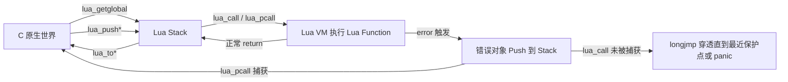

# 04. C -> Lua：反过来调用一个 Lua Function

> 对应用户需求"第五阶段：C -> Lua"。代码见 `code/`（`make run` 已验证）。

## 直觉

Chapter 01 讲的是 Lua 调用 C（`add(10, 20)` 这种写在 `.lua` 里的调用，最终跳进一个 `l_add` C Function）。本章反过来：**C 主动去调用一个 Lua Function**。

直觉上这看起来是"对称"的操作——无非是调用方向反了。但从机制上看，这次是 **C 原生世界主动打开 Lua C API 这道门，把参数放上 Lua Stack，再命令 Lua VM：去执行这个 Lua Function，执行完把结果放回 Stack**。这件事在 Wireshark 插件、事件回调、脚本化配置系统里几乎无处不在：C 引擎在某个时刻（收到一个包、触发一个事件）需要"回头问一下脚本要怎么处理"。

这也是本章第二个重点的起点：**如果那个 Lua Function 自己出错了怎么办？** C 主动发起的调用，出错处理方式必须由 C 自己决定——这就是 `lua_call` 与 `lua_pcall` 的分野，也是本章真正的重点。

## Architecture

```text
C 原生世界
    |
    | lua_getglobal(L, "add")   -- Get 系列：Lua Object -> Stack
    v
Lua Stack: [add]
    |
    | lua_pushinteger(L, 10)
    | lua_pushinteger(L, 20)    -- Push 系列：C Value -> Stack
    v
Lua Stack: [add, 10, 20]
    |
    | lua_call(L, 2, 1)         -- 调用系列：触发 Lua VM 执行
    v
Lua VM 执行 add(10, 20)
    |
    v
Lua Stack: [30]                 -- add 与 2 个参数被弹出，1 个返回值被 Push 回来
    |
    | lua_tointeger(L, -1)      -- Read/To 系列：Stack -> C Value
    v
C 原生世界拿到 result = 30
```

`lua_getglobal` 属于术语表里的 **Get 系列**：把一个 Lua Object（这里是全局 Table 里名为 `"add"` 的值）取到 Stack 上。之后的流程和 Chapter 01 完全对称，只是发起方换成了 C。

## 完整代码

C 侧宿主程序（节选，完整文件见 `code/callback_demo.c`）：

```c
lua_getglobal(L, "add");      /* Stack: [add] */
lua_pushinteger(L, 10);       /* Stack: [add, 10] */
lua_pushinteger(L, 20);       /* Stack: [add, 10, 20] */

lua_call(L, 2, 1);            /* Stack: [30] */

int result = (int)lua_tointeger(L, -1);
printf("result = %d\n", result);

lua_pop(L, 1);                /* Stack: [] */
```

配套 Lua 脚本（`code/callback_demo.lua`）只是定义三个全局 Lua Function，真正的"调用"动作全部由 C 侧发起：

```lua
function add(a, b)
    return a + b
end

function boom(a, b)
    if b == 0 then
        error("boom: b 不能是 0")
    end
    return a / b
end

function boom_with_table()
    error({ code = 42, message = "结构化错误" })
end
```

`code/callback_demo.c` 完整包含 4 个演示函数：

1. `demo_lua_call_success`：`lua_call` 正常返回。
2. `demo_lua_call_propagates_through_pcall`：`lua_call` 遇到出错的 Lua Function 时，错误如何"穿透"当前 C 栈帧、被外层 `lua_pcall` 兜住。
3. `demo_lua_pcall_direct`：直接用 `lua_pcall` 就地捕获同样的错误，作对比。
4. `demo_lua_pcall_non_string_error`：`lua_pcall` 捕获一个非字符串的错误对象（Table）。

## Stack Diagram

**`lua_getglobal(L, "add")`**

```text
Before: Stack: []
After:  Stack: [add]
```

**`lua_pushinteger(L, 10)`**

```text
Before: Stack: [add]
After:  Stack: [add, 10]
```

**`lua_pushinteger(L, 20)`**

```text
Before: Stack: [add, 10]
After:  Stack: [add, 10, 20]
```

**`lua_call(L, 2, 1)`**

```text
Before: Stack: [add, 10, 20]
After:  Stack: [30]
```

`lua_call` 内部做的事：从栈顶数 2 个参数（`10, 20`），把它们和再往下一格的函数对象（`add`）一起弹出，跳进 Lua VM 执行，执行完把 VM 承诺的 1 个返回值 Push 回来。调用前 Stack 上除函数与参数外的其它内容不受影响（本例里 Stack 在调用前只有这 3 个值）。

**`lua_tointeger(L, -1)`**

```text
Before: Stack: [30]
After:  Stack: [30]      -- lua_to* 只读，不改变 Stack
```

**`lua_pop(L, 1)`**（手动清理）

```text
Before: Stack: [30]
After:  Stack: []
```

**`lua_pcall(L, 2, 1, 0)`**（`demo_lua_pcall_direct`，boom(10, 0) 出错的情形）

```text
Before: Stack: [boom, 10, 0]
After:  Stack: [error object]     -- 不是返回值，是错误对象；status != LUA_OK
```

## Data Flow



关键点：**`lua_call` 和 `lua_pcall` 的"正常返回"路径完全一样**（参数进、结果出），区别只发生在 Lua Function 内部 `error()` 时：

- `lua_pcall`：错误在这次调用的边界内被捕获，Stack 上留一个错误对象，函数返回一个非 `LUA_OK` 的状态码——**函数正常 return，C 调用者可以继续往下执行**。
- `lua_call`：没有边界。错误会 `longjmp` 直接跳过当前这次 `lua_call` 所在的整个 C 栈帧（这次调用之后的所有代码都不会执行），一直向外跳，直到找到"最近一层由 `lua_pcall` 或 `luaL_dofile` 建立的保护点"。如果一路跳到最外层都没有任何保护点，就会触发 `lua_State` 的 panic 函数——默认实现是打印错误信息后中止整个进程。

## Lifecycle

参见 Chapter 00（本章不引入新的 `lua_State` 生命周期考量，`add`/`boom`/`boom_with_table` 三个 Lua Function 的生命周期就是普通全局变量，跟随 `lua_State` 存在，`lua_close` 时一起被 GC）。

## Failure

**Failure 1：`lua_call` 调用出错的 Lua Function，且外层没有任何保护——直接中止整个进程**

`code/callback_demo.c` 里的 `demo_real_crash`（仅在 `./callback_demo --crash` 时执行，不在默认 `make run` 流程里，避免默认验证失败）：

```c
lua_getglobal(L, "boom");
lua_pushinteger(L, 10);
lua_pushinteger(L, 0);
lua_call(L, 2, 1); /* 没有任何 lua_pcall 兜底 -> 触发 panic -> 进程中止 */
```

实际运行输出（真实终端输出，退出码 134 = 被 `SIGABRT` 中止）：

```text
$ ./callback_demo --crash

=== Demo 5（危险）: 无保护的 lua_call 直接中止整个宿主程序 ===
PANIC: unprotected error in call to Lua API (callback_demo.lua:17: boom: b 不能是 0)
Aborted (core dumped)
$ echo $?
134
```

这就是术语表里"普通调用（`lua_call`）出错时会 `longjmp`/直接中止宿主程序，除非宿主自己再包一层 `lua_pcall`"的真实效果——不是比喻，是进程真的被 `abort()`。

**Failure 2：`lua_call` 出错时，当前 C 栈帧里"错误发生点之后"的代码全部被跳过**

对照 `code/callback_demo.c` 里的 `l_call_boom_unprotected`：

```c
static int l_call_boom_unprotected(lua_State *L) {
    printf("[l_call_boom_unprotected] 即将用 lua_call 调用 boom(10, 0) ...\n");
    lua_getglobal(L, "boom");
    lua_pushinteger(L, 10);
    lua_pushinteger(L, 0);
    lua_call(L, 2, 1); /* boom 内部 error() -> longjmp，下面这行不会执行 */
    printf("[l_call_boom_unprotected] 这一行永远不会被打印！\n");
    return 1;
}
```

实际运行（这次是安全的，因为 `main()` 用 `lua_pcall` 包了一层）：

```text
=== Demo 2: lua_call 出错时 longjmp 穿透 C 栈帧，被外层 lua_pcall 兜住 ===
[l_call_boom_unprotected] 即将用 lua_call 调用 boom(10, 0) ...
外层 lua_pcall 捕获到错误: callback_demo.lua:17: boom: b 不能是 0
（l_call_boom_unprotected 里 lua_call 之后那行 printf 确实没有被执行）
```

注意"这一行永远不会被打印！"确实没有出现在输出里——这不是 `l_call_boom_unprotected` 自己 `return` 提前退出，而是 `lua_call` 内部直接 `longjmp`，从这次调用点直接跳到了 `main()` 里 `lua_pcall` 建立的保护点，中间跳过的所有 C 代码（包括潜在的 `free()`、资源清理）都不会执行——这是本章要传达的最重要的一点：**`lua_call` 的错误传播不是 C 语言的 `return`/异常机制，普通 C 清理代码（没有专门用 `lua_pcall` 或类似机制保护）在这条路径上完全不可靠**。

**Failure 3：`lua_pcall` 捕获到的错误对象不一定是字符串**

`boom_with_table()` 用 `error({ code = 42, message = "..." })` 抛出一个 Table。如果盲目对 `lua_pcall` 之后 Stack 顶部调用 `lua_tostring`，虽然不会崩溃（`lua_tostring` 对 Table 返回 `NULL`），但会丢失结构化的错误信息。正确做法是先 `lua_istable` / `lua_type` 判断，见 `demo_lua_pcall_non_string_error`。

## Debugging

- **看到宿主程序无预警退出、终端打印 `PANIC: unprotected error in call to Lua API`** —— 说明有一处 `lua_call`（或某个内部触发了同等语义的调用）在没有任何 `lua_pcall`/`luaL_dofile` 保护的路径上遇到了 Lua Error。定位方法：从 panic 消息里的文件名+行号找到出错的 Lua Function，再反查 C 侧是谁用 `lua_call`（而不是 `lua_pcall`）调用了它。
- **确认调用方式**：全局搜索代码里的 `lua_call(` 调用点，问自己"这次调用往外追溯，最近一层是不是一定有 `lua_pcall` 或 `luaL_dofile`？" 如果答案是"不确定"，就是隐患。
- **`lua_pcall` 返回非 `LUA_OK` 但打印出乱码/崩溃** —— 通常是想当然地对错误对象调用了 `lua_tostring`，但错误对象其实是 Table/其它类型。先 `lua_type(L, -1)` 确认。
- **调试时临时加保护**：如果一段现有代码用 `lua_call` 且怀疑它会出错，排查阶段可以临时换成 `lua_pcall` 并打印状态码——这不会改变正常路径的行为，但能把"静默中止"变成"可观察的错误信息"，定位问题后再决定是否要长期改成 `lua_pcall`。

## Mental Model

> **`lua_call` 是"信任对方不会出错"的调用；`lua_pcall` 是"预期对方可能出错，并由我来决定怎么处理"的调用。凡是 C 主动发起、且不能 100% 确定被调用的 Lua Function 不会出错的场景，都应该用 `lua_pcall`，而不是 `lua_call`。**
