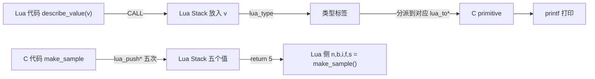

# 05. 基本数据类型的双向转换

> 对应用户需求"第六阶段：基本数据类型交互"。代码见 `code/`（`make run` 已验证）。

## 直觉

Chapter 01 和 04 已经用过 `lua_pushinteger` / `lua_tointeger`，但只覆盖了 integer 这一种类型，而且没有系统讲过"为什么是这几个函数、怎么知道该用哪个"。

本章把这件事讲透：Lua Stack 上的每一个槽位本质是一个 `TValue`（tag + union），C 侧永远不知道某个槽位"长什么样"，除非先问一句 **它是什么类型**（`lua_type` / `lua_is*`），再用**对应的** `lua_to*` 把值取出来。反过来，C 往 Stack 上放值时，`lua_push*` 的每个变体对应一种 C primitive 类型到 Lua Value 的转换规则。

这五种类型（`nil` / `boolean` / `integer` / `number` / `string`）是全书后续 Table、Userdata 一切复杂类型的基础——Table 的 key/value 本质也是靠这几个基本类型 + 引用类型拼出来的。

## Architecture

```text
                    C 原生世界
                        |
          +-------------+-------------+
          |             |             |
     lua_push*      lua_is*       lua_to*
   (C -> Stack)    (类型查询)    (Stack -> C)
          |             |             |
          +-------------+-------------+
                         v
                    Lua Stack
                         |
                         v
                     Lua Value
              (nil/boolean/integer/
               number/string ...)
```

分类表（Lua Type / Lua -> C / C -> Lua）：

| Lua Type | Lua -> C（Read/To 系列） | C -> Lua（Push 系列） |
|---|---|---|
| nil | `lua_isnil` | `lua_pushnil` |
| boolean | `lua_toboolean` | `lua_pushboolean` |
| integer（`lua_isinteger` 为真的 number 子类型） | `lua_tointeger` | `lua_pushinteger` |
| number（float 子类型） | `lua_tonumber` | `lua_pushnumber` |
| string | `lua_tostring` / `lua_tolstring` | `lua_pushstring` / `lua_pushlstring` |

**注意 integer 和 number 的关系**：在 Lua 5.4 里它们共享同一个 `lua_type()` 返回值 `LUA_TNUMBER`，本质是同一个 Lua Type 的两个子类型（Lua 5.4 起数字分为 integer 子类型和 float 子类型）。要在 C 侧区分，需要额外调用 `lua_isinteger(L, idx)`，本表把它们分成两行是为了对照两组不同的转换函数，不代表它们是 `lua_type()` 意义上两个不同的类型标签。

**`lua_to*` 与 `lua_push*` 的方向，一句话记住**：

- `lua_to*`：从 Stack 上"读出"一个 Lua Value，转换成 C primitive——方向是 **Stack -> C**。
- `lua_push*`：把一个 C primitive "放进" Stack，转换成 Lua Value——方向是 **C -> Stack**。
- `lua_is*`：只读判断 Stack 上某个槽位的类型，不修改 Stack、不做转换、不报错——纯粹的"问一句"。
- `lua_type`：返回一个整数类型标签（`LUA_TNIL` / `LUA_TBOOLEAN` / `LUA_TNUMBER` / `LUA_TSTRING` / …），是 `lua_is*` 系列的底层依据。

## 完整代码

C 侧两个核心 C Function（完整文件见 `code/types_demo.c`）：

```c
/* Lua -> C：先问类型，再用对应的 lua_to* 读出来 */
static int l_describe_value(lua_State *L) {
    int t = lua_type(L, 1);
    switch (t) {
    case LUA_TNIL:
        printf("type=nil\n");
        break;
    case LUA_TBOOLEAN:
        printf("type=boolean value=%s\n", lua_toboolean(L, 1) ? "true" : "false");
        break;
    case LUA_TNUMBER:
        if (lua_isinteger(L, 1))
            printf("type=integer value=%lld\n", (long long)lua_tointeger(L, 1));
        else
            printf("type=number value=%g\n", lua_tonumber(L, 1));
        break;
    case LUA_TSTRING: {
        size_t len = 0;
        const char *s = lua_tolstring(L, 1, &len);
        printf("type=string value=\"%s\" len=%zu\n", s, len);
        break;
    }
    default:
        printf("type=%s（本章不覆盖）\n", lua_typename(L, t));
    }
    return 0;
}

/* C -> Lua：依次 push 五种基本类型，return 5 交给 Lua 接收 */
static int l_make_sample(lua_State *L) {
    lua_pushnil(L);
    lua_pushboolean(L, 1);
    lua_pushinteger(L, 123);
    lua_pushnumber(L, 2.5);
    lua_pushlstring(L, "C 端字符串", sizeof("C 端字符串") - 1);
    return 5;
}
```

配套 Lua 脚本（`code/types_demo.lua`）分别测试单个值、`make_sample()` 的多返回值，以及往返闭环（`make_sample()` 的结果再传回 `describe_value`）。C 文件里还有 `checknumber_strict` 和 `demo_pitfalls` 两个专门用于 Failure 部分的函数，见下文。

## Stack Diagram

**Lua -> C 方向**（以 `describe_value(42)` 为例，`42` 已经由 Lua VM 在 `CALL` 之前放上 Stack）：

```text
进入 l_describe_value 时
Stack: [42]     -- 索引 1

lua_type(L, 1)      -> 只读，Stack 不变
lua_isinteger(L, 1) -> 只读，Stack 不变
lua_tointeger(L, 1) -> 只读，Stack 不变

离开时
Stack: [42]     -- describe_value 没有 push 任何东西，return 0
```

**C -> Lua 方向**（`make_sample()` 内部）：

```text
Before: Stack: []
lua_pushnil(L)
After:  Stack: [nil]

Before: Stack: [nil]
lua_pushboolean(L, 1)
After:  Stack: [nil, true]

Before: Stack: [nil, true]
lua_pushinteger(L, 123)
After:  Stack: [nil, true, 123]

Before: Stack: [nil, true, 123]
lua_pushnumber(L, 2.5)
After:  Stack: [nil, true, 123, 2.5]

Before: Stack: [nil, true, 123, 2.5]
lua_pushlstring(L, "C 端字符串", 14)
After:  Stack: [nil, true, 123, 2.5, "C 端字符串"]
```

`return 5` 之后：Lua VM 从栈顶数 5 个值作为这次调用的返回值，`local n, b, i, f, s = make_sample()` 按顺序接住。

## Data Flow



数据流的核心不变量：**Stack 上的每个槽位在被读取之前，类型都是未知的（对 C 而言），必须先问 `lua_type`/`lua_is*`，再选择正确的 `lua_to*`——用错函数不会被编译器发现，只会在运行时产生错误或静默错误的结果**（见下方 Failure）。

## Lifecycle

参见 Chapter 00。本章涉及的都是值类型（nil/boolean/integer/number）和 string（string 在 Lua 里是不可变的、由 Lua 自己的 GC 堆管理的驻留字符串），C 侧拿到的 `const char *` 指针生命周期规则见下方 Debugging 一节，不涉及 Userdata/Table 那种需要 Registry Reference 的长期持有问题。

## Failure

**Failure 1：`lua_tointeger` 对无法转换的字符串静默返回 0**

```c
lua_pushstring(L, "hello");
lua_Integer bad = lua_tointeger(L, -1); /* "hello" 不是数字字符串 */
printf("lua_tointeger(\"hello\") = %lld\n", (long long)bad);
```

实际运行输出：

```text
--- Failure 1: lua_tointeger 对无法转换的字符串静默返回 0 ---
lua_tointeger("hello") = 0  (没有任何报错，看起来像一个合法的 0！)
```

`lua_to*` 系列属于术语表里的"Read/To 系列"，设计上就是**转换失败时静默返回 0/false/NULL，不报错**。如果 C 代码没有先用 `lua_isnumber`/`lua_type` 确认类型，很容易把"转换失败"和"值真的是 0"搞混。

**Failure 2：`lua_tostring` 对 boolean 返回 `NULL`**

```c
lua_pushboolean(L, 1);
const char *s = lua_tostring(L, -1); /* boolean 不能隐式转换为字符串 */
```

实际运行输出：

```text
--- Failure 2: lua_tostring 对 boolean 返回 NULL ---
lua_tostring(true) 返回 NULL（boolean 无法转换为字符串）
若不判空直接 printf("%s", s) 会解引用空指针，属于未定义行为
```

`lua_tostring` 只对 string 和 number（Lua 会自动把 number 转成字符串表示）有效，对其它类型（包括 boolean、nil、Table）都返回 `NULL`。凡是用 `lua_tostring`/`lua_tolstring` 的返回值之前，都必须判空。

**Failure 3：`luaL_checknumber` 遇到无法转换的参数直接报错（对照 Failure 1 的静默行为）**

```c
static int l_checknumber_strict(lua_State *L) {
    double v = luaL_checknumber(L, 1); /* 无法转换成数字 -> 直接 luaL_error */
    lua_pushnumber(L, v * 2);
    return 1;
}
```

实际运行输出（Lua 侧用 `pcall` 包裹调用）：

```text
pcall(checknumber_strict, "abc") ->	false	bad argument #1 to 'checknumber_strict' (number expected, got string)
pcall(checknumber_strict, "3.5") ->	true	7.0
```

这正是术语表里"`luaL_check*`：校验失败直接抛 Lua Error（`luaL_error`）"的行为，与 `lua_to*` 的"静默失败"形成鲜明对照。`luaL_error` 底层也是走 Chapter 04 讲过的"错误传播"机制——如果调用方没有 `pcall` 保护，同样会一路 `longjmp` 到最近的保护点或触发 panic。

## Debugging

- **结果看起来"莫名其妙是 0 / false / 空字符串"** —— 第一反应是查这个值有没有先经过 `lua_isnumber`/`lua_isstring`/`lua_type` 确认类型，还是直接假设了类型就调 `lua_to*`。`lua_to*` 系列的"静默失败"是本章最容易踩的坑。
- **`lua_tostring`/`lua_tolstring` 返回值被直接传给 `%s` 且偶尔崩溃** —— 检查调用点是否有可能传入非 string/非 number 的 Lua Value（比如上游代码路径变了，原来一直是 string，某个分支传了 nil），必须判空。
- **`describe_value` 打印出的类型和预期不一致（比如整数被判成了 number 而不是 integer）** —— 检查 Lua 侧字面量写法：`42` 是 integer 子类型，`42.0` 是 float 子类型；算术运算（如除法 `/`）在 Lua 5.4 里总是产生 float 结果，即便两个操作数都是 integer。
- **中文字符串长度看起来"对不上"** —— `lua_tolstring` 返回的 `len` 是**字节长度**（UTF-8 编码），不是"字符个数"；`sizeof(literal) - 1` 同理算的是字节数。本例里 `"C 端字符串"` 是 14 字节但只有 6 个字符。

## Mental Model

> **Lua Stack 上的每个值对 C 来说都是"未知类型的盲盒"：`lua_type`/`lua_is*` 负责开盒前的探测，`lua_to*` 负责按已知类型取出内容（失败时静默给一个默认值），`lua_push*` 负责把 C 的值装回盒子交给 Lua——五种基本类型只是这套机制第一次、也是最简单的一次演练。**
