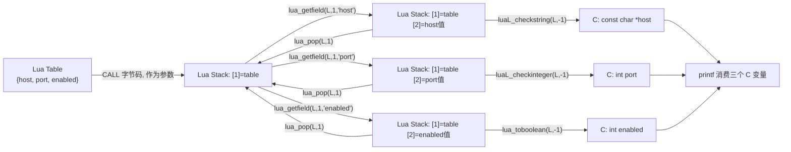

# 06. Table 从 Lua 传入 C（Lua Table -> C）

> 对应用户需求"第七阶段：Lua Table -> C"。本章在 Chapter 01-05 的基础上，把参数从"单个数字/字符串"升级成"一张 Table"，第一次遇到需要在**同一次 C 函数调用内**反复使用 Get 系列 + 校验系列 + Push/Pop 的场景，借此建立 **Stack Balance** 的直觉（Chapter 19 会正式展开）。

## 1. 直觉

前几章里，C Function 的参数都是"一个值对应一个 Stack 位置"：`add(10, 20)` 进来，Stack 上就是 `[1]=10 [2]=20`，读起来很直白。

Table 打破了这种一一对应：Lua 侧写 `configure({ host = ..., port = ..., enabled = ... })`，C 侧收到的 **Stack 上只有一个东西**——`[1] = 那张 table`。table 内部的三个字段并不会自动铺开到 Stack 上，C 完全看不到 table 内部的实现细节（那是 Lua 侧的 GC 堆内存布局）。

要拿到 `host`/`port`/`enabled`，C 必须主动"伸手进 table 里够"：

1. **Get 系列**（`lua_getfield`）：把 table 里某个字段的值，临时 Push 到 Stack 顶部。
2. **校验系列 / To 系列**（`luaL_checkstring` / `luaL_checkinteger` / `lua_toboolean`）：把 Stack 顶部那个临时值读成 C 变量。
3. **`lua_pop`**：读完就扔，把 Stack 恢复到"伸手之前"的样子。

这三步缺一不可，尤其是第 3 步——**每次 Get 完，用完，就必须 Pop**。忘记 Pop 不会让这一次调用立刻崩溃（Chapter 19 会解释为什么），但它破坏了"这个 C 函数在 Stack 上的进出对账"，也就是 **Stack Balance（栈平衡）**：一个 C 函数从 Stack 上"借"的临时空间，必须在自己需要的地方还回去，不能寄望于"反正函数返回时会自动清干净"。本章 Failure 部分会给出一个具体的反例。

## 2. Architecture

```text
Lua:
  configure({ host = "127.0.0.1", port = 8080, enabled = true })

                    |  CALL（Lua VM 字节码）
                    v
            Lua C API Boundary
                    |
                    v
              Lua Stack
       [1] = table（host/port/enabled 的引用）
                    |
                    v
            l_configure(L)   <- lua_CFunction
                    |
        +-----------+-----------------------+
        |           |                        |
   luaL_checktype  重复 3 次：               return 0
   （确认 [1] 是   lua_getfield -> 校验/To -> lua_pop  （告诉 VM：
    LUA_TTABLE）    （每个字段各一轮）              没有返回值）
```

一句话：**Table 参数在 Stack 上只占一格，字段要靠 Get 系列一个个"借"到栈顶，用完立刻还（pop）**。

## 3. 完整代码

正式示例：[`code/table_lua_to_c_demo.c`](code/table_lua_to_c_demo.c) + [`code/table_lua_to_c_demo.lua`](code/table_lua_to_c_demo.lua) + [`code/Makefile`](code/Makefile)（`make run` 已验证通过，见下方 Debugging 小节的输出）。

```c
static int l_configure(lua_State *L)
{
    luaL_checktype(L, 1, LUA_TTABLE);

    lua_getfield(L, 1, "host");
    const char *host = luaL_checkstring(L, -1);
    lua_pop(L, 1);

    lua_getfield(L, 1, "port");
    int port = (int)luaL_checkinteger(L, -1);
    lua_pop(L, 1);

    lua_getfield(L, 1, "enabled");
    int enabled = lua_toboolean(L, -1);
    lua_pop(L, 1);

    printf("[C] configure: host=%s port=%d enabled=%s\n",
           host, port, enabled ? "true" : "false");

    return 0; /* 栈顶 0 个值是返回值 */
}

int main(void)
{
    lua_State *L = luaL_newstate();
    luaL_openlibs(L);
    lua_register(L, "configure", l_configure);

    if (luaL_dofile(L, "table_lua_to_c_demo.lua") != LUA_OK) {
        fprintf(stderr, "lua error: %s\n", lua_tostring(L, -1));
        lua_close(L);
        return 1;
    }
    lua_close(L);
    return 0;
}
```

```lua
configure({
    host = "127.0.0.1",
    port = 8080,
    enabled = true
})

print("configure() 调用完成")
```

宿主程序结构与 Chapter 01 完全一致：`main()` 建 `lua_State*` -> `luaL_openlibs` -> `lua_register` 挂上本章的 C 能力 -> `luaL_dofile` 跑配套脚本 -> `lua_close`。

## 4. Stack Diagram

> 约定：下面每张图从上到下按 index 从 1 递增排列，**最下面一行就是当前的栈顶**。

**进入 `l_configure` 时**（`luaL_checktype` 只读判断，不改变 Stack，图略）：

```text
  [1] table                                  <- 栈顶（也是唯一元素）
```

### 第 1 轮：读 `host`

`lua_getfield(L, 1, "host")` 之后（Get 系列：Table -> Stack）：

```text
  [1] table
  [2] "127.0.0.1"  (string)                   <- 栈顶，新 Push 上来的临时值
```

`luaL_checkstring(L, -1)` 只读，不改变 Stack。`lua_pop(L, 1)` 之后：

```text
  [1] table                                  <- 栈顶恢复成 table，Stack Balance 归零
```

### 第 2 轮：读 `port`

`lua_getfield(L, 1, "port")` 之后：

```text
  [1] table
  [2] 8080  (integer)                         <- 栈顶，临时值
```

`lua_pop(L, 1)` 之后：

```text
  [1] table                                  <- 再次归零
```

### 第 3 轮：读 `enabled`

`lua_getfield(L, 1, "enabled")` 之后：

```text
  [1] table
  [2] true  (boolean)                         <- 栈顶，临时值
```

`lua_pop(L, 1)` 之后：

```text
  [1] table                                  <- 归零
```

### 离开 `l_configure` 时

`return 0` 之前 Stack 上只剩 `[1] table`，且 `return 0` 告诉 Lua VM"栈顶 0 个值是返回值"——这次调用对 Lua 侧来说什么都不返回（`configure(...)` 是一条语句，不是表达式）。

三轮的规律完全一样，这正是本章要建立的直觉：**每一次 Get，都对应一次之后的 Pop；Get 和 Pop 必须成对出现，谁借的谁还**。

## 5. Data Flow



数据只沿一个方向流动：**Lua Table -> Stack（临时）-> C 变量**。Table 本身一直待在 `[1]`，从未被替换或弹出；每一轮的临时值都是"借来即还"，不会累积。

## 6. Lifecycle

本章没有超出 Chapter 00 的额外生命周期考量：Table 作为参数只在这一次调用里被读取，C 侧读完就转成了普通 C 变量（`const char *`/`int`），不持有对这张 Table 的任何长期引用。参见 Chapter 00。

（如果需要跨调用继续持有这张 Table 本身，而不是只拷贝出它的字段值，就必须用 `luaL_ref(L, LUA_REGISTRYINDEX)`——那是 Chapter 09 的内容，本章的参数用完即弃，不涉及。）

## 7. Failure

以下三个例子全部**真实编译运行过**（源码见本节内联片段；反例 3 已作为 `code/table_lua_to_c_fail_demo.c` 提交，可用 `make run-fail` 复现）。

### Failure 1：忘记 `luaL_checktype`，Lua 侧传错类型

```c
static int l_configure_no_checktype(lua_State *L)
{
    /* 故意省掉 luaL_checktype(L, 1, LUA_TTABLE); */
    lua_getfield(L, 1, "host");
    ...
}
```

Lua 侧调用 `configure(42)`（传了个数字，不是 table）。实测输出：

```text
lua error: attempt to index a number value
```

`lua_getfield` 内部本质是"对 index 1 处的值做 table 访问"，数字没有 `__index` metamethod，Lua VM 直接抛错。**`luaL_checktype` 存在的意义就是把这种"深层才暴露的类型错误"提前到函数入口，报错信息也更明确**（加上 checktype 后错误会变成 `bad argument #1 to 'configure' (table expected, got number)`）。

### Failure 2：字段名拼错，`lua_getfield` 静默返回 `nil`

```c
lua_getfield(L, 1, "Host");   /* 大小写打错，本该是 "host" */
const char *host = luaL_checkstring(L, -1);
```

Lua 侧仍然传 `{ host = "127.0.0.1" }`（字段名是小写 `host`）。实测输出：

```text
lua error: [string "configure({ host = '127.0.0.1' })"]:1: bad argument #-1 to 'configure' (string expected, got nil)
```

**关键点**：`lua_getfield` 找不到字段时**不会报错**，它是 Get 系列的常规行为——找不到就把 `nil` Push 上去，交给后面的校验系列去决定"这算不算错误"。如果后面用的是 `lua_tostring`（To 系列，不校验）而不是 `luaL_checkstring`（校验系列），这个 bug 甚至不会报错，只会让 `host` 变成一个空字符串或段错误风险（`lua_tostring` 对非 string/number 返回 `NULL`，直接传给 `printf("%s", NULL)` 是未定义行为）——这也是为什么本教程反复强调：**从 Table 里取出的值，只要接下来要当成确定类型的 C 值使用，就该用校验系列，而不是 To 系列**。

### Failure 3：忘记 `lua_pop`，Stack Balance 被破坏，殃及后续的相对索引

```c
lua_getfield(L, 1, "host");
const char *host = luaL_checkstring(L, -1);
/* BUG: 应该在这里 lua_pop(L, 1)，但故意漏掉 */

lua_getfield(L, -1, "port");   /* 本意：回到 table 里找 port；
                                   实际：-1 此刻是 host 字符串，不是 table！ */
int port = (int)luaL_checkinteger(L, -1);
```

实测输出（`code/table_lua_to_c_fail_demo.c`，`make run-fail`）：

```text
./table_lua_to_c_fail_demo
[C] 进入时 lua_gettop(L) = 1
[C] 读完 host 之后 lua_gettop(L) = 2（预期应该是 1，多出的 1 个就是没 pop 的 host）
lua error: table_lua_to_c_fail_demo.lua:1: bad argument #-1 to 'configure' (number expected, got nil)
```

**逐步还原发生了什么**：

```text
lua_getfield(L, 1, "host") 之后:
  [1] table
  [2] "127.0.0.1"                     <- 忘记 pop，这个临时值赖着不走

lua_getfield(L, -1, "port") 试图这样做：
  "在 -1（此刻是 [2] = "127.0.0.1" 这个字符串）里找字段 port"
  -> 字符串有 metatable（string 库设置的 __index = string 库表），
    "port" 不是 string 库里的成员 -> 查找结果是 nil，Push 上去：
  [1] table
  [2] "127.0.0.1"
  [3] nil                             <- "找 port" 实际上是在字符串身上找，找到的是 nil

luaL_checkinteger(L, -1) 校验 [3] = nil -> 类型不对 -> 报错退出
```

**这是 Stack Balance 被破坏后最典型的后果**：漏掉的一次 `pop` 让栈上的"预期布局"和"实际布局"错位了一格，后续所有用**相对索引**（`-1`/`-2`）表达"回到 table"这种意图的代码，实际引用到的都是错误的槽位。本例因为字符串恰好有 metatable 才只是查到 `nil` 报错；如果被误当成 table 访问的临时值本身也是一个 table，这种错位可能完全不报错，产生看起来"正常"但数值全错的结果——更难排查。

## 8. Debugging

- **第一反应永远是画 Stack**：出问题时先确定"此刻 Stack 上有几个元素、每个 index 是什么"，可以直接在 C 代码里插入 `printf("top=%d\n", lua_gettop(L));` 定位（就是 Failure 3 里用的手法）。
- **区分"取不到"和"取到了类型不对"**：`lua_getfield` 永远成功（找不到就给 `nil`），真正会报错的是后面的校验系列；如果怀疑字段名/大小写问题，先用 `lua_type(L, -1) == LUA_TNIL` 或者干脆 `lua_getfield` 之后立刻 `printf("%s\n", lua_typename(L, lua_type(L, -1)))` 打出类型名确认。
- **凡是看到用 `-1`/`-2` 这类相对索引的代码，先确认"此刻栈顶到底是什么"**，不要凭"应该是"去猜；一旦怀疑 Stack Balance 被破坏，在每一行可疑代码后面都加一句 `lua_gettop` 打印，几行下来问题基本会自己暴露。
- **每写完一段"Get + 校验 + Pop"，数一遍 Get 和 Pop 的次数是否相等**——这是本章最朴素但最有效的自查方法，Chapter 19 会把它上升为正式的"Stack Contract"检查。

主示例实测输出：

```text
$ make run
./table_lua_to_c_demo
[C] configure: host=127.0.0.1 port=8080 enabled=true
configure() 调用完成
```

## 9. Mental Model

```text
lua_getfield = Table -> Stack（借一个字段的值到栈顶，临时的）
校验系列/To 系列 = Stack -> C（把临时值定型成 C 变量）
lua_pop        = 还回去（Stack Balance：借了就要还，Get 和 Pop 成对出现）
```

> **一句话**：Table 参数在 Stack 上永远只占一格；字段要靠 `lua_getfield` 一个个"借"到栈顶用，用完立刻 `lua_pop`——欠着不还，早晚会让后面用相对索引的代码读错位置。
