# 07. Table 从 C 传回 Lua（C -> Lua Table）

> 对应用户需求"第八阶段：C -> Lua Table"。本章是 Chapter 06 的镜像：Chapter 06 讲"C 怎么把 Table 里的字段读出来"（`lua_getfield` = Table -> Stack），本章讲"C 怎么凭空造一张 Table 交给 Lua"（`lua_setfield` = Stack -> Table）。

## 1. 直觉

Chapter 06 里，Table 是 Lua 传进来的，C 只是"访客"，伸手进去读几个字段就走。本章反过来：C 才是"建造者"——Lua 侧手上什么都没有，完全靠 C 一步步在 Stack 上"搭"出一张 Table，再交回去。

搭 Table 的过程只有三个动作，且严格重复：

1. `lua_newtable(L)`：在 Stack 上放一张**空** table（这一步之后，Stack 上多了一个新槃位，装的是这张新 table 的引用）。
2. 对每个字段：先 `lua_push*` 把这个字段的值 Push 到栈顶，再 `lua_setfield(L, -2, key)`——**Set 系列**（Stack -> Table）：它会把栈顶那个刚 push 的值**弹出**，写进 table 的 `key` 字段，同时 table 本身**留在栈上不动**。
3. 全部字段写完后，`return 1`：栈顶那 1 个值（也就是这张 table 本身）就是这次调用的返回值。

本章最容易看错的地方是那个 `-2`：直觉上"我刚 push 了一个新值，table 的位置是不是也跟着变了？"——不会。因为 `lua_setfield` 在**读取完 `-2` 指向的 table 之后**才把栈顶的值弹出，所以只要每次"push 一个值、立刻 setfield 一次"，`-2` 永远精确指向"最近一次 setfield 完之后留在栈上的那张 table"。这正是本章 Stack Diagram 要逐帧钉死的地方。

## 2. Architecture

```text
Lua:
  local config = get_config()
  print(config.host)
  print(config.port)

C:
  l_get_config(L)
        |
        v
  lua_newtable(L)              <- Stack: [1] = 新空 table
        |
        +-- lua_pushstring("localhost")   Stack: [1]=table [2]="localhost"
        |   lua_setfield(L, -2, "host")   Stack: [1]=table   （写完弹出 [2]）
        |
        +-- lua_pushinteger(8080)         Stack: [1]=table [2]=8080
        |   lua_setfield(L, -2, "port")   Stack: [1]=table   （写完弹出 [2]）
        |
        v
  return 1                      <- 告诉 Lua VM：栈顶 1 个值（这张 table）是返回值
        |
        v
  Lua 侧：local config = get_config()   <- config 就是这张刚搭好的 table
```

一句话：**`lua_newtable` 先占住一格，之后每写一个字段都是"push 值 -> setfield 弹出并写入"的一轮，table 全程待在同一个位置不挪窝**。

## 3. 完整代码

正式示例：[`code/table_c_to_lua_demo.c`](code/table_c_to_lua_demo.c) + [`code/table_c_to_lua_demo.lua`](code/table_c_to_lua_demo.lua) + [`code/Makefile`](code/Makefile)。

```c
static int l_get_config(lua_State *L)
{
    lua_newtable(L);                 /* [1] = 新的空 table */

    lua_pushstring(L, "localhost");  /* [1]=table [2]="localhost" */
    lua_setfield(L, -2, "host");     /* 弹出 [2]，写入 table.host；[1]=table */

    lua_pushinteger(L, 8080);        /* [1]=table [2]=8080 */
    lua_setfield(L, -2, "port");     /* 弹出 [2]，写入 table.port；[1]=table */

    return 1; /* 栈顶 1 个值是返回值 */
}

int main(void)
{
    lua_State *L = luaL_newstate();
    luaL_openlibs(L);
    lua_register(L, "get_config", l_get_config);

    if (luaL_dofile(L, "table_c_to_lua_demo.lua") != LUA_OK) {
        fprintf(stderr, "lua error: %s\n", lua_tostring(L, -1));
        lua_close(L);
        return 1;
    }
    lua_close(L);
    return 0;
}
```

```lua
local config = get_config()
print(config.host)
print(config.port)
```

## 4. Stack Diagram

> 约定同 Chapter 06：下面每张图从上到下按 index 从 1 递增排列，最下面一行是当前栈顶。

**进入 `l_get_config` 时**：Stack 空（这个 C Function 不接受参数）。

### 第 1 步：`lua_newtable(L)`

Before：

```text
  (空栈)
```

After：

```text
  [1] table  (空)                             <- 栈顶，新造的空 table
```

### 第 2 步：写 `host` 字段

`lua_pushstring(L, "localhost")` 之后（Push 系列：C -> Stack）：

```text
  [1] table  (空)
  [2] "localhost"                              <- 栈顶，临时值
```

**此刻 `-2` 指向 `[1]`（table），`-1` 指向 `[2]`（字符串）**——这是关键的一帧，务必确认清楚，下一步 `lua_setfield` 就是照着这个布局工作的。

`lua_setfield(L, -2, "host")` 之后：

```text
  [1] table  { host = "localhost" }            <- 栈顶又变回 table
```

`lua_setfield` 内部做的事：①读取 `-2` 处的值，认定它是"要写字段的 table"；②读取栈顶（此刻是 `[2]`）的值作为要写入的 value；③执行 `table[key] = value`；④把刚才当作 value 的那个栈顶值**弹出**。四步做完，`[2]` 消失，`[1]` 还是同一张 table，只是内容多了一个字段。

### 第 3 步：写 `port` 字段

`lua_pushinteger(L, 8080)` 之后：

```text
  [1] table  { host = "localhost" }
  [2] 8080                                      <- 栈顶，临时值
```

同样地，此刻 `-2` 还是精确指向 `[1]`（table）——**因为每一轮都是"先 setfield 归零，再 push 下一轮的值"，`-2` 相对栈顶的偏移量在每一轮开始时都是固定的（table 底下永远只多出 1 个刚 push 的临时值）**。

`lua_setfield(L, -2, "port")` 之后：

```text
  [1] table  { host = "localhost", port = 8080 }   <- 栈顶
```

### 离开 `l_get_config` 时

Stack 上只剩 `[1]`——那张搭好的 table。`return 1` 告诉 Lua VM："栈顶 1 个值是这次调用的返回值"，VM 把它取走，赋给 Lua 侧的 `config`。

**对比 Chapter 06**：

```text
lua_getfield  =  Table  -> Stack   （读字段：从 table 里"借"一个值到栈顶）
lua_setfield  =  Stack  -> Table   （写字段：把栈顶的值"存"进 table，随即弹出）
```

## 5. Data Flow

```mermaid
flowchart LR
    Start["l_get_config(L) 开始<br/>Stack 为空"] -->|lua_newtable| S1["Stack: [1]=table(空)"]
    S1 -->|"lua_pushstring('localhost')"| S2["Stack: [1]=table [2]='localhost'"]
    S2 -->|"lua_setfield(L,-2,'host')<br/>弹出[2], 写入table.host"| S3["Stack: [1]=table{host}"]
    S3 -->|lua_pushinteger_8080| S4["Stack: [1]=table{host} [2]=8080"]
    S4 -->|"lua_setfield(L,-2,'port')<br/>弹出[2], 写入table.port"| S5["Stack: [1]=table{host,port}"]
    S5 -->|"return 1<br/>栈顶1个值是返回值"| LuaConfig["Lua: local config = get_config()"]
    LuaConfig --> PrintHost["print(config.host)"]
    LuaConfig --> PrintPort["print(config.port)"]
```



数据只沿一个方向流动：**C 原生常量 -> Push 到 Stack（临时）-> setfield 写进 Table -> Table 整体作为返回值交回 Lua**。跟 Chapter 06 正好反过来。

## 6. Lifecycle

本章没有超出 Chapter 00 的额外生命周期考量：这张 table 是全新创建的 Lua Object，`return 1` 之后它的生命周期完全交给 Lua 侧的 GC 管理——一旦 `config` 变量在 Lua 里不再被引用，它就会被正常 GC 掉，C 侧不持有、也不需要持有对它的任何长期引用。参见 Chapter 00。

## 7. Failure

以下三个例子全部**真实编译运行过**（反例 1 已作为 `code/table_c_to_lua_fail_demo.c` 提交，可用 `make run-fail` 复现；反例 2、3 的源码见本节内联片段，已在临时环境验证过输出）。

### Failure 1：`lua_setfield` 的相对索引写错（`-1` 而不是 `-2`）

```c
lua_newtable(L);                 /* [1] = table */
lua_pushstring(L, "localhost");  /* [1]=table [2]="localhost" */
lua_setfield(L, -1, "host");     /* BUG: 应该是 -2，这里误写成 -1 */
```

实测输出（`code/table_c_to_lua_fail_demo.c`，`make run-fail`）：

```text
./table_c_to_lua_fail_demo
[C] lua_newtable 之后 lua_gettop(L) = 1
[C] push 字符串之后 lua_gettop(L) = 2，-2 应该是 table，-1 是字符串
lua error: attempt to index a string value
```

**发生了什么**：`-1` 此刻指向的是刚 push 的字符串 `"localhost"` 本身，不是 table。`lua_setfield(L, -1, "host")` 变成了"把 `-1` 处的值本身既当 table 又当 value"，等价于让字符串去做 `"localhost".host = "localhost"`。字符串没有 `__newindex` metamethod，Lua 直接报错。**这也是为什么 Chapter 07 的直觉部分反复强调 `-2` 而不是"随便一个负数"——`-2` 精确对应"table 在刚 push 完这一轮临时值之后的位置"，写成 `-1` 就等于把临时值错当成了操作对象。**

### Failure 2：忘记 `return 1`，返回值凭空消失

```c
lua_newtable(L);
lua_pushstring(L, "localhost");
lua_setfield(L, -2, "host");
return 0; /* BUG: 应该 return 1，把栈顶的 table 交回去 */
```

Lua 侧仍然是 `local c = get_config(); print(c.host)`。实测输出：

```text
lua error: [string "local c = get_config(); print(c.host)"]:1: attempt to index a nil value (local 'c')
```

**发生了什么**：Table 在 C 侧确实造好了，也确实还在 Stack 顶部，但 `return 0` 告诉 Lua VM"栈顶 0 个值是返回值"——VM 完全不关心 Stack 上实际还剩什么，只会按 `return` 声明的个数去取。于是 Lua 侧拿到的 `c` 就是 `nil`，`c.host` 直接报错。**这是 `return N` 语义的核心提醒：`return N` 不是"把 C 语言里某个变量的值返回出去"，而是"告诉 VM 从栈顶数 N 个值当返回值"——Stack 上东西造对了，`N` 报错了，结果照样是错的。**

### Failure 3：写入和读取的字段名大小写不一致（静默返回 `nil`，不报错）

```c
lua_pushstring(L, "localhost");
lua_setfield(L, -2, "host");   /* C 侧写的字段名是小写 "host" */
```

```lua
local c = get_config()
print("Host field =", c.Host)   -- Lua 侧读的是大写 "Host"
```

实测输出：

```text
Host field =	nil
```

**这一条不报错，也不崩溃**——`c.Host` 在 Lua 里就是合法的"访问一个不存在的字段"，结果是 `nil`。这是 Table 双向传递里最隐蔽的一类 bug：**没有任何报错信号，只有"值不对"**，往往要到业务逻辑层面（比如拿 `nil` 去拼字符串、比大小）才会暴露出来。排查时如果怀疑是这一类问题，第一步永远是在 C 侧和 Lua 侧分别打印字段名字符串，逐字符核对大小写/空格。

## 8. Debugging

- **`lua_setfield` 之前，先确认 `-2` 到底是谁**：在每一次 `lua_pushXxx(...); lua_setfield(L, -2, "key");` 之前插入 `printf("%s\n", lua_typename(L, lua_type(L, -2)));`，如果打出来不是 `table`，说明相对索引算错了——这正是本章 Failure 1 的排查手法。
- **怀疑"返回值不对"时，先看 `return N` 而不是先看 Stack 内容**：本章 Failure 2 说明了"Stack 上东西是对的，`N` 却错了"同样会导致返回值错误；`lua_gettop(L)` 打印出来的数字要和 `return` 后面写的数字对上。
- **字段名不匹配是"零报错"的 bug**，唯一的排查方式是显式打印双方用到的字符串常量，或者在构造 table 之后立刻 `lua_getfield` 读回来验证（"写完立刻读一遍自检"，本教程后面 Chapter 18/19 会把这类自检方法系统化）。
- 主示例实测输出：

```text
$ make run
./table_c_to_lua_demo
localhost
8080
```

## 9. Mental Model

```text
lua_getfield  =  Table  -> Stack   （Chapter 06：读，借值到栈顶）
lua_setfield  =  Stack  -> Table   （Chapter 07：写，栈顶的值被弹出、存进 table）

造一张 Table 交回 Lua = newtable 占位 -> 反复 (push 值 -> setfield 写入并弹出) -> return 1
```

> **一句话**：`lua_newtable` 先在 Stack 上占一个位置，之后每写一个字段都是"push 值、setfield 立刻收走"的一轮循环，table 本身全程待在同一个相对位置（`-2`）不动；最后用 `return 1` 告诉 Lua VM"栈顶这 1 个值就是结果"，而不是"C 变量里有一张 table"。
