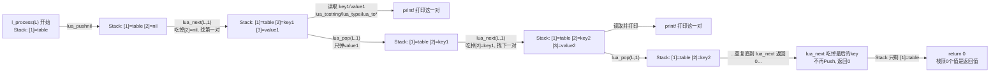

# 08. 遍历 Table（Lua Table 遍历）

> 对应用户需求"第九阶段：Lua Table 遍历"。Chapter 06 讲"知道字段名，主动去 table 里取"（`lua_getfield`）；本章讲"不知道 table 里有哪些字段，只能一个一个问出来"——这就是 `lua_next` 存在的意义，也是本教程里**对 Stack 状态要求最苛刻**的一个 API：它的契约几乎完全靠"栈顶此刻是什么"来定义。

## 1. 直觉

`lua_getfield` 要求你已经知道 key 是什么字符串。但很多场景下（比如 Chapter 06 里 `configure()` 的字段其实是可选的，或者 Wireshark 的 dissector 需要遍历一张任意结构的配置 table）C 侧事先并不知道 table 里有哪些 key。这时候需要**遍历**，Lua C API 给的工具是 `lua_next`。

`lua_next` 和前几章的 API 有一个本质区别：**它不是"给个 key，查一个 value"，而是"给个 key，问它的下一个 key/value 是什么"**。这就要求调用者严格遵守一个协议：

1. 遍历开始前，先 Push 一个 `nil` 当"起始 key"——意思是"我还没问过任何 key，从第一个开始"。
2. 每次调用 `lua_next(L, tbl_idx)`：它会**吃掉栈顶那个"上一次的 key"**，找到 table 里排在它后面的下一对 key/value，成功就把新的 key、value 依次 Push 上去（栈净增 1），返回非 0；如果已经遍历完了，就什么都不 Push，返回 0。
3. 每一轮循环处理完 value 之后，必须 `lua_pop(L, 1)`——**只弹 value，把 key 留在栈顶**，因为它就是下一次 `lua_next` 调用需要的"上一次的 key"。

这个协议里最容易出错、也最致命的一步就是第 3 步的"只弹 value"。本章 Failure 部分会给出实测的崩溃/报错案例。

## 2. Architecture

```text
Lua:
  process({ name = "foo", version = "1.0", enabled = true })

C:
  l_process(L)
        |
        v
  luaL_checktype(L, 1, LUA_TTABLE)     <- 校验系列：[1] 必须是 table
        |
        v
  lua_pushnil(L)                        <- Stack: [1]=table [2]=nil（起始 key）
        |
        v
  +-----------------------------------------------------+
  |  while (lua_next(L, 1) != 0) {                      |
  |      /* Stack: [1]=table [2]=key [3]=value */       |
  |      读取 key、value（lua_tostring/lua_type/lua_to*）|
  |      lua_pop(L, 1);  /* 只弹 value */               |
  |  }                                                 |
  +----------------------------------------------------+
        |
        v
  循环结束时 Stack: [1]=table         <- lua_next 返回 0 时什么都不 Push
        |
        v
  return 0
```

一句话：**`lua_next` 每成功一次就把 Stack 净增 1（吃 1 个 key，还 2 个 key+value）；循环体必须弹掉那 1 个 value 才能让下一轮重新对齐"栈顶是 key"这个契约**。

## 3. 完整代码

正式示例：[`code/table_iteration_demo.c`](code/table_iteration_demo.c) + [`code/table_iteration_demo.lua`](code/table_iteration_demo.lua) + [`code/Makefile`](code/Makefile)。

```c
static int l_process(lua_State *L)
{
    luaL_checktype(L, 1, LUA_TTABLE);

    lua_pushnil(L); /* [1]=table [2]=nil，nil 表示"从第一个 key 开始找" */

    while (lua_next(L, 1) != 0) {
        /* 此刻栈上：[1]=table [2]=key [3]=value */
        const char *key = lua_tostring(L, -2);
        int vtype = lua_type(L, -1);

        switch (vtype) {
        case LUA_TSTRING:
            printf("[C]   %s = \"%s\" (string)\n", key, lua_tostring(L, -1));
            break;
        case LUA_TBOOLEAN:
            printf("[C]   %s = %s (boolean)\n", key,
                   lua_toboolean(L, -1) ? "true" : "false");
            break;
        case LUA_TNUMBER:
            printf("[C]   %s = %g (number)\n", key, lua_tonumber(L, -1));
            break;
        default:
            printf("[C]   %s = <%s>\n", key, lua_typename(L, vtype));
            break;
        }

        lua_pop(L, 1); /* 只弹 value，把 key 留给下一次 lua_next 当输入 */
    }

    return 0;
}
```

```lua
process({
    name = "foo",
    version = "1.0",
    enabled = true
})

print("process() 调用完成")
```

**实测输出**（`make run`；Table 遍历顺序见第 4 节的重要说明）：

```text
[C]   enabled = true (boolean)
[C]   version = "1.0" (string)
[C]   name = "foo" (string)
process() 调用完成
```

## 4. Stack Diagram

> ⚠️ **重要说明**：Lua 的 Table 遍历顺序**不保证**任何固定次序，也**不保证**跨运行一致——本例用的 Lua 5.4 默认给字符串哈希加了随机种子（安全考虑，防哈希碰撞攻击），同一个程序每次启动看到的顺序都可能不同（本机实测：`enabled`/`version`/`name` 三种顺序都出现过）。下面的逐帧图**固定取某一次实际运行**（`enabled -> version -> name`）来讲解 Stack 怎么变化，但结论对任意顺序都成立：`lua_next` 的契约从来不承诺顺序，只承诺"每次给一个未访问过的 key，直到访问完所有 key"。

> 约定同前两章：下面每张图从上到下按 index 从 1 递增排列，最下面一行是当前栈顶。

**进入 `l_process` 时**：

```text
  [1] table                                   <- 栈顶（唯一元素）
```

**`lua_pushnil(L)` 之后**：

```text
  [1] table
  [2] nil                                     <- 栈顶，"起始 key"，表示"还没问过任何 key"
```

### 第 1 轮循环

`lua_next(L, 1)` 读取栈顶的 `nil`，在 table 里找到第一对（本次实测是 `enabled`），把 key、value 依次 Push 上去，返回非 0：

```text
  [1] table
  [2] "enabled"     (key)
  [3] true          (value)                   <- 栈顶
```

循环体读取 `key="enabled"`、`value=true` 并打印。处理完之后 `lua_pop(L, 1)`（只弹 value）：

```text
  [1] table
  [2] "enabled"                                <- 栈顶，留给下一次 lua_next 当输入
```

### 第 2 轮循环

`lua_next(L, 1)` 读取栈顶的 `"enabled"`，在 table 里找到排在它后面的下一对（本次实测是 `version`）：

```text
  [1] table
  [2] "version"     (key)
  [3] "1.0"         (value)                   <- 栈顶
```

打印之后 `lua_pop(L, 1)`：

```text
  [1] table
  [2] "version"                                <- 栈顶
```

### 第 3 轮循环

`lua_next(L, 1)` 用 `"version"` 找下一对（本次实测是 `name`）：

```text
  [1] table
  [2] "name"        (key)
  [3] "foo"         (value)                   <- 栈顶
```

打印之后 `lua_pop(L, 1)`：

```text
  [1] table
  [2] "name"                                   <- 栈顶
```

### 第 4 轮：遍历结束

`lua_next(L, 1)` 用 `"name"` 去找下一对，发现已经没有更多元素了。**这次调用不 Push 任何东西**，直接把栈顶那个当输入的 key（`"name"`）也一并移除，返回 0：

```text
  [1] table                                   <- 栈顶，只剩 table，Stack Balance 干净
```

`while` 循环条件为假，退出循环。此刻 Stack 上只有 `[1] table`——和进入函数时一模一样，`return 0` 告诉 Lua VM 没有返回值。

### 为什么"只弹 value"这一步不能省

对照第 1->2 轮的转换：`lua_pop(L, 1)` 把 `[3]=value` 弹掉，只留下 `[2]=key`。**`lua_next` 下一次调用时，会读取"栈顶"当"上一次的 key"去查找下一个**——它并不关心那个栈顶的值语义上是不是"key"，它只是机械地把栈顶那个值拿去 table 里"找排在它后面的那一项"。如果没有弹掉 value，栈顶留的是 `value`（比如上一轮的 `true`），下一次 `lua_next` 就会拿 `true` 去 table 里找"排在 `true` 后面的 key"——`true` 根本不是这张 table 里的任何一个 key，`lua_next` 找不到就会直接报错。这正是第 7 节 Failure 1 的实测复现。

## 5. Data Flow



数据流动的方向很特殊：不是"Lua Object -> C 变量"这种单向搬运，而是**每一轮都用"上一轮的 key"换出"这一轮的 key + value"**，key 本身在 C 侧读一次就丢（不跨轮持有），只有"哪个 key 该问下一个"这件事被 Stack 顶那个残留的 key 悄悄记住了。

## 6. Lifecycle

本章没有超出 Chapter 00 的额外生命周期考量：遍历过程中读到的 key/value 都是临时借到 Stack 上的引用，用完即弹，C 侧不持有任何长期引用。参见 Chapter 00。

（有一条重要但属于"Failure/Debugging"范畴而非对象生命周期的规则：**遍历过程中不能向 table 插入新的、此前不存在的 key**——Lua 参考手册明确写了这是未定义行为；已存在的字段允许修改值、甚至设成 `nil` 删除。第 7 节 Failure 3 会实测复现"插入新 key"具体会出什么问题。）

## 7. Failure

以下三个例子全部**真实编译运行过**（Failure 1 已作为 `code/table_iteration_fail_demo.c` 提交，可用 `make run-fail` 复现；Failure 2、3 的源码见本节内联片段，已在临时环境验证过输出——Failure 2 会真实 crash，没有作为仓库里的 `make run-fail` 目标提交，避免仓库默认流程里出现一个故意段错误的二进制）。

### Failure 1（本章要求的核心反例）：循环里漏掉 `lua_pop`

```c
lua_pushnil(L);
while (lua_next(L, 1) != 0) {
    const char *key = lua_tostring(L, -2);
    printf("[C]   key = %s\n", key ? key : "(non-string key)");
    /* BUG: 应该在这里 lua_pop(L, 1)，只弹 value；这里故意漏掉 */
}
```

实测输出（`code/table_iteration_fail_demo.c`，`make run-fail`）：

```text
./table_iteration_fail_demo
[C] 第 1 轮 lua_next 返回后 lua_gettop(L) = 3 （正常应该是 3：table+key+value）
[C]   key = version
lua error: invalid key to 'next'
```

**逐步还原**：

```text
第 1 轮 lua_next 成功之后:
  [1] table
  [2] "version"     (key)
  [3] "1.0"          (value)      <- 忘记 pop，这个 value 赖着不走

第 2 轮 lua_next(L, 1) 被调用:
  它固定的假设是："栈顶（此刻是 [3] = "1.0"）就是上一次的 key，
                    去 table 里找排在它后面的那一项"
  但 "1.0" 根本不是这张 table 里的任何一个 key
  -> luaH_next 内部查找失败 -> 直接抛错："invalid key to 'next'"
```

漏掉一次 `pop`，下一次 `lua_next` 就会拿"value"当"key"去查，绝大多数情况下这个 value 都不是一个合法的 key，于是**立即报错退出**——这是相对"友好"的失败模式（至少不会静默遍历出错误结果）。

### Failure 2：忘记 `luaL_checktype`，传入非 table 参数——直接段错误

```c
static int l_process_notable(lua_State *L)
{
    /* 故意省掉 luaL_checktype(L, 1, LUA_TTABLE); */
    lua_pushnil(L);
    while (lua_next(L, 1) != 0) {
        lua_pop(L, 1);
    }
    return 0;
}
```

Lua 侧调用 `process(42)`。实测输出：

```text
$ ./f_notable
Segmentation fault (core dumped)
exit=139
```

**这是本章最值得警惕的一条**：跟 Chapter 06 的"传错类型会被 Lua 温和地抛一个 `attempt to index a number value`"不同，`lua_next` 在很多 Lua 构建（包括本教程 vendor 的这份 Lua 5.4.7，未开启 `LUA_USE_APICHECK` 调试断言）下，对"index 处不是 table"这件事**不做检查就直接按 table 内部结构去解释那块内存**，传入一个数字会导致它把数字的位模式当成 table 内部指针去解引用，直接**段错误、进程崩溃**，Lua 的错误处理机制（`lua_pcall`/`luaL_dofile`）完全来不及介入——因为这不是"Lua Error"，是 C 层面的非法内存访问。**`luaL_checktype` 不是"锦上添花的类型检查"，它是防止宿主进程被一个写错的 Lua 脚本直接打崩的第一道、也是最后一道防线。**

### Failure 3：遍历过程中插入新 key（未定义行为，实测复现"静默丢字段"）

```c
while (lua_next(L, 1) != 0) {
    const char *key = lua_tostring(L, -2);
    printf("[C] key=%s\n", key);

    /* BUG: 遍历过程中新增一个此前不存在的字段 —— Lua 参考手册
     * 明确说这是未定义行为（"The behavior of next is undefined
     * if, during the traversal, you assign any value to a
     * non-existent field in the table"） */
    lua_pushstring(L, "...");
    lua_setfield(L, 1, "some_brand_new_key");

    lua_pop(L, 1);
}
```

实测输出（表里原本有 `name`/`version`/`enabled` 三个字段）：

```text
[C] 第 1 轮 key=name
[C] 第 2 轮 key=extra_1
[C] 第 3 轮 key=enabled
[C] 共迭代 3 轮
```

**注意 `version` 完全没有出现**——不是报错，也不是崩溃，是**遍历过程中悄悄丢掉了一个原本存在的字段**，因为插入新 key 触发了 table 内部的 rehash，遍历用来记录"当前进度"的内部状态失效了。这是三种失败模式里最难排查的一种：**代码跑完了，没有任何错误提示，但结果就是不对**。这也是为什么手册专门把这条写成"未定义行为"而不是"会报错"——它不承诺任何具体后果，你观察到的具体表现（丢字段/重复访问/正常/崩溃）在不同 Lua 版本、不同 table 大小下都可能不一样，唯一确定的是：**遍历中只能修改已存在字段的值，不能新增字段**。

## 8. Debugging

- **遇到 `invalid key to 'next'`，第一反应是"循环体是不是漏了一次 pop"**——这是本章的招牌错误，几乎总是这一个原因。
- **遇到用 `lua_next` 相关代码就莫名 crash，第一反应是检查 `luaL_checktype`**——`lua_next` 对参数类型的容错度比其他大多数 API 低得多，Failure 2 的段错误足够说明这一点，任何暴露给 Lua 脚本调用的、内部用了 `lua_next` 的 C 函数，入口处的类型校验都不能省。
- **遇到"遍历结果里字段数量对不上/顺序很奇怪"，先问自己"循环体里有没有对这张 table 做写操作"**——Failure 3 说明"读的时候顺手写"是遍历类 bug 里最隐蔽的一种，检查思路是搜索循环体内所有 `lua_set*`/`lua_raw`set*` 调用。
- **不要依赖遍历顺序**：如果业务逻辑要求"某个字段先处理"，不要指望 `lua_next` 按插入顺序或字母顺序给出 key，必须显式排序或者对特定字段单独用 `lua_getfield` 取。
- **手动打印 `lua_gettop(L)` 依然是万能排查手段**：每轮循环开始和结束时打印一次栈深度，正常情况下应该看到"循环开始前 2 -> `lua_next` 后 3 -> pop 后回到 2"这样规律的锯齿状变化，一旦规律被打破，说明这一轮的 Get/Pop 没有配对。

主示例实测输出：

```text
$ make run
./table_iteration_demo
[C]   enabled = true (boolean)
[C]   version = "1.0" (string)
[C]   name = "foo" (string)
process() 调用完成
```

## 9. Mental Model

```text
遍历开始：push nil 当"起始 key"

while lua_next(L, tbl) != 0:
    栈顶新增了 key + value（净增 1）
    读 key、value（临时值，用完即弹）
    lua_pop(1)   只弹 value，把 key 留给下一次 lua_next

lua_next 返回 0：连"上一次的 key"也一并收走，栈恢复到只有 table
```

> **一句话**：`lua_next` 靠"栈顶必须是上一次的 key"这个契约驱动整个遍历；循环体唯一的责任就是"读完 value 立刻弹掉它，绝对不能连 key 一起弹、也绝对不能什么都不弹"——多一个不弹、多一个乱弹，下一轮的"key"就变成了别的东西，`lua_next` 不会帮你纠错，只会照着错的输入继续跑下去，直到报错、崩溃，或者（最可怕的）安静地给你一个错误答案。
