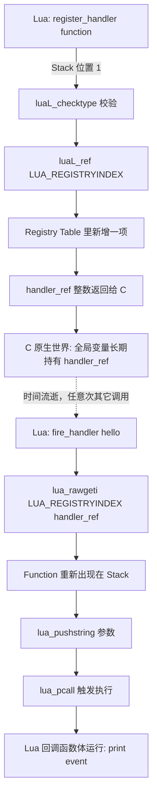

# 09. Lua Function -> C：用 Registry 长期持有一个 Lua Function

> 对应用户需求"第十阶段：Lua Function -> C"。完整可运行代码见 [`code/`](code/)（`make run` 已验证）。

## 1. 直觉

前几章里，C 从 Stack 上读到的都是"活一次就扔"的东西：一个整数、一个字符串、一个 Table 的字段值，读完这次 C 函数调用就结束了，C 也不需要再记住它们。

但现在出现一个新需求：

```lua
register_handler(function(event)
    print(event)
end)
```

这次传给 C 的不是一个"用完就算"的值，而是一个**以后还要被调用**的 Lua Function。C 必须做到：这次 `register_handler` 调用早就返回了，甚至 Lua 脚本的其它代码又调用了无数次别的 C 函数、Stack 内容被反复覆盖，若干毫秒／若干次调用之后，C 依然能精确地把"当年那个 Function"找回来并执行它。

直觉上这要求 C 侧有一个**长期的、独立于任何单次调用的"抽屉"**，能把一个 Lua Object 放进去、贴上标签、随时按标签取出来。这个抽屉就是 **Registry**。

## 2. Architecture

```text
第 1 次进入 C（register_handler 被调用）
    |
    v
Lua Function 出现在 Stack 位置 1
    |
    | luaL_checktype(L, 1, LUA_TFUNCTION)   校验系列：只读判断，失败则报错
    v
luaL_ref(L, LUA_REGISTRYINDEX)              把 Stack 顶部的值搬进 Registry
    |                                       并把它从 Stack 上弹出
    v
handler_ref（一个整数，C 原生世界里的普通变量）
    |
    | ... 时间流逝 ...
    | ... 无数次别的、完全不相关的"进入 C / 离开 C" ...
    |
    v
第 N 次进入 C（fire_handler 被调用，或 C 自己主动决定触发）
    |
    v
lua_rawgeti(L, LUA_REGISTRYINDEX, handler_ref)   用整数把 Function 重新 Push 到 Stack
    |
    v
lua_pcall(L, ...)                                CALL：触发 Lua VM 执行它
```

关键点：`handler_ref` 本身只是一个普通的 C `int`，可以放在全局变量、`struct` 字段、`malloc` 出来的内存里，跟着 C 原生世界的生命周期规则走，完全不受"某次 Lua Stack 状态"影响。

## 3. 完整代码

```1:30:chapters/09-lua-function-to-c-registry/code/register_demo.c
/*
 * register_demo.c
 *
 * 本章要证明的唯一一件事：
 *   一个 Lua Function 如果只靠"记住它在 Stack 上的位置（Stack index）"，
 *   是不可能被 C 跨调用长期持有的——Stack index 只在"当前这次 C 函数
 *   调用"内有效。C 必须把它存进 Registry（LUA_REGISTRYINDEX 指向的
 *   那张 C 私有 Table），拿到一个 Registry Reference（一个整数），
 *   才能在任意未来时刻、任意一次全新的"进入 C"里把它取回来调用。
 *
 * 本例分两步验证："跨调用"到底跨到什么程度：
 *   1. register_handler(fn) 在 luaL_dofile 执行 Lua 脚本期间被调用一次
 *      （这是第一次"进入 C"），把 fn 存进 Registry，只留下一个整数 ref。
 *   2. fire_handler("...") 在同一次脚本执行里被 Lua 主动调用一次
 *      （这是第二次"进入 C"），验证 ref 依然指向同一个 Function。
 *   3. luaL_dofile 完全返回之后（脚本已经跑完，Lua 那次调用早就结束、
 *      Stack 上当时的参数区早就被覆盖过很多次），main() 直接用普通 C
 *      代码（call_handler_from_c）第三次"进入 C 世界访问这个 Function"，
 *      证明 Registry Reference 跨越了"脚本运行期"这个更大的边界依然有效。
 */
#include <stdio.h>
#include <lua.h>
#include <lauxlib.h>
#include <lualib.h>

/* 全局：C 侧长期持有的 Registry Reference。
 * 初始值 LUA_NOREF 表示"目前没有注册任何 handler"。
 * 注意：这里存的是一个整数（Registry 里的槽位编号），
 * 不是 Stack index，也不是任何形式的裸指针。 */
static int handler_ref = LUA_NOREF;
```

```39:60:chapters/09-lua-function-to-c-registry/code/register_demo.c
static int l_register_handler(lua_State *L) {
    luaL_checktype(L, 1, LUA_TFUNCTION);

    /* 如果之前已经注册过一个 handler，先把旧引用释放掉，
     * 避免每次 register_handler 都在 Registry 里留下一个再也
     * 用不到的槽位（这属于本章 Failure 部分要讲的"引用泄漏"）。 */
    if (handler_ref != LUA_NOREF) {
        luaL_unref(L, LUA_REGISTRYINDEX, handler_ref);
    }

    /* luaL_ref 做两件事：
     *   1. 把 Stack 顶部的值（此刻正是 Stack 位置 1 上的那个 Function，
     *      luaL_checktype 并不会移动它，它还在栈顶）搬进 Registry Table；
     *   2. 把它从 Stack 上弹出，返回一个整数——这个整数就是以后
     *      找回它的"钥匙"。
     */
    handler_ref = luaL_ref(L, LUA_REGISTRYINDEX);

    printf("[C] register_handler: 已保存，Registry Reference = %d\n",
           handler_ref);
    return 0; /* 告诉 Lua VM：这次调用没有返回值 */
}
```

```68:89:chapters/09-lua-function-to-c-registry/code/register_demo.c
static void invoke_handler(lua_State *L, const char *msg) {
    if (handler_ref == LUA_NOREF) {
        printf("[C] 尚未注册任何 handler，跳过\n");
        return;
    }

    /* 第 1 步：GET —— 用 Registry Reference 把当年存进去的
     * Lua Function 重新 Push 到 Stack 顶部。此刻它才重新拥有一个
     * 有效的 Stack index，但这个 index 只在接下来几行代码内有效。 */
    lua_rawgeti(L, LUA_REGISTRYINDEX, handler_ref);

    /* 第 2 步：把参数 Push 到 Stack 上，函数和参数必须紧邻。 */
    lua_pushstring(L, msg);

    /* 第 3 步：CALL —— 用保护调用触发 Lua VM 执行这个 Function。
     * 1 个参数、期望 0 个返回值。如果 Lua 侧 error()，pcall 会把
     * 错误对象留在 Stack 顶部并返回非 0，而不会让整个宿主程序崩溃。 */
    if (lua_pcall(L, 1, 0, 0) != LUA_OK) {
        fprintf(stderr, "[C] handler 执行出错: %s\n", lua_tostring(L, -1));
        lua_pop(L, 1); /* 把错误对象弹掉，保持 Stack Balance */
    }
}
```

完整文件另见 [`code/register_demo.c`](code/register_demo.c)（含 `l_fire_handler`、`call_handler_from_c`、`main`）与配套脚本 [`code/register_demo.lua`](code/register_demo.lua)。

## 4. Stack Diagram

**`register_handler(function(event) ... end)` 调用期间**（第一次进入 C）：

```text
调用前（Lua VM 把参数放上去之后，C 函数刚被调用时）：
+-----+------------------------+
| idx | value                  |
+-----+------------------------+
|  1  | Function（那个闭包）    |  <- luaL_checktype 在这里校验
+-----+------------------------+

luaL_ref(L, LUA_REGISTRYINDEX) 执行后：
+-----+------------------------+
| idx | value                  |
+-----+------------------------+
|  (empty)                     |  <- Function 已被搬进 Registry 并弹出
+-----+------------------------+

C 原生世界：
handler_ref = 4   (举例；具体数值由 Lua 实现内部分配)
```

**`fire_handler("hello")` 调用期间**（第二次、完全独立的一次进入 C）：

```text
调用刚开始：
+-----+------------------------+
| idx | value                  |
+-----+------------------------+
|  1  | "hello"                |
+-----+------------------------+

lua_rawgeti(L, LUA_REGISTRYINDEX, handler_ref) 执行后：
+-----+------------------------+
| idx | value                  |
+-----+------------------------+
|  1  | "hello"                |
|  2  | Function（重新取回的） |
+-----+------------------------+

lua_pushstring(L, msg) 执行后（这里 msg 就是 C 变量里的 "hello"）：
+-----+------------------------+
| idx | value                  |
+-----+------------------------+
|  1  | "hello"                |
|  2  | Function               |
|  3  | "hello"（Push 的参数） |
+-----+------------------------+

lua_pcall(L, 1, 0, 0) 执行后（正常返回 0 个结果）：
+-----+------------------------+
| idx | value                  |
+-----+------------------------+
|  1  | "hello"                |
+-----+------------------------+
   <- Function 和参数都被 pcall 内部消费掉了
```

注意两次 Stack 图里位置 1 上的东西完全不是同一个对象（一次是 Function，一次是字符串）——这正好说明 Stack index 1 在两次调用里"指代的东西"没有任何必然联系，唯一"跨调用"存活的是 `handler_ref` 这个整数。

## 5. Data Flow



数据只在两个瞬间跨越 Lua↔C 边界：注册时（Function 从 Lua 世界"进入"C 侧的 Registry），触发时（Function 从 Registry"回到"Lua VM 执行）。中间那段"时间流逝"完全发生在 C 原生世界，Lua VM 甚至可能完全没有在运行。

## 6. Lifecycle

```text
Lua 里出现一个 Function 字面量
        |
        v
作为参数传给 register_handler   -- 此刻它同时"活"在：
        |                          Lua 字节码创建的闭包对象里，
        |                          以及本次调用的 Stack 位置 1 上
        v
luaL_ref(L, LUA_REGISTRYINDEX)  -- 在 Registry Table 里新增一条
        |                          "整数 key -> Function" 的记录
        v
本次 register_handler 调用返回  -- Stack 位置 1 早已被清空/覆盖，
        |                          但 Registry 里的那条记录不受影响
        v
只要 Registry 里还有这条记录，   -- GC 在扫描"谁还引用着这个
GC 就不会回收这个 Function          Function"时，会把 Registry
        |                          Table 本身当作一个"根"来扫描
        v
未来任意次数的 lua_rawgeti+pcall -- 每次都能拿到同一个、依然存活
        |                          的 Function 对象
        v
（可选）luaL_unref 被调用       -- 从 Registry Table 里删掉这条记录
        |
        v
如果此时 Lua 侧也没有任何变量还   -- 下一次 GC 可能真正回收这个
指向这个 Function                  Function 占用的内存
```

**GC 如何与 C Reference 协作？** Lua 的 GC 是"可达性"驱动的：从一组"根对象"（Global Table、当前正在执行的 Stack、以及 **Registry**）出发，能追踪到的对象就是存活的，追踪不到的才会被回收。`luaL_ref` 的本质就是"把这个 Function 挂在 Registry 这个根对象下面"，所以只要不 `luaL_unref`，它永远可达，永远不会被回收——这正是 C 侧"占住"一个 Lua Object 的标准手段。

## 7. Failure

### Failure 1：直接保存 Stack index，而不是 Registry Reference

```c
/* 错误示范：不要这样写 */
static int saved_index = -1; /* 想当然地记住"参数在位置 1" */

static int l_register_handler_BAD(lua_State *L) {
    luaL_checktype(L, 1, LUA_TFUNCTION);
    saved_index = 1;      /* 这里"看起来"是对的…… */
    return 0;
}

static int l_fire_handler_BAD(lua_State *L) {
    /* 灾难：这次调用的 Stack 位置 1 上早就是别的东西了
     * （可能是这次 fire_handler 自己的参数，也可能是任何垂悬数据），
     * 跟当年那个 Function 毫无关系。 */
    lua_pushvalue(L, saved_index);
    lua_pcall(L, 0, 0, 0);
    return 0;
}
```

**为什么错**：Stack index 是**本次 C 函数调用内的临时坐标**。`register_handler` 一返回，Lua VM 会把这段 Stack 空间挪给后续任何调用复用——下一次调用（哪怕是完全不相关的另一个 C 函数）的参数、临时值都会覆盖到同样的位置上。`saved_index = 1` 保存的只是"数字 1"，而"位置 1 在未来指向什么"完全由那次调用自己的上下文决定，跟当年的 Function 早已没有关系。

### Failure 2：注册了却忘了处理"没有注册过"的情况

```c
static int l_fire_handler_BAD2(lua_State *L) {
    lua_rawgeti(L, LUA_REGISTRYINDEX, handler_ref); /* handler_ref 还是 LUA_NOREF */
    lua_pushstring(L, "hello");
    lua_pcall(L, 1, 0, 0);
    return 0;
}
```

**为什么错**：`LUA_NOREF` 是 `-2`。`lua_rawgeti(L, LUA_REGISTRYINDEX, -2)` 不会崩溃，但会把 `nil` Push 到 Stack 上（Registry 里根本没有这个 key），然后 `lua_pcall` 会尝试把 `nil` 当函数调用，报 `attempt to call a nil value` 错误。生产代码必须在触发前检查 `handler_ref != LUA_NOREF`（见 `code/register_demo.c` 里 `invoke_handler` 的判断）。

### Failure 3：反复 `register_handler` 却不释放旧引用（引用泄漏）

```c
/* 错误示范：每次都新开一个槛位，从不 luaL_unref 旧的 */
static int l_register_handler_LEAK(lua_State *L) {
    luaL_checktype(L, 1, LUA_TFUNCTION);
    handler_ref = luaL_ref(L, LUA_REGISTRYINDEX); /* 旧的 ref 直接被丢弃 */
    return 0;
}
```

**为什么错**：旧的那个 Registry Reference 所指向的 Function，从此再也没有任何 C 变量记得它的编号了——但它依然挂在 Registry Table 下面，GC 永远认为它"可达"，永远不会回收。如果脚本反复调用 `register_handler`（比如一个长期运行的服务反复重新注册回调），Registry 会无限增长，等价于内存泄漏。本章代码在 `l_register_handler` 里先 `luaL_unref` 旧引用正是为了避免这个问题。

## 8. Debugging

遇到"回调没执行 / 执行了错误的函数 / 程序崩在 `lua_pcall` 附近"时，按下面顺序排查：

1. **`handler_ref` 现在是多少？** 打一行 `printf` 确认它不是 `LUA_NOREF`（`-2`），也不是一个明显异常的陈旧数值。
2. **这个 ref 是在哪次 `register_handler` 调用里赋的值？** 如果代码里有多处 `luaL_ref` 却只有一个全局变量，很可能互相覆盖（见 Failure 3）。
3. **`lua_rawgeti` 之后，Stack 顶部真的是 Function 吗？** 可以临时插入 `lua_type(L, -1) == LUA_TFUNCTION` 的断言；如果不是，说明 Registry 里那个槛位存的根本不是预期的对象（常见于键值搞混、或者对 `LUA_REGISTRYINDEX` 使用了错误的下标）。
4. **`lua_pcall` 的返回值检查了吗？** 任何忘记检查 `lua_pcall` 返回值的代码，都可能在回调出错时把错误对象误当成别的东西继续用，进而在后续代码里崩溃或产生垃圾结果。

## 9. Mental Model

```text
Stack index      = 本次 C 函数调用内的临时坐标，调用一返回就可能失效
Registry         = LUA_REGISTRYINDEX 指向的一张 C 私有 Table，
                    生命周期与 lua_State 一样长
Registry Reference（luaL_ref 的返回值）
                  = C 长期"占住"一个 Lua Object、
                    不被 GC 回收的标准手段
```

> **一句话**：Lua Function 不能靠 Stack index 跨调用保存；C 必须用 `luaL_ref(L, LUA_REGISTRYINDEX)` 把它换成一个长期有效的整数 Reference，未来任意时刻用 `lua_rawgeti` + `lua_pcall` 取回并调用它。
