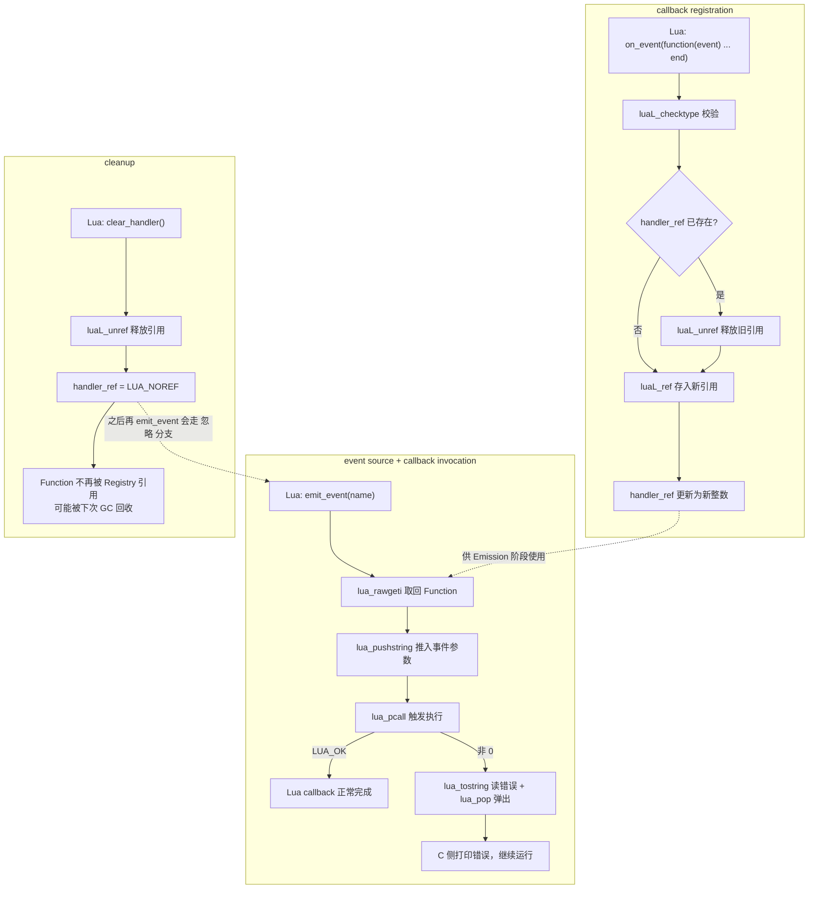

# 10. C Callback -> Lua：一个完整的事件系统

> 对应用户需求"第十一阶段：C Callback -> Lua"。完整可运行代码见 [`code/`](code/)（`make run` 已验证）。
> 前置知识：Chapter 09 已经讲清楚"如何用 Registry 长期持有一个 Lua Function"；本章把它组装成一个真正的**事件系统**，并补上 error handling 与 cleanup 这两个 Chapter 09 没展开的点。

## 1. 直觉

Chapter 09 证明了"C 能长期记住一个 Lua Function"。但真实场景往往不是"记住一次、调用一次"，而是一套完整的**事件系统**：

```lua
on_event(function(event)
    print("event:", event)
end)

emit_event("connected")
emit_event("disconnected")
```

`on_event` 负责"登记谁想被通知"，`emit_event` 负责"通知发生了、该叫谁"。这正是几乎所有 GUI 框架、网络库、协议解析器（包括 Wireshark 的 dissector 回调）暴露给脚本的标准模式：**C 是事件的生产者，Lua 是事件的消费者，Registry 是两者之间的"电话本"**。

本章要多想一步的两件事：
- 如果 Lua 那端的回调函数自己写错了（`error()`），C 侧会不会被拖崩？
- 如果永远不清理注册过的回调，会有什么后果？

## 2. Architecture

```text
Lua: on_event(function(event) ... end)
      |
      v
callback registration：luaL_checktype + luaL_ref(LUA_REGISTRYINDEX)
      |
      v
callback storage：handler_ref（C 全局变量，一个整数）
      |
      | ... C 原生世界决定"现在有事件发生了" ...
      v
Lua: emit_event("connected")   （event source，本例简化为脚本直接调用）
      |
      v
callback invocation：
  lua_rawgeti(L, LUA_REGISTRYINDEX, handler_ref)
      |
      v
  lua_pushstring(L, "connected")
      |
      v
  lua_pcall(L, 1, 0, 0)
      |
      +-- 返回 LUA_OK --------------► Lua callback 正常执行完毕
      |
      +-- 返回非 0（error handling）-► 打印 lua_tostring(L, -1)，
                                       lua_pop 弹掉错误对象，继续运行

Lua: clear_handler()
      |
      v
cleanup：luaL_unref(L, LUA_REGISTRYINDEX, handler_ref)
      |
      v
handler_ref = LUA_NOREF   （C 侧彻底"放手"，Function 才可能被 GC）
```

## 3. 完整代码

```1:32:chapters/10-c-callback-event-system/code/event_demo.c
/*
 * event_demo.c
 *
 * 在 Chapter 09 的基础上，把"Registry Reference 长期持有一个
 * Lua Function"这件事，包装成一个更完整的事件系统：
 *
 *   on_event(fn)      -- callback registration：把 fn 存进 Registry
 *   emit_event(name)  -- event source + callback invocation：
 *                        C 侧任意时刻决定"事件发生了"，
 *                        用 lua_rawgeti + lua_pcall 把 fn 取回来调用
 *   clear_handler()   -- cleanup：luaL_unref 释放引用，
 *                        并演示"不清理会怎样"
 *
 * 本例额外覆盖两个 Chapter 09 没有覆盖的点：
 *   1. error handling：如果 Lua 回调本身 error()，lua_pcall 返回
 *      非 0，C 侧必须能捕获、打印，然后继续正常运行——绝不能让
 *      "回调里的一个 bug"变成"整个宿主程序崩溃"。
 *   2. cleanup 的必要性：只要 Registry 里还有引用，Lua 那个
 *      Function 对象就不会被 GC 回收，即使 Lua 侧已经没有任何
 *      变量指向它。必须显式 luaL_unref，才能让 C 侧"放手"。
 *
 * Mental Model（本章要落地的一句话）：
 *   Callback = C 保存 Lua Function 的 Registry Reference。
 */
#include <stdio.h>
#include <lua.h>
#include <lauxlib.h>
#include <lualib.h>

/* C 侧长期持有的、当前唯一的事件 handler 引用。
 * LUA_NOREF 表示"当前没有注册任何 handler"。 */
static int handler_ref = LUA_NOREF;
```

```47:59:chapters/10-c-callback-event-system/code/event_demo.c
static int l_on_event(lua_State *L) {
    luaL_checktype(L, 1, LUA_TFUNCTION);

    if (handler_ref != LUA_NOREF) {
        printf("[C] on_event: 替换旧 handler（先释放旧的 Registry Reference "
               "= %d）\n", handler_ref);
        luaL_unref(L, LUA_REGISTRYINDEX, handler_ref);
    }

    handler_ref = luaL_ref(L, LUA_REGISTRYINDEX);
    printf("[C] on_event: 已注册，Registry Reference = %d\n", handler_ref);
    return 0;
}
```

```73:98:chapters/10-c-callback-event-system/code/event_demo.c
static int l_emit_event(lua_State *L) {
    const char *name = luaL_checkstring(L, 1);

    if (handler_ref == LUA_NOREF) {
        printf("[C] emit_event(\"%s\"): 当前没有注册任何 handler，忽略\n",
               name);
        return 0;
    }

    printf("[C] emit_event(\"%s\"): 触发 handler\n", name);

    lua_rawgeti(L, LUA_REGISTRYINDEX, handler_ref); /* GET: Registry -> Stack */
    lua_pushstring(L, name);                        /* PUSH: 参数 */

    if (lua_pcall(L, 1, 0, 0) != LUA_OK) {
        /* Lua 回调出错：Stack 顶部是错误对象（这里假设是字符串，
         * 更严谨的写法应该先用 lua_isstring 判断，见 Chapter 18）。
         * 打印后必须 lua_pop 把它弹掉，保持 Stack Balance，
         * 然后正常返回——绝不能让这里的错误变成 C 程序的崩溃。 */
        fprintf(stderr, "[C] emit_event(\"%s\"): handler 执行出错: %s\n",
                name, lua_tostring(L, -1));
        lua_pop(L, 1);
    }

    return 0;
}
```

```108:118:chapters/10-c-callback-event-system/code/event_demo.c
static int l_clear_handler(lua_State *L) {
    (void)L;
    if (handler_ref == LUA_NOREF) {
        printf("[C] clear_handler: 当前没有注册任何 handler，无需清理\n");
        return 0;
    }
    printf("[C] clear_handler: 释放 Registry Reference = %d\n", handler_ref);
    luaL_unref(L, LUA_REGISTRYINDEX, handler_ref);
    handler_ref = LUA_NOREF;
    return 0;
}
```

完整文件另见 [`code/event_demo.c`](code/event_demo.c) 与配套脚本 [`code/event_demo.lua`](code/event_demo.lua)。

## 4. Stack Diagram

**`emit_event("connected")` 正常路径**：

```text
调用刚开始：
+-----+------------------------+
| idx | value                  |
+-----+------------------------+
|  1  | "connected"            |
+-----+------------------------+

lua_rawgeti(L, LUA_REGISTRYINDEX, handler_ref) 之后：
+-----+------------------------+
| idx | value                  |
+-----+------------------------+
|  1  | "connected"            |
|  2  | Function（取回的回调） |
+-----+------------------------+

lua_pushstring(L, name) 之后：
+-----+------------------------+
| idx | value                  |
+-----+------------------------+
|  1  | "connected"            |
|  2  | Function               |
|  3  | "connected"（参数）    |
+-----+------------------------+

lua_pcall(L, 1, 0, 0) 正常返回后（LUA_OK，0 个结果）：
+-----+------------------------+
| idx | value                  |
+-----+------------------------+
|  1  | "connected"            |
+-----+------------------------+
```

**`emit_event("will-error")` 出错路径**（回调内部 `error(...)`）：

```text
lua_pcall(L, 1, 0, 0) 返回非 0（LUA_ERRRUN）之后：
+-----+---------------------------------------------+
| idx | value                                       |
+-----+---------------------------------------------+
|  1  | "will-error"                                |
|  2  | "...: boom in handler while handling..."    |  <- 错误对象
+-----+---------------------------------------------+
        |
        | lua_tostring(L, -1) 读出来打印
        v
      lua_pop(L, 1)   把它弹掉，恢复到调用前的 Stack 高度
+-----+------------------------+
| idx | value                  |
+-----+------------------------+
|  1  | "will-error"           |
+-----+------------------------+
```

**关键点**：无论 `lua_pcall` 成功还是失败，Function 和参数都已经从 Stack 上消失（成功时被"消费"成 0 个返回值，失败时被替换成 1 个错误对象）。**保护调用永远只留下约定数量的值**——这正是为什么 `lua_pcall` 是"安全"的：即使 Lua 侧代码本身写错了，Stack Balance 依然可以被 C 侧手动恢复，不会越调用越乱。

## 5. Data Flow



三个子图分别对应三次独立的"进入 C"：注册一次、触发任意多次、清理一次——它们之间唯一的耦合点就是那个 C 全局变量 `handler_ref`，这也正是本章 Mental Model 要强调的东西。

## 6. Lifecycle

```text
脚本调用 on_event(fn)
        |
        v
fn 被 luaL_ref 存入 Registry -- handler_ref 指向它，GC 视其为"可达"
        |
        v
        +-----------------------------+
        |   事件循环（可以发生任意多次）  |
        |                              |
        |   emit_event(name)            |
        |        |                      |
        |        v                      |
        |   lua_rawgeti 取回 fn          |
        |        |                      |
        |        v                      |
        |   lua_pcall 执行               |
        |        |                      |
        |   +----+----+                 |
        |   |         |                 |
        |  成功      出错（error handling）|
        |   |         |                 |
        |   |    打印错误 + lua_pop       |
        |   |         |                 |
        |   +----+----+                 |
        |        |                      |
        |   （fn 依然存活，可以再 emit）   |
        +--------+---------------------+
                 |
                 v
         再次 on_event(fn2)          -- 旧 fn 被 luaL_unref，
                 |                     新 fn2 取代 handler_ref
                 v
        （可选）clear_handler()     -- 显式 luaL_unref，
                 |                     handler_ref = LUA_NOREF
                 v
     不再有任何 C 侧引用指向该 Function
                 |
                 v
   如果 Lua 侧也没有变量再指向它 -- 下一次 GC 可能真正回收它
```

**为什么"回调内部出错"不会破坏这条生命周期？** 因为 `lua_pcall` 是**保护调用**：Lua VM 在执行回调时如果触发 `error()`，会在内部做一次 `longjmp` 回到 `lua_pcall` 调用处，而不是让错误继续往上"炸穿"整个 C 调用栈。`lua_pcall` 把这次"事故"折算成一个整数状态码 + Stack 顶部的错误对象返回给 C，C 侧处理完（打印、`lua_pop`）之后，`handler_ref` 依然完好，Registry 里的引用没有受到任何影响——**下一次 `emit_event` 可以正常继续工作**，这也是本章 `code/event_demo.lua` 里特意在"出错"之后仍有后续 `emit_event` 调用要验证的点。

## 7. Failure

### Failure 1：忘记检查 `lua_pcall` 的返回值

```c
/* 错误示范：假装 lua_pcall 永远成功 */
static int l_emit_event_BAD(lua_State *L) {
    const char *name = luaL_checkstring(L, 1);
    lua_rawgeti(L, LUA_REGISTRYINDEX, handler_ref);
    lua_pushstring(L, name);
    lua_pcall(L, 1, 0, 0);   /* 返回值被无视 */
    return 0;
}
```

**为什么错**：如果回调内部 `error()`，`lua_pcall` 返回非 0，此时 Stack 顶部留的是**错误对象**，不是"没有返回值"。后续代码如果继续假设"Stack 已经干净"，实际上 Stack 上多了一个游离的错误对象，会导致 Stack 高度逐次调用累积增长（Stack Balance 被破坏），轻则后续 API 读到错乱的值，重则长期运行后 Stack 溢出。`code/event_demo.c` 里的 `l_emit_event` 用 `if (lua_pcall(...) != LUA_OK) { ...; lua_pop(L, 1); }` 正是为了避免这个问题。

### Failure 2：把错误对象当字符串处理却不做防御

```c
if (lua_pcall(L, 1, 0, 0) != LUA_OK) {
    /* 危险：如果 Lua 侧 error({code=42}) 抛的是一个 Table 而不是字符串，
     * lua_tostring 对非字符串、非数字的值会返回 NULL。 */
    const char *msg = lua_tostring(L, -1);
    fprintf(stderr, "error: %s\n", msg); /* msg 可能是 NULL，%s 传 NULL 是未定义行为 */
    lua_pop(L, 1);
}
```

**为什么错**：Lua 的 `error()` 可以抛出**任意类型**的 Lua Value（字符串、Table、数字……），不是只能是字符串。生产代码应该先用 `lua_isstring`/`lua_type` 判断，或者统一用 `luaL_tolstring`（会自动尝试用 `__tostring` Metamethod 转换）取代裸的 `lua_tostring`。本章示例的回调只 `error()` 字符串，是为了聚焦"错误能被捕获"这一个点；更完整的处理方式见 Chapter 18（Error Handling）。

### Failure 3：`clear_handler` 之后忘记把 `handler_ref` 重置为 `LUA_NOREF`

```c
/* 错误示范 */
static int l_clear_handler_BAD(lua_State *L) {
    (void)L;
    luaL_unref(L, LUA_REGISTRYINDEX, handler_ref);
    /* 忘了写 handler_ref = LUA_NOREF; */
    return 0;
}
```

**为什么错**：`luaL_unref` 只是把 Registry Table 里那个槛位标记为"可复用"，但 C 侧的 `handler_ref` 变量本身还留着那个**已经失效的编号**。如果之后 Lua 又调用了别的、无关的 `luaL_ref`（哪怕是完全不同功能的另一段代码），Lua 实现完全可能把同一个编号重新分配给别的对象——这时 `emit_event` 会用一个陈旧的 `handler_ref` 意外调用到"另一个毫不相关的 Lua Object"，这是一种隐蔽的悬挂引用 bug，比崩溃更难排查。必须在 `luaL_unref` 之后立刻把本地变量重置为 `LUA_NOREF`（`code/event_demo.c` 的 `l_clear_handler` 已经这样做）。

## 8. Debugging

1. **回调"好像没被调用"？** 先确认 `on_event` 那次调用真的执行到了 `luaL_ref`（加一行 `printf` 打出 `handler_ref`），再确认 `emit_event` 里 `handler_ref != LUA_NOREF` 这一步走的是"触发"分支而不是"忽略"分支。
2. **回调"调用了但报错、然后整个程序退出"？** 说明当前用的是 `lua_call` 而不是 `lua_pcall`，或者 `lua_pcall` 返回值没被检查就继续往下跑触发了别的崩溃。确认 `code/event_demo.c` 里 `l_emit_event` 的错误分支确实被走到（可以临时在回调里主动 `error("test")` 观察输出）。
3. **怀疑"引用指向了别的对象"？** 在 `luaL_ref`/`luaL_unref` 附近打印 `handler_ref` 的值，观察它在整个运行期内的变化序列，确认没有"先 unref、忘记置 `LUA_NOREF`、又被别处复用"的情况（对照 Failure 3）。
4. **想知道 Registry 里到底攒了多少"陈旧"引用？** 开发调试阶段可以临时遍历 `LUA_REGISTRYINDEX` 这张 Table（`lua_pushnil` + `lua_next` 循环）打印所有 key，配合 Chapter 08 的 Table 遍历技巧，直观看到有没有累积泄漏。

## 9. Mental Model

```text
Callback = C 保存 Lua Function 的 Registry Reference
```

拆开看：

```text
on_event(fn)     --  callback registration  --  luaL_ref 存入 Registry
emit_event(name) --  callback invocation    --  lua_rawgeti + lua_pcall 取回并触发
error() in fn    --  error handling         --  lua_pcall 非 0 时打印 + lua_pop，绝不崩溃
clear_handler()  --  cleanup                --  luaL_unref + 置 LUA_NOREF，C 侧真正"放手"
```

> **一句话**：C Callback 从来不是"C 直接保存了一个函数指针"，而是"C 用一个整数（Registry Reference）间接指向 Registry 里的一个 Lua Function"；触发回调永远是"取回 + 保护调用"这两步，且必须假设它随时可能失败——`lua_pcall` 的存在就是为了让"Lua 脚本的 bug"和"C 程序的稳定性"彼此隔离。

