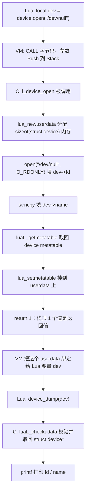

# 11. Userdata Basics：C Object 如何变成 Lua 手里的一个值

> 对应用户需求"第十二阶段：C Object -> Lua Userdata"。本章目标只有一个：把 `device.open()`
> 做出来，让一个真实的 C struct 能"活"在 Lua 变量里。`dev:start()/stop()/name()` 的方法派发链
> 留给 Chapter 12；这里只演示"能拿到 userdata，并从里面读出 `struct device*`"。

## 1. 直觉

到目前为止（Chapter 01-10），C 和 Lua 之间交换的都是**值**：整数、字符串、Table——这些东西
Lua VM 自己完全理解，可以随意拷贝、比较、打印。但 C 世界里还有一大类东西 Lua VM **根本不理解**：
一个打开的文件描述符、一块 `malloc` 出来的结构体、一个网络连接……它们的内部布局是 C 编译器决定的，
Lua VM 不可能"认识"任意一个 `struct` 的字段排布。

Userdata 存在的意义就是解决这个问题：**给 Lua 一块它不需要理解内部结构、但可以安全持有、传递、
GC 的"不透明内存"**。Lua 只知道"这是一块内存，大小是多少，归我管"，具体这块内存里是什么、
怎么解释，完全由 C 侧决定。

```text
C 世界                              Lua 世界
struct device {                     local dev = device.open("/dev/foo")
    int fd;              ----►      dev 是一个"看不透的值"
    char name[64];                  Lua 只知道：这是 userdata，这么大，归我 GC 管
};
```

**本章重点：Userdata 是 Lua 世界与 C Object 世界之间的桥梁。** 没有它，C 侧任何"有状态的资源"
都没法自然地表示成一个 Lua 变量。

## 2. Architecture

```text
Lua object（local dev）
    |
    v
userdata                  <- lua_newuserdata() 分配、由 Lua GC 持有的一块裸内存
    |
    v
struct device *           <- 把这块裸内存的起始地址，当作 struct device* 来用
    |
    +-- state              (dev->fd)
    +-- resources           (打开的文件描述符本身)
    +-- methods             (本章还没有；Chapter 12 才挂上去)
```

涉及的五个 API，各自的职责：

```text
lua_newuserdata(L, sz)
    在 Lua Stack 顶部创建一块大小为 sz、由 Lua GC 管理的内存，Push 上去
    （这一步之后它还只是"一块匿名内存"，Lua 不知道它的"类型"）

luaL_newmetatable(L, name)
    在 Registry 里以字符串 name 为 key，创建（或取回）一张全局唯一的 Metatable
    Lua 5.4 会自动给这张表设置 __name = name 字段

luaL_getmetatable(L, name)
    按名字，从 Registry 把已经建好的那张 Metatable 取到 Stack 顶部
    （宏，等价于 lua_getfield(L, LUA_REGISTRYINDEX, name)）

lua_setmetatable(L, idx)
    把 Stack 顶部的那张表，设置为 idx 位置那个值的 Metatable
    （设置完，Stack 顶部的 Metatable 会被弹出）

luaL_checkudata(L, idx, name)
    校验 idx 位置是不是一个 userdata，并且它的 Metatable 恰好是 Registry[name]
    这一张；两者都满足才返回裸内存指针，否则直接 luaL_error（类型混淆保护）
```

## 3. 完整代码

完整源码见 `code/device_demo.c`；下面按函数逐段解释。

### 3.1 贯穿 Chapter 11-14 的 C Object

```c
struct device {
    int fd;
    char name[64];
};
```

这一个结构体会原样贯穿 Chapter 11、12、13、14 四章——本章只创建它、读它；Chapter 12 给它加方法
派发；Chapter 13 给它加生命周期管理（`__gc`）；Chapter 14 用它对比 Light Userdata。

### 3.2 `check_device()`：本章到 Chapter 14 都会用到的校验帮手

```c
static struct device *check_device(lua_State *L, int idx)
{
    void *ud = luaL_checkudata(L, idx, DEVICE_MT);
    return (struct device *)ud;
}
```

`luaL_checkudata` 内部做两件事：
1. 确认 `idx` 位置是 userdata（不是 table、不是 nil……）；
2. 确认它的 Metatable 就是 `Registry[DEVICE_MT]` 这一张（不是别的模块注册的、名字不同的 Metatable）。

两条都满足才返回裸内存指针；否则直接 `luaL_error`，函数不会返回到这一行之后。这就是"类型混淆保护"：
即使 Lua 脚本里传进来的是另一个 C 模块导出的、看起来也像"某种资源"的 userdata，这里也会被挡住，
不会被错误地当成 `struct device*` 来解引用。

### 3.3 `device.open(path)`：本章的主角

```c
static int l_device_open(lua_State *L)
{
    const char *path = luaL_checkstring(L, 1);

    struct device *dev = (struct device *)lua_newuserdata(L, sizeof(struct device));

    dev->fd = open(path, O_RDONLY);
    strncpy(dev->name, path, sizeof(dev->name) - 1);
    dev->name[sizeof(dev->name) - 1] = '\0';

    luaL_getmetatable(L, DEVICE_MT);
    lua_setmetatable(L, -2);

    return 1;
}
```

三步：**分配** -> **初始化** -> **挂 Metatable**。`fd` 用真实的 `open("/dev/null", O_RDONLY)`
打开，不是伪造整数——这样"资源"这个概念是看得见的：`fd` 可能成功（`>= 0`）也可能失败（`-1`），
这一点在 Chapter 13 讲生命周期时会用上。

### 3.4 `device_dump(dev)`：证明"能读出 struct device\*"

```c
static int l_device_dump(lua_State *L)
{
    luaL_checktype(L, 1, LUA_TUSERDATA);
    struct device *dev = check_device(L, 1);

    printf("[device_dump] fd=%d name=%s\n", dev->fd, dev->name);
    return 0;
}
```

先用 `luaL_checktype(L, 1, LUA_TUSERDATA)` 做一次"粗粒度"校验——只看"是不是某种 userdata"，
不关心具体类型；再用 `check_device` 做"细粒度"校验——必须恰好是 `device` 类型。这是本章故意
把两层校验分开写的原因：`luaL_checktype` 对应术语表里的"校验系列"里最通用的一层，`luaL_checkudata`
是专门给 Userdata 用的、带类型名字的那一层。

配套的 `code/device_demo.lua`：

```lua
local dev = device.open("/dev/null")

print("type(dev)      =", type(dev))
print("tostring(dev)  =", tostring(dev))

device_dump(dev)

local ok, err = pcall(device_dump, {})
print("device_dump({}) ok  =", ok)
print("device_dump({}) err =", err)
```

## 4. Stack Diagram

`device.open("/dev/null")` 被调用时，Stack 的演化：

```text
调用前（Lua VM 已经把参数放好）：
+-----+----------------+
|  1  | "/dev/null"    |   <- path 参数
+-----+----------------+

lua_newuserdata(L, sizeof(struct device)) 之后：
+-----+----------------+
|  1  | "/dev/null"    |
|  2  | userdata(裸内存)|   <- 新 Push 上去的，还没有 metatable
+-----+----------------+

luaL_getmetatable(L, "device") 之后：
+-----+----------------+
|  1  | "/dev/null"    |
|  2  | userdata        |
|  3  | metatable       |   <- 从 Registry 取回来的，Push 到栈顶
+-----+----------------+

lua_setmetatable(L, -2) 之后：
+-----+----------------+
|  1  | "/dev/null"    |
|  2  | userdata（已挂好 metatable）|
+-----+----------------+
        ^
        +-- 栈顶的 metatable 被"消耗"掉了（设置完自动弹出）

return 1  ->  告诉 Lua VM：从栈顶数 1 个值就是返回值，也就是这个 userdata。
```

`device_dump(dev)` 被调用时：

```text
调用时：
+-----+----------------+
|  1  | userdata(dev)   |   <- 唯一的参数
+-----+----------------+

luaL_checktype / check_device 都只是"读"，不改变 Stack 形状。
函数体内部 printf 完之后 return 0，栈顶 0 个返回值。
```

**Stack index 提醒**：上面 `idx = 1` 只在 `l_device_dump` 这一次调用内有效；`check_device`
拿到的 `struct device *` 指针**才是**可以跨调用、长期持有的东西——Stack index 本身绝不能被
保存到某个全局变量里当作"以后还能用的引用"。

## 5. Data Flow



数据在这条链路上只有一次"跨界"：`open()` 系统调用拿到的 `fd`（一个纯 C 世界的整数）被写进
了 Lua GC 管理的那块内存里；此后无论 Lua 侧怎么传递这个 `dev` 变量（赋值给别的变量、存进
table……），底层这块内存和里面的 `fd` 都不会变——因为传递的始终是"对同一块 GC 内存的引用"，
不是内容拷贝。

## 6. Lifecycle

本章只覆盖生命周期的"出生"这一段（完整的"死亡"在 Chapter 13）：

```text
main() 启动
    |
    v
luaL_newmetatable(L, "device")   -- 全局唯一的 metatable 建好，存进 Registry
    |
    v
device.open("/dev/null") 被调用
    |
    +-- lua_newuserdata()   -- Lua GC 开始追踪这块内存
    +-- open() 系统调用      -- 拿到真实 fd
    +-- lua_setmetatable()  -- 这块内存"获得类型"，变成一个 device 对象
    |
    v
dev 变量持有这个 userdata
    |
    v
（本章到此为止：dev 还活着，fd 也还开着，没有人主动关闭它）
```

值得注意：`lua_newuserdata` 分配的内存此刻**已经**被 Lua GC 接管——即使我们还没挂 Metatable，
GC 该收的时候也会收；只是没有 Metatable 的 Userdata 没有 `__gc`，GC 收走它时只是单纯释放内存，
不会触发任何"清理 C 资源"的钩子。这也是为什么本章刻意先调用 `luaL_getmetatable` +
`lua_setmetatable`，再返回——保证脚本拿到的 `dev` 从第一刻起就是"有类型"的。

## 7. Failure

### Failure 1：忘记挂 Metatable

如果 `l_device_open` 少写了 `luaL_getmetatable` + `lua_setmetatable` 两行，`dev` 仍然是
一个合法的 userdata，`type(dev)` 依然打印 `userdata`，脚本表面上看不出问题。但只要后面调用
`device_dump(dev)`，`luaL_checkudata(L, 1, "device")` 会发现这个 userdata **没有** Metatable
（或者 Metatable 不是 `Registry["device"]`），直接 `luaL_error`：

```text
bad argument #1 to 'device_dump' (device expected, got userdata)
```

### Failure 2：类型混淆（本章脚本已实际触发）

脚本里故意用一个空 table 去调用 `device_dump({})`：

```text
device_dump({}) ok  =	false
device_dump({}) err =	bad argument #1 to 'device_dump' (userdata expected, got table)
```

这正是 `luaL_checktype(L, 1, LUA_TUSERDATA)` 起作用的地方——在还没走到 `check_device`（也就
是还没去比较 Metatable 名字）之前，先把"压根不是 userdata"的情况挡在门外，报错信息也更直接。

### Failure 3：`open()` 失败但没人检查

如果传入的 `path` 是一个不存在的文件，`open()` 返回 `-1`，但 `l_device_open` 里并没有检查
这个返回值——`dev->fd` 会被设成 `-1`，`device.open()` 依然"成功"返回一个 userdata，`dev` 看
起来一切正常，直到后面某个用到 `fd` 的操作（比如 Chapter 12 的 `dev:start()`）才会发现资源
其实根本没打开。这是"C 侧的错误被静默吞掉，延迟到很久以后才暴露"的典型模式，Chapter 12 会
在 `start()` 里补上检查。

## 8. Debugging

- **第一反应**：`type(dev)` 打印 `userdata` 但方法调用/字段访问全部失败？先确认是否真的挂
  了 Metatable——最快的验证方式是在 C 侧临时加一行 `lua_getmetatable(L, -1)` 后 `lua_type`
  检查，或者干脆在 Lua 侧 `print(getmetatable(dev))` 看看是不是 `nil`。
- **`bad argument ... (device expected, got userdata)`**：说明拿到的确实是某种 userdata，
  但 Metatable 对不上——通常是"这个 userdata 是另一个模块创建的"或者"忘了挂 Metatable"。
- **`bad argument ... (userdata expected, got xxx)`**：说明连"是不是 userdata"这一步都没过，
  基本可以确定调用者传错了类型的 Lua 值（比如传了 table、nil）。
- **`fd=-1`**：`luaL_checkudata` 全都通过了，说明"桥梁"本身没问题，是 C 侧的资源初始化
  （`open()`）真的失败了——去检查传入的路径，而不是去查 Lua/C 交互的代码。

## 9. Mental Model

```text
Userdata = 一块"Lua 愿意用 GC 管理、但不打算理解内容"的裸内存，
           它的"类型"完全来自挂在它身上的那张 Metatable（按名字全局唯一）。

C Object -> Userdata：分配（lua_newuserdata）-> 初始化（普通 C 代码）-> 挂类型（setmetatable）
Userdata -> C Object：校验类型 + 取回地址，一步到位（luaL_checkudata）

Userdata 是 Lua 世界与 C Object 世界之间的桥梁：
    Lua 侧只把它当一个"不可拆开看"的值传递、持有、GC；
    C 侧才知道这块内存里到底是什么、该怎么解释。
```
