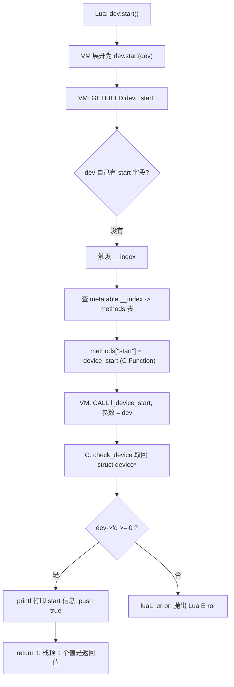

# 12. Userdata + Metatable + Method：`dev:start()` 到底调用了什么

> 对应用户需求"第十三阶段：Userdata + Metatable + Method"。在 Chapter 11 的 `struct device`
> 基础上增量演进：完整实现 `dev:start()` / `dev:stop()` / `dev:name()`，并把 `dev:start()`
> 这一句语法糖背后的完整调用链拆开讲清楚。

## 1. 直觉

Chapter 11 已经能拿到一个"类型为 device"的 userdata，但它身上除了裸内存什么都没有——没法
调用任何方法。`dev:start()` 这种写法在 Lua 里非常自然，但它**不是**内建的"面向对象语法"，
而是完全由 `Metatable.__index` 这一个 Metamethod 实现出来的效果。

一句话直觉：**`dev:start()` = `dev.start(dev)`**，而 `dev.start` 这个字段本身根本不存在于
`dev` 这块 userdata 上——它是 Lua 在"找不到就去 Metatable 的 `__index` 里再找一次"这条规则
驱动下，间接找到的。

## 2. Architecture

```text
Lua object
      |
      v
userdata
      |
      v
metatable
      |
      +-- __index      -> 方法表（device_methods）
      +-- __gc          （本章还没实现，留给 Chapter 13）
      +-- __tostring   -> l_device_tostring
      +-- methods      -> start / stop / name（挂在方法表里，不是直接挂在 metatable 上）
```

`dev:start()` 完整调用链（用户需求原文给出的链路）：

```text
dev:start()
    |
    v
dev["start"]            <- ":" 只是语法糖，等价于取 dev.start 再把 dev 作为第 1 个参数传进去
    |
    v
dev 本身没有 "start" 字段，触发 __index
    |
    v
Metatable
    |
    v
Metatable.__index -> 方法表
    |
    v
方法表["start"] = l_device_start   <- 这是一个 C Function
    |
    v
调用 l_device_start(L)，第 1 个参数就是 dev 自己
    |
    v
luaL_checkudata 取回 struct device*
```

**C 语言类比**：`Metatable.__index` 指向的这张方法表，本质上很像 C 里手写 vtable 时会写的：

```c
struct device_vtable {
    int (*start)(struct device *);
    int (*stop)(struct device *);
    const char *(*name)(struct device *);
};
```

区别只在于"怎么找到那个函数"：C 的 vtable 是**编译期固定的结构体偏移**——`vtable->start`
是一次指针解引用加上编译器算好的固定偏移量，没有任何运行时开销去"查找"；Lua 的方法表是
**运行时按字符串查哈希表**——`dev:start()` 每次调用都要真的去查一次 `"start"` 这个 key。
两者"给一类对象提供一组统一操作接口"的设计目的完全一样，只是查找机制一个是静态的、
一个是动态的。这也是为什么 Lua 的方法调用比 C 的虚函数调用天生多一层开销，但换来的是极大
的灵活性（运行时可以随时往方法表里加字段、换实现）。

## 3. 完整代码

完整源码见 `code/device_demo.c`；下面重点解释与 Chapter 11 不同的部分。

### 3.1 三个方法：`l_device_start` / `l_device_stop` / `l_device_name`

```c
static int l_device_start(lua_State *L)
{
    struct device *dev = check_device(L, 1);

    if (dev->fd < 0) {
        return luaL_error(L, "device '%s' has no valid fd, cannot start", dev->name);
    }

    printf("[device] start: name=%s fd=%d\n", dev->name, dev->fd);
    lua_pushboolean(L, 1);
    return 1;
}
```

三个方法的签名完全一样——`int (*)(lua_State *)`，这是 Chapter 00 就强调过的"Lua VM 只认识
一种外部函数"。它们与 Chapter 11 的 `l_device_dump` 唯一的区别是：**第一个参数永远是 `dev`
自己**。这不是这几个函数自己规定的，而是 `dev:start()` 这个调用语法本身保证的——Lua 在展开
`:` 语法糖时，永远把冒号左边的对象作为第 1 个参数插进去。

`l_device_start` 里补上了 Chapter 11 Failure 3 留下的坑：如果 `fd < 0`（`open()` 当时失败），
现在会用 `luaL_error` 明确报错，而不是让错误继续被吞掉。

### 3.2 方法表与 `__index` 的建立

```c
luaL_newmetatable(L, DEVICE_MT);       /* Stack: [mt] */

lua_newtable(L);                       /* Stack: [mt, methods] */
luaL_setfuncs(L, device_methods, 0);   /* 填充 methods 表 */

lua_setfield(L, -2, "__index");        /* mt.__index = methods; Stack: [mt] */

lua_pushcfunction(L, l_device_tostring);
lua_setfield(L, -2, "__tostring");      /* mt.__tostring = l_device_tostring */

lua_pop(L, 1);
```

注意这里是**两张表**：`mt`（metatable 本身）和 `methods`（方法表），`mt.__index` 指向
`methods`，`start`/`stop`/`name` 是挂在 `methods` 上，不是直接挂在 `mt` 上。这样设计的好处
是把"元编程用的 Metamethod"（`__index`、`__gc`、`__tostring`……）和"业务方法"（`start`、
`stop`、`name`……）分成两张表，互不干扰、便于阅读。

### 3.3 配套 Lua 脚本

```lua
local dev = device.open("/dev/null")

print("tostring(dev) =", tostring(dev))

print("name:", dev:name())
dev:start()
dev:stop()

local ok = dev.start(dev)
print("dev.start(dev) 等价调用, ok =", ok)

local bad = device.open("/path/does/not/exist")
local ok2, err2 = pcall(function() bad:start() end)
print("bad:start() ok  =", ok2)
print("bad:start() err =", err2)
```

脚本里特意写了 `dev.start(dev)` 这一行，跟 `dev:start()` 效果完全一样——用来实打实地证明
"`:` 只是语法糖"这句话，不是空口白话。

## 4. Stack Diagram

`dev:start()` 被 Lua VM 展开、真正发生 `CALL` 之前，Lua 编译器已经把它变成等价于
`dev.start(dev)`。所以从 Stack 的角度看，`l_device_start` 被调用时：

```text
调用时（VM 已经把 dev 复制了一份放进第 1 个参数位）：
+-----+----------------+
|  1  | userdata(dev)   |   <- ":" 语法糖自动插入的第 1 个参数，也是唯一的参数
+-----+----------------+

check_device(L, 1) 内部（只读，不改变 Stack 形状）：
    luaL_checkudata(L, 1, "device")
        -> 检查 index 1 是 userdata
        -> 检查它的 metatable == Registry["device"]
        -> 返回裸内存地址

lua_pushboolean(L, 1) 之后：
+-----+----------------+
|  1  | userdata(dev)   |
|  2  | true            |   <- 新 Push 的返回值
+-----+----------------+

return 1  ->  栈顶 1 个值（true）是这次调用的返回值。
```

**`dev["start"]` 这一步在 Stack 上其实也发生了一次隐藏的查找**：Lua VM 执行 `GETFIELD`
指令时，先在 `dev` 自己身上找 `"start"`（没有），于是触发 `__index`，把 `mt.__index`（也
就是 `methods` 表）Push 到内部临时槽位，再在 `methods` 表里找 `"start"`，找到后才是真正的
`CALL`。这整个过程在 C 侧代码里看不到，因为它完全发生在 Lua VM 内部（`GETFIELD` + `__index`
的处理逻辑），我们写的 C 代码只在最后 `CALL` 到 `l_device_start` 这一步才介入。

## 5. Data Flow



## 6. Lifecycle

本章不引入新的"生死"阶段（依然没有 `__gc`，留给 Chapter 13），但引入了"方法可用性"这个
维度——同一个 `dev` 对象在不同状态下调用同一个方法，行为不同：

```text
device.open(path) 成功、fd >= 0
    |
    v
dev:start()  -->  正常打印 start 信息，返回 true
    |
    v
dev:stop()   -->  正常打印 stop 信息，返回 true
    |
    v
（本章到此为止，fd 一直开着，没有人关闭它——Chapter 13 补上）

---

device.open(path) 失败（路径不存在），fd == -1
    |
    v
dev:start()  -->  luaL_error，Lua 侧看到的是一个可以被 pcall 捕获的 Error
```

## 7. Failure

### Failure 1：把方法直接挂在 metatable 上而不是通过 `__index`

如果写成 `lua_setfield(L, -2, "start")`（直接把函数挂到 `mt` 上，而不是 `mt.__index`），
`dev:start()` 会报错，因为 Lua 找 `dev["start"]` 时，走的是 `dev` 的 `__index`，而 `__index`
这个字段本身现在还是 `nil`（因为我们没设置它），并**不会**自动去"metatable 自己身上"找。
`__index` 到底指向谁，完全由我们自己 `lua_setfield(L, -2, "__index")` 决定——它可以指向一张
独立的方法表（本章的做法），也可以让 `mt.__index = mt` 自己指向自己（另一种常见写法，等效
于"直接把方法挂在 metatable 上"），但**绝不会**自动发生。

### Failure 2：忘记检查 `fd`，`start()` 在无效资源上"假装成功"

本章脚本里的 `bad:start()` 示例已经实际触发：如果 `l_device_start` 不检查 `dev->fd < 0`
就直接 `printf`，脚本会看到一行"start 成功"的假象，但底层根本没有真实资源在支撑。这是
"C Object 状态校验被跳过"的典型 Failure：

```text
bad:start() ok  =	false
bad:start() err =	device_demo.lua:17: device '/path/does/not/exist' has no valid fd, cannot start
```

### Failure 3：类型混淆仍然存在（继承自 Chapter 11）

即使有了方法表，`luaL_checkudata` 的保护依然是第一道防线——如果有人把一个不相关的 userdata
硬塞进 `mt.__index` 对应的某个方法（比如手写 `SomeOtherType.start(dev)`），`check_device`
仍然会在方法内部拦截住，防止用错误的方式解释这块内存。这提醒我们：方法表只解决了"怎么找到
该调用哪个 C Function"，并不能替代"调用时必须重新校验 self 的类型"这一步。

## 8. Debugging

- **`attempt to call a nil value (method 'start')`**：说明 `dev["start"]` 查了一圈（自己 ->
  `__index` -> 方法表）最终还是 `nil`。先检查 `__index` 到底有没有设置成方法表，再检查方法表
  里的 key 拼写是否与 Lua 侧调用的方法名一致（大小写敏感）。
- **`attempt to index a userdata value`**：如果 `dev:start()` 报的是"不能 index"而不是
  "nil 方法"，说明 `dev` 这个 userdata 压根没有 metatable（`__index` 都无法触发）——回到
  Chapter 11 检查 `device.open()` 是否真的执行了 `lua_setmetatable`。
- **改了方法表结构却发现不生效**：确认修改是在 `main()` 里"注册阶段"发生的，而不是每次调用
  时重新建表——`luaL_newmetatable` 对同一个名字只会真正创建一次，第二次调用只是取回已有的
  那张表，如果不小心在多处调用 `lua_setfield(L, -2, "__index")`，最后一次生效，之前的会被
  覆盖。
- **`dev.start(dev)` 和 `dev:start()` 结果不一致**：理论上必须完全一致，如果不一致，说明
  代码里某处手动传了错误的 `self`（比如 `dev.start()` 漏传参数），要回去对照 Stack Diagram
  数一数参数个数。

## 9. Mental Model

```text
dev:start()  ==  dev.start(dev)   -- ":" 只是"自动补第一个参数"的语法糖

方法查找链：
    dev 自己（没有）
      -> metatable.__index（一张方法表）
        -> 方法表["start"]（一个 C Function）
          -> 调用，第 1 个参数 = dev 自己
            -> luaL_checkudata 取回 struct device*

Metatable.__index 方法表 ≈ C 的 vtable，
只不过 C 是编译期固定偏移，Lua 是运行时按字符串查表。
```
