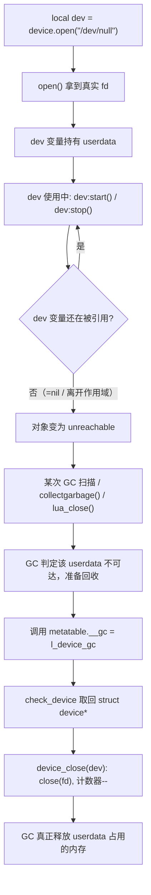

# 13. `__gc` 与 C Object 生命周期：Lua GC 到底管到哪一层

> 对应用户需求"第十四阶段：`__gc` 与 C Object 生命周期"。在 Chapter 12 的 `struct device`
> 基础上增量演进：加上 `__gc`，并用一个真实可观察的计数器证明它确实被触发、确实释放了 C 资源。

## 1. 直觉

Chapter 11-12 已经让 `struct device` 活在 Lua 变量里、能被调用方法，但一直有一个没解决的
问题：**这个 `dev` 变量不再被使用之后，那个用 `open()` 打开的真实文件描述符会怎样？**

答案是：**什么都不会自动发生**。Lua GC 只负责"这块 userdata 占用的内存最终会被释放"，
它完全不知道、也没有任何办法知道这块内存里藏着一个操作系统级别的 `fd`，更不知道这个 `fd`
需要调用 `close()` 才算真正释放。

**本章的核心观点，也是这一整章要反复强调的一句话：Lua GC 管理的是 Lua Object（这块内存本身），
不是自动理解你的 C resource（内存里藏着的 fd/socket/句柄……）。** 只有靠
`Lua GC + __gc + C destructor` 三者配合，才能让"C 资源的生死"跟上"Lua Object 的生死"。

## 2. Architecture

```text
Lua Object Created          <- local dev = device.open(...)
      |
      v
C Resource Acquired         <- open() 系统调用拿到真实 fd
      |
      v
Lua owns reference           <- dev 变量持有这个 userdata
      |
      v
Object becomes unreachable  <- dev = nil，或离开作用域，或没有任何变量再指向它
      |
      v
GC                          <- Lua GC 的某一轮扫描判定它不可达
      |
      v
__gc                         <- GC 在真正释放这块内存前，调用挂在 metatable 上的 __gc
      |
      v
C resource released         <- __gc 里调用 device_close()，真正 close(fd)
```

三个独立的"生死"要对齐，缺一个都会出问题：

```text
+------------------+     +------------------+     +------------------+
|   Lua GC          |     |   __gc            |     |  C destructor     |
|  决定"什么时候"     |     |  Lua 侧的钩子      |     |  真正释放资源      |
|  这块内存该被回收   |----►|  GC 触发时被调用   |----►|  close(fd) 等     |
+------------------+     +------------------+     +------------------+
```

## 3. 完整代码

完整源码见 `code/device_demo.c`；下面重点解释与 Chapter 12 不同的部分。

### 3.1 `device_close()`：真正的 C destructor

```c
static void device_close(struct device *dev)
{
    if (dev->fd >= 0) {
        close(dev->fd);
        dev->fd = -1;
        g_open_count--;
        printf("[device] closed: name=%s (open_count=%d)\n", dev->name, g_open_count);
    }
}
```

特意写成**普通 C 函数**（不是 `lua_CFunction`），因为"关闭一个 device"本身是纯 C 世界的
操作，跟"是不是由 GC 触发"完全无关——它只是恰好会被 `__gc` 调用。把 C destructor 和
"GC 触发入口"分开写，也是实际项目里常见的做法：destructor 可能还会被"用户主动调用
`dev:close()`"这条路径复用（本章没有开这个口子，但结构已经为它留好了）。

关闭后把 `dev->fd` 设成 `-1`，是为了防止重复关闭——如果同一个 `dev` 被 `__gc` 调用了两次
（正常情况下不会，但防御性编程的习惯），第二次会因为 `fd < 0` 而直接跳过，不会重复
`close()` 一个已经关闭的 fd（那是未定义行为）也不会重复扣减计数器。

### 3.2 `l_device_gc`：用户需求原文给出的实现

```c
static int l_device_gc(lua_State *L)
{
    struct device *dev = check_device(L, 1);
    device_close(dev);
    return 0;
}
```

签名和 `l_device_start` 等方法完全一样——`__gc` 本质上也是一个普通的 `lua_CFunction`，只是
调用它的不是 Lua 脚本里的一句 `dev:xxx()`，而是**Lua GC 内部**在判定某个 userdata 不可达后
自动发起的调用。第 1 个参数（`idx 1`）依然是这个即将被回收的 userdata 自己，所以
`check_device(L, 1)` 的写法不用变。

### 3.3 挂载 `__gc`

```c
lua_pushcfunction(L, l_device_gc);
lua_setfield(L, -2, "__gc"); /* mt.__gc = l_device_gc */
```

只多了这两行，其他挂载逻辑与 Chapter 12 完全一样。

### 3.4 `g_open_count`：让效果"看得见"

```c
static int g_open_count = 0;
```

`device.open()` 成功时 `g_open_count++`，`device_close()` 里 `g_open_count--` 并打印一行
`closed: ...`。这个计数器本身不是必需的机制，纯粹是为了让读者在终端输出里能实打实地
"看到" `__gc` 被触发、看到计数器真的归零——教学用的可观察性手段。

### 3.5 配套 Lua 脚本：三种触发 GC 的方式

```lua
do
    local dev = device.open("/dev/null")
    dev:start()
    dev:stop()
end
collectgarbage()

local dev2 = device.open("/dev/null")
dev2:start()
dev2 = nil
collectgarbage()

local dev3 = device.open("/dev/null")
dev3:start()
-- 不 collectgarbage，交给脚本结束后的 lua_close(L) 兜底
```

三段分别演示：`do...end` 作用域结束、显式 `= nil`、以及完全不管、靠宿主程序退出时的
`lua_close` 兜底——三种都会触发 `__gc`，只是触发的时机不同。

## 4. Stack Diagram

`__gc` 被调用时的 Stack，和普通方法调用一模一样：

```text
GC 判定 dev 不可达，准备回收它占用的内存之前：
+-----+----------------+
|  1  | userdata(dev)   |   <- GC 内部自己把这个即将被回收的 userdata Push 上去
+-----+----------------+

l_device_gc 内部：
    check_device(L, 1)  -- 正常校验、取回 struct device*
    device_close(dev)   -- 纯 C 调用，不碰 Stack

return 0  ->  栈顶 0 个值。GC 拿到这个"没有返回值"的约定后，
             继续执行真正的内存释放（把这块 userdata 占用的内存还给分配器）。
```

**关键点**：`__gc` 调用本身依然遵守"C Function 只通过 Stack 交换数据"这条铁律，唯一不同
的是**谁**发起了这次调用——不是 Lua 脚本里的 `CALL` 字节码，而是 GC 扫描到不可达对象后，
在内部主动安排的一次调用。对 C 侧代码而言，这次调用和普通方法调用没有任何区别。

## 5. Data Flow



数据流上唯一的"逆向"之处：正常方法调用是"Lua 脚本主动发起 -> C 侧响应"；`__gc` 是
"C/GC 内部主动发起 -> 我们写的 C 代码被动响应"，Lua 脚本本身在这一刻**什么都没做**——
这也是为什么很多人第一次接触 `__gc` 时会觉得它"神秘"：它的触发时机不由脚本逐行代码决定，
而是由 GC 的内部策略决定。

## 6. Lifecycle

完整的一个 `device` 生命周期，从出生到死亡：

```text
device.open(path)
    |
    +-- lua_newuserdata()      -- Lua GC 开始追踪这块内存（"出生"）
    +-- open() 系统调用          -- C Resource Acquired
    +-- lua_setmetatable()     -- 获得类型，包括 __gc 这个钩子
    |
    v
Lua owns reference             -- 某个变量（或 table 字段、upvalue……）指向它
    |
    v
dev:start() / dev:stop() ...   -- 正常使用阶段，可以反复调用任意次
    |
    v
最后一个引用消失                -- = nil / 离开作用域 / 所在 table 本身被回收……
    |
    v
Object becomes unreachable      -- 从 GC 的角度看，这个对象"死"了，但内存还没还回去
    |
    v
GC 的某一轮扫描（增量或 collectgarbage() 强制的完整一轮）
    |
    v
__gc 被调用                     -- 这是"C 资源释放"唯一保证会发生的时刻
    |
    v
C resource released             -- close(fd)，g_open_count--
    |
    v
userdata 占用的内存被真正释放     -- GC 完成回收（"死亡"完成）
```

**兜底机制**：即使脚本从头到尾一次 `collectgarbage()` 都没调用，只要宿主程序最终调用了
`lua_close(L)`，Lua 也会在关闭整个解释器之前，对所有还活着的对象触发一遍 `__gc`——这是
本章 `main()` 里 `lua_close(L)` 那一行真正在做的事，也是第 3 段示例（`dev3`）能被正确
关闭的原因。

## 7. Failure

### Failure 1：只有 Lua GC，没有 `__gc`（回到 Chapter 12 的状态）

如果不挂 `__gc`，`dev` 变量失效之后，Lua GC 依然会正常回收这块 userdata 占用的**内存**——
不会内存泄漏（Lua 侧）。但 `open()` 打开的那个 `fd` 永远不会被 `close()`：这是一种"Lua
看起来毫无问题，实际上在 C 侧、操作系统层面持续泄漏文件描述符"的隐蔽 bug，跑久了会撞上
`ulimit -n`（进程可打开的最大 fd 数），报出跟"Lua/C 交互"看起来毫不相关的"Too many open
files"错误，非常难联想到根因。

### Failure 2：在 `__gc` 里做了"太多"的事

`__gc` 是在 GC 内部特殊阶段被调用的，Lua 官方手册明确警告：`__gc` 里最好只做"释放资源"这
类简单、确定的事，避免在里面创建大量新对象、抛出未被捕获的错误、或者递归触发新一轮 GC——
这些都可能导致行为复杂化甚至崩溃。本章的 `l_device_gc` 严格遵守这条原则：只做一次
`check_device` + 一次 `device_close`，没有任何"额外动作"。

### Failure 3：以为 `dev = nil` 会"立刻"释放资源

本章第 2 段示例特意演示了这个误解：`dev2 = nil` 之后如果不手动 `collectgarbage()`，`__gc`
不会立刻执行——Lua 的增量 GC 可能过很久才真正扫到这个对象。如果代码逻辑依赖"资源必须在
某个精确时间点被释放"（比如一个文件锁必须在下一行代码执行前解开），**不能**依赖 `__gc`
的触发时机，必须显式提供一个可以主动调用的 `close()` 方法（本章没有实现，但这是真实项目
里几乎总会补上的接口）。

## 8. Debugging

- **怀疑 `__gc` 没被触发**：先确认脚本里是否真的调用了 `collectgarbage()`（或者程序是否
  正常走到了 `lua_close`）——Lua 的自动增量 GC 不保证"变量失效后马上收"。最直接的验证手段
  就是像本章一样加一个 `printf`/计数器。
- **`fd` 泄漏、`lsof`/`/proc/<pid>/fd` 里看到打开的文件描述符数量只增不减**：说明大概率是
  `__gc` 没挂上，或者挂上了但 `device_close` 里的 `close()` 调用条件写错了（比如判断条件
  永远为 false）。
- **`__gc` 里访问到已经被破坏的数据**：如果同一个 userdata 被错误地多次触发 `__gc`（正常
  流程不会，但一旦出现说明有更底层的 bug），本章用 `fd = -1` 之后的判断挡住了重复
  `close()`；如果你的场景里资源释放本身不是"幂等"的，务必学习这个模式。
- **在 `__gc` 里 `luaL_error` 抛出的错误看不到堆栈**：`__gc` 内部抛错的处理方式和普通调用
  不完全一样（部分 Lua 版本会把错误吞掉或打到一个特殊的错误处理器），排查时优先用
  `printf`/日志代替在 `__gc` 里抛错误。

## 9. Mental Model

```text
Lua GC   只管："这块 userdata 占用的内存最终要被回收"
__gc     只管："GC 真正回收之前，给 C 侧一个清理机会"
C destructor（如 device_close）  只管："把里面藏着的真实资源正确释放"

三者缺一：
    没有 __gc          -> Lua 内存不泄漏，但 C 资源永久泄漏
    __gc 里啥都不做      -> 等于没有 __gc
    C destructor 写错   -> __gc 按时触发了，但资源没有被正确释放（比如忘了置 -1 导致重复 close）

一句话：Lua GC 决定"何时"，__gc 决定"要不要清理"，C destructor 决定"怎么清理"——
三者配合才是完整的 C Object 生命周期管理。
```
