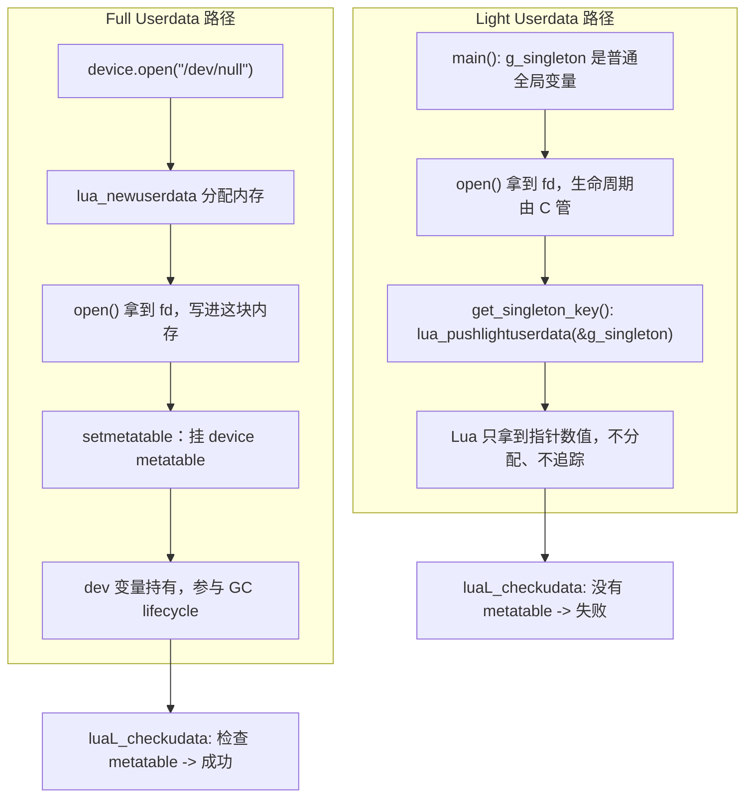

# 14. Light Userdata vs Full Userdata：两种"往 Lua 塞 C 指针"的方式

> 对应用户需求"第十五阶段：Light Userdata vs Full Userdata"。在 Chapter 13 的 `struct device`
> 基础上增量演进：额外引入一个"生命周期由 C 管理的全局单例"，用它对比
> `lua_pushlightuserdata()` 和 `lua_newuserdata()` 两条完全不同的路。

## 1. 直觉

Chapter 11-13 讲的 `device.open()` 每次都会真正**分配一块新内存**，这块内存的生死完全交给
Lua GC 决定，还能挂 Metatable、有 `__gc`——这是 **Full Userdata**。

但现实中还有另一种常见需求：**你手里已经有一个现成的 C 指针**（比如一个进程启动时就建好、
生命周期跨越整个程序运行期的全局单例），你只是想让 Lua 脚本能"拿到它、传来传去、认出它"，
但完全不想让 Lua 来决定它什么时候该被释放——这块内存本来就不该由 Lua 的 GC 插手。这种场景
用 **Light Userdata** 更合适：它只是把指针的**数值**本身塞进 Lua，不分配任何内存，
Lua 甚至不知道这个指针指向的东西有多大、是什么类型。

**一句话直觉**：Full Userdata 是"Lua 帮你造了一块内存并拿走所有权"；Light Userdata 是
"你自己已经有一个指针，只是借 Lua 的手把这个数值带来带去"。

## 2. Architecture

```text
                    Full Userdata                    Light Userdata
                    -------------                    --------------
分配者              Lua（lua_newuserdata）             无人分配，只是拷贝指针数值
                                                       （lua_pushlightuserdata）

Stack 上占的东西     一个指向"Lua 管理内存"的引用         裸指针数值本身

是否参与 GC          是（GC 追踪、可能触发 __gc）         否（GC 完全不知道它的存在）

能否挂 Metatable      能（luaL_setmetatable）             不能（没有地方挂）

luaL_checkudata      能用来做类型安全校验                  永远失败（没有 metatable 可比对）

相等性（==）          按"同一块内存"判等                    按"指针数值"判等——
                                                        不同 C 类型、只要地址数值相同就相等

典型场景             这块内存本来就该由 Lua 决定何时释放     指针的生命周期由别处（C 全局/单例/
                    （本章的 struct device）              静态变量）管理，Lua 只是拿到一把"钥匙"
                                                        （本章的 g_singleton）
```

本章新增的全局单例：

```text
g_singleton（struct device，静态全局变量）
      |
      |  生命周期：进程启动时在 main() 里初始化，进程退出前在 main() 里手动关闭
      |  完全不经过 lua_newuserdata，Lua GC 从不知道它的存在
      v
get_singleton_key() 把 &g_singleton 塞进 Lua
      |
      v
Lua 脚本拿到的只是"一个钥匙"（Light Userdata），
不拥有它，不能靠 collectgarbage() 让它消失
```

## 3. 完整代码

完整源码见 `code/device_demo.c`；下面重点解释与 Chapter 13 不同、本章新增的部分。

### 3.1 全局单例：生命周期不归 Lua 管

```c
static struct device g_singleton;

/* main() 里： */
g_singleton.fd = open("/dev/null", O_RDONLY);
strncpy(g_singleton.name, "singleton", sizeof(g_singleton.name) - 1);
```

它和 `device.open()` 创建出来的 `struct device` **类型完全一样**，唯一的区别是"谁分配、
谁决定何时释放"：`device.open()` 里那个是 `lua_newuserdata` 分配、Lua GC 决定生死；
`g_singleton` 是普通的 C 全局变量，跟 Lua 毫无关系——即使从来不启动 Lua 解释器，这个变量
依然存在、依然有效。

### 3.2 `get_singleton_key()` / `get_singleton_key_alias()`：Push 一个"钥匙"

```c
static int l_get_singleton_key(lua_State *L)
{
    lua_pushlightuserdata(L, &g_singleton);
    return 1;
}

static int l_get_singleton_key_alias(lua_State *L)
{
    lua_pushlightuserdata(L, &g_singleton.fd);
    return 1;
}
```

`lua_pushlightuserdata` 不分配任何内存，只是把参数里的指针**数值**存进 Stack 的这一格。
第二个函数故意取 `&g_singleton.fd`——因为 `fd` 是 `struct device` 的**第一个成员**，
在没有额外 padding 的前提下它的地址与 `&g_singleton` 数值相同，但 C 类型是 `int*`，跟
`&g_singleton` 的 `struct device*` 完全不是一回事。这正是用户需求里要求演示的：
**两个指向不同类型但数值相同的指针，在 Lua 看来是"相等"的 light userdata**——Lua 只存
指针数值本身，压根不知道也不关心原来的 C 类型是什么。运行结果证实了这一点：

```text
key1 == key2 (地址相同、C 类型不同) =	true
```

### 3.3 `use_singleton_key()`：把钥匙换回指针来用

```c
static int l_use_singleton_key(lua_State *L)
{
    luaL_checktype(L, 1, LUA_TLIGHTUSERDATA);
    struct device *dev = (struct device *)lua_touserdata(L, 1);

    printf("[singleton] name=%s fd=%d\n", dev->name, dev->fd);
    return 0;
}
```

`luaL_checktype(L, 1, LUA_TLIGHTUSERDATA)` 只能确认"这是一个 light userdata"这个大类，
**没有任何机制**能确认它到底指向什么类型——这是 Light Userdata 天生的限制：类型安全完全
靠"约定"（谁调用这个函数、传的是不是真的应该是 `struct device*` 的指针），而不是靠 API
本身强制。这与 Full Userdata 用 `luaL_checkudata` 能做到的"运行时类型校验"是本质区别。

### 3.4 `try_checkudata()`：证明 Light Userdata 无法通过 `luaL_checkudata`

```c
static int l_try_checkudata(lua_State *L)
{
    struct device *dev = check_device(L, 1); /* 内部就是 luaL_checkudata */
    printf("[try_checkudata] name=%s fd=%d\n", dev->name, dev->fd);
    return 0;
}
```

用同一个 `check_device`（内部是 `luaL_checkudata(L, idx, DEVICE_MT)`）分别喂给 Light
Userdata 和 Full Userdata，观察两种截然不同的结果——这是本章的核心验证点，在 §7 会详细看
实际输出。

## 4. Stack Diagram

`get_singleton_key()` 与 `device.open()` 的 Stack 变化，形状上"看起来一样"（都是 Push
1 个值），但内容的本质完全不同：

```text
device.open("/dev/null")：
+-----+------------------------------------------+
|  1  | userdata --> [Lua 分配的一块 sizeof(struct device) 内存]  |
+-----+------------------------------------------+
       这一格存的是"对一块 GC 管理内存的引用"

get_singleton_key()：
+-----+------------------------------------------+
|  1  | lightuserdata = 0x55f3a8b2c040（就是 &g_singleton 的数值）  |
+-----+------------------------------------------+
       这一格直接存了指针数值本身，没有任何"指向 Lua 内存"的中间层
```

`try_checkudata(key1)` 与 `try_checkudata(dev)` 对比：

```text
try_checkudata(key1)   Stack: [ lightuserdata ]
    luaL_checkudata(L, 1, "device")
        第一步："idx 1 是 userdata 吗？" —— lua_type 返回 LUA_TLIGHTUSERDATA，不是 LUA_TUSERDATA
        —— 检查在这一步就已经失败，luaL_error 直接抛出

try_checkudata(dev)     Stack: [ userdata(full) ]
    luaL_checkudata(L, 1, "device")
        第一步："idx 1 是 userdata 吗？" —— 是（LUA_TUSERDATA）
        第二步："它的 metatable 是 Registry[&quot;device&quot;] 吗？" —— 是
        —— 两步都通过，返回裸内存地址
```

## 5. Data Flow



两条路径唯一共同点是"都能在 Lua 脚本里被当作一个值传递、比较、当参数传给别的函数"；
除此之外，从内存管理到类型安全到相等性语义，全部不同。

## 6. Lifecycle

```text
Full Userdata（dev）:
    device.open() 分配         -- 出生，归 Lua GC 管
    dev 变量持有 / 使用
    最后引用消失
    GC / collectgarbage() / lua_close()
    __gc 触发 -> device_close() -> 真正 close(fd)
    -- 全流程与 Chapter 13 完全一致

Light Userdata（key1 / key2，指向 g_singleton）:
    main() 里 g_singleton 初始化 -- 出生，归 main() 自己管，跟 Lua 无关
    get_singleton_key() 把地址数值"借"给 Lua
    Lua 脚本里 key1/key2 可以被传递、比较、当参数
    dev = nil; collectgarbage()  -- 对 key1/key2 完全没有任何影响：
                                      它们不是 Lua 分配的，GC 根本不认识它们
    -- 本章最后，main() 在 lua_close() 之后手动 close(g_singleton.fd)
    -- 这一步与任何 Lua GC 活动都无关，是纯 C 世界的清理
```

运行结果里最后两行清楚地展示了这个对比：

```text
[device] closed: name=/dev/null (open_count=0)   <- Full Userdata 的 __gc 被触发
[main] singleton closed manually (not via Lua GC) <- Light Userdata 指向的资源要手动关
```

## 7. Failure

### Failure 1：对 Light Userdata 调用 `luaL_checkudata`（本章脚本已实际触发）

```text
try_checkudata(key1) ok  =	false
try_checkudata(key1) err =	bad argument #1 to 'try_checkudata' (device expected, got light userdata)
```

即使 `key1` 数值上精确等于一个真实、当前有效的 `struct device*` 地址，`luaL_checkudata`
依然会失败——因为它检查的第一件事是"这是不是（Full）Userdata 并带有匹配的 metatable"，
Light Userdata 在类型系统的这一层直接不是同一种东西，无论指针数值是否"看起来合理"。

### Failure 2：误以为两个 Light Userdata 相等就意味着"类型也相同"

本章 `key1`（`struct device*`）和 `key2`（`int*`，取自 `fd` 字段地址）数值相同、
`key1 == key2` 为 `true`，但它们在 C 侧代表完全不同的语义（一个是整个 struct 的起始地址，
一个是它第一个字段的地址）。如果脚本逻辑写成"因为 `key1 == key2`，所以它们可以互换使用"，
在这个例子里因为 `fd` 恰好是第一个成员而"凑巧不会出错"；但只要换一个不是第一个成员的字段，
或者结构体有 padding，这种"凑巧相等"的假设立刻会导致解引用出错误的内存位置。
**Light Userdata 的相等性只能证明"数值相同"，不能证明"语义相同"**，这是它相比 Full
Userdata 缺失类型安全的直接后果。

### Failure 3：试图给 Light Userdata 挂 Metatable

Lua C API 里没有任何函数能给一个 Light Userdata 关联 Metatable——`lua_setmetatable`
要求 Stack 上目标位置的值必须是 table 或者 Full Userdata。如果代码里对一个刚
`lua_pushlightuserdata` 出来的值调用 `lua_setmetatable`，实际效果是：**这次调用直接是
无意义的**（Lua 手册规定除 table/userdata 外的其它类型调用 `lua_setmetatable` 会被
忽略，具体行为以所用 Lua 版本文档为准）；无论如何，都得不到一个"带类型标记的 Light
Userdata"——如果确实需要类型标记，说明这个场景本来就该用 Full Userdata，不该用 Light
Userdata。

## 8. Debugging

- **`bad argument ... (device expected, got light userdata)`**：看到这个错误，第一反应
  不是"我的 metatable 挂错了"，而是"这个参数从一开始就是 Light Userdata，根本不该走
  `luaL_checkudata` 这条路"——回去检查这个值最初是从 `lua_pushlightuserdata` 还是
  `lua_newuserdata` Push 出来的。
- **两个看起来毫不相关的值 `==` 竟然是 `true`**：如果两边都是 `userdata` 类型，先用
  `lua_islightuserdata`（C 侧）或者观察 Lua 侧 `tostring()` 打印格式，区分是不是
  Light Userdata——Light Userdata 的相等性是纯地址比较，很容易在"凑巧地址相同"的场景下
  制造出误导性的 `true`。
- **拿到一个 userdata，不确定它是 Light 还是 Full**：C 侧用 `lua_islightuserdata(L, idx)`
  直接判断；Lua 侧没有内建函数区分两者（`type()` 对两者都返回 `"userdata"`），只能通过
  "这个值是从哪个 API 拿到的"这种上下文信息判断，或者尝试 `getmetatable()`——Full
  Userdata 如果挂了 metatable，`getmetatable(ud)` 会返回那张表；Light Userdata 永远
  返回 `nil`。
- **怀疑单例的 `fd` 被 Lua GC 意外关闭**：不可能发生——`g_singleton` 从未经过
  `lua_newuserdata`，Lua GC 的对象图里根本没有它的存在，`collectgarbage()` 无论跑多少
  次都不会碰到它。如果单例真的被意外关闭，问题一定在 C 侧代码本身（比如某处手动调用了
  `close(g_singleton.fd)` 两次）。

## 9. Mental Model

```text
Full Userdata = Lua 分配、Lua 拥有、参与 GC、能挂 Metatable、能类型安全校验
Light Userdata = 只是一个 C 指针数值、Lua 不分配、不拥有、不参与 GC、无法挂 Metatable

选择依据只有一个问题："这块内存的生死，应该由 Lua 的 GC 决定，还是由别的地方决定？"
    由 Lua GC 决定  -> Full Userdata（本章前面的 struct device）
    由别处决定      -> Light Userdata（本章的 g_singleton，只给 Lua 一把"钥匙"）

Light Userdata 的相等性只看指针数值，不看原来的 C 类型——
这既是它"轻量"的来源，也是它"没有类型安全"的根本原因。
```
