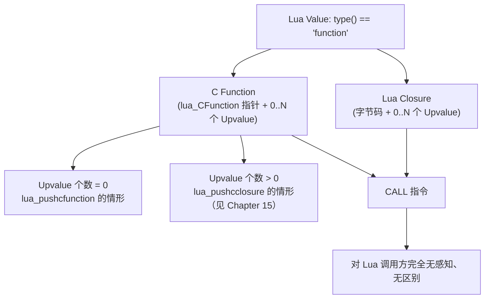

# 16. C 创建 Lua Function：C Function 如何变成 Lua 眼中的普通函数值

> 对应用户需求 第十七阶段。前面几章 C Function 都是通过 `lua_register` 提前挂在全局变量上；本章要看清楚：C Function 到底是怎么"变成"一个 Lua 里能被 `type()` 认成 `"function"`、能被赋值/传递/调用的普通值的。

## 16.1 直觉

在 Lua 脚本里写：

```lua
local f = get_hello_function()
f()
```

`f` 看起来跟下面这行完全一样：

```lua
local f = function() print("hi") end
f()
```

但 `get_hello_function()` 背后返回的其实是一段 C 代码的入口地址（包在 `lua_CFunction` 里）。**Lua 语言层面根本不区分"函数背后是字节码还是 C 代码"**——`function` 这个 Value 类型统一对外表现为"可以被 CALL 的东西"，具体它是哪种实现，对调用方是完全透明、也完全不需要关心的细节。本章要做的，就是亲手把一个 C Function push 成这样一个"看起来毫无区别"的函数值。

## 16.2 Architecture

```text
C Function（一段编译好的机器码，签名 int (*)(lua_State*)）
     |
     | lua_pushcfunction(L, l_hello)
     v
Lua Stack（栈顶多了一个"函数值"）
     |
     | return 1;  （C 函数 get_hello_function 把它交还给调用方）
     v
Lua 变量 f 持有这个函数值
     |
     | f()   -- 普通 CALL 语法
     v
Lua VM 的 CALL 指令
     |
     +-- 如果函数值指向字节码 Closure -> VM 跳进去执行字节码
     +-- 如果函数值指向 lua_CFunction -> VM 跳到这段机器码执行
             （两条路径对 CALL 指令来说只是"跳转目标不同"，
              没有任何语义上的分支判断需要 Lua 脚本自己关心）
```

Lua 的 Value 模型里，"函数"这个 tag 底下实际有两种具体表示：



`lua_pushcfunction(L, f)` 就是 `lua_pushcclosure(L, f, 0)` 的宏展开（可以在 `lua.h` 里确认），本章的 `l_hello` 恰好是 0 个 Upvalue 的最简单情形——所以它既是本章的主角，也是 Chapter 15 C Closure 的"退化特例"。

## 16.3 完整代码

C 侧：一个普通 C Function `l_hello`，以及负责把它 push 出去的 `get_hello_function`：

```1:43:/home/morrism/code_extra/wireshark-plugins/lua-c-interop-guide/chapters/16-c-creates-lua-function/code/hello_demo.c
#include <stdio.h>
#include <lua.h>
#include <lauxlib.h>
#include <lualib.h>

/*
 * l_hello: 一个普通的 C Function（0 个 Upvalue）。
 * 它本身不会被 lua_register 成全局变量，
 * 而是由 get_hello_function 动态 push 出来，
 * 交给 Lua 侧当一个普通的函数值使用。
 */
static int l_hello(lua_State *L) {
    (void)L;
    printf("[C] l_hello: hello from C!\n");
    return 0;
}

/*
 * get_hello_function: 唯一暴露给 Lua 的入口。
 * 它的返回值不是一个"结果数据"，而是一个"函数值"本身——
 * 这个函数值背后指向的是一段 C 代码（l_hello），
 * 但对 Lua 调用方来说，它跟任何一个普通 Lua Function 长得一样。
 */
static int l_get_hello_function(lua_State *L) {
    lua_pushcfunction(L, l_hello);
    return 1;
}

int main(void) {
    lua_State *L = luaL_newstate();
    luaL_openlibs(L);

    lua_register(L, "get_hello_function", l_get_hello_function);

    if (luaL_dofile(L, "hello_demo.lua") != LUA_OK) {
        fprintf(stderr, "lua error: %s\n", lua_tostring(L, -1));
        lua_close(L);
        return 1;
    }

    lua_close(L);
    return 0;
}
```

Lua 侧：拿到这个函数值后当普通函数用，并与一个真正的 Lua Function 对照：

```1:20:/home/morrism/code_extra/wireshark-plugins/lua-c-interop-guide/chapters/16-c-creates-lua-function/code/hello_demo.lua
-- get_hello_function() 从 C 侧拿回一个"函数值"，
-- 它背后是 lua_pushcfunction 包出来的 C Function，
-- 但 Lua 侧完全无法（也不需要）区分它和一个普通 Lua Function。

local f = get_hello_function()

local function lua_hello()
    print("[Lua] lua_hello: hello from Lua!")
end

print("type(f) =", type(f))
print("type(lua_hello) =", type(lua_hello))

-- 两者都用同一个 CALL 语法调用，Lua 侧写法上没有任何区别
f()
lua_hello()

-- f 也可以像任何 Lua Function 一样被继续传递、赋值
local g = f
g()
```

Makefile：

```1:6:/home/morrism/code_extra/wireshark-plugins/lua-c-interop-guide/chapters/16-c-creates-lua-function/code/Makefile
GUIDE_ROOT := $(abspath ../../..)
include $(GUIDE_ROOT)/Makefile.common

TARGET := hello_demo
SRCS := hello_demo.c

include $(GUIDE_ROOT)/Makefile.rules
```

`make run` 实际输出：

```text
$ make run
./hello_demo
type(f) =	function
type(lua_hello) =	function
[C] l_hello: hello from C!
[Lua] lua_hello: hello from Lua!
[C] l_hello: hello from C!
```

对照解读：`type(f)` 和 `type(lua_hello)` 都是 `"function"`——Lua 语言层面完全看不出 `f` 背后是 C 代码；`f()` 触发的是 C 侧的 `printf`（第 3 行输出），`g = f; g()` 之后再调用一次同样触发 C 侧输出（第 5 行）——证明 `f` 被当作普通函数值赋值、传递、调用，行为跟 Lua Function 毫无差别。

## 16.4 Stack Diagram

```text
调用 get_hello_function() 时，Stack 上没有 Argument

Step 1: lua_pushcfunction(L, l_hello)
   等价于 lua_pushcclosure(L, l_hello, 0) —— 打包 0 个 Upvalue
+------------------------+
|  <l_hello 的函数值>      |  <- 栈顶
|  (lua_CFunction 指针,   |
|   0 个 Upvalue)         |
+------------------------+

return 1;   -- 栈顶 1 个值（这个函数值）就是 get_hello_function 的返回值
```

```text
Lua 侧接收：
  local f = get_hello_function()
       |
       v
  f 是一个局部变量，持有刚才那个函数值（Lua Object 的"句柄"，
  跟持有一个 Table/Closure 完全一样的存储方式）

调用 f() 时，Lua VM 的 CALL 指令：
+------------------+        +------------------+
|  Before：         |        |  After（f 是 C     |
|  f (函数值)        |  CALL  |  Function 情形）：  |
+------------------+  --->  |  C 函数执行完，    |
                             |  return 0，        |
                             |  Stack 上没有留下   |
                             |  返回值             |
                             +------------------+
```

**关键点**：从 Lua 脚本的视角，`f()` 这一行代码，不管 `f` 背后是字节码还是 C 代码，写法、语义、Stack 上"参数进/返回值出"的规则完全一致——差异只发生在 VM 内部"CALL 之后跳到哪"这一步，Lua 脚本从来看不到、也不需要看到这一步。

## 16.5 Data Flow

```text
get_hello_function() 被调用（Lua -> C）
       |
       v
  C 侧执行 lua_pushcfunction(L, l_hello)
       |
       v
  Stack 顶部出现一个"函数值"，return 1 交还给 Lua
       |
       v
  Lua 变量 f 持有这个函数值（C -> Lua 的第一段数据流：函数本身作为返回值传递）
       |
       | f()（Lua -> C，第二段数据流：真正触发 l_hello 执行）
       v
  VM CALL 指令识别出这是 lua_CFunction，跳转执行 l_hello 的机器码
       |
       v
  l_hello 内部 printf，不 push 任何返回值，return 0
       |
       v
  控制权交还 Lua VM，继续执行后面的字节码
```

注意这里出现了两次独立的"跨界"：第一次是**函数值本身**作为数据穿过 Stack（从 C 传到 Lua，被变量持有）；第二次是**调用行为**穿过 Stack（从 Lua 触发，跳进 C 代码执行）。这两次跨界用的是同一条 Lua C API 通道，但发生的时间点完全不同——理解这个区分，是理解"回调"概念（Chapter 09-10、17）的前提。

## 16.6 Lifecycle

```text
lua_pushcfunction(L, l_hello)
       |  VM 生产一个"函数值"，指向 l_hello 这段机器码地址，
       |  0 个 Upvalue（没有额外分配 Closure 存储）
       v
get_hello_function 返回后，这个函数值被 f 持有
       |
       |  只要 f 在作用域内可达，这个函数值就"存活"
       |  （其实机器码地址本身不需要 GC 管理，
       |   但"函数值"这个包装对象仍然遵循 Lua 的 GC 规则）
       v
f() / g() 反复调用
       |  每次调用都是一次全新的 CALL，跟函数值本身的生命周期无关
       v
f、g 都不再被引用
       |
       v
GC 回收这个函数值对象（l_hello 本身是普通 C 代码，
                       并不会被"释放"，只是这层 Lua 包装被回收）
```

## 16.7 Failure

**1. 把 `lua_pushcfunction` 和"直接把 C 函数指针塞进 Lua Table/Userdata"搞混**

```c
/* 错误：C 函数指针不是 Lua Value，不能直接当 lua_pushlightuserdata 的等价物混用 */
lua_pushlightuserdata(L, (void *)l_hello);   /* 这样 push 出来的是 Light Userdata，
                                                 Lua 侧 type() 会得到 "userdata"，
                                                 f() 调用会直接报错："attempt to call a userdata value" */
```

必须用 `lua_pushcfunction`（或 `lua_pushcclosure`），才能让 Lua 的 CALL 指令认出这是"可调用对象"。

**2. C Function 签名不是 `int (*)(lua_State *)`**

```c
static void l_hello(void) { printf("hi\n"); }   /* 签名不对 */
...
lua_pushcfunction(L, l_hello);   /* 编译器会报类型不匹配的警告/错误 */
```

`lua_CFunction` 的类型是固定的 `int (*)(lua_State *L)`，这是 VM 唯一认识的"外部函数"形态（详见 Chapter 00）。即使强行用类型转换绕过编译器警告，运行时 VM 按这个签名去调用，会用错误的方式访问参数/返回值，直接崩溃。

**3. 误以为需要先 `lua_register` 才能把函数交出去**

`lua_register(L, name, f)` 只是"把函数值 push 到 Stack，再 `lua_setglobal` 存成一个全局变量"的简写，它不是产生"可调用函数值"的必要步骤。本章的 `l_hello` 全程没有出现在任何全局变量里，纯粹通过 `get_hello_function` 的返回值被传递出去——这才是本章想强调的：**函数值的产生（`lua_pushcfunction`）和函数值的存放位置（全局变量 / 局部变量 / Table 字段 / 函数返回值）是两件独立的事**。

## 16.8 Debugging

- `f()` 报 `attempt to call a X value`（X 不是 `function`）：说明 C 侧根本没有用 `lua_push{cfunction,cclosure}` 把它 push 成函数值，检查是不是误用了 `lua_pushlightuserdata`/`lua_pushinteger` 之类的函数。
- 编译期出现 `-Wincompatible-pointer-types` 之类的警告：`lua_CFunction` 签名写错了，回去对照 `int (*)(lua_State *L)`，不要强转掩盖。
- 怀疑"C 生成的函数值"和"Lua 生成的函数值"行为不一致：先用 `type()` 确认两者都是 `"function"`；如果调用行为确实不同（比如报错信息不同），大概率问题出在函数体内部的逻辑（比如 C 侧忘了处理某个 Argument 类型），而不是"函数值本身"这一层。

## 16.9 Mental Model

```text
Lua 的 "function" 这个 Value 类型，底下有两种具体实现：

    字节码 Closure          lua_CFunction 指针（+ 0..N 个 Upvalue）
         |                          |
         +------------ CALL --------+
                        |
                        v
              对调用方完全无感知、无区别

lua_pushcfunction(L, f)  ==  lua_pushcclosure(L, f, 0)
    —— 0 个 Upvalue 时的特例，是本章的核心动作

C 创造出的"函数值"，一旦 push 到 Stack 上被 Lua 变量接住，
就是一个普普通通的 Lua Object，可以被赋值、传递、当参数、当返回值——
和任何用 function() ... end 写出来的函数没有本质区别。
```
