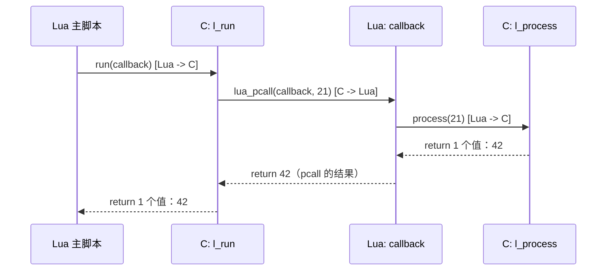

# 17. 双向调用：Lua 调 C，C 又调回 Lua，Lua 再调 C

> 对应用户需求 第十八阶段。这是 Chapter 15-16 之后的收束：把"C 创建 Lua Function"（本质是拿到一个可调用值）和"C 长期/临时持有 Lua Function 并反过来调用它"（`lua_pcall`）拼在一起，走一条完整的双向调用链。

## 17.1 直觉

前面所有章节讲的调用方向都是单一的：Chapter 01 是 Lua -> C；Chapter 04 是 C -> Lua。真实世界的 Lua/C 交互几乎从不是单向的——一个典型例子就是"注册回调"：

```lua
run(function(value)
    return process(value)
end)
```

`run` 是 C 函数，它接收一个 Lua 函数作为参数，在自己内部反过来调用这个 Lua 函数；而这个 Lua 函数**又调用了另一个 C 函数** `process`。整条链路是：

```text
Lua 主脚本 -> C(run) -> Lua(callback) -> C(process) -> 逐层返回
```

这不是"FFI 单向调用某个库函数"，而是一个**双向调用系统**：Lua 和 C 互相是对方的"调用方"，也互相是对方的"被调用方"，Lua Stack 在每一次穿越边界时都被重新使用。本章的目标：把这条链路上每一层的 Stack 状态都画出来，让"双向"这两个字不再抽象。

## 17.2 Architecture

```text
Lua
 | run(callback)
 v
C (l_run)
 | lua_pushvalue(callback) + lua_pushinteger(arg) + lua_pcall
 v
Lua (callback 函数体)
 | process(value)
 v
C (l_process)
 | lua_pushinteger(result)，return 1
 v
Lua (callback 函数体，接收 process 的返回值)
 | return result   -- 交还给 l_run 的 lua_pcall
 v
C (l_run)
 | 读取 pcall 结果，return 1
 v
Lua (主脚本，final = run(...) 拿到最终结果)
```

关键点：`callback` 这个 Lua Function 是`l_run` 调用期间的**临时值**——它以 Argument 的身份出现在 Stack index 1，`l_run` 从头到尾都没有离开过这一次 C 函数调用，所以直接用 `lua_pushvalue(L, 1)` 引用它是完全安全的。

**这和 Chapter 09 的对照**：Chapter 09 里 C 侧要把一个 Lua Function 存起来，等到*将来某个不确定的时刻*（比如网络事件到达）才调用它——那时候当初的 C 函数调用早已 `return` 结束，Stack index 早就失效，必须用 `luaL_ref(L, LUA_REGISTRYINDEX)` 把它挪到 Registry 里长期占位。本章的 `l_run` 恰恰是**不需要**这么做的对照案例：回调"即用即走"，全程活在同一次 C 函数调用的生命周期内，Stack index 这个"本次调用内的临时坐标"足够用了。

一句话区分两者：

```text
      本次 C 函数调用内直接用完   --->  Stack index 就够（本章 l_run）
      要跨越"这次调用结束"之后才用 --->  必须 luaL_ref 存进 Registry（Chapter 09）
```

## 17.3 完整代码

C 侧：两个 C Function，`l_process` 是被回调反过来调用的一方，`l_run` 是发起回调调用的一方：

```1:65:/home/morrism/code_extra/wireshark-plugins/lua-c-interop-guide/chapters/17-bidirectional-calls/code/bidir_demo.c
#include <stdio.h>
#include <lua.h>
#include <lauxlib.h>
#include <lualib.h>

/*
 * l_process: 第二个 C Function，会被 Lua 回调在执行期间反过来调用。
 * 它自己不知道、也不关心是谁调用了它——它只认 Stack。
 */
static int l_process(lua_State *L) {
    lua_Integer value = luaL_checkinteger(L, 1);
    printf("[C]   l_process: received %lld from Lua callback\n", (long long)value);
    lua_pushinteger(L, value * 2);
    return 1;
}

/*
 * l_run: 接收一个 Lua Function 作为唯一 Argument。
 *
 * 注意：这个 Lua Function 只在本次 l_run 调用内部被使用（拿来 lua_pcall），
 * 全程没有离开这次 C 函数调用，所以用 Stack index 1 直接引用它是安全的——
 * 不需要像 Chapter 09 那样把它存进 Registry（Registry 只在“需要跨调用长期
 * 持有 Lua Function”时才是必须的，例如事件回调要在很久之后才被触发）。
 */
static int l_run(lua_State *L) {
    luaL_checktype(L, 1, LUA_TFUNCTION);  /* Stack index 1：调用方传进来的回调 */

    printf("[C]   l_run: about to call the Lua callback\n");

    lua_pushvalue(L, 1);       /* 把回调复制一份到栈顶，准备当函数调用 */
    lua_pushinteger(L, 21);    /* 传给回调的参数 */

    /* lua_pcall(L, nargs, nresults, msgh):
     *   从栈顶往下数 1 个 Argument + 再往下数 1 个函数值，一起弹出，
     *   调用这个函数，调用完成后把 1 个返回值重新 push 回 Stack。
     */
    if (lua_pcall(L, 1, 1, 0) != LUA_OK) {
        /* 保护调用失败：栈顶此刻是 Lua Error 对象，继续向上传播 */
        return lua_error(L);
    }

    lua_Integer result = luaL_checkinteger(L, -1);
    printf("[C]   l_run: callback returned %lld\n", (long long)result);

    lua_pop(L, 1);              /* 用完就弹掉，保持 Stack Contract 干净 */
    lua_pushinteger(L, result); /* 作为 l_run 自己的返回值重新 push 一次 */
    return 1;
}

int main(void) {
    lua_State *L = luaL_newstate();
    luaL_openlibs(L);

    lua_register(L, "run", l_run);
    lua_register(L, "process", l_process);

    if (luaL_dofile(L, "bidir_demo.lua") != LUA_OK) {
        fprintf(stderr, "lua error: %s\n", lua_tostring(L, -1));
        lua_close(L);
        return 1;
    }

    lua_close(L);
    return 0;
}
```

Lua 侧：回调函数体内部又调用了另一个 C 函数，形成闭环：

```1:14:/home/morrism/code_extra/wireshark-plugins/lua-c-interop-guide/chapters/17-bidirectional-calls/code/bidir_demo.lua
-- 完整的双向调用链：
--   Lua 调用 run(callback)
--     -> C  l_run 内部用 lua_pcall 调用这个 Lua callback
--       -> Lua callback 内部又调用了 C 的 process()
--         -> C  l_process 计算结果，返回给 callback
--       <- callback 把 process() 的结果原样返回
--     <- l_run 读到返回值，打印，再返回给最外层 Lua

local final = run(function(value)
    print("[Lua] callback: got", value, "from C, now calling process()")
    return process(value)
end)

print("[Lua] final result =", final)
```

Makefile：

```1:6:/home/morrism/code_extra/wireshark-plugins/lua-c-interop-guide/chapters/17-bidirectional-calls/code/Makefile
GUIDE_ROOT := $(abspath ../../..)
include $(GUIDE_ROOT)/Makefile.common

TARGET := bidir_demo
SRCS := bidir_demo.c

include $(GUIDE_ROOT)/Makefile.rules
```

`make run` 实际输出：

```text
$ make run
./bidir_demo
[C]   l_run: about to call the Lua callback
[Lua] callback: got	21	from C, now calling process()
[C]   l_process: received 21 from Lua callback
[C]   l_run: callback returned 42
[Lua] final result =	42
```

输出顺序完整对应设计的调用链：`l_run` 打印 -> 回调打印（收到 21）-> `l_process` 打印（收到 21）-> `l_run` 打印（收到 42）-> 主脚本打印最终结果 42（= 21 * 2，经过 `process` 翻倍）。

## 17.4 Stack Diagram（完整 Stack 生命周期）

**重要前提**：Lua Stack 是 `lua_State` 内部**一整段共享的数组**，但每一层函数调用（不管是 Lua Function 还是 C Function）都有自己的"Stack Base"，`lua_gettop`/`index 1` 永远是**相对当前这一层调用**的坐标，不是绝对物理位置。下面每个 Step 里的 Stack 图，画的都是"当前这一层调用能看到的那一段"。

### Step 0：Lua 主脚本，尚未调用 run

```text
+--------------------+
| （主脚本层，Stack   |
|  上暂存着 run 函数   |
|  值 + 匿名回调函数值 |
|  两个 Argument，即  |
|  将触发 CALL）       |
+--------------------+
```

### Step 1：进入 l_run（Lua -> C，第一次跨界）

```text
l_run 自己视角的 Stack（index 1 = 传进来的回调）：
+-----------------------+
| 1: <callback 函数值>   |
+-----------------------+
```

### Step 2：l_run 内部，pushvalue + pushinteger，pcall 前

```text
+-----------------------+
| 1: <callback 函数值>   |   <- 原始 Argument，保留不动
| 2: <callback 函数值>   |   <- lua_pushvalue(L, 1) 复制的一份，即将被当函数调用
| 3: 21                  |   <- lua_pushinteger(L, 21)，callback 的 Argument
+-----------------------+
                 ^
         lua_pcall(L, 1, 1, 0) 即将把 [2]、[3] 一起弹出并调用
```

### Step 3：进入 Lua callback（C -> Lua，第二次跨界）

```text
callback 自己视角的 Stack（这是一次全新的调用帧，index 1 = value）：
+-----------------------+
| 1: 21                  |   <- value 参数
+-----------------------+

callback 函数体执行 print(...)，然后执行 return process(value)
   -> 触发对全局函数 process 的 CALL
```

### Step 4：callback 内部，即将调用 process（Lua -> C，第三次跨界）

```text
callback 自己视角的 Stack，在构造 process(value) 调用之前：
+-----------------------+
| 1: 21                  |   <- 自己的参数 value（未变）
| 2: <process 函数值>     |   <- CALL 指令自动 push 的被调函数
| 3: 21                  |   <- value 作为 process 的 Argument
+-----------------------+
```

### Step 5：进入 l_process

```text
l_process 自己视角的 Stack（index 1 = 传进来的 21）：
+-----------------------+
| 1: 21                  |
+-----------------------+

lua_pushinteger(L, 42):
+-----------------------+
| 1: 21                  |
| 2: 42                  |   <- 栈顶，即将作为返回值
+-----------------------+

return 1;   -- 告诉 VM：栈顶 1 个值（42）是 l_process 的返回值
```

### Step 6：控制权回到 callback，process(value) 的 CALL 结束

```text
CALL 指令把 Step 4 图里的 [2]（函数）、[3]（Argument）替换成 1 个结果：
+-----------------------+
| 1: 21                  |   <- 自己的参数 value（未变）
| 2: 42                  |   <- process(value) 的返回值
+-----------------------+

callback 执行 return 42（也就是 return process(value)）
   -- 告诉 VM：这次 callback 调用的返回值是 42
```

### Step 7：控制权回到 l_run，lua_pcall 返回

```text
回到 Step 2 那张图的视角：pcall 把 [2]（函数）、[3]（Argument=21）
连同调用过程整体替换成 1 个结果：
+-----------------------+
| 1: <callback 函数值>   |   <- 原始 Argument，仍然保留
| 2: 42                  |   <- lua_pcall 留下的返回值
+-----------------------+

lua_Integer result = luaL_checkinteger(L, -1);   -- result = 42
lua_pop(L, 1);
+-----------------------+
| 1: <callback 函数值>   |
+-----------------------+

lua_pushinteger(L, result);
+-----------------------+
| 1: <callback 函数值>   |
| 2: 42                  |
+-----------------------+

return 1;   -- 告诉 VM：栈顶 1 个值（42）是 l_run 的返回值
```

### Step 8：控制权回到 Lua 主脚本，run(...) 的 CALL 结束

```text
+--------------------+
| local final = 42    |   <- final 拿到 l_run 的返回值
+--------------------+
```

### 用 Mermaid 串起整条调用链（时序视角）



## 17.5 Data Flow

```text
21（l_run 里的字面量）
   | lua_pushinteger + lua_pcall
   v
callback 的参数 value = 21
   | Lua 表达式 process(value)
   v
l_process 的参数 = 21
   | value * 2
   v
l_process 的返回值 = 42
   | VM 把它当作 process(value) 表达式的结果
   v
callback 的返回值 = 42（return process(value)）
   | lua_pcall 把它留在 l_run 的 Stack 上
   v
l_run 读到 result = 42，再 push 一次
   | return 1
   v
Lua 主脚本 final = 42
```

数据本身（`21` -> `42`）在这条链路上只经历了两次真正的“计算”（`l_process` 的乘 2），中间所有传递都只是 Stack 上的值被搬运、复制、当作 Argument/Return Value 交接——这正是"Lua Stack 是唯一数据交换通道"这句话在双向调用场景下的体现：无论调用方向如何反复切换，值永远通过同一套 Push/Pcall/Return 机制流动。

## 17.6 Lifecycle

```text
main() 里 lua_register("run", l_run) / lua_register("process", l_process)
       |  两个 C Function 作为全局变量注册，生命周期等于整个 lua_State
       v
luaL_dofile 开始执行 bidir_demo.lua
       |
       v
run(function(value) ... end) 被求值
       |  匿名函数在这一行被创建（一个 Lua Closure，捕获了外层的 process 全局函数，
       |  其实是通过 _ENV Upvalue 访问，不是本章重点）
       v
进入 l_run：这个匿名函数值以 Argument 身份出现在 l_run 的 Stack index 1
       |  它的生命周期完全嵌套在 l_run 这一次调用之内
       v
lua_pcall 触发对它的调用 -> 它的函数体开始执行 -> 调用 process -> 返回
       |
       v
l_run 返回，这次调用结束
       |  此刻这个匿名函数值如果没有被任何变量继续持有，
       |  就变成不可达对象，等待下一次 GC 被回收
       v
Lua 主脚本继续执行，final 持有的只是一个整数 42（值类型，不受 GC 管理）
```

这条 Lifecycle 清楚地对照出本章和 Chapter 09 的分界线：**回调函数值的"存活时间"如果被设计成只需要覆盖"一次 C 函数调用"，Stack index 就是足够且更轻量的方案；一旦需要覆盖到"某次调用结束之后"，就必须转向 Registry。**

## 17.7 Failure

**1. 把 `lua_pushvalue(L, 1)` 误写成直接对 index 1 调用**

```c
/* 错误：lua_pcall 需要的是"函数值在栈顶、Argument 在函数值之上"，
   不能直接对 index 1（原始 Argument 所在位置）调用，
   那样会打乱后续代码对 index 1 的引用 */
lua_pushinteger(L, 21);
if (lua_pcall(L, 1, 1, 0) != LUA_OK) { ... }   /* 此时栈顶下面那个"函数"其实是 21 之前的东西，
                                                    不是 callback，会报 "attempt to call a
                                                    number value" 或更隐蔽的错乱 */
```

必须先 `lua_pushvalue(L, 1)` 把函数值复制到栈顶，再 push Argument，让 `lua_pcall` 能按"函数在下、Argument 在上"的顺序正确弹出。

**2. `lua_pcall` 的返回值检查被省略，Lua Error 直接被吞掉或造成 Stack 错乱**

```c
lua_pcall(L, 1, 1, 0);   /* 没检查返回码！*/
lua_Integer result = luaL_checkinteger(L, -1);  /* 如果 callback 内部报错，
                                                     栈顶此刻是 Error 对象（通常是字符串），
                                                     luaL_checkinteger 在这里会直接
                                                     luaL_error 中止，报错信息会很误导 */
```

务必检查 `lua_pcall` 的返回码，失败时按 `!= LUA_OK` 分支处理（本例是 `return lua_error(L)`，把错误继续向上传播给最外层的 `luaL_dofile`）。

**3. 误以为 `callback` 在 `l_run` 返回之后还能继续被 C 侧引用**

```c
static lua_CFunction saved_ref;   /* 错误的设计：想在 l_run 里"顺手"存一个原始函数指针，
                                      但 callback 是 Lua Function，不是 C Function，
                                      根本没有"函数指针"这种东西可存 */
```

如果需求真的变成"`run` 只是登记回调，之后某个异步事件才触发调用"，那就不再是本章的场景，而是 Chapter 09/10 的场景——必须用 `luaL_ref(L, LUA_REGISTRYINDEX)` 把 Lua Function 存进 Registry，而不能存任何形式的裸指针或 Stack index。

## 17.8 Debugging

- 双向调用链路里任何一层报 "attempt to call a X value"：从最内层往外，逐层画出那一层调用前 Stack 上"函数值应该在哪个位置"，通常是 `lua_pushvalue`/CALL 顺序搞错了函数和 Argument 的相对位置。
- 结果不对但没有报错：不要只看最外层 `final` 的值，把 Step 1-8 的每一层 Stack 图重新走一遍，确认每一层的 Argument 数量和 `lua_pcall(L, nargs, nresults, ...)` 里的 `nargs`/`nresults` 是否对得上。
- 怀疑"回调没有被正确调用"：在 Lua 回调函数体第一行加 `print("callback entered")`，在对应的 C 侧函数入口也加 `printf`，通过实际打印顺序反推调用链是否按设计走通（本章示例的打印顺序本身就是最好的调试模板）。
- 涉及嵌套 `lua_pcall` 出错排查时，记住：**每一层 C 函数看到的 Stack index 都是相对自己这一层的**，不要把"外层 l_run 的 index 2"和"内层 l_process 的 index 1"混为同一个物理位置来推理。

## 17.9 Mental Model

```text
Lua/C 交互不是单向 FFI，而是一个双向调用系统：

  Lua --CALL--► C --lua_pcall--► Lua --CALL--► C
   ^                                              |
   +---------------- 结果逐层返回 -----------------+

每一次箭头都穿越同一条边界（Lua C API + Lua Stack），
方向可以任意反复切换，但规则永远不变：
参数怎么进，就有对应的返回值怎么出；
只要这次调用还没结束，Stack index 就是可信的坐标；
一旦需要“调用结束后还能用”，就必须换成 Registry Reference。
```
