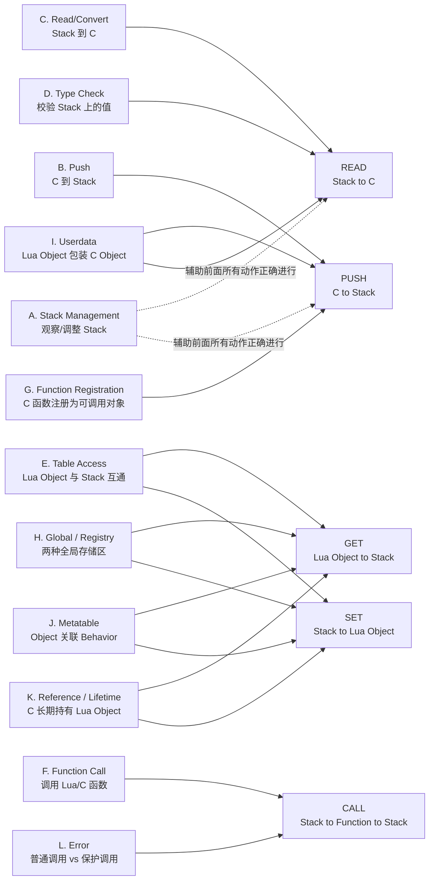

# 20. API Map：常用 Lua C API 分类地图

> 对应用户需求"第二十一阶段：常用 Lua C API 分类"。本章不含独立
> `code/`，是一张纯文档性质的"地图"：把散落在全书各章节里出现过的、
> 以及尚未专门展开的 Lua C API，按 12 个类别（A-L）系统性地归档，
> 每类先给一句 Mental Model，再逐个列出该类下的具体 API。
>
> 记忆方法上，请优先参考 Chapter 26 的"五类动作"（READ / PUSH / GET /
> SET / CALL）：本章的 12 个类别是"按用途"切的细分地图，Chapter 26
> 的 5 个动作是"按数据流向"切的压缩地图，本章末尾会把两者对应起来。

## A. Stack Management —— 观察/调整 Stack

**Mental Model**：这一类不搬运任何"数据"，只负责回答"Stack 现在长
什么样"以及"我需要多大的空间"。

| API | 说明 |
|---|---|
| `lua_gettop(L)` | 返回当前 Stack 上一共有多少个元素（等价于"栈顶的正索引"） |
| `lua_settop(L, idx)` | 把 Stack 的栈顶设为 `idx`：变小则丢弃多余元素，变大则用 `nil` 补齐 |
| `lua_pop(L, n)` | 从栈顶弹出 `n` 个元素，等价于 `lua_settop(L, -n-1)` |
| `lua_checkstack(L, n)` | 确保 Stack 至少还能再放 `n` 个元素，放不下会尝试扩容，扩容失败返回 0 |
| `lua_absindex(L, idx)` | 把一个可能是负数的相对索引，转换成等价的正数绝对索引 |

```c
/* 小示例：把当前 Stack 顶部转换成绝对索引，防止后续 push 操作让
 * 原本的负索引"漂移"到别的位置——这是 Chapter 03 讲过的经典坑。 */
int idx = lua_absindex(L, -1); /* 记录下来的是"第几个"，不会因为后续 push 而改变含义 */
lua_pushnil(L);                /* 这里 push 之后，原来的 -1 已经不再指向同一个值了 */
lua_getfield(L, idx, "field"); /* 但 idx 依然准确 */
```

## B. Push —— C -> Stack

**Mental Model**：把一个 C 世界的值，转换成 Stack 上的一个 Lua Value。

| API | 说明 |
|---|---|
| `lua_pushnil(L)` | push 一个 `nil` |
| `lua_pushboolean(L, b)` | push 一个 boolean |
| `lua_pushinteger(L, n)` | push 一个整数（`lua_Integer`） |
| `lua_pushnumber(L, n)` | push 一个浮点数（`lua_Number`） |
| `lua_pushstring(L, s)` | push 一个以 `\0` 结尾的 C 字符串（内部会做一次拷贝） |
| `lua_pushlstring(L, s, len)` | push 一段指定长度的字符串，允许内部含 `\0`（二进制安全） |
| `lua_pushlightuserdata(L, p)` | push 一个 Light Userdata（只是包装了一个裸指针，不受 GC 管理） |
| `lua_pushcfunction(L, f)` | push 一个 C Function，使其成为 Lua 可调用对象 |
| `lua_pushvalue(L, idx)` | 把 Stack 上 `idx` 位置的值再复制一份到栈顶（原值不受影响） |

```c
lua_pushinteger(L, 42);
lua_pushlstring(L, "a\0b", 3); /* 二进制安全：中间的 \0 会被完整保留 */
```

## C. Read/Convert —— Stack -> C

**Mental Model**：把 Stack 上的一个 Lua Value，转换回 C 世界能直接使用的值。

| API | 说明 |
|---|---|
| `lua_toboolean(L, idx)` | 读成 C 的真假值（Lua 里只有 `nil` 和 `false` 是假） |
| `lua_tointeger(L, idx)` | 读成 `lua_Integer`（如果不是数字/不能转换，返回 0，不报错） |
| `lua_tonumber(L, idx)` | 读成 `lua_Number`（同样不报错，转换失败返回 0） |
| `lua_tostring(L, idx)` | 读成 `const char *`（等价于 `lua_tolstring(L, idx, NULL)`） |
| `lua_tolstring(L, idx, &len)` | 读成 `const char *` 并同时取出长度，二进制安全 |
| `lua_touserdata(L, idx)` | 读出 Userdata（Full 或 Light）内部的裸指针 |
| `lua_topointer(L, idx)` | 读出几乎任何 Lua Value 的内部指针，主要用于调试/打印地址，不建议用来做业务逻辑 |

**与 D 类的关键区别**：本类是"尽力转换，转换不了给默认值，不会
抛错"，所以永远要配合 D 类的 `lua_is*`/`luaL_check*` 先确认类型，
否则读到的 0 可能是"真的是 0"，也可能是"根本不是数字"。

```c
if (lua_isnumber(L, 1)) {
    lua_Number n = lua_tonumber(L, 1);
    printf("n = %f\n", n);
}
```

## D. Type Check —— Validate Stack Value

**Mental Model**：`lua_is*` 是**类型查询**——只读判断，不报错，用来
"问一下"；`luaL_check*` 是**校验系列**——校验失败直接抛 Lua Error
（内部调用 `luaL_error`/`luaL_argerror`），用来"要求必须是"。

| API | 分类 | 说明 |
|---|---|---|
| `lua_type(L, idx)` | 查询 | 返回该位置的类型常量（`LUA_TNIL`/`LUA_TTABLE`/...） |
| `lua_isnil(L, idx)` | 查询 | 是否为 `nil` |
| `lua_isboolean(L, idx)` | 查询 | 是否为 boolean |
| `lua_isnumber(L, idx)` | 查询 | 是否为数字，或者是"可以被转换成数字的字符串" |
| `lua_isinteger(L, idx)` | 查询 | 是否是一个"没有小数部分"的 `lua_Integer` 子类型 |
| `lua_isstring(L, idx)` | 查询 | 是否为字符串，或者是"可以被转换成字符串的数字" |
| `lua_istable(L, idx)` | 查询 | 是否为 Table |
| `lua_isfunction(L, idx)` | 查询 | 是否为函数（Lua Function 或 C Function） |
| `lua_isuserdata(L, idx)` | 查询 | 是否为 Userdata（Full 或 Light） |
| `luaL_checktype(L, idx, t)` | 校验 | 类型不是 `t` 就抛错 |
| `luaL_checkinteger(L, idx)` | 校验 | 不是合法整数就抛错，否则返回该整数 |
| `luaL_checknumber(L, idx)` | 校验 | 不是合法数字就抛错，否则返回该数字 |
| `luaL_checkstring(L, idx)` | 校验 | 不是合法字符串就抛错，否则返回 `const char *` |
| `luaL_checkudata(L, idx, name)` | 校验 | 不是指定 Metatable 名字的 Full Userdata 就抛错 |

```c
/* 典型模式：先用 luaL_check* 校验 + 取值一步到位，
 * 校验失败会自动带上"第几个参数、期望什么类型"的错误信息，
 * 比自己用 lua_is* 判断后再手写 luaL_error 更省事、信息更规范。 */
static int l_demo(lua_State *L) {
    lua_Integer n = luaL_checkinteger(L, 1); /* 第 1 个参数必须是整数 */
    lua_pushinteger(L, n * 2);
    return 1;
}
```

## E. Table Access —— Lua Object ↔ Stack

**Mental Model**：在 Table（Lua Object）和 Stack 之间搬运数据，是
`lua_get*`（Get 系列，Lua Object -> Stack）与 `lua_set*`（Set 系列，
Stack -> Lua Object）在 Table 场景下的具体体现。

| API | 说明 |
|---|---|
| `lua_gettable(L, idx)` | 用栈顶的 key 到 `idx` 位置的 table 里查值，结果替换掉栈顶的 key；**可能触发 `__index` metamethod** |
| `lua_settable(L, idx)` | 用栈顶下面的两个值（key、value）给 `idx` 位置的 table 赋值，两者都会被弹出；**可能触发 `__newindex` metamethod** |
| `lua_getfield(L, idx, k)` | 等价于 `lua_gettable`，但 key 是一个固定的 C 字符串，更常用；**可能触发 `__index`** |
| `lua_setfield(L, idx, k)` | 等价于 `lua_settable`，key 是固定字符串；**可能触发 `__newindex`** |
| `lua_rawget(L, idx)` | 和 `lua_gettable` 一样，但**不触发任何 metamethod**，直接查原始 table |
| `lua_rawset(L, idx)` | 和 `lua_settable` 一样，但**不触发任何 metamethod** |
| `lua_rawgeti(L, idx, n)` | 按整数下标 `n` 直接查（数组风格），不触发 metamethod |
| `lua_rawseti(L, idx, n)` | 按整数下标 `n` 直接赋值，不触发 metamethod |
| `lua_next(L, idx)` | 遍历 table：用栈顶的 key 找"下一个" key/value 并 push；配合 Chapter 08/19 讲过的 pop 规则使用 |

**`lua_gettable`/`lua_settable`（以及 `lua_getfield`/`lua_setfield`）
vs `lua_raw*` 系列的关键区别**：前者会检查目标是否设置了
`__index`/`__newindex` metamethod，如果有就会转而调用 metamethod
（这正是 Chapter 12 讲的"面向对象方法调用"能工作的原理）；后者永远
只操作 table 自身实际存储的原始键值对，绝不触发任何 metamethod——
在明确知道自己要的就是"原始数据"、或者需要在 `__index` 内部访问真实
存储、避免无限递归时，必须用 `lua_raw*`。

```c
lua_getfield(L, 1, "x");      /* 可能触发 t 的 __index */
lua_pop(L, 1);
lua_rawgeti(L, 1, 1);         /* 直接读数组第 1 项，绝不触发 metamethod */
lua_pop(L, 1);
```

## F. Function Call —— Stack -> Function invocation -> Stack

**Mental Model**：把 Stack 上的"函数 + 参数"变成一次真正的调用，
调用结果重新放回 Stack。

| API | 说明 |
|---|---|
| `lua_call(L, nargs, nresults)` | 普通调用（Normal call）：出错时 Error propagation 直接穿透，无保护 |
| `lua_pcall(L, nargs, nresults, msgh)` | 保护调用（Protected call）：出错时返回非 `LUA_OK` 状态码，错误信息留在 Stack 上，详见 Chapter 18 |
| `lua_callk(L, nargs, nresults, ctx, k)` | `lua_call` 的协程感知版本，支持在调用中途 `yield` 后借助续延函数 `k` 恢复 |
| `lua_pcallk(L, nargs, nresults, msgh, ctx, k)` | `lua_pcall` 的协程感知版本，同上 |

`*k` 后缀版本是为了支持"被调用的 Lua Function 内部执行了 `coroutine.yield`"这种场景而设计的：普通的 `lua_call`/`lua_pcall`
一旦发生 `yield` 就无法在原来的 C 栈帧里继续等待恢复（C 调用栈不能被
挂起再恢复），`*k` 版本通过"延续函数 `ctx`/`k`"把"调用之后要做的事"
包装成一个可以被重新调度执行的回调。**本教程主线全程使用非 `k`
版本**（`lua_call`/`lua_pcall`），协程话题不在覆盖范围内。

```c
lua_getglobal(L, "some_lua_function");
lua_pushinteger(L, 1);
lua_pushinteger(L, 2);
int status = lua_pcall(L, 2, 1, 0); /* 2 个参数，期望 1 个返回值 */
```

## G. Function Registration —— C Function -> Lua Callable Object

**Mental Model**：把一个 C 函数指针，包装成 Lua 能够识别、能够调用的对象。

| API | 说明 |
|---|---|
| `lua_pushcfunction(L, f)` | 把一个没有 Upvalue 的 C Function push 成 Lua 可调用对象（等价于 `lua_pushcclosure(L, f, 0)`） |
| `lua_pushcclosure(L, f, n)` | 把 C Function 和栈顶 `n` 个值一起打包成一个 Closure（这 `n` 个值成为它的 Upvalue），详见 Chapter 15 |
| `luaL_setfuncs(L, funcs, nup)` | 把一个 `luaL_Reg` 数组（一组"名字 -> 函数指针"）批量注册进栈顶的 table，常用于给 Metatable/模块 table 一次性挂上一整套方法 |

```c
static const luaL_Reg my_methods[] = {
    {"foo", l_foo},
    {"bar", l_bar},
    {NULL, NULL}
};
luaL_newtable(L);
luaL_setfuncs(L, my_methods, 0); /* 把 foo/bar 一次性注册进这个 table */
```

## H. Global / Registry —— 两个不同的"全局存储区"

**Mental Model**：Global Table 解决"Lua 脚本之间共享/暴露状态"的问题；
Registry 解决"C 代码之间私下共享状态、且不能被 Lua 脚本看到或篡改"的问题。

| API | 说明 |
|---|---|
| `lua_getglobal(L, name)` | 从 Global Table（`_G`）里读一个全局变量，push 到栈顶 |
| `lua_setglobal(L, name)` | 把栈顶的值，写成 Global Table 里的一个全局变量 |
| `lua_getfield(L, idx, k)` | 通用的"按字段名取值"，`idx` 传 `LUA_REGISTRYINDEX` 时就是在操作 Registry |
| `lua_setfield(L, idx, k)` | 通用的"按字段名赋值"，同上，`idx` 传 `LUA_REGISTRYINDEX` 即操作 Registry |
| `lua_rawgeti(L, idx, n)` | 通用的"按整数下标取值"，`idx` 传 `LUA_REGISTRYINDEX` 时用于取出 `luaL_ref` 存的值 |
| `lua_rawseti(L, idx, n)` | 通用的"按整数下标赋值"，同上 |

**Global Table（`_G`）**：一张普通的、Lua 脚本自己也能读写的 Table。
`function foo() end` 在顶层写出来，本质就是 `_G.foo = function() end`。
它解决的问题是"暴露给脚本作者使用的、脚本可见可改的状态"。

**Registry（`LUA_REGISTRYINDEX` 指向的 Table）**：和 Global Table 结构
上是同一类东西（都是 Table），但**Lua 脚本完全看不到、也碰不到它**——
没有任何 Lua 语法能直接访问 `LUA_REGISTRYINDEX`。它解决的问题是
"C 代码需要一个只属于自己、不会被脚本意外覆盖或读取的私有存储区"，
典型用途正是 K 类讲的 `luaL_ref`/`luaL_unref`。

```c
lua_pushinteger(L, 100);
lua_setglobal(L, "MAX_LEN");     /* Lua 脚本里可以直接读写 MAX_LEN */

lua_pushstring(L, "internal");
lua_setfield(L, LUA_REGISTRYINDEX, "my_plugin.secret"); /* Lua 脚本完全看不到这个键 */
```

## I. Userdata —— Lua Object ↔ C Object

**Mental Model**：Userdata 是"让一段 C 内存，看起来像一个 Lua Object"
的机制，是 Chapter 11-14 的核心内容在这里的归档。

| API | 说明 |
|---|---|
| `lua_newuserdata(L, size)` | 分配一块受 Lua GC 管理的内存（Full Userdata），push 到栈顶，返回其裸指针（Lua 5.4 中是 `lua_newuserdatauv` 的兼容包装） |
| `lua_newuserdatauv(L, size, nuvalue)` | Lua 5.4 新增：同上，同时指定这个 Userdata 自带的 Uservalue（关联值）个数 |
| `lua_touserdata(L, idx)` | 取出 Userdata（Full 或 Light）内部的裸指针 |
| `luaL_checkudata(L, idx, name)` | 校验 `idx` 位置是不是"挂着名为 `name` 的 Metatable"的 Full Userdata，是则返回指针，否则抛错 |
| `luaL_newmetatable(L, name)` | 创建一个以 `name` 为标识、注册进 Registry 的新 Metatable（如果已存在则不重复创建），push 到栈顶 |
| `luaL_getmetatable(L, name)` | 从 Registry 里把之前用 `luaL_newmetatable` 注册过的 Metatable 取出来 push 到栈顶 |
| `lua_setmetatable(L, idx)` | 把栈顶的 table 设为 `idx` 位置的值的 Metatable |

```c
typedef struct { int value; } my_obj_t;

static int l_new_obj(lua_State *L) {
    my_obj_t *obj = (my_obj_t *)lua_newuserdata(L, sizeof(my_obj_t));
    obj->value = 0;
    luaL_getmetatable(L, "my_obj_mt");
    lua_setmetatable(L, -2);
    return 1;
}
```

## J. Metatable —— Object -> Metatable -> Behavior

**Mental Model**：Metatable 是"给一个 Lua Object 挂上一套行为规则"的
机制——Object 本身只是数据，Metatable 决定了对它做 `+`、索引、调用
等操作时该怎么"表现"。

| API | 说明 |
|---|---|
| `lua_getmetatable(L, idx)` | 取出 `idx` 位置的值当前的 Metatable，push 到栈顶（没有则返回 0，不 push） |
| `lua_setmetatable(L, idx)` | 把栈顶的 table 设为 `idx` 位置的值的 Metatable |
| `luaL_newmetatable(L, name)` | 创建/复用一个具名 Metatable（以 `name` 存入 Registry，防止重复创建） |
| `luaL_getmetatable(L, name)` | 按名字从 Registry 里取回之前创建的具名 Metatable |

```text
Object（比如一个 Userdata）
    |
    | lua_setmetatable
    v
Metatable（一个普通 Table，键是 __index / __newindex / __gc / __tostring ...）
    |
    | Lua VM 在做特定操作时自动查这些键
    v
Behavior（索引行为、赋值行为、GC 行为、打印行为……）
```

关联关系是"Object -> Metatable -> Behavior"：Object 自己不直接定义
行为，行为都定义在它关联的 Metatable 里，这也是为什么同一个
`luaL_newmetatable(L, "my_obj_mt")` 可以被成千上万个 Userdata 实例
共享——它们共享同一套 Behavior，各自只带自己的数据。

## K. Reference / Lifetime —— C needs to keep Lua Object alive -> Registry Reference

**Mental Model**：C 代码如果需要**跨调用**长期持有一个 Lua Object
（不想让它被 GC 回收，也不想依赖任何一次调用里的 Stack 布局），
唯一正确的做法是在 Registry 里占一个稳定的引用槽位。

| API | 说明 |
|---|---|
| `luaL_ref(L, LUA_REGISTRYINDEX)` | 弹出栈顶的值，把它存进 Registry，返回一个可以长期保存的整数引用编号 |
| `luaL_unref(L, LUA_REGISTRYINDEX, ref)` | 释放一个引用编号，对应的 Registry 槽位被清空，值不再被引用（如果没有其他引用，之后可能被 GC 回收） |
| `LUA_REGISTRYINDEX` | Registry 的伪索引，`luaL_ref`/`lua_rawgeti`/`lua_rawseti` 配合它使用 |

```text
持有前（只是 Stack 上的一个临时值）：
    某次调用里 [idx] Lua Function
        |
        | luaL_ref(L, LUA_REGISTRYINDEX)  <- 弹出该值，存入 Registry，返回 ref
        v
长期持有：
    C 全局变量 int callback_ref = ref;
        |
        | 任意时刻、任意一次调用里都可以：
        | lua_rawgeti(L, LUA_REGISTRYINDEX, callback_ref)
        v
    取回同一个 Lua Function，与当前调用的 Stack 布局完全无关

不再需要时：
    luaL_unref(L, LUA_REGISTRYINDEX, callback_ref);
```

这正是 Chapter 09/10（C 长期持有 Lua Function 做事件回调）、以及
Chapter 19 Failure 4（用 Registry Reference 替代"跨调用保存 Stack
index"这个反面模式）背后的机制。

## L. Error —— normal call vs protected call

**Mental Model**：错误处理这一类 API，核心矛盾就是"直接抛出去，
交给最近的保护点/panic 处理"还是"先兜住，转换成一个普通的返回值"。

| API | 说明 |
|---|---|
| `lua_error(L)` | 把栈顶的值当作错误对象抛出（本质是 `longjmp`），详见 Chapter 18 |
| `luaL_error(L, fmt, ...)` | 格式化一条错误信息（自动附加"哪个文件哪一行"），然后调用 `lua_error` |
| `luaL_argerror(L, argn, extramsg)` | 专门用来报告"第 `argn` 个参数不对"，错误信息格式统一（`bad argument #n to 'func' (...)`），内部也是走 `lua_error` |
| `lua_call(L, nargs, nresults)` | 普通调用（Normal call）：出错直接 Error propagation 穿透，没有保护就会终止宿主进程 |
| `lua_pcall(L, nargs, nresults, msgh)` | 保护调用（Protected call）：出错会被兜住，转换成状态码 + Stack 上的错误信息 |

```text
lua_error 系列（如何"制造"一个错误）
    lua_error / luaL_error / luaL_argerror
        |
        v
调用系列（错误会沿着谁去传播）
    lua_call    -> 无保护，直接穿透
    lua_pcall   -> 有保护，转换成返回值
```

完整的原理、示例代码与实测输出见 Chapter 18。

## 12 个类别与 Chapter 26"五类动作"的对应关系

Chapter 26 把整套 Lua C API 压缩成 5 个动词：`READ`（Stack -> C）、
`PUSH`（C -> Stack）、`GET`（Lua Object -> Stack）、`SET`（Stack -> Lua
Object）、`CALL`（Stack -> Function -> Stack）。本章的 A-L 12 个类别，
每一类本质上都是这 5 个动作在某个具体场景下的展开：



一句话记忆：**A 类（Stack Management）不是一种独立的"动作"，而是
支撑其余所有动作正确执行的"地基"**——只有先搞清楚 Stack 现在的状态
（`gettop`/`checkstack`/`absindex`），后面 B-L 的每一次 push/get/
set/call 才有意义。这也呼应了 Chapter 19 的核心结论：Stack Balance
是贯穿全书所有 API 使用的前提，而不是某一类 API 独有的问题。
