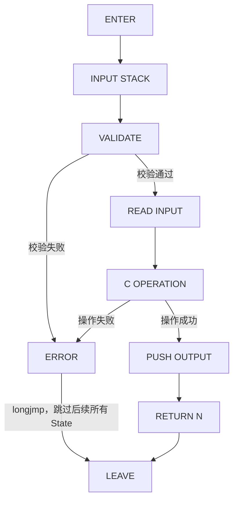

# 23. State Machine 视角：一次 C Function 调用的九个状态

> 对应用户需求 Stage 25。本章要传达的核心观点：**很多 Lua/C Bug
> 本质上不是"这个 API 不会用"，而是写代码的人对"此刻处于状态机的
> 哪一个状态、Stack 上应该有什么"没有一个清晰的模型**。把任何一个
> C Function 套进下面这台状态机走一遍，绝大多数 bug 会自己暴露
> 出来。

## 23.1 为什么要用状态机而不是流程图（Why）

Chapter 21 已经把"一次调用"画成了一条时间线。但时间线是"线性"
的，它暗示"事情总是按顺序从头走到尾"——而真实的 C Function 里
永远有分支：校验失败怎么办？C 操作本身失败怎么办？这些分支不是
"意外情况"，而是这台状态机本来就有的、和正常路径同样重要的一部分。

状态机比流程图多出来的东西，正是这些"分支跳转"——这也是为什么
按照本书的图表规则，这张图必须用 Mermaid 而不是纯 ASCII：一旦
图里出现"条件分支/跳转"，就不再是简单的线性关系，属于"复杂关系
图"的范畴。

## 23.2 状态机图



九个状态逐一解释：

| 状态 | 含义 | 典型 API |
|---|---|---|
| `ENTER` | Lua VM 刚跳进这个 `lua_CFunction`，控制权交给 C | 无（VM 内部动作） |
| `INPUT STACK` | 参数已经出现在 Stack 位置 1、2、3…… | `lua_gettop` |
| `VALIDATE` | 检查参数数量、类型是否符合预期 | `luaL_checktype`、`luaL_checkinteger`、`luaL_argerror` |
| `ERROR` | 校验或操作失败，通过 `longjmp` 直接跳出，本次调用剩余代码全部不执行 | `luaL_error`、`lua_error` |
| `READ INPUT` | 把 Stack 上的值转换成真正的 C 变量 | `lua_tointeger`、`lua_tolstring` |
| `C OPERATION` | 纯 C 世界的业务逻辑 | 无（普通 C 代码） |
| `PUSH OUTPUT` | 把结果重新变成 Lua Value，放上 Stack | `lua_pushinteger`、`lua_pushstring` |
| `RETURN N` | 声明 Stack 契约："栈顶 N 个值是返回值" | `return N;` |
| `LEAVE` | 控制权交还给 Lua VM | 无（VM 内部动作） |

**关于 `ERROR` 状态的一个关键细节**：它和其它状态之间的转移不是
"函数正常 return"，而是 `longjmp`——这意味着一旦进入 `ERROR`，
当前 C 函数里"接下来那几行代码"**不会被执行**，包括任何你以为
"无论如何都会跑到"的清理代码（除非你在外层专门用 `lua_pcall` +
错误处理逻辑去补，这属于 Chapter 18 的内容）。这也是 Chapter 24
Failure 6 要着重演示的行为。

## 23.3 用 Chapter 06 的 `l_configure` 走一遍

`l_configure` 是 Chapter 06（`table-lua-to-c`）里最基础的一个
C Function：接收一个 Table 参数，读出 `host`/`port`/`enabled`
三个字段。逐状态标注对应的真实代码行：

```18:39:/home/morrism/code_extra/wireshark-plugins/lua-c-interop-guide/chapters/06-table-lua-to-c/code/table_lua_to_c_demo.c
static int l_configure(lua_State *L)
{
    luaL_checktype(L, 1, LUA_TTABLE);

    lua_getfield(L, 1, "host");
    const char *host = luaL_checkstring(L, -1);
    lua_pop(L, 1);

    lua_getfield(L, 1, "port");
    int port = (int)luaL_checkinteger(L, -1);
    lua_pop(L, 1);

    lua_getfield(L, 1, "enabled");
    int enabled = lua_toboolean(L, -1);
    lua_pop(L, 1);

    printf("[C] configure: host=%s port=%d enabled=%s\n",
           host, port, enabled ? "true" : "false");

    /* 没有值要交回 Lua：栈顶 0 个值是返回值 */
    return 0;
}
```

| 状态 | 对应代码行 | Stack 状态说明 |
|---|---|---|
| `ENTER` | 第 18 行函数入口 | VM 刚跳进来，Stack 位置 1 是那张 Table |
| `INPUT STACK` | （隐含，进入函数体那一刻） | Stack: `[table]`，`lua_gettop(L) == 1` |
| `VALIDATE` | 第 20 行 `luaL_checktype(L, 1, LUA_TTABLE)` | 校验位置 1 确实是 Table；失败会立即进入 `ERROR`（`longjmp`），下面 22-38 行整段都不会执行 |
| `READ INPUT` | 第 22-32 行，三组 `lua_getfield` + `luaL_check*`/`lua_toboolean` + `lua_pop` | 每一组都是一次完整的"迷你状态机循环"：Stack 先变成 `[table, field]`，读完立刻 `lua_pop(L, 1)` 变回 `[table]`——这正是 Chapter 19 讲的 Stack Balance |
| `C OPERATION` | 本例里几乎为空（只是把三个 C 变量凑在一起） | 真实场景里这里可能是连接数据库、解析协议等任意 C 逻辑 |
| `PUSH OUTPUT` | 本例没有真正 push 任何返回值 | Stack 在 `return` 之前应该回到 `[table]`（参数本身还留在栈上是正常的，见 Chapter 19 的" Stack Contract 只关心 return N 声明的那部分") |
| `RETURN N` | 第 38 行 `return 0;` | 声明"这次调用没有返回值" |
| `LEAVE` | 函数结束，控制权交还 VM | Lua 侧 `configure(...)` 这次调用得到 0 个返回值 |

### 如果 `VALIDATE` 失败会怎样？

`table_lua_to_c_fail_demo.c`（同一章的 Failure 演示）改的不是
`VALIDATE`，而是"忘记在 `READ INPUT` 循环里 `lua_pop`"——这提醒
我们一个容易被忽略的点：**状态机图上的每一个状态内部，仍然可能
有自己的子 bug**（比如 `READ INPUT` 这个状态本身应该是一个
"稳定循环"：`get -> check -> pop`，如果这个循环内部漏了最后一步，
状态机整体流程看起来还是"走完了"，但 Stack 已经不平衡）。这正是
Chapter 24 Failure 2 要讲的案例，也是为什么"套状态机模板"只是
第一步，具体到每个状态内部仍然要对照 Stack Diagram 逐步验证。

## 23.4 Mental Model

> **一次 C Function 调用永远是这九个状态中的某一个：ENTER ->
> INPUT STACK -> VALIDATE ->（成功）READ INPUT -> C OPERATION ->
> PUSH OUTPUT -> RETURN N -> LEAVE，或者（失败）直接 ERROR
> `longjmp` 跳出；绝大多数 Lua/C Bug，只要能准确说出"此刻在哪个
> 状态、Stack 应该长什么样"，答案就已经出来了一半。**
