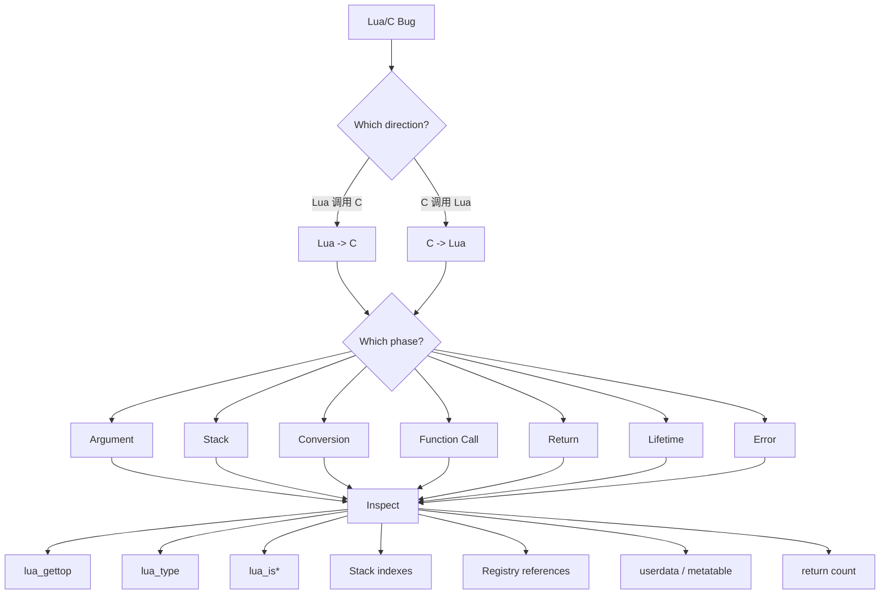

# 25. Debugging Mental Model：一份可以直接照着排查的 Checklist

> 对应用户需求 Stage 27。本章把 Chapter 21-24 的知识，压缩成一套
> 遇到任何 Lua/C Bug 时可以直接照着走的排查流程——先定方向，再定
> 阶段，最后逐项检查 Stack/Registry/生命周期的实际状态。

## 25.1 为什么排查要按"方向 -> 阶段 -> 检查项"这个顺序（Why）

Chapter 00 结尾提过一句话："遇到任何 Lua/C 交互的 bug，第一反应
永远是问'此刻 Stack 上有什么？'"。本章把这句直觉，展开成一个
可以真正执行的三层决策过程：

1. **先确定方向**——这个 bug 发生在 Lua 调用 C 的路径上（Chapter
   21 的第一条链路），还是 C 调用 Lua 的路径上（第二条链路）？
   方向错了，后面查的 API 全部会查错地方。
2. **再确定阶段**——同一个方向内部，问题出在参数校验、Stack 状态、
   类型转换、函数调用本身、返回值、对象生命周期，还是错误处理？
   Chapter 23 的九个状态机状态，本质上就是这七个阶段的更细分。
3. **最后逐项 Inspect**——针对定位到的阶段，用一组固定的、便宜的
   检查手段（`lua_gettop`、`lua_type`……）去确认真实状态，而不是
   凭记忆或者假设。

## 25.2 决策树



七个阶段和 Chapter 23 状态机的对应关系：

| 阶段 | 对应状态机状态 | 典型问题 |
|---|---|---|
| Argument | `INPUT STACK` / `VALIDATE` | 参数数量、类型不对 |
| Stack | 贯穿全程 | 位置算错、临时值没清理 |
| Conversion | `READ INPUT` / `PUSH OUTPUT` | `lua_to*`/`lua_push*` 用错 |
| Function Call | 不在单个状态机内，跨越"谁在调用谁" | `lua_call` vs `lua_pcall` 选错 |
| Return | `RETURN N` | Stack Contract 声明的数量/位置不对 |
| Lifetime | 跨越多次状态机（多次调用） | Registry Reference、GC、userdata 生命周期 |
| Error | `ERROR` | 错误对象类型判断、传播路径 |

## 25.3 Debug Checklist

遇到任何 Lua/C 交互的 bug，逐条走一遍：

```text
[ ] Stack top 是否符合预期？
[ ] 每个 index 对应什么 Value？
[ ] Value type 是否正确？
[ ] 是否产生 temporary values？
[ ] temporary values 是否 pop？
[ ] return count 是否正确？
[ ] negative index 是否仍然指向预期对象？
[ ] Lua Function 是否仍然存活？
[ ] Registry reference 是否有效？
[ ] userdata 是否属于正确 metatable？
[ ] __gc 是否正确释放 C resource？
[ ] lua_call / lua_pcall 是否选择正确？
```

逐条展开说明"为什么这一条重要"：

1. **Stack top 是否符合预期？** —— `lua_gettop(L)` 是最便宜的
   第一道检查，一行代码就能确认"函数以为收到几个参数"和"实际
   收到几个参数"是否一致（对应 Failure 1）。
2. **每个 index 对应什么 Value？** —— 光知道"有几个值"不够，还
   要能画出"位置 1 是什么、位置 2 是什么"这张心智地图，这是
   Chapter 02/03 反复强调的基本功。
3. **Value type 是否正确？** —— `lua_type`/`lua_is*` 系列，判断
   是否真的拿到了预期类型的值，而不是想当然地直接 `lua_to*`
   （对应 Failure 1、7）。
4. **是否产生 temporary values？** —— 任何 `get*`（`lua_getfield`
   等）都会在 Stack 上留下一个新值，问自己"这一步之后 Stack 多了
   什么"。
5. **temporary values 是否 pop？** —— 第 4 条问出来的每一个临时值，
   都要能明确回答"在哪一行被清理了"（对应 Failure 2、4，Chapter
   19 的 Stack Balance）。
6. **return count 是否正确？** —— `return N` 之前，数一数栈顶
   往下 N 个到底是不是想要的那几个值（对应 Failure 3、4）。
7. **negative index 是否仍然指向预期对象？** —— 负索引是"相对
   栈顶"的，一旦栈顶因为漏掉的 pop 而发生偏移，所有负索引的含义
   都会跟着漂移（对应 Failure 2、4，本质是第 5 条的后果）。
8. **Lua Function 是否仍然存活？** —— 如果这个函数是通过
   Registry Reference 长期持有的，要确认对应的 Lua 侧对象没有在
   意料之外的时间点被清理（对应 Failure 5、9、10）。
9. **Registry reference 是否有效？** —— 检查保存引用的变量是否
   还是 `LUA_NOREF`，是否在 `luaL_unref` 之后被正确重置（对应
   Failure 10，这是本书唯一一个"实测结果和直觉不一致"的案例，
   务必对照 24.10 的真实报错）。
10. **userdata 是否属于正确 metatable？** —— `luaL_checkudata`
    传入的名字字符串是否和创建该对象时 `luaL_newmetatable`/
    `luaL_setmetatable` 用的名字完全一致（对应 Failure 7）。
11. **`__gc` 是否正确释放 C resource？** —— 确认释放逻辑有
    "已释放"标记防止重复释放，且不存在其它裸指针在 `__gc` 之后
    继续访问同一块内存（对应 Failure 8）。
12. **`lua_call` / `lua_pcall` 是否选择正确？** —— 任何"C 主动
    调用可能出错的 Lua Function"的地方，检查是不是不小心用了
    `lua_call`（对应 Failure 6）。

## 25.4 Checklist 与 Chapter 24 Failure 对照表

| Checklist 项 | 能抓到的 Failure |
|---|---|
| 1. Stack top 是否符合预期？ | Failure 1、2、3、4 |
| 2. 每个 index 对应什么 Value？ | Failure 1、2、4、9 |
| 3. Value type 是否正确？ | Failure 1、7 |
| 4. 是否产生 temporary values？ | Failure 2、4 |
| 5. temporary values 是否 pop？ | Failure 2、4 |
| 6. return count 是否正确？ | Failure 3、4 |
| 7. negative index 是否仍然指向预期对象？ | Failure 2、4 |
| 8. Lua Function 是否仍然存活？ | Failure 5、9、10 |
| 9. Registry reference 是否有效？ | Failure 5、9、10 |
| 10. userdata 是否属于正确 metatable？ | Failure 7 |
| 11. `__gc` 是否正确释放 C resource？ | Failure 8 |
| 12. `lua_call` / `lua_pcall` 是否选择正确？ | Failure 6、10 |

反过来按 Failure 编号看，覆盖情况同样完整：

| Failure | 被覆盖的 Checklist 项 |
|---|---|
| 1. 错误的 Stack index | 1、2、3 |
| 2. 忘记 pop | 1、2、4、5、7 |
| 3. 错误的 return count | 1、6 |
| 4. 返回位置错误 | 1、2、4、5、6、7 |
| 5. Stack index 当长期引用 | 8、9 |
| 6. `lua_call` 导致错误穿透 | 12 |
| 7. userdata 类型错误 | 3、10 |
| 8. userdata 生命周期错误 | 11 |
| 9. Stack index 当对象引用（跨调用） | 8、9 |
| 10. 引用失效后继续调用 | 8、9、12 |

10 个 Failure 全部至少被一条 checklist 项覆盖，12 条 checklist
项全部至少能抓到一个 Failure——这份表格本身就是"这份 Checklist
为什么足够用"的证明。

## 25.5 Mental Model

> **排查任何 Lua/C Bug，先问方向（Lua -> C 还是 C -> Lua），再问
> 阶段（Argument/Stack/Conversion/Function Call/Return/Lifetime/
> Error 这七个之一），最后照着这 12 条 Checklist 逐项核对 Stack、
> Registry、userdata 的真实状态——这份 Checklist 不是用来"背下来"
> 的，而是用来在遇到问题的那一刻，替代"凭感觉猜"的一套可执行
> 步骤。**
