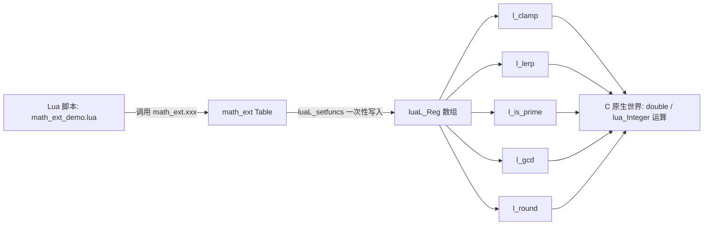

# Project 1: Math Library —— 用 `luaL_setfuncs` 打包一个真正的库

> 场景一句话简介：给 Lua 脚本提供一个 `math_ext` Table，里面装着一组比 Chapter 01 的 `add` 更丰富的数学函数（`clamp` / `lerp` / `is_prime` / `gcd` / `round`），一次性用 `luaL_Reg` + `luaL_setfuncs` 注册，而不是逐个 `lua_register` 挂全局函数。

## 架构：Lua 侧调用什么 / C 侧提供什么能力

```text
Lua 侧调用                          C 侧提供的能力
------------------------            ------------------------
math_ext.clamp(v, lo, hi)     -->   luaL_checknumber x3
math_ext.lerp(a, b, t)        -->   luaL_checknumber x3
math_ext.is_prime(n)          -->   luaL_checkinteger
math_ext.gcd(a, b)            -->   luaL_checkinteger x2
math_ext.round(v, ndigits)    -->   luaL_checknumber + luaL_optinteger
```



和 Chapter 01 `add` 的关键区别：`add` 用 `lua_register(L, "add", l_add)` 直接把一个 C Function 挂成**全局变量**；本项目用 `lua_newtable` + `luaL_setfuncs` + `lua_setglobal` 三步，把 5 个 C Function **打包进同一张 Table**，Lua 侧看到的是一个内聚的库（`math_ext.xxx`），不会污染全局命名空间——这正是 Chapter 20 API Map 里 "G. Function Registration" 想说明的知识点。

## 完整代码

### `math_ext.c`（C 侧宿主程序）

```c
/*
 * math_ext.c —— Project 1: Math Library
 *
 * 本项目要证明的事情：真正的"库"不是一堆散落的全局函数
 * （像 Chapter 01 的 add 那样用 lua_register 一个个挂到 _G 上），
 * 而是一张 luaL_Reg 数组 + 一次 luaL_setfuncs，把一组相关的 C Function
 * 打包注册进同一个 Lua Table（math_ext），对照 Chapter 20 API Map 里的
 * "G. Function Registration" 知识点。
 *
 * 每个 C Function 内部的动作分类都逃不出 Chapter 26 的五个动词：
 *   luaL_check*   ->  READ    （Stack -> C，校验失败直接 luaL_error）
 *   lua_push*     ->  PUSH    （C -> Stack）
 * 本文件只有一种"进入 C"的场景：Lua 调用 math_ext 里的某个函数，
 * 不涉及 C 反过来调用 Lua，所以没有 CALL 动作。
 */
#include <stdio.h>
#include <math.h>
#include <lua.h>
#include <lauxlib.h>
#include <lualib.h>

/*
 * math_ext.clamp(v, lo, hi)
 *   把浮点数 v 限制在 [lo, hi] 区间内。
 *
 * Stack 进入时：
 *   [1] = v   [2] = lo   [3] = hi
 * 三个都用 luaL_checknumber 校验并转换成 C 的 double —— 这是
 * READ 动作：Stack -> C，任何一个参数类型不对（比如传字符串
 * "abc"），luaL_checknumber 会直接 luaL_error，跳过后面所有代码，
 * 相当于 C 侧提前"拒绝"了这次调用，绝不会用垃圾值继续算下去。
 */
static int l_clamp(lua_State *L)
{
    double v  = luaL_checknumber(L, 1);
    double lo = luaL_checknumber(L, 2);
    double hi = luaL_checknumber(L, 3);

    if (lo > hi) {
        return luaL_error(L, "clamp: lo(%f) 不能大于 hi(%f)", lo, hi);
    }

    double result = v;
    if (result < lo) result = lo;
    if (result > hi) result = hi;

    lua_pushnumber(L, result);   /* PUSH：C -> Stack，栈顶就是这次调用的返回值 */
    return 1;                    /* 告诉 Lua VM：栈顶 1 个值是返回值 */
}

/*
 * math_ext.lerp(a, b, t)
 *   在 a、b 之间按比例 t 做线性插值：a + (b - a) * t。
 *   t 通常落在 [0, 1]，但本函数不强制，允许外插。
 */
static int l_lerp(lua_State *L)
{
    double a = luaL_checknumber(L, 1);
    double b = luaL_checknumber(L, 2);
    double t = luaL_checknumber(L, 3);

    double result = a + (b - a) * t;

    lua_pushnumber(L, result);
    return 1;
}

/*
 * math_ext.is_prime(n)
 *   判断整数 n 是否为素数，返回一个 Lua boolean。
 *   注意用 luaL_checkinteger（不是 luaL_checknumber），这样传
 *   "3.5" 之类的非整数浮点数或非数字字符串都会被 luaL_error 挡住。
 */
static int l_is_prime(lua_State *L)
{
    lua_Integer n = luaL_checkinteger(L, 1);

    int prime = 1;
    if (n < 2) {
        prime = 0;
    } else {
        for (lua_Integer i = 2; i * i <= n; i++) {
            if (n % i == 0) {
                prime = 0;
                break;
            }
        }
    }

    lua_pushboolean(L, prime);   /* PUSH：C int(0/1) -> Lua boolean */
    return 1;
}

/*
 * math_ext.gcd(a, b)
 *   欧几里得算法求最大公约数，a、b 都是整数。
 */
static int l_gcd(lua_State *L)
{
    lua_Integer a = luaL_checkinteger(L, 1);
    lua_Integer b = luaL_checkinteger(L, 2);

    if (a < 0) a = -a;
    if (b < 0) b = -b;

    while (b != 0) {
        lua_Integer tmp = b;
        b = a % b;
        a = tmp;
    }

    lua_pushinteger(L, a);
    return 1;
}

/*
 * math_ext.round(v, ndigits)
 *   把浮点数 v 四舍五入到小数点后 ndigits 位，示范"混合整数 + 浮点
 *   参数"的校验：v 用 luaL_checknumber，ndigits 用 luaL_optinteger
 *   （可选参数，缺省时默认为 0，对照 luaL_check* 家族里带"opt"的变体）。
 */
static int l_round(lua_State *L)
{
    double v = luaL_checknumber(L, 1);
    lua_Integer ndigits = luaL_optinteger(L, 2, 0);

    double factor = pow(10.0, (double)ndigits);
    double result = round(v * factor) / factor;

    lua_pushnumber(L, result);
    return 1;
}

/*
 * luaL_Reg 数组：name -> C Function 的映射表，luaL_setfuncs 会
 * 逐条读取，把每一项都以 name 为 key 写进当前栈顶的 Table 里。
 * 数组必须以 {NULL, NULL} 结尾，luaL_setfuncs 靠这个哨兵判断数组长度。
 */
static const luaL_Reg math_ext_funcs[] = {
    {"clamp",    l_clamp},
    {"lerp",     l_lerp},
    {"is_prime", l_is_prime},
    {"gcd",      l_gcd},
    {"round",    l_round},
    {NULL, NULL}
};

/*
 * 把 math_ext_funcs 注册成一个名为 "math_ext" 的全局 Lua Table，
 * 对应 Lua 侧的 math_ext.clamp(...)、math_ext.lerp(...) 等等。
 *
 * 步骤（对照 Chapter 20 API Map "G. Function Registration"）：
 *   1. lua_newtable(L)          在 Stack 顶部新建一张空 Table
 *   2. luaL_setfuncs(L, funcs, 0)
 *      把 math_ext_funcs 里的每一项都以 luaL_Reg.name 为 key，
 *      对应 C Function 为 value，SET 进这张 Table（此刻它还在栈顶）。
 *      第三个参数 0 表示"没有 upvalue 要绑定给这些函数共享"
 *      （Closure/Upvalue 是 Chapter 15 的主题，这里不需要）。
 *   3. lua_setglobal(L, "math_ext")
 *      把栈顶这张已经填满函数的 Table，SET 成全局变量 math_ext，
 *      同时把它从 Stack 上弹出。
 */
static void register_math_ext(lua_State *L)
{
    lua_newtable(L);
    luaL_setfuncs(L, math_ext_funcs, 0);
    lua_setglobal(L, "math_ext");
}

int main(void)
{
    lua_State *L = luaL_newstate();
    luaL_openlibs(L);

    register_math_ext(L);

    if (luaL_dofile(L, "math_ext_demo.lua") != LUA_OK) {
        fprintf(stderr, "lua error: %s\n", lua_tostring(L, -1));
        lua_close(L);
        return 1;
    }

    lua_close(L);
    return 0;
}
```

### `math_ext_demo.lua`（配套 Lua 脚本）

```lua
-- math_ext_demo.lua
--
-- 调用 math_ext.c 里注册好的整张 math_ext Table，
-- 覆盖整数参数（is_prime / gcd）和浮点参数（clamp / lerp / round）
-- 两类场景，最后故意传错参数类型触发 luaL_check* 报错，
-- 用 pcall 捕获，证明"C 侧校验失败 = 一次 Lua Error，
-- 不会让整个宿主程序崩溃"。

print("== math_ext.clamp(v, lo, hi) ==")
print("clamp(5, 0, 10)   =", math_ext.clamp(5, 0, 10))
print("clamp(-3, 0, 10)  =", math_ext.clamp(-3, 0, 10))
print("clamp(99, 0, 10)  =", math_ext.clamp(99, 0, 10))

print()
print("== math_ext.lerp(a, b, t) ==")
print("lerp(0, 100, 0.5) =", math_ext.lerp(0, 100, 0.5))
print("lerp(10, 20, 0)   =", math_ext.lerp(10, 20, 0))
print("lerp(10, 20, 1)   =", math_ext.lerp(10, 20, 1))

print()
print("== math_ext.is_prime(n) ==")
for _, n in ipairs({1, 2, 17, 18, 97}) do
    print("is_prime(" .. n .. ") =", math_ext.is_prime(n))
end

print()
print("== math_ext.gcd(a, b) ==")
print("gcd(48, 18)  =", math_ext.gcd(48, 18))
print("gcd(17, 5)   =", math_ext.gcd(17, 5))

print()
print("== math_ext.round(v, ndigits) ==")
print("round(3.14159, 2) =", math_ext.round(3.14159, 2))
print("round(3.14159)    =", math_ext.round(3.14159))  -- ndigits 省略，luaL_optinteger 缺省为 0

print()
print("== Failure：故意传错参数类型，用 pcall 捕获 luaL_check* 报错 ==")
-- clamp 的第一个参数按约定应该是 number，这里故意传一个字符串。
-- luaL_checknumber 内部检测到类型不对，会直接 luaL_error，
-- 相当于在 C 里 "抛出" 一个 Lua Error；如果这里不用 pcall 包一层，
-- 这个 Error 会一路传播到 main() 的 luaL_dofile，导致整个宿主程序
-- 以非 0 状态退出。
local ok, err = pcall(math_ext.clamp, "not-a-number", 0, 10)
print("pcall 结果 ok =", ok)
print("pcall 捕获的错误信息 =", err)
```

### `Makefile`

```makefile
GUIDE_ROOT := $(abspath ../..)
include $(GUIDE_ROOT)/Makefile.common
TARGET := math_ext_demo
SRCS := math_ext.c
include $(GUIDE_ROOT)/Makefile.rules
```

> 注意：`GUIDE_ROOT` 用的是 `$(abspath ../..)`，不是 `$(abspath ..)`——本项目目录 `projects/01-math-library/` 到 guide 根目录实际要向上两级（`01-math-library` -> `projects` -> 根目录），已用 `make run` 实测验证。

## Stack Diagram：两个最有代表性的调用

### 1. `math_ext.clamp(5, 0, 10)` —— 三个 number 参数、一个 number 返回值

**Before**（`l_clamp` 刚被 VM 调用，Stack 已经放好 3 个参数）：

```text
+-----+----------------+
| idx | value          |
+-----+----------------+
|  3  | 10  (hi)       |  <- 栈顶
|  2  | 0   (lo)       |
|  1  | 5   (v)        |  <- 栈底
+-----+----------------+
```

依次 `luaL_checknumber(L, 1/2/3)` 只是 READ（Stack -> C），不改变 Stack 本身。算出 `result = 5.0` 后：

**After**（`lua_pushnumber` 之后，`return 1` 之前）：

```text
+-----+----------------+
| idx | value          |
+-----+----------------+
|  4  | 5.0  (result)  |  <- 新 push 的返回值，栈顶
|  3  | 10  (hi)       |
|  2  | 0   (lo)       |
|  1  | 5   (v)        |  <- 栈底
+-----+----------------+
```

`return 1` 告诉 Lua VM："从栈顶数 1 个值就是这次调用的返回值"——VM 自己负责把下面 3 个参数一起清理掉，`l_clamp` 不需要手动 `lua_pop` 参数。

### 2. `math_ext.gcd(48, 18)` —— 整数参数、循环内不新增 Stack 内容

**Before**：

```text
+-----+----------------+
| idx | value          |
+-----+----------------+
|  2  | 18  (b)        |  <- 栈顶
|  1  | 48  (a)        |  <- 栈底
+-----+----------------+
```

`luaL_checkinteger` 把 `a=48`、`b=18` 读进 C 原生世界的两个 `lua_Integer` 局部变量后，整个欧几里得算法的循环全部在 **C Call Stack**（普通 C 局部变量 `tmp`）里完成，**完全不触碰 Lua Stack**——这正是 Chapter 00 强调的"C 调用栈 与 Lua Stack 是两回事"：算法逻辑越复杂，越应该尽量搬到 C 原生世界里跑，只在最终结果要交回 Lua 时才碰一次 Stack。

**After**（`lua_pushinteger(L, 6)` 之后）：

```text
+-----+----------------+
| idx | value          |
+-----+----------------+
|  3  | 6   (result)   |  <- 新 push 的返回值，栈顶
|  2  | 18  (b)        |
|  1  | 48  (a)        |  <- 栈底
+-----+----------------+
```

## Failure：如果这个库被误用会怎样

**场景**：调用方不看文档，把字符串当数字传给 `clamp`：

```lua
math_ext.clamp("not-a-number", 0, 10)
```

`luaL_checknumber(L, 1)` 检测到 Stack 位置 1 上的值不能转换成 number，立即调用 `luaL_error`（内部走 `lua_error` -> `longjmp`），**函数体后面的代码整个不会被执行**——不存在"用 0 或垫底值继续往下算，算出一个看似正常但其实错误的结果"这种情况，这是 `luaL_check*` 系列相比手写 `if` 判断的核心优势：错误参数在第一行就被拦住。

如果调用方外面**没有** `pcall` 包一层（就像 `math_ext_demo.lua` 最后那样），这个 Lua Error 会一路向上传播，最终从 `luaL_dofile` 返回非 `LUA_OK`，`main()` 里的 `lua_tostring(L, -1)` 会打印出错误信息，宿主程序以状态码 1 退出——对一个内嵌 Lua 的 C 程序来说，这可能意味着整个应用直接中止，所以生产代码里"库函数用 `luaL_check*` 校验、调用方用 `pcall` 兜底"往往是标配组合，缺一边都不安全。

另一个隐藏坑：`clamp(v, lo, hi)` 如果调用方传反了 `lo` 和 `hi`（比如 `clamp(5, 10, 0)`），三个参数都是合法的 number，`luaL_checknumber` 不会报错，但语义上"下界大于上界"本身就是错的——本项目在 `l_clamp` 里额外加了一层业务校验（`if (lo > hi) return luaL_error(...)`），这提醒读者：`luaL_check*` 只保证"类型对"，不保证"语义对"，业务不变量需要库作者自己补充检查。

## Mental Model

> **`luaL_Reg` + `luaL_setfuncs` 把"一组相关的 C Function"从零散的全局变量提升为一个内聚的 Lua Table 库；每个函数内部依然遵守 Chapter 26 的动作分类——`luaL_check*` 做 READ（Stack -> C，失败即报错），`lua_push*` 做 PUSH（C -> Stack）——真正的计算永远躲在 C 原生世界里跑，只在函数入口/出口两端碰一次 Lua Stack。**
