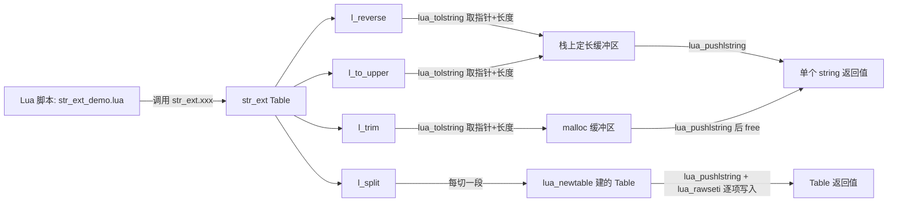

# Project 2: String Utility Library —— `lua_tolstring` 与 C -> Lua Table

> 场景一句话简介：给 Lua 脚本提供一个 `str_ext` Table（`reverse` / `trim` / `to_upper` / `split`），重点示范"带长度的字符串"如何在 Lua↔C 之间安全往返，以及 C 侧如何用 `lua_newtable` + `lua_rawseti` 把"多个结果"打包成一张 Lua Table 送回去。

## 架构：Lua 侧调用什么 / C 侧提供什么能力

```text
Lua 侧调用                           C 侧提供的能力
-------------------------            --------------------------------
str_ext.reverse(s)             -->   lua_tolstring + 栈上定长缓冲区 + lua_pushlstring
str_ext.trim(s)                -->   lua_tolstring + malloc 缓冲区 + lua_pushlstring + free
str_ext.to_upper(s)             -->   lua_tolstring + 栈上定长缓冲区 + lua_pushlstring
str_ext.split(s, sep)           -->   lua_tolstring + lua_newtable + lua_rawseti（多个结果 -> Table）
```



和 Chapter 06/07 的关系：本项目所有函数都以 `lua_tolstring`（而不是 `luaL_checkstring`/`lua_tostring`）读入参数——两者拿到的指针内容一样，但 `lua_tolstring` 额外给出一个 `size_t *len`，这才是"Lua String 是长度显式的字节数组"这条规则在代码里的具体体现；`split` 则是 Chapter 07 "C -> Lua Table" 知识点在字符串场景下的落地：结果不是一个值，而是"未知数量的多个值"，天然应该用一张 Table 承载，而不是勉强凑成多个返回值。

## 完整代码

### `str_ext.c`（C 侧宿主程序）

```c
/*
 * str_ext.c —— Project 2: String Utility Library
 *
 * 本项目要证明的事情：
 *   1. Lua String 不是 C 的 `char *`（以 '\0' 结尾），而是"长度显式的
 *      字节数组"，可能内部包含 '\0'。读它必须用 lua_tolstring（拿到
 *      指针 *and* 长度），只用 lua_tostring/luaL_checkstring 拿指针
 *      而不管长度，遇到内嵌 '\0' 的字符串就会被截断——这是本项目
 *      Failure 部分要示范的坑。
 *   2. C 处理完字符串后，"送回 Lua"分两种典型场景：
 *      - 结果长度已知、且不含内嵌 '\0'（比如 reverse/trim/to_upper 处理
 *        纯文本）：lua_pushlstring(L, buf, len) 是唯一严谨的做法——
 *        依然要显式给长度，不能想着"反正处理完没有 \0 就用 pushstring
 *        也行"，本教程统一用 pushlstring 保持一致、不留隐患。
 *      - 结果是"多个子串"（split）：不是一个字符串，而是一整张
 *        Lua Table，用 lua_newtable + lua_rawseti 按下标 1..N 写入
 *        （对照 Chapter 07"C -> Lua Table"知识点）。
 *   3. C 侧的临时缓冲区来源分两类：栈上定长缓冲区（reverse/to_upper，
 *      长度可预先知道等于输入长度）和 malloc 出来的动态缓冲区
 *      （trim 的结果长度 <= 输入长度，这里选择更保守的 malloc 方案，
 *      并用 split 演示"多次 malloc、用完即 free"）。
 */
#include <stdio.h>
#include <stdlib.h>
#include <string.h>
#include <ctype.h>
#include <lua.h>
#include <lauxlib.h>
#include <lualib.h>

/*
 * str_ext.reverse(s)
 *   把字符串 s 按字节反转。用 lua_tolstring 同时拿到指针 src 和
 *   长度 len——即使 s 内部含有 '\0'，len 依然是"真实字节数"，
 *   不会被 '\0' 截断，反转结果也完整保留这些字节。
 *
 * C 侧缓冲区：用一个栈上（C Call Stack 意义上的栈，不是 Lua Stack）
 * 定长数组即可，因为反转后长度和输入完全相同，不需要 malloc。
 */
#define REVERSE_BUF_MAX 4096

static int l_reverse(lua_State *L)
{
    size_t len;
    const char *src = lua_tolstring(L, 1, &len);
    if (src == NULL) {
        return luaL_error(L, "reverse: 参数 #1 必须是 string");
    }
    if (len >= REVERSE_BUF_MAX) {
        return luaL_error(L, "reverse: 输入长度 %zu 超过示例上限 %d",
                           len, REVERSE_BUF_MAX);
    }

    char buf[REVERSE_BUF_MAX];
    for (size_t i = 0; i < len; i++) {
        buf[i] = src[len - 1 - i];
    }

    lua_pushlstring(L, buf, len); /* PUSH：显式带长度，'\0' 字节原样保留 */
    return 1;
}

/*
 * str_ext.trim(s)
 *   去掉字符串两端的空白字符（空格/\t/\n/\r），中间内容原样保留。
 *   结果长度 <= 输入长度，且要跨函数返回，这里用 malloc 而不是
 *   栈上数组，示范"动态缓冲区处理后 pushlstring、随即 free"的模式：
 *   缓冲区的生命周期完全在 C 原生世界内闭合（malloc -> 用 -> free），
 *   Lua 侧拿到的是 lua_pushlstring 复制出来的新字符串（Lua 自己的
 *   GC 堆内存），跟这块 malloc 缓冲区没有任何关系——释放它绝不会
 *   影响 Lua 那边已经拿到的返回值。
 */
static int l_trim(lua_State *L)
{
    size_t len;
    const char *src = lua_tolstring(L, 1, &len);
    if (src == NULL) {
        return luaL_error(L, "trim: 参数 #1 必须是 string");
    }

    size_t start = 0;
    while (start < len && isspace((unsigned char)src[start])) {
        start++;
    }

    size_t end = len; /* [start, end) 是去除两端空白后的区间 */
    while (end > start && isspace((unsigned char)src[end - 1])) {
        end--;
    }

    size_t out_len = end - start;
    char *buf = malloc(out_len > 0 ? out_len : 1);
    if (buf == NULL) {
        return luaL_error(L, "trim: malloc 失败");
    }
    memcpy(buf, src + start, out_len);

    lua_pushlstring(L, buf, out_len);
    free(buf); /* Lua 已经把内容复制进自己的 GC 堆，这块 malloc 内存可以立即释放 */
    return 1;
}

/*
 * str_ext.to_upper(s)
 *   把字符串按字节转成大写（只处理 ASCII 字母，非字母字节原样保留，
 *   包括可能存在的内嵌 '\0'）。和 reverse 一样，输出长度 == 输入长度，
 *   用栈上定长缓冲区即可。
 */
static int l_to_upper(lua_State *L)
{
    size_t len;
    const char *src = lua_tolstring(L, 1, &len);
    if (src == NULL) {
        return luaL_error(L, "to_upper: 参数 #1 必须是 string");
    }
    if (len >= REVERSE_BUF_MAX) {
        return luaL_error(L, "to_upper: 输入长度 %zu 超过示例上限 %d",
                           len, REVERSE_BUF_MAX);
    }

    char buf[REVERSE_BUF_MAX];
    for (size_t i = 0; i < len; i++) {
        buf[i] = (char)toupper((unsigned char)src[i]);
    }

    lua_pushlstring(L, buf, len);
    return 1;
}

/*
 * str_ext.split(s, sep)
 *   按单字符分隔符 sep 切分 s，返回一张 Lua Table：{ [1]=part1,
 *   [2]=part2, ... }。这是本项目"C -> Lua Table"的核心示范
 *   （对照 Chapter 07）：
 *
 *   1. lua_newtable(L)：在 Stack 顶部新建一张空 Table（这就是
 *      将来要 return 的那个 Lua Object）。
 *   2. 每切出一段子串：
 *        lua_pushlstring(L, part, part_len)   PUSH：子串进 Stack
 *        lua_rawseti(L, table_idx, i)         SET：Stack 顶部的值
 *                                              写入 table[i]，同时把
 *                                              这个值从 Stack 上弹出
 *      "rawset" 而不是普通 lua_settable，是因为我们确定 table 上
 *      没有 __newindex 之类的 Metamethod 需要触发（Metatable 是
 *      Chapter 11-14 的主题），rawseti 直接写、更快、语义也更清楚。
 *   3. 循环结束后，Stack 顶部正好剩下这张已经填满的 Table，
 *      直接 return 1 交给 Lua。
 */
static int l_split(lua_State *L)
{
    size_t len;
    const char *src = lua_tolstring(L, 1, &len);
    if (src == NULL) {
        return luaL_error(L, "split: 参数 #1 必须是 string");
    }
    size_t sep_len;
    const char *sep = lua_tolstring(L, 2, &sep_len);
    if (sep == NULL || sep_len != 1) {
        return luaL_error(L, "split: 参数 #2 必须是长度为 1 的分隔符 string");
    }
    char sep_ch = sep[0];

    lua_newtable(L);           /* Stack: [1]=s [2]=sep [3]=新 table */
    int table_idx = lua_gettop(L);
    lua_Integer i = 1;          /* Lua Table 下标从 1 开始，是约定，不是强制 */

    const char *part_start = src;
    for (size_t pos = 0; pos <= len; pos++) {
        int at_end = (pos == len);
        int at_sep = (!at_end && src[pos] == sep_ch);
        if (at_end || at_sep) {
            size_t part_len = (size_t)((src + pos) - part_start);
            lua_pushlstring(L, part_start, part_len); /* PUSH：子串 */
            lua_rawseti(L, table_idx, i);              /* SET：table[i] = 子串，并弹出 */
            i++;
            part_start = src + pos + 1;
        }
    }

    /* 此刻 Stack 顶部正是 table_idx 那张 Table：return 1 交给 Lua */
    return 1;
}

static const luaL_Reg str_ext_funcs[] = {
    {"reverse",  l_reverse},
    {"trim",     l_trim},
    {"to_upper", l_to_upper},
    {"split",    l_split},
    {NULL, NULL}
};

/* 注册方式与 Project 1 完全一致：newtable + setfuncs + setglobal，
 * 把上面 4 个 C Function 打包进一张名为 str_ext 的 Lua Table。 */
static void register_str_ext(lua_State *L)
{
    lua_newtable(L);
    luaL_setfuncs(L, str_ext_funcs, 0);
    lua_setglobal(L, "str_ext");
}

int main(void)
{
    lua_State *L = luaL_newstate();
    luaL_openlibs(L);

    register_str_ext(L);

    if (luaL_dofile(L, "str_ext_demo.lua") != LUA_OK) {
        fprintf(stderr, "lua error: %s\n", lua_tostring(L, -1));
        lua_close(L);
        return 1;
    }

    lua_close(L);
    return 0;
}
```

### `str_ext_demo.lua`（配套 Lua 脚本）

```lua
-- str_ext_demo.lua
--
-- 调用 str_ext.c 里注册好的整张 str_ext Table，
-- 重点验证 lua_tolstring 对"带内嵌 \0 的字符串"依然正确处理
-- （不会被当成 C 风格字符串截断），以及 split 返回的 Table
-- 内容是否正确。

print("== str_ext.reverse(s) ==")
print("reverse('hello')      =", str_ext.reverse("hello"))
print("reverse('Lua/C API')  =", str_ext.reverse("Lua/C API"))

print()
print("== str_ext.trim(s) ==")
print("trim('  hi there  ')  = '" .. str_ext.trim("  hi there  ") .. "'")
print("trim('\\t\\nboth\\r\\n') = '" .. str_ext.trim("\t\nboth\r\n") .. "'")

print()
print("== str_ext.to_upper(s) ==")
print("to_upper('Lua meets C') =", str_ext.to_upper("Lua meets C"))

print()
print("== str_ext.split(s, sep) 返回 Table ==")
local parts = str_ext.split("a,bb,ccc,dddd", ",")
print("split('a,bb,ccc,dddd', ',') 共", #parts, "段：")
for i, p in ipairs(parts) do
    print(string.format("  parts[%d] = %q", i, p))
end
assert(#parts == 4)
assert(parts[1] == "a")
assert(parts[2] == "bb")
assert(parts[3] == "ccc")
assert(parts[4] == "dddd")
print("split 结果校验通过")

print()
print("== 关键场景：字符串内嵌 '\\0'，验证 lua_tolstring 不会截断 ==")
-- Lua string 本身就是长度显式的字节数组，可以合法内嵌 '\0'。
-- string.char(104,105,0,108,117,97) 构造出 "hi\0lua"，总长度 6。
local with_nul = string.char(104, 105, 0, 108, 117, 97)
print("原始长度 #with_nul =", #with_nul)

local reversed = str_ext.reverse(with_nul)
print("reverse 后长度      =", #reversed)
-- 如果 C 侧误用了 lua_tostring/strlen 之类只认 '\0' 结尾的写法，
-- 这里长度会变成 2（"hi"），字节内容也会不完整；
-- 用 lua_tolstring 正确处理后，长度应该依然是 6，
-- 且内容是原字符串的完整字节反转： "aul\0ih"
assert(#reversed == 6)
assert(reversed == string.char(97, 117, 108, 0, 105, 104))
print("reverse 对内嵌 \\0 的处理校验通过（长度与字节内容都完整保留）")

print()
print("== Failure：如果误用 luaL_checkstring/lua_tostring 却忽略长度 ==")
print("（本项目所有函数内部都用 lua_tolstring 显式取长度，因此不会触发这个坑；")
print(" 完整的失败示范代码见 README.md 的 Failure 小节。）")
```

### `Makefile`

```makefile
GUIDE_ROOT := $(abspath ../..)
include $(GUIDE_ROOT)/Makefile.common
TARGET := str_ext_demo
SRCS := str_ext.c
include $(GUIDE_ROOT)/Makefile.rules
```

> 注意：与 Project 1 一样，`GUIDE_ROOT` 用 `$(abspath ../..)`（向上两级到达 guide 根目录），已用 `make run` 实测验证。

## Stack Diagram：两个最有代表性的调用

### 1. `str_ext.reverse(with_nul)` —— 内嵌 `'\0'` 的字符串，`lua_tolstring` 正确取到完整长度

**Before**（`l_reverse` 刚被 VM 调用）：

```text
+-----+---------------------------------------+
| idx | value                                 |
+-----+---------------------------------------+
|  1  | string，字节 = 68 69 00 6C 75 61       |  <- "hi\0lua"，len = 6
+-----+---------------------------------------+
```

`lua_tolstring(L, 1, &len)` 是一次 READ（Stack -> C），返回的 `src` 指向 Lua 内部持有的这段字节数组，`len` 被写成 `6`——**不是** `strlen(src)` 算出来的 `2`（`strlen` 一遇到字节值 `0x00` 就会提前停止，这正是本项目反复强调的坑）。C 侧把这 `6` 个字节完整反转进本地 `buf`：

```text
buf 字节 = 61 75 6C 00 69 68   ("aul\0ih")
```

**After**（`lua_pushlstring(L, buf, 6)` 之后）：

```text
+-----+---------------------------------------+
| idx | value                                 |
+-----+---------------------------------------+
|  2  | string，字节 = 61 75 6C 00 69 68       |  <- 新 push 的返回值，len 依然是 6，栈顶
|  1  | string，字节 = 68 69 00 6C 75 61       |  <- 原始参数
+-----+---------------------------------------+
```

`return 1` 只把栈顶这 1 个值交回 Lua VM，长度信息随 `lua_pushlstring` 的第三个参数一起显式传递，全程没有任何地方依赖过 `'\0'` 结尾这个假设。

### 2. `str_ext.split("a,bb,ccc,dddd", ",")` —— 结果是一整张 Table，不是一个值

**Before**：

```text
+-----+----------------------+
| idx | value                |
+-----+----------------------+
|  2  | ","                  |  <- 栈顶
|  1  | "a,bb,ccc,dddd"      |  <- 栈底
+-----+----------------------+
```

`lua_newtable(L)` 之后，Stack 变成：

```text
+-----+----------------------+
| idx | value                |
+-----+----------------------+
|  3  | {}  (新 table)       |  <- 栈顶，table_idx = 3
|  2  | ","                  |
|  1  | "a,bb,ccc,dddd"      |
+-----+----------------------+
```

循环体每切出一段子串，Stack 会短暂地"涨一格、又立刻缩回去"——比如处理第一段 `"a"` 时：

```text
lua_pushlstring 之后：            lua_rawseti 之后（写入 table[1] 并弹出）：
+-----+----------------+          +-----+----------------------+
|  4  | "a"            |  <- 新增  |  3  | {1="a"}  (table)     |  <- 恢复回 3 层
|  3  | {} (table)     |          |  2  | ","                  |
|  2  | ","            |          |  1  | "a,bb,ccc,dddd"      |
|  1  | "a,bb,ccc,dddd"|          +-----+----------------------+
+-----+----------------+
```

四段全部写完后，Stack 顶部（idx 3）正是 `{ "a", "bb", "ccc", "dddd" }` 这张完整的 Table，`return 1` 把它整体交回 Lua——这就是"多个结果用一张 Table 承载"和"多个返回值"的本质区别：前者是 Stack 上的**一个** Lua Object（Table 句柄），后者才是 Stack 上**真的有 N 个独立槽位**。

## Failure：如果这个库被误用会怎样

**场景**：假设有人在维护这份代码时"偷懒重构"，把 `reverse` 内部的 `lua_tolstring` 换成看起来更简洁的 `luaL_checkstring`（只拿指针，不要长度），然后自己用 `strlen` 算长度：

```c
/* 反面示例，本项目实际代码里没有这样写！ */
static int l_reverse_BUGGY(lua_State *L)
{
    const char *src = luaL_checkstring(L, 1);
    size_t len = strlen(src);        /* BUG：遇到 '\0' 就提前停止 */
    ...
}
```

对普通文本（`"hello"`）这个 Bug 完全不会暴露——`strlen` 和真实长度刚好一致，测试用例全部通过，代码甚至可能就这样上线了。但一旦调用方传入本项目 `str_ext_demo.lua` 里演示的 `string.char(104,105,0,108,117,97)`（真实长度 6，但第 3 个字节是 `'\0'`），`strlen` 会在第 3 个字节处停下，算出 `len = 2`：

- 返回结果被静默截断成只反转了 `"hi"` 的前两个字节，后面 4 个字节的数据**彻底丢失**，且没有任何报错——这是最危险的一类 Bug：不崩溃、不报错，只是安静地返回错误的结果。
- 如果这份数据来自网络协议解析或二进制文件（这类场景里字节流内嵌 `\0` 完全合法、很常见），线上会表现为"处理到某些特定输入时数据莫名其妙变短"，且很难在只用正常英文单词测试的场景下复现，排查成本极高。

这正是为什么本教程所有涉及"从 Stack 读字符串"的场景，只要有跨函数传递、二次处理的需求，一律用 `lua_tolstring`（要长度）而不是 `luaL_checkstring`/`lua_tostring`（只要指针）——多写一个 `size_t *len` 参数的成本，远低于一次"静默数据截断"线上事故的排查成本。

## Mental Model

> **Lua String 是"长度显式的字节数组"，不是 C 的"以 `'\0'` 结尾的字符串"；`lua_tolstring` 才是这条规则在 API 层面的落地，`lua_pushlstring` 是它在"送回 Lua"方向上的对称动作。单个字符串结果对应 Stack 上一个值（PUSH 一次），而"数量不固定的多个结果"应该对应 Stack 上一张 Table（`lua_newtable` + 循环 `lua_rawseti`），这是 Chapter 07 "C -> Lua Table" 知识点在字符串处理场景下最典型的应用。**
