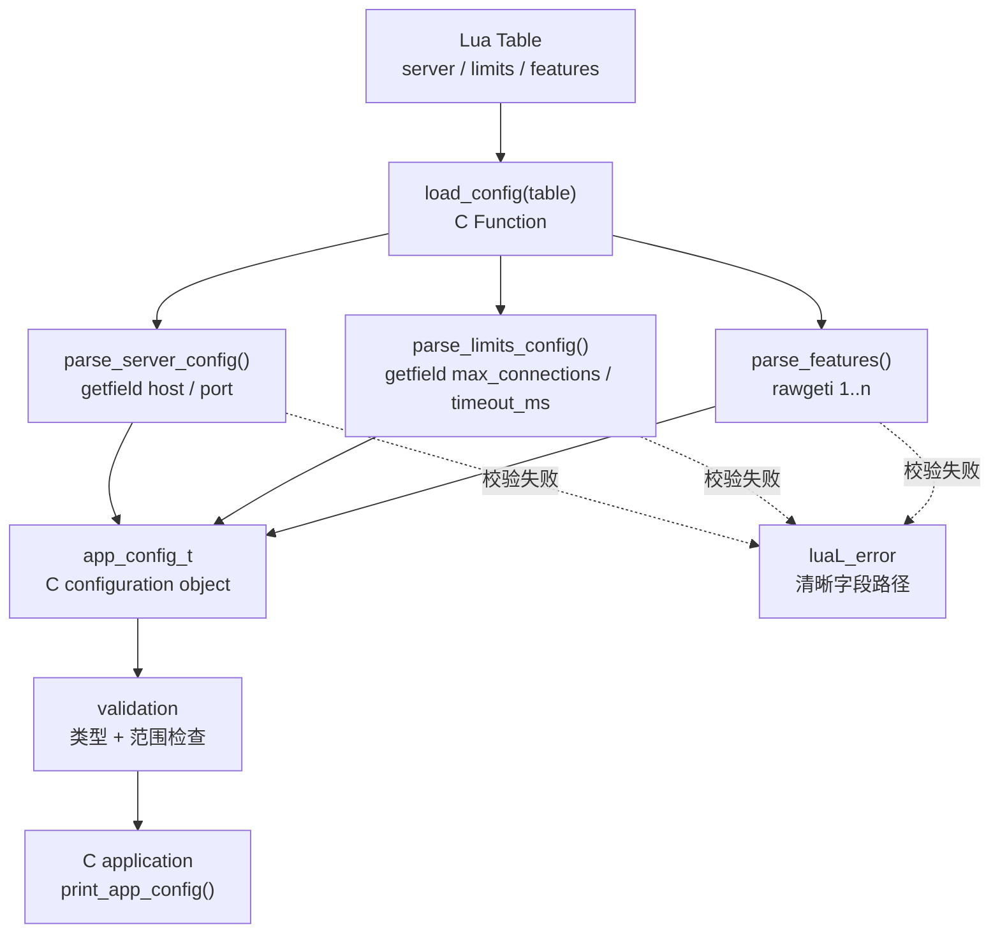

# Project 3 · Configuration Parser

> 依赖知识：Chapter 06（Table Lua -> C）、Chapter 18（错误处理）。
> 完整代码见同目录 `config_parser_demo.c` / `config_parser_demo.lua`，已通过 `make run` 验证。

## 场景简介

真实应用极少只用一层扁平字段来配置自己（Chapter 06 的 `configure({host=..., port=..., enabled=...})` 只覆盖了这种最简单的情况）。更常见的形态是一份**嵌套配置**：一部分字段本身又是一个子 Table（比如 `server`、`limits`），还有一部分字段是**数组**（比如 `features` 这样的功能开关列表）。

本项目实现一个 `load_config(table)`：把这样一份嵌套 + 数组混合的 Lua Table，解析进 C 侧的 `struct app_config`（嵌套 struct），过程中逐字段校验类型和取值范围，任何一处校验失败都用 `luaL_error` 报出**清晰的字段路径**（例如 `"server.port must be a number"`），而不是一个笼统的 "invalid config"。校验全部通过后，C 侧把解析结果打印出来，证明 C application 确实拿到了正确、且类型安全的数据。

```text
Lua Table（嵌套结构 + 数组部分）
    |
    v
load_config()          <- C Function，Lua/C API 的唯一入口
    |
    v
C configuration object  <- struct app_config（嵌套 struct）
    |
    v
validation               <- 逐字段类型/范围检查，失败就 luaL_error
    |
    v
C application            <- 这里简化为打印，证明数据已经正确落地
```

## 架构图



## 完整代码

C 侧核心结构（完整实现见 `config_parser_demo.c`）：

```c
typedef struct {
    char host[MAX_HOST_LEN];
    int  port;
} server_config_t;

typedef struct {
    int max_connections;
    int timeout_ms;
} limits_config_t;

typedef struct {
    server_config_t server;
    limits_config_t limits;
    char features[MAX_FEATURES][MAX_FEATURE_LEN];
    int  feature_count;
} app_config_t;
```

`load_config` 的整体骨架：

```c
static int l_load_config(lua_State *L)
{
    luaL_checktype(L, 1, LUA_TTABLE);

    app_config_t cfg;
    memset(&cfg, 0, sizeof(cfg));

    parse_server_config(L, 1, &cfg.server);
    parse_limits_config(L, 1, &cfg.limits);
    parse_features(L, 1, &cfg);

    print_app_config(&cfg);   /* C application 拿到数据后的动作 */
    return 0;
}
```

三个 `parse_*` 函数各自遵守同一条 **Stack Contract**：进入前 Stack 是什么样，离开后必须恢复成一样（净 Stack Balance 为 0），调用方完全不需要关心它们内部用了多少临时槛位。

**设计选择 1：为什么 `parse_server_config` / `parse_limits_config` 没有写成真正递归调用自己的 C 函数？**

本例的嵌套只有固定的一层（`app.server`、`app.limits`），两个函数各自重复的是**完全相同的三步套路**：

```text
lua_getfield（Get: Lua Object -> Stack）
    -> 类型校验 + lua_to*（Read: Stack -> C）
    -> lua_pop（清理临时值）
```

这正是"处理嵌套 table"的通用模式——每多一层嵌套，就是再套一次这三步。如果配置的嵌套深度不固定（比如允许任意深度的 JSON 风格配置），自然的写法就是把这三步收进一个真正递归调用自己的 C 函数，额外带一个 `path` 前缀字符串参数，一路拼出 `"a.b.c"` 这样的错误路径。本项目为了让读者看清"套路"本身，选择了显式展开而不是抽象成递归函数——两种写法在 Lua/C API 使用方式上没有区别，只是"代码复用程度"不同。

**设计选择 2：数组部分为什么用 `lua_rawgeti` 而不是 `lua_next`？**

```c
size_t n = lua_rawlen(L, features_idx);
for (size_t i = 1; i <= n; i++) {
    lua_rawgeti(L, features_idx, (lua_Integer)i);
    /* ... 校验 + 读取 ... */
    lua_pop(L, 1);
}
```

- `features` 在语义上是"一个有序列表"，不是"任意键值对集合"。
- `lua_rawlen` 直接给出这类纯数组 Table 的长度（border），配合 `lua_rawgeti(L, idx, i)` 按 `1..n` 遍历，**顺序确定**、代码直白，且天然跳过 hash 部分（如果脚本手误往 `features` 里塞了非数字 key，会被安静忽略，不会被当成"数组的一部分"误读）。
- `lua_next`（Chapter 08）更适合"不知道有哪些 key、需要遍历整张 Table"的场景；这里我们已经明确知道要的是"数组部分"，用 `lua_next` 反而要多写代码过滤非整数 key，还要处理它不保证遍历顺序的问题——对一个"有序功能列表"来说这是不必要的复杂度。

## 关键 Stack Diagram

### Diagram 1：`parse_server_config` 读 `server.port` 那一刻

进入 `parse_server_config` 时，Stack 上已经有外层 table（位置 1）。`lua_getfield(L, 1, "server")` 把子 table Push 上去，我们记下它的位置 `server_idx`；随后 `lua_getfield(L, server_idx, "port")` 再把 `port` 值 Push 上去：

```text
索引     内容                          来源
----     ----------------------------  ----------------------------
 1       外层 table（load_config 的参数） 调用时已在 Stack 上
 2       server 子 table               lua_getfield(L, 1, "server")
 3(栈顶) port 的值（比如 8080）          lua_getfield(L, 2, "port")
```

读完 `port` 之后：`lua_pop(L, 1)` 弹掉位置 3，Stack 回到只有 `[1, 2]`；`parse_server_config` 返回前再 `lua_pop(L, 1)` 弹掉位置 2（`server` 子 table 本身），Stack 恢复成进入前的样子（只有 `[1]`）——这就是"Stack Contract：净 Stack Balance 为 0"在代码里的具体样子。

### Diagram 2：`parse_features` 遍历数组部分

```text
lua_getfield(L,1,"features")   索引: [1]=outer [2]=features table
lua_rawgeti(L,2,1)              索引: [1]=outer [2]=features [3]=features[1]
  ... 校验 + strncpy 进 out->features[0] ...
lua_pop(L,1)                     索引: [1]=outer [2]=features        <- 回到只剩 features table
lua_rawgeti(L,2,2)               索引: [1]=outer [2]=features [3]=features[2]
  ... 校验 + strncpy 进 out->features[1] ...
lua_pop(L,1)                     索引: [1]=outer [2]=features
... 循环 n 次 ...
lua_pop(L,1)                     索引: [1]=outer                     <- 弹掉 features table 本身
```

每一轮循环都是"Push 一个数组元素 -> 读走它 -> 立刻 Pop"，栈上永远只多出一个临时槛位，绝不会随着 `n` 的增大而累积。

## Failure

**触发方式**：把 `server.port` 写成字符串 `"8080"` 而不是数字 `8080`。

这个案例的教学价值不在"类型错误会报错"本身，而在于**第一次实现时它并不会报错**——本项目在开发过程中就真实踩过这个坑：最初用的是 `lua_isnumber(L, -1)` 做类型判断，结果 `port = "8080"` 这种写法竟然被当作合法配置接受了。原因是 `lua_isnumber()` 的语义是"这个值是数字，**或者**是一个能被转换成数字的字符串"——这是 Lua 语言级别的隐式强转规则（`"8080" + 1` 能算出 `8081`，靠的就是这套机制），但对配置校验来说，这几乎从来不是我们想要的行为：它会让 `port = "8080"`（字符串，可能是拼写习惯问题）和 `port = "abc"`（字符串，明显是错误）走上完全不同的路径——前者被静默接受，后者才报错，行为很不一致，也很难调试。

修复方式是把类型判断从 `lua_isnumber()` / `lua_isstring()` 换成严格的 `lua_type(L, -1) == LUA_TNUMBER` / `== LUA_TSTRING`（本项目代码里 `server.port`、`server.host`、`limits.*`、`features[i]` 全部采用这种严格判断）。修复后的实际输出：

```text
== 错误示例 1：server.port 类型错误（字符串而不是数字） ==
  ok1 =	false
  err1 =	server.port must be a number (got string)
```

**Debugging 心得**：Lua C API 里带 `is*` 前缀的类型判断函数不全是"纯类型查询"——`lua_isnumber`/`lua_isstring` 明确包含隐式转换语义（这一点在官方文档里其实写清楚了，但容易被名字误导），`lua_istable`/`lua_isfunction`/`lua_isnil` 等则是严格判断。写校验逻辑时，只要"类型必须精确匹配"是硬性要求，就应该用 `lua_type(L, idx) == LUA_Txxxx`，而不是名字看起来对应的 `lua_isxxx`。

另外两个已验证的失败案例（同样用 `pcall` 捕获，实际输出见下方"实际运行输出"）：
- `server.port = 99999`（超出 1~65535 范围）-> `"server.port must be between 1 and 65535 (got 99999.0)"`
- 缺失 `limits.timeout_ms` 字段 -> `"limits.timeout_ms must be a number (got nil)"`（`lua_getfield` 在字段不存在时会 Push 一个 `nil`，`luaL_typename` 报出的类型正是 `"nil"`，这正好说明了"缺字段"在 Lua C API 层面和"类型错误"走的是同一套校验路径）。

## Mental Model

> **校验一份嵌套配置，本质上是把"Get 一层 -> 严格判类型 -> Read 出来 -> Pop 掉"这个四步循环，在每一层嵌套 Table 和每一个数组元素上原样重复一遍；`luaL_error` 让任何一步失败都能立刻中止并报出此刻真正的字段路径，而不需要手写一层层的 `if` 错误传播。**

对照全书骨架：Lua Table（Lua Object）-> `lua_getfield`（Get）-> `lua_type` + `lua_to*`（类型查询 + Read）-> C configuration object（Native C World）-> validation -> C application。所有跨界动作依然只发生在 Lua Stack 这唯一的通道上，没有任何"直接把 Lua 变量地址传给 C 指针"的捷径。
