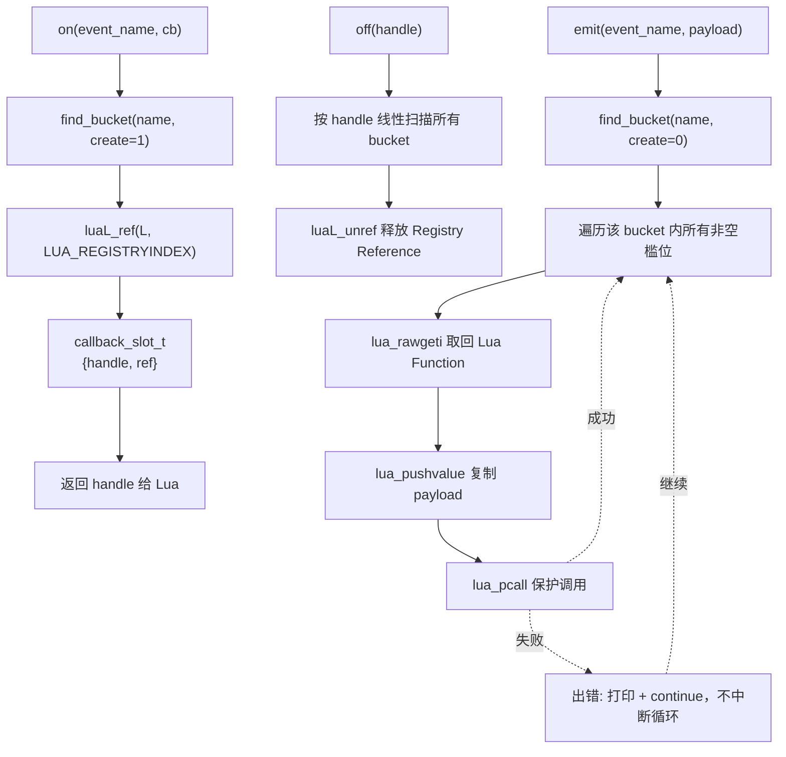

# Project 4 · Event Callback System

> 依赖知识：Chapter 09（Lua Function -> C，Registry Reference）、
> Chapter 10（C Callback Event System，单一 handler 版本）、
> Chapter 18（错误处理）。
> 完整代码见同目录 `event_system_demo.c` / `event_system_demo.lua`，已通过 `make run` 验证。

## 场景简介

Chapter 10 的 `event_demo.c` 证明了"一个 Registry Reference 可以让 C 长期持有一个 Lua Function"，但它只支持**全局唯一一个 handler**——`on_event` 再调用一次就把上一个覆盖掉了。真实的事件系统显然需要更多：不同事件类型（`"connected"`、`"message"` ……）各自独立，同一个事件类型下也允许**同时挂多个回调**（比如日志模块和业务模块都想在 `"connected"` 时做点事，互不干扰）。

本项目实现三个 C Function：

- `on(event_name, callback)` —— 注册，返回一个 handle（整数）。
- `off(handle)` —— 按 handle 反注册。
- `emit(event_name, payload)` —— 触发该事件名下所有已注册回调。

```text
Lua callback
    |
    v
on(event, cb)           <- Registry：luaL_ref 长期持有这个 Lua Function
    |
    v
emit(event, payload)    <- C event source
    |
    v
lua_pcall                <- 每个回调单独保护调用
    |
    v
Lua callback（被调用，可能出错，但不影响其它回调）
```

## 架构图



## 完整代码

数据结构（按事件名分桶，每桶固定槛位数组）：

```c
typedef struct {
    int handle;   /* 0 表示空闲槛位 */
    int ref;      /* luaL_ref 返回的 Registry Reference */
} callback_slot_t;

typedef struct {
    char name[MAX_EVENT_NAME_LEN];
    int  in_use;
    callback_slot_t slots[MAX_CALLBACKS_PER_EVENT];
} event_bucket_t;

static event_bucket_t g_buckets[MAX_EVENT_TYPES];
static int g_next_handle = 1;
```

`on()` 的核心逻辑：

```c
static int l_on(lua_State *L)
{
    const char *name = luaL_checkstring(L, 1);
    luaL_checktype(L, 2, LUA_TFUNCTION);

    event_bucket_t *bucket = find_bucket(name, 1);
    int slot_idx = /* 找一个 handle == 0 的空槛位 ... */;

    lua_pushvalue(L, 2);
    int ref = luaL_ref(L, LUA_REGISTRYINDEX);   /* Stack -> Registry */

    int handle = g_next_handle++;
    bucket->slots[slot_idx].handle = handle;
    bucket->slots[slot_idx].ref = ref;

    lua_pushinteger(L, handle);
    return 1;
}
```

`emit()` 的核心逻辑（**任何一个回调出错都不能中断其它回调**是本项目的硬约束）：

```c
static int l_emit(lua_State *L)
{
    const char *name = luaL_checkstring(L, 1);
    event_bucket_t *bucket = find_bucket(name, 0);
    if (bucket == NULL) return 0; /* 没人注册过，忽略 */

    for (int i = 0; i < MAX_CALLBACKS_PER_EVENT; i++) {
        if (bucket->slots[i].handle == 0) continue; /* 空槛位 */

        lua_rawgeti(L, LUA_REGISTRYINDEX, bucket->slots[i].ref); /* GET */
        lua_pushvalue(L, 2);                                     /* PUSH payload */

        if (lua_pcall(L, 1, 0, 0) != LUA_OK) {
            fprintf(stderr, "... callback error: %s\n", lua_tostring(L, -1));
            lua_pop(L, 1);   /* 弹掉错误对象，继续下一个槛位 */
            continue;
        }
    }
    return 0;
}
```

**设计选择：为什么 `off()` 只接受一个 `handle`，而不是 `off(event_name, callback)`？**

Lua Function 值本身没有"内容相等"的比较方式——每一次 `function(...) ... end` 表达式求值都会创建一个新的 Closure 对象，即使两处代码逐字符相同，它们在 Lua 里也是两个不同的对象；反过来，就算调用方确实保留了同一个 Function 变量再传回来，`lua_rawequal` 判断的也只是"是不是同一个对象"，一旦同一个事件下注册了两次内容相同的匿名函数字面量，这种比较方式也没办法说清楚"到底要删哪一次注册"。更彻底的做法是让 `on()` 返回一个 C 侧维护、全局单调递增的整数 `handle`：`off(handle)` 直接按这个数字定位槛位，语义上没有任何歧义，调用方也不需要保留 Function 引用本身，只需要保留一个整数——这正是本项目采用的设计。

## 关键 Stack Diagram

### Diagram：`emit()` 内部一次 `lua_pcall` 前后的 Stack

进入 `l_emit` 时 Stack 上是调用参数：

```text
索引     内容
----     --------------------------------
 1       event_name（字符串，比如 "message"）
 2       payload（比如 "hello world"）
```

进入循环体，对某个非空槛位执行 `lua_rawgeti` + `lua_pushvalue`：

```text
索引     内容                              来源
----     --------------------------------  --------------------------------
 1       event_name                        调用参数
 2       payload                           调用参数
 3       该槛位对应的 Lua Function          lua_rawgeti(L, LUA_REGISTRYINDEX, ref)
 4(栈顶) payload 的一份拷贝                  lua_pushvalue(L, 2)
```

`lua_pcall(L, 1, 0, 0)` 之后（假设成功）：位置 3、4 被 VM 消费掉（函数连同它的 1 个参数一起被 `CALL`），Stack 恢复到只有 `[1, 2]`；假设失败，Stack 上位置 3 变成错误对象（函数和参数被弹走，错误对象被 Push 上来），代码手动 `lua_pop(L, 1)` 把它清掉，同样恢复到 `[1, 2]`。**两条路径最终都回到同一个 Stack 状态**，这正是"循环体内部自己负责收拾干净，调用方完全不知道内部发生过多少次 push/pop"的体现——下一轮循环可以放心地假设 Stack 上只有 `[1, 2]` 这两个参数。

## Lifecycle：Registry Reference 的一生

这是本项目相对 Chapter 09/10 的核心增量：一个 Registry Reference 不再是"永远只有一个、程序运行期间自然存在到 `lua_close`"，而是有明确的**创建、存活、（可能）反注册**三个阶段，且同一时刻可能有多个 Reference 并存：

```text
on(event, cb) 被调用
      |
      v
luaL_ref(L, LUA_REGISTRYINDEX)
      |
      v
Registry 里出现一个新槛位，cb 被"钉住"
（即使 Lua 侧那个 cb 变量后续被覆盖/丢弃，
 只要 Registry 还占着这个槛位，cb 就不会被 GC）
      |
      |<---------------------------------+
      v                                  |
emit(event, ...) 被调用任意次              |
      |                                  |
      v                                  |
lua_rawgeti 把它重新 Push 到 Stack         |
（每次都是"临时借出"，Stack index         |
  只在这次 emit 内有效）                   |
      |                                  |
      +----------------------------------+
      |
      v
off(handle) 被调用（可能永远不被调用！）
      |
      v
luaL_unref(L, LUA_REGISTRYINDEX, ref)
      |
      v
Registry 槛位被释放；如果 Lua 侧也没有其它
变量指向这个 Function，它才真正变成 GC 可回收对象
      |
      v
（如果 off() 从未被调用）程序一直运行到 lua_close(L)，
lua_close 释放整个 lua_State，这个 Reference 才随之消失
```

关键点：**"注册"和"触发"可以发生任意多次、任意穿插**（比如脚本里可以先给 `"message"` 注册两个回调、`emit` 几次、再注册第三个回调、再 `emit`——本项目 Lua 脚本里就是这么做的），Registry Reference 的存活期完全不跟"某一次 C 函数调用"绑定，只跟"有没有被 `luaL_unref`"绑定。这也是为什么 `emit()` 每次都要重新 `lua_rawgeti`，而不能"缓存"上次取到的 Stack index——Stack index 天生就是"这次调用内"的临时坐标（见 `TERMS.md` 的写作约定第 5 条），能跨调用存活的只有 Registry 里的那个整数引用。

## Failure

**触发方式 1（核心要求）**：给 `"message"` 事件注册第 3 个回调，这个回调故意 `error(...)`，然后 `emit("message", ...)`，验证同事件下另外两个正常的回调（`callback#3`、`callback#4`）依然被执行，且执行顺序不受影响。

实际输出：

```text
== emit("message")：callback#5 会报错，但 callback#3/#4 应该都还正常执行 ==
  [lua] callback#3 (message):	second wave
  [lua] callback#4 (message):	second wave
[C] emit("message"): callback handle=5 raised an error: event_system_demo.lua:38: boom in callback#5 while handling: second wave
[C] emit("message"): 2 callback(s) fired successfully
```

注意打印顺序：`callback#3`/`#4` 的输出先于 `[C] ... raised an error`，这是因为槛位遍历顺序是 `#0 -> #1 -> #2`，而 `callback#5` 恰好占了 `#2`（最后注册），所以它出错的时机排在其它两个成功回调**之后**——`emit()` 的返回统计（`2 callback(s) fired successfully`）也证明了：3 个槛位里只有 2 个真正成功，第 3 个的失败被吞掉打印，但循环没有被它打断。

**触发方式 2（槛位耗尽）**：`MAX_CALLBACKS_PER_EVENT` 固定为 4，连续给同一个事件名注册第 5 个回调：

```text
== 演示回调槛位耗尽的 Failure：连续注册超过上限个回调 ==
[C] on("overflow-test"): registered, handle=6  ...
[C] on("overflow-test"): registered, handle=7  ...
[C] on("overflow-test"): registered, handle=8  ...
[C] on("overflow-test"): registered, handle=9  ...
  5th on("overflow-test", ...) => ok=false err=on("overflow-test"): callback slots exhausted (max 4), call off() on an existing handle first
```

这里用 `pcall` 包住第 5 次 `on()` 调用——虽然整个脚本本身已经跑在 `luaL_dofile` 内部隐含的一层保护调用之下（不会导致 C 宿主程序崩溃），但如果不在脚本层再包一层 `pcall`，`luaL_error` 触发的 Lua Error 会一路向上穿透，直接中止整份脚本的后续执行（脚本里排在这行之后的所有代码都不会再跑）。用 `pcall` 把这次失败限制在"这一次注册"这一行上，才能让脚本继续往下执行后面的清理逻辑。

**触发方式 3（幂等的 off）**：对一个从未存在过的 `handle`（这里用 `9999`）调用 `off()`：

```text
== off() 一个不存在的 handle，验证不会崩溃 ==
[C] off(9999): handle not found (already removed, or never existed)
  off(9999) returned:	false
```

这里特意**没有**用 `luaL_error`，而是返回 `false`——因为"重复 off 同一个 handle"或"off 一个已经因为其它原因失效的 handle"在真实系统里是完全正常的操作序列（比如两处代码都持有同一个 handle，都在各自的清理逻辑里调用了一次 `off`），不应该被当成一个需要用 `pcall` 才能防住的异常。

## Mental Model

> **一个事件系统 = 若干个"事件名 -> Registry Reference 列表"的桶；`on()` 用 `luaL_ref` 往桶里加一个引用并换回一个 handle，`off()` 用 `luaL_unref` 按 handle 精确摘除一个引用，`emit()` 对桶里现存的每一个引用各自独立地 `lua_rawgeti` 取回、`lua_pcall` 调用——每一次调用的成败只属于它自己，绝不传染给同一批里的其它调用。**

对照全书骨架：Lua callback（Lua Object）-> `luaL_ref`（跨调用长期持有）-> Registry（Reference 的家）-> `lua_rawgeti`（Get: Registry -> Stack，每次都是临时借出）-> `lua_pcall`（Call，保护调用）-> Lua callback 被执行。全部数据交换依然只经过 Lua Stack 这一条通道；能够跨越"这次 C 函数调用结束"这条边界存活的，永远只有 Registry 里的整数引用，不是任何形式的 Stack index 或裸指针。
