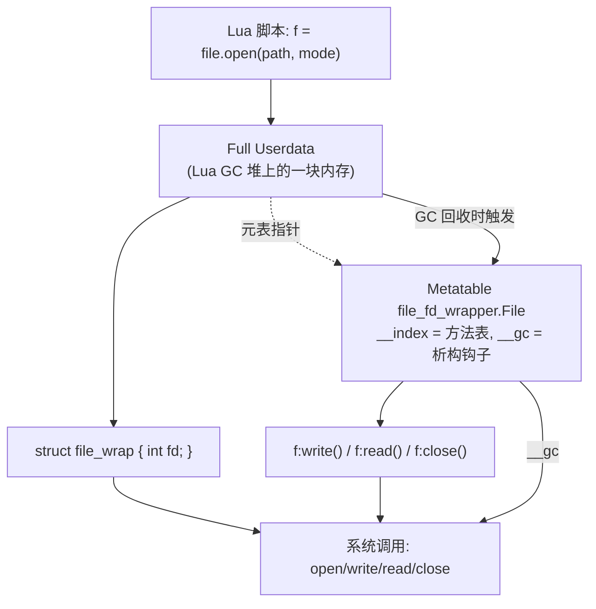

# Project 5：File / FD Wrapper

> 前置知识：Chapter 00（总体架构）、Chapter 09-10（Registry / Lua Function 被 C 持有）、
> Chapter 11-14（Userdata + Metatable，如果这几章此时还没写完，本项目按 TERMS.md 的标准套路
> `luaL_newmetatable` + `__index` 方法表 + `__gc` 独立给出完整实现，不依赖它们已存在）。

## 场景简介

真实世界里，"文件"对操作系统来说只是一个整数——`int fd`（文件描述符）。
`open()` 拿到它，`write()`/`read()` 用它读写数据，`close()` 释放它。这个整数本身
**没有任何自动生命周期管理**：C 程序员必须手动记得 `close()`，忘记了就是经典的
"fd 泄漏"（长时间运行的进程会因此耗尽进程可用的 fd 上限）。

本项目要解决的问题：**如何把这个"裸的、需要手动管理的 C 资源"包装成一个 Lua Object**，
让 Lua 脚本可以像用一个普通对象一样使用它（`f:write(...)`、`f:read()`、`f:close()`），
同时借助 Lua 的 GC，即使脚本作者忘记调用 `:close()`，fd 也不会永久泄漏。

这正是 Lua C API 里 **Userdata + Metatable + `__gc`** 这一整套机制存在的核心原因：
Full Userdata 是"被 GC 管理的一块原始内存"，Metatable 给它挂上方法和析构钩子，
`__gc` 则让"C 资源的生命周期"挂靠在"Lua Object 的生命周期"上。

对应的 Lua 侧用法（也是本项目 `file_fd_demo.lua` 的核心）：

```lua
local f = file.open("/tmp/xxx.txt", "w")
f:write("hello\n")
f:close()

local r = file.open("/tmp/xxx.txt", "r")
print(r:read())
r:close()
```

## Architecture（架构图）

```text
Lua                     f = file.open(path, mode)
 |
 v
Userdata                lua_newuserdata(L, sizeof(struct file_wrap))
 |                      （一块被 Lua GC 堆管理的原始内存）
 v
struct file_wrap        { int fd; }
 |
 v
C fd                    open() 返回的操作系统文件描述符
 |
 v
methods                 f:write() / f:read() / f:close()
 |                      （通过 Metatable 的 __index 派发到 C Function）
 v
系统调用                  write(fd,...) / read(fd,...) / close(fd)
 |
 v
__gc                    userdata 被 GC 回收时自动触发，
                         兜底关闭忘记显式 close 的 fd
```

Mermaid 版本（对象关系更完整）：



## 完整代码

### `file_fd_demo.c`

```c
/*
 * Project 5: File / FD Wrapper
 *
 * 教学目的：把一个真实的 OS 文件描述符（int fd）包装成 Lua Object，
 * 覆盖 Userdata + Metatable + __gc 的标准套路：
 *
 *   Lua (file.open / f:write / f:read / f:close)
 *     |
 *   Userdata (struct file_wrap*，由 Lua GC 堆管理)
 *     |
 *   C struct file_wrap { int fd; }
 *     |
 *   系统调用 open()/write()/read()/close()
 *
 * 关键设计点：
 *   1. fd 关闭后立刻置成 -1，close()/__gc 都先检查 fd >= 0，
 *      这样"手动 close 过的 userdata 又被 GC 调用 __gc"不会重复关闭出错。
 *   2. __gc 是最后一道防线：即便 Lua 脚本忘记调用 :close()，
 *      只要这个 userdata 被 GC 回收，fd 就一定会被关闭，不会永久泄漏。
 */
#include <stdio.h>
#include <stdlib.h>
#include <string.h>
#include <errno.h>
#include <fcntl.h>
#include <unistd.h>

#include <lua.h>
#include <lauxlib.h>
#include <lualib.h>

#define FILE_MT "file_fd_wrapper.File"

struct file_wrap {
    int fd;
};

/* ---- 工具函数 ---- */

static struct file_wrap *check_file(lua_State *L, int idx) {
    return (struct file_wrap *)luaL_checkudata(L, idx, FILE_MT);
}

/* ---- file.open(path, mode) ---- */

static int l_file_open(lua_State *L) {
    const char *path = luaL_checkstring(L, 1);
    const char *mode = luaL_optstring(L, 2, "r");

    int flags;
    if (mode[0] == 'r') {
        flags = O_RDONLY;
    } else if (mode[0] == 'w') {
        flags = O_WRONLY | O_CREAT | O_TRUNC;
    } else if (mode[0] == 'a') {
        flags = O_WRONLY | O_CREAT | O_APPEND;
    } else {
        return luaL_error(L, "file.open: unsupported mode '%s' (use \"r\"/\"w\"/\"a\")", mode);
    }

    int fd = open(path, flags, 0644);
    if (fd < 0) {
        return luaL_error(L, "file.open(\"%s\", \"%s\") failed: %s",
                           path, mode, strerror(errno));
    }

    /* Native C World -> Userdata：lua_newuserdata 在 Lua GC 堆上分配
     * sizeof(struct file_wrap) 字节，返回的指针既是普通 C 指针，
     * 也已经被 Push 到 Stack 顶（这次调用的返回值）。 */
    struct file_wrap *fw = (struct file_wrap *)lua_newuserdata(L, sizeof(*fw));
    fw->fd = fd;

    luaL_getmetatable(L, FILE_MT);
    lua_setmetatable(L, -2);

    return 1; /* 栈顶 1 个值：这个新 userdata */
}

/* ---- f:write(data) ---- */

static int l_file_write(lua_State *L) {
    struct file_wrap *fw = check_file(L, 1);
    size_t len;
    const char *data = luaL_checklstring(L, 2, &len);

    if (fw->fd < 0) {
        return luaL_error(L, "write: file already closed (fd = -1)");
    }

    size_t total = 0;
    while (total < len) {
        ssize_t n = write(fw->fd, data + total, len - total);
        if (n < 0) {
            if (errno == EINTR) continue;
            return luaL_error(L, "write failed: %s", strerror(errno));
        }
        total += (size_t)n;
    }

    lua_pushinteger(L, (lua_Integer)total);
    return 1;
}

/* ---- f:read() ---- 读到 EOF 为止，整体作为一个 Lua string 返回 */

static int l_file_read(lua_State *L) {
    struct file_wrap *fw = check_file(L, 1);

    if (fw->fd < 0) {
        return luaL_error(L, "read: file already closed (fd = -1)");
    }

    luaL_Buffer b;
    luaL_buffinit(L, &b);

    char chunk[256];
    for (;;) {
        ssize_t n = read(fw->fd, chunk, sizeof(chunk));
        if (n < 0) {
            if (errno == EINTR) continue;
            return luaL_error(L, "read failed: %s", strerror(errno));
        }
        if (n == 0) break; /* EOF */
        luaL_addlstring(&b, chunk, (size_t)n);
    }

    luaL_pushresult(&b);
    return 1;
}

/* ---- f:close()：显式关闭，幂等 ---- */

static int l_file_close(lua_State *L) {
    struct file_wrap *fw = check_file(L, 1);

    if (fw->fd >= 0) {
        printf("[close] explicit :close() -> close(fd=%d)\n", fw->fd);
        close(fw->fd);
        fw->fd = -1;
    } else {
        printf("[close] :close() called again on an already-closed file, no-op\n");
    }
    return 0;
}

/* ---- __gc：最后一道防线，兜底关闭忘记 close 的 fd ---- */

static int l_file_gc(lua_State *L) {
    /* __gc 是 Lua VM 在回收这个 userdata 时自己触发的，
     * 不是脚本主动调用，所以这里用 luaL_checkudata 而不是假设参数一定合法。 */
    struct file_wrap *fw = (struct file_wrap *)luaL_checkudata(L, 1, FILE_MT);
    if (fw->fd >= 0) {
        printf("[gc] __gc caught a leaked fd=%d, closing it now\n", fw->fd);
        close(fw->fd);
        fw->fd = -1;
    }
    return 0;
}

static const luaL_Reg file_methods[] = {
    {"write", l_file_write},
    {"read",  l_file_read},
    {"close", l_file_close},
    {NULL, NULL}
};

/* 标准套路：luaL_newmetatable + __index 指向自身 + __gc */
static void register_file_api(lua_State *L) {
    luaL_newmetatable(L, FILE_MT);          /* mt */
    luaL_setfuncs(L, file_methods, 0);      /* mt.write / mt.read / mt.close */

    lua_pushcfunction(L, l_file_gc);
    lua_setfield(L, -2, "__gc");            /* mt.__gc = l_file_gc */

    lua_pushvalue(L, -1);
    lua_setfield(L, -2, "__index");         /* mt.__index = mt（方法表就是元表自己） */

    lua_pop(L, 1);                          /* 弹出 mt，Registry 里仍持有一份 */

    lua_newtable(L);                        /* file = {} */
    lua_pushcfunction(L, l_file_open);
    lua_setfield(L, -2, "open");            /* file.open = l_file_open */
    lua_setglobal(L, "file");
}

int main(void) {
    lua_State *L = luaL_newstate();
    luaL_openlibs(L);

    register_file_api(L);

    if (luaL_dofile(L, "file_fd_demo.lua") != LUA_OK) {
        fprintf(stderr, "lua error: %s\n", lua_tostring(L, -1));
        lua_close(L);
        return 1;
    }

    lua_close(L);
    return 0;
}
```

### `file_fd_demo.lua`

```lua
local PATH = "/tmp/lua-c-guide-demo.txt"

print("== Step 1: file.open(path, \"w\") + f:write() + f:close() ==")
local w = file.open(PATH, "w")
w:write("hello\n")
w:close()

print("== Step 2: file.open(path, \"r\") + r:read() ==")
local r = file.open(PATH, "r")
local content = r:read()
print("content =", string.format("%q", content))
assert(content == "hello\n", "content mismatch! write/read 不一致")
r:close()

print("== Step 3: 已经 close 过的 userdata 再次 :close()，必须是安全的 no-op ==")
r:close()

print("== Step 4: 对已关闭的文件继续读写，必须报错而不是崩溃/读到垃圾 ==")
local ok, err = pcall(function() return r:read() end)
print("pcall ok =", ok, "err =", err)
assert(not ok, "对已关闭文件调用 :read() 本应报错")

print("== Step 5: 忘记调用 :close()，__gc 必须兜底关闭 fd，不能永久泄漏 ==")
do
    local leaked = file.open(PATH, "r")
    -- 故意不调用 leaked:close()，让这个 userdata 在 do-block 结束后失去唯一引用
    leaked = nil
end
collectgarbage("collect") -- 强制触发一次完整 GC；日志里应看到 [gc] 行

print("== all checks passed ==")
```

### `make run` 实际输出

```text
$ make run
./file_fd_demo
== Step 1: file.open(path, "w") + f:write() + f:close() ==
[close] explicit :close() -> close(fd=5)
== Step 2: file.open(path, "r") + r:read() ==
content =	"hello\
"
[close] explicit :close() -> close(fd=5)
== Step 3: 已经 close 过的 userdata 再次 :close()，必须是安全的 no-op ==
[close] :close() called again on an already-closed file, no-op
== Step 4: 对已关闭的文件继续读写，必须报错而不是崩溃/读到垃圾 ==
pcall ok =	false	err =	file_fd_demo.lua:19: read: file already closed (fd = -1)
== Step 5: 忘记调用 :close()，__gc 必须兜底关闭 fd，不能永久泄漏 ==
[gc] __gc caught a leaked fd=5, closing it now
== all checks passed ==
```

（`content` 那一行 `print` 是 tab 分隔的两个值 `"content ="` 和被 `%q` 转义后的字符串，
`%q` 会把字符串里的换行符转成反斜杠加真实换行，所以看起来像换成了两行——这是
`string.format("%q", ...)` 的标准行为，不是 bug。）

## Stack Diagram

以 `f:write("hello\n")` 这一次调用为例（Lua 里 `f:write(x)` 是 `f.write(f, x)` 的语法糖，
第一个参数永远是 `self`，也就是这个 userdata 自己）：

**调用发生前，VM 内部经历的方法派发：**

```text
1. VM 执行 f:write("hello\n")
2. VM 需要先取出 f.write —— 但 f 是 userdata，没有普通字段，
   于是触发 __index metamethod：
       __index(f, "write")
   因为 __index 本身被设成了 Metatable 自己（一个 table），
   Lua 对 "__index 是 table" 的情况有特殊处理：
   直接等价于 rawget(mt, "write")，不会真的调用一个 Lua/C Function。
3. 从 Metatable 里查到 write 字段 = l_file_write（一个 lua_CFunction）
4. VM 把 (f, "hello\n") 两个参数压栈，跳转执行 l_file_write
```

**进入 `l_file_write` 那一刻，Lua Stack 状态（Before）：**

```text
index  1        2
      +--------+------------+
      | f(ud)  | "hello\n"  |
      +--------+------------+
      ^                     ^
   stack bottom          stack top
```

- index 1：`self`，也就是那个 `struct file_wrap*` 包装出来的 userdata。
- index 2：要写入的字符串参数。

**`l_file_write` 内部的 Stack 操作序列：**

```text
check_file(L, 1)              读 index 1，luaL_checkudata 校验 Metatable 匹配，
                               返回 struct file_wrap* 指针（这是 C 指针，
                               已经离开 Stack，落回 Native C World）

luaL_checklstring(L, 2, &len) 读 index 2，得到 const char* data 和长度 len
                               （字符串内容仍然由 Lua GC 管理，
                               data 指针只在本次调用内有效）

write(fw->fd, data, len)      纯 C 世界的系统调用，与 Stack 无关

lua_pushinteger(L, total)     把写入的字节数 Push 回 Stack
```

**函数返回前，Stack 状态（After）：**

```text
index  1        2            3
      +--------+------------+---------+
      | f(ud)  | "hello\n"  |  total  |
      +--------+------------+---------+
                                 ^
                            stack top（新 Push 的返回值）

return 1;   -- 告诉 Lua VM：从栈顶数 1 个值（也就是 total）就是这次调用的返回值
```

VM 收到 `return 1` 后，会把原本属于这次 `CALL` 的那些槽位（index 1、2）连同多余部分
一起清理，只把 `total` 留在调用方期望的位置上——这就是 **Stack Contract**：进入时你能看到
参数，离开时你只需要保证"该 Push 的返回值已经 Push，且用 `return N` 如实汇报数量"，
VM 会负责收拾其余的槽位。

## Lifecycle（生命周期）

```text
file.open(path, mode)
      |
      v
   open() 系统调用成功，得到 fd
      |
      v
lua_newuserdata()  -- 在 Lua GC 堆上分配 struct file_wrap，fd 存进去
      |
      v
lua_setmetatable() -- 挂上 Metatable（方法表 + __gc）
      |
      v
   Lua 变量持有这个 userdata（比如 local f = ...）
      |
      +-- 分支 A：脚本显式调用 f:close()
      |        |
      |        v
      |    close(fd)，fw->fd = -1
      |        |
      |        v
      |    之后即使这个 userdata 之后被 GC 触发 __gc，
      |    __gc 里 fd < 0，直接跳过，不会重复 close()
      |
      +-- 分支 B：脚本忘记调用 f:close()，f 的引用最终消失
               |
               v
           Lua GC 在某次回收周期扫描到这个 userdata 不可达
               |
               v
           触发 __gc metamethod（l_file_gc）
               |
               v
           fd >= 0，执行兜底 close(fd)，fw->fd = -1
               |
               v
           fd 不会永久泄漏，但注意：GC 触发时机不确定
           （不像 C++ RAII 或显式 close 那样"立刻"释放）
```

**忘记显式 `:close()` 会怎样？**

1. **最坏情况**：如果 GC 一直没有被触发（比如脚本很快退出、内存压力一直不够
   触发下一轮 GC），fd 会在整个进程存活期间一直占用着，直到 `lua_close(L)`
   关闭整个 Lua 解释器时才被强制触发所有对象的 `__gc`（本项目的 `main()` 在
   `luaL_dofile` 之后、返回之前都会调用 `lua_close(L)`，所以进程退出前一定会清理）。
2. **实际风险**：如果脚本在一个长期运行的循环里反复 `file.open()` 却从不 `:close()`
   也不给 GC 触发的机会（比如禁用了自动 GC、或者持续持有引用导致对象一直可达），
   会导致进程的 fd 句柄数一直增长，最终撞到 `ulimit -n`（每进程 fd 数上限），
   后续所有 `open()`/`socket()` 调用都会失败——这是真实生产环境里最常见的一类
   "资源泄漏导致服务雪崩"故障。
3. `__gc` **不是免费的性能特权**，它只是"最后一道安全网"，正确的习惯永远是
   **显式调用 `:close()`**，`__gc` 只用来兜底"异常路径 / 忘记写"的情况。

**为什么 `close()`/`__gc` 都要检查 `fd >= 0`？**

因为一个 userdata 的 `__gc` 迟早都会被调用（只要这块内存被分配过，GC 回收时
一定会跑一次 `__gc`），而脚本完全可能已经手动 `:close()` 过。如果不检查直接
再 `close(fd)`，在 `fd` 已经被操作系统回收并可能被其他 `open()` 调用复用给
另一个完全无关的资源的情况下，会误关掉别人的 fd——这是一类隐蔽且危险的
bug（术语上属于 fd 复用引发的"use-after-close"）。把 `fd` 显式置为 `-1`
并在每个入口检查，是这个问题的标准解法。

## Failure

**Failure 1：对已关闭的文件继续读写**

```lua
r:close()
r:read()   -- 触发 luaL_error("read: file already closed (fd = -1)")
```

`l_file_read`/`l_file_write` 在真正调用 `read()`/`write()` 系统调用之前，
都先检查 `fw->fd < 0`。如果不检查，`read(-1, ...)` 在 POSIX 语义下会返回
`-1` 并设置 `errno = EBADF`，但如果 fd 恰好被后续某次 `open()` 复用给了别的
资源，`read()`/`write()` 会"成功"地读写到一个完全不相关的文件上——这是
比"直接报错崩溃"更危险的情况（静默数据损坏）。本项目通过在 C 层提前
`luaL_error` 把这种误用转成一次明确的 Lua Error，脚本可以用 `pcall` 捕获，
而不会污染无关资源。

**Failure 2（对照组，未在代码中触发，仅用于说明）：如果 `__gc` 不存在会怎样**

假设去掉 `mt.__gc = l_file_gc` 这一行：脚本里 `file.open()` 出来的 userdata
一旦失去所有引用，Lua GC 只会回收这块 userdata 本身占的内存，**但不会
关闭里面记录的 `fd`**——因为 GC 根本不知道这个整数字段有特殊含义
（对它来说只是 userdata 内存里的几个字节）。这就是"忘记显式 `:close()`"
在没有 `__gc` 时的真实后果：fd 会一直存活，直到进程退出由操作系统内核
强制回收。这正是本项目坚持"必须实现 `__gc`"的原因。

## Mental Model

```text
Userdata 的价值不在于"包了一块内存"，
而在于把一个 C 资源（fd）的生命周期
接到了 Lua GC 能观测到的对象生命周期上。

__gc 不是让你可以偷懒不写 :close()，
而是让"忘记写 :close()"这个人为失误
不会变成"资源永久泄漏"这个系统级故障。

fd == -1 是这个 wrapper 唯一的"已关闭"标志，
close()/__gc 两条路径都必须先查它、再动它——
这是所有"允许重复释放"资源包装的通用解法。
```
