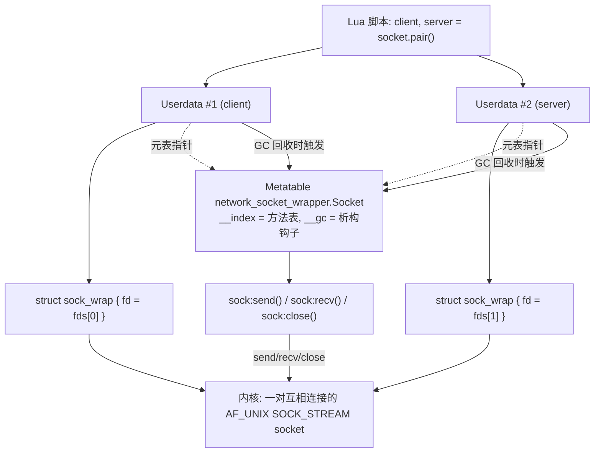

# Project 6：Network Socket Wrapper

> 前置知识：Project 5（File / FD Wrapper）。本项目跟 Project 5 是同一套骨架
> （Userdata + Metatable + `__gc`）在另一种 OS 资源上的重复应用——看完 Project 5
> 再看这里，你会发现 C 代码结构几乎一模一样，只是把 `open/read/write` 换成了
> `socketpair/recv/send`。这正是本教程想传达的东西：**这套 wrapper 骨架不是
> "文件专属技巧"，而是包装任意"需要手动释放的系统资源"的通用模式。**

## 场景简介

网络 socket 和文件 fd 本质上是同一类东西：内核里的一个整数句柄，指向一块
内核维护的、需要手动 `close()` 释放的资源。区别只是 socket 多了"连接"这个
状态（`connect`/`accept`）和专用的收发 API（`send`/`recv` 而不是
`read`/`write`，虽然在 Linux 上很多场景下 `read`/`write` 也能用在 socket 上）。

真实的 TCP client/server 需要 `socket()` + `bind()` + `listen()` + `accept()`
（服务端）配合 `socket()` + `connect()`（客户端），涉及端口分配、等待连接、
可能的端口冲突等一堆跟"Lua/C 互操作"这个教学主题无关的时序问题。

本项目按照需求里给出的简化方案：用 **`socketpair(AF_UNIX, SOCK_STREAM, 0, fds)`**
一次性拿到两个已经互相连接好的本地 socket fd——这在语义上等价于"一次成功的
TCP 握手之后，服务端 `accept()` 返回的连接 fd + 客户端 `connect()` 用的 fd"，
区别只是不需要真的监听端口。分别把这两个 fd 包装成两个 `sock` userdata
（一个当 "client"、一个当 "server"），在同一个 Lua 脚本里让其中一个
`:send()`、另一个 `:recv()` 并核对内容一致——完整覆盖了 userdata + 方法派发
+ 真实系统资源的教学目的，同时不依赖任何外部网络、不会有端口冲突，
每次运行结果确定可重复。

对应的 Lua 侧用法：

```lua
local client, server = socket.pair()
client:send("hello")
print(server:recv(5))
client:close()
server:close()
```

## Architecture（架构图）

```text
Lua object              client, server = socket.pair()
 |
 v
Userdata                lua_newuserdata(L, sizeof(struct sock_wrap))  x 2
 |                      （分别包装 socketpair() 返回的两个 fd）
 v
struct sock_wrap        { int fd; }
 |
 v
C networking APIs       socketpair() / send() / recv() / close()
 |
 v
methods                 sock:send(data) / sock:recv(maxlen) / sock:close()
 |                      （通过 Metatable 的 __index 派发到 C Function）
 v
__gc                    userdata 被 GC 回收时自动触发，
                         兜底关闭忘记显式 close 的 socket fd
```

Mermaid 版本：



## 完整代码

### `socket_demo.c`

```c
/*
 * Project 6: Network Socket Wrapper
 *
 * 教学目的：跟 Project 5（file fd）几乎完全同构，只是把"文件描述符"
 * 换成"socket 描述符"，进一步证明 Userdata + Metatable + __gc 这套
 * 骨架能包住任意一种"需要手动释放的 OS 资源"：
 *
 *   Lua object (socket.pair() / sock:send/recv/close)
 *     |
 *   Userdata (struct sock_wrap*，由 Lua GC 堆管理)
 *     |
 *   struct sock_wrap { int fd; }
 *     |
 *   C networking APIs: socketpair()/send()/recv()/close()
 *
 * 关于"为什么用 socketpair 而不是真的 socket()+bind()+listen()+accept()+connect()"：
 *   socketpair(AF_UNIX, SOCK_STREAM, 0, fds) 会一次性返回两个已经互相连接好的
 *   本地 socket fd，语义上完全等价于"一次成功的 TCP 三次握手之后，服务端 accept()
 *   拿到的连接 fd + 客户端 connect() 用的 fd"——区别只是不需要真的绑定端口、
 *   不需要处理"谁先谁后""端口被占用""等待 accept"这些跟本章教学目标无关的
 *   时序问题。sock:send()/sock:recv()/sock:close() 这三个方法内部就是标准
 *   POSIX socket API（send/recv/close），如果换成一个真正的 TCP fd，
 *   这三个方法可以不改一行代码直接复用。
 */
#include <stdio.h>
#include <stdlib.h>
#include <string.h>
#include <errno.h>
#include <unistd.h>
#include <sys/types.h>
#include <sys/socket.h>

#include <lua.h>
#include <lauxlib.h>
#include <lualib.h>

#define SOCK_MT "network_socket_wrapper.Socket"

struct sock_wrap {
    int fd;
};

/* ---- 工具函数 ---- */

static struct sock_wrap *check_sock(lua_State *L, int idx) {
    return (struct sock_wrap *)luaL_checkudata(L, idx, SOCK_MT);
}

static void push_socket(lua_State *L, int fd) {
    struct sock_wrap *sw = (struct sock_wrap *)lua_newuserdata(L, sizeof(*sw));
    sw->fd = fd;
    luaL_getmetatable(L, SOCK_MT);
    lua_setmetatable(L, -2);
}

/* ---- socket.pair()：一次性创建两个已连接的本地 socket ---- */

static int l_socket_pair(lua_State *L) {
    int fds[2];
    if (socketpair(AF_UNIX, SOCK_STREAM, 0, fds) != 0) {
        return luaL_error(L, "socketpair failed: %s", strerror(errno));
    }
    push_socket(L, fds[0]); /* 习惯上当 "client" */
    push_socket(L, fds[1]); /* 习惯上当 "server" */
    return 2; /* 栈顶 2 个值：client, server */
}

/* ---- sock:send(data) ---- */

static int l_sock_send(lua_State *L) {
    struct sock_wrap *sw = check_sock(L, 1);
    size_t len;
    const char *data = luaL_checklstring(L, 2, &len);

    if (sw->fd < 0) {
        return luaL_error(L, "send: socket already closed (fd = -1)");
    }

    size_t total = 0;
    while (total < len) {
        ssize_t n = send(sw->fd, data + total, len - total, 0);
        if (n < 0) {
            if (errno == EINTR) continue;
            return luaL_error(L, "send failed: %s", strerror(errno));
        }
        total += (size_t)n;
    }

    lua_pushinteger(L, (lua_Integer)total);
    return 1;
}

/* ---- sock:recv(maxlen) ---- */

static int l_sock_recv(lua_State *L) {
    struct sock_wrap *sw = check_sock(L, 1);
    lua_Integer maxlen = luaL_checkinteger(L, 2);

    if (sw->fd < 0) {
        return luaL_error(L, "recv: socket already closed (fd = -1)");
    }
    if (maxlen <= 0) {
        return luaL_error(L, "recv: maxlen must be > 0");
    }

    char *buf = (char *)malloc((size_t)maxlen);
    if (buf == NULL) {
        return luaL_error(L, "recv: out of memory (maxlen=%d)", (int)maxlen);
    }

    ssize_t n;
    for (;;) {
        n = recv(sw->fd, buf, (size_t)maxlen, 0);
        if (n < 0 && errno == EINTR) continue;
        break;
    }
    if (n < 0) {
        int saved_errno = errno;
        free(buf);
        return luaL_error(L, "recv failed: %s", strerror(saved_errno));
    }

    lua_pushlstring(L, buf, (size_t)n); /* n == 0 表示对端已关闭连接（EOF） */
    free(buf);
    return 1;
}

/* ---- sock:close()：显式关闭，幂等 ---- */

static int l_sock_close(lua_State *L) {
    struct sock_wrap *sw = check_sock(L, 1);

    if (sw->fd >= 0) {
        printf("[close] explicit :close() -> close(fd=%d)\n", sw->fd);
        close(sw->fd);
        sw->fd = -1;
    } else {
        printf("[close] :close() called again on an already-closed socket, no-op\n");
    }
    return 0;
}

/* ---- __gc：兜底关闭忘记 close 的 socket fd ---- */

static int l_sock_gc(lua_State *L) {
    struct sock_wrap *sw = (struct sock_wrap *)luaL_checkudata(L, 1, SOCK_MT);
    if (sw->fd >= 0) {
        printf("[gc] __gc caught a leaked socket fd=%d, closing it now\n", sw->fd);
        close(sw->fd);
        sw->fd = -1;
    }
    return 0;
}

static const luaL_Reg sock_methods[] = {
    {"send",  l_sock_send},
    {"recv",  l_sock_recv},
    {"close", l_sock_close},
    {NULL, NULL}
};

static void register_socket_api(lua_State *L) {
    luaL_newmetatable(L, SOCK_MT);
    luaL_setfuncs(L, sock_methods, 0);

    lua_pushcfunction(L, l_sock_gc);
    lua_setfield(L, -2, "__gc");

    lua_pushvalue(L, -1);
    lua_setfield(L, -2, "__index");

    lua_pop(L, 1);

    lua_newtable(L);                     /* socket = {} */
    lua_pushcfunction(L, l_socket_pair);
    lua_setfield(L, -2, "pair");         /* socket.pair = l_socket_pair */
    lua_setglobal(L, "socket");
}

int main(void) {
    lua_State *L = luaL_newstate();
    luaL_openlibs(L);

    register_socket_api(L);

    if (luaL_dofile(L, "socket_demo.lua") != LUA_OK) {
        fprintf(stderr, "lua error: %s\n", lua_tostring(L, -1));
        lua_close(L);
        return 1;
    }

    lua_close(L);
    return 0;
}
```

### `socket_demo.lua`

```lua
print("== Step 1: socket.pair() 创建一对已连接的本地 socket ==")
local client, server = socket.pair()

print("== Step 2: client:send() -> server:recv() ==")
local msg = "hello from client\n"
local sent = client:send(msg)
print("sent bytes =", sent)

local got = server:recv(#msg)
print("server got =", string.format("%q", got))
assert(got == msg, "content mismatch! send/recv 不一致")

print("== Step 3: server:send() -> client:recv()（反向验证） ==")
local reply = "ack from server\n"
server:send(reply)
local got2 = client:recv(#reply)
print("client got =", string.format("%q", got2))
assert(got2 == reply, "reply mismatch! send/recv 不一致")

print("== Step 4: 已经 close 过的 userdata 再次 :close()，必须是安全的 no-op ==")
client:close()
client:close()

print("== Step 5: 对已关闭的 socket 继续读写，必须报错而不是崩溃 ==")
local ok, err = pcall(function() return client:send("oops") end)
print("pcall ok =", ok, "err =", err)
assert(not ok, "对已关闭 socket 调用 :send() 本应报错")

print("== Step 6: 忘记调用 :close()，__gc 必须兜底关闭 fd，不能永久泄漏 ==")
do
    local leaked_client, leaked_server = socket.pair()
    -- 故意不调用 :close()，让两个 userdata 在 do-block 结束后失去唯一引用
    leaked_client = nil
    leaked_server = nil
end
collectgarbage("collect") -- 强制触发一次完整 GC；日志里应看到两行 [gc]

server:close()

print("== all checks passed ==")
```

### `make run` 实际输出

```text
$ make run
./socket_demo
== Step 1: socket.pair() 创建一对已连接的本地 socket ==
== Step 2: client:send() -> server:recv() ==
sent bytes =	18
server got =	"hello from client\
"
== Step 3: server:send() -> client:recv()（反向验证） ==
client got =	"ack from server\
"
== Step 4: 已经 close 过的 userdata 再次 :close()，必须是安全的 no-op ==
[close] explicit :close() -> close(fd=5)
[close] :close() called again on an already-closed socket, no-op
== Step 5: 对已关闭的 socket 继续读写，必须报错而不是崩溃 ==
pcall ok =	false	err =	socket_demo.lua:25: send: socket already closed (fd = -1)
== Step 6: 忘记调用 :close()，__gc 必须兜底关闭 fd，不能永久泄漏 ==
[gc] __gc caught a leaked socket fd=7, closing it now
[gc] __gc caught a leaked socket fd=5, closing it now
[close] explicit :close() -> close(fd=6)
== all checks passed ==
```

（Step 6 里两条 `[gc]` 日志的 fd 号是 7 和 5，不是 6——因为 `client`（原 fd=5）
在 Step 4 已经被显式 `:close()` 过，操作系统把 5 这个号码回收后又分配给了
Step 6 里新建的 `leaked_client`；而 `server`（fd=6）此时仍然存活、被 Lua 变量
`server` 持有，所以不会被这次 GC 回收，要等脚本最后手动 `server:close()`
才会看到 fd=6 的 `[close]` 日志。这正好也是一个活教材：**fd 数字本身会被
内核重复利用，不能用"数值相同"去判断是不是同一个逻辑资源**。）

## Stack Diagram

以 `server:recv(#msg)` 这一次调用为例（`server:recv(x)` 是
`server.recv(server, x)` 的语法糖）：

**方法派发过程（跟 Project 5 完全一致，__index 直接是 Metatable 本身）：**

```text
1. VM 执行 server:recv(18)
2. server 是 userdata，没有普通字段 -> 触发 __index
3. __index 是一个 table（就是 Metatable 自己）
   -> 等价于 rawget(mt, "recv")，查到 recv = l_sock_recv
4. VM 把 (server, 18) 压栈，跳转执行 l_sock_recv
```

**进入 `l_sock_recv` 那一刻，Lua Stack 状态（Before）：**

```text
index  1              2
      +--------------+------+
      | server(ud)   |  18  |
      +--------------+------+
      ^                     ^
   stack bottom          stack top
```

- index 1：`self`，`struct sock_wrap*` 包装出来的 userdata（内部 `fd` 是
  `socketpair()` 返回的第二个 fd）。
- index 2：`maxlen`，本次最多读取的字节数。

**`l_sock_recv` 内部的 Stack 操作序列：**

```text
check_sock(L, 1)                读 index 1，luaL_checkudata 校验 Metatable，
                                 得到 struct sock_wrap* 指针（落回 Native C World）

luaL_checkinteger(L, 2)         读 index 2，得到 maxlen（纯 C 整数）

malloc(maxlen) + recv(fd,...)   纯 C 世界操作：分配缓冲区、调用 recv() 系统调用，
                                 与 Lua Stack 完全无关

lua_pushlstring(L, buf, n)      把收到的 n 个字节，以"长度显式"的方式
                                 Push 成一个 Lua string（哪怕数据里有 \0 也安全，
                                 这是用 lua_pushlstring 而不是 lua_pushstring
                                 的原因——网络数据不能假设是 C 字符串）

free(buf)                       C 侧缓冲区已经拷贝进 Lua string，可以释放
```

**函数返回前，Stack 状态（After）：**

```text
index  1              2       3
      +--------------+------+------------------------+
      | server(ud)   |  18  | "hello from client\n"  |
      +--------------+------+------------------------+
                                        ^
                                   stack top（新 Push 的返回值）

return 1;   -- 告诉 Lua VM：栈顶 1 个值就是这次调用的返回值
```

跟 Project 5 的 `l_file_write` 对比可以看到：**方法派发（`__index` 查表）、
Stack Before/After 的结构，在"文件 wrapper"和"socket wrapper"里是完全相同的
模式**——变化的只是 C 函数内部具体调哪个系统调用。这就是 Userdata +
Metatable 这套机制"可复用"的地方：一旦你会写一个资源 wrapper，其余的都是
照抄骨架、换系统调用。

## Lifecycle（生命周期）

```text
socket.pair()
      |
      v
   socketpair() 系统调用成功，得到 fds[0], fds[1]（已互相连接）
      |
      v
lua_newuserdata() x 2  -- 分别为 client / server 在 Lua GC 堆上分配 struct sock_wrap
      |
      v
lua_setmetatable() x 2 -- 都挂上同一个 Metatable（方法表 + __gc）
      |
      v
   Lua 变量分别持有 client / server 两个 userdata
      |
      +-- 分支 A：脚本显式调用 sock:close()
      |        |
      |        v
      |    close(fd)，sw->fd = -1
      |        |
      |        v
      |    之后即使该 userdata 被 GC 触发 __gc，fd < 0，直接跳过
      |
      +-- 分支 B：脚本忘记调用 sock:close()，引用最终消失
               |
               v
           Lua GC 某次回收周期扫描到这个 userdata 不可达
               |
               v
           触发 __gc metamethod（l_sock_gc）
               |
               v
           fd >= 0，执行兜底 close(fd)，sw->fd = -1
```

**忘记显式 `:close()` 会怎样？**

跟 Project 5 的结论完全一样，但网络场景下后果通常更严重：

1. socket fd 同样会占用进程的 fd 上限（`ulimit -n`）；一旦触顶，不仅新的
   `socket()`/`accept()` 会失败，连 `open()` 打开配置文件、日志文件都会
   一起失败——这是很多"看起来跟网络无关的报错"背后的真实原因。
2. 对于真正建立了 TCP 连接的 socket（不是本项目用的 `socketpair`），如果
   忘记 `close()` 且对端也没有主动断开，这个连接会一直占用对端的连接数
   （比如数据库连接池、HTTP keep-alive 连接池），最终表现为"对端服务
   连接数耗尽、新请求被拒绝"，排查起来往往要从对端反查回来，成本很高。
3. 跟文件一样，`__gc` 只是兜底，**正确习惯永远是显式 `:close()`**；
   `collectgarbage("collect")` 在生产代码里几乎不会被主动调用，
   GC 触发时机由 Lua 运行时自己决定，不能假设"很快就会被回收"。

## Failure

**Failure 1：对已关闭的 socket 继续收发数据**

```lua
client:close()
client:send("oops")   -- 触发 luaL_error("send: socket already closed (fd = -1)")
```

跟 Project 5 的原因完全一致：如果不提前检查 `fd < 0`，`fd` 有可能已经被
操作系统复用给另一个完全无关的 socket（本项目 `make run` 的实际输出
里就出现了这种复用：`client` 关闭后的 fd=5 立刻被后面新建的
`leaked_client` 拿到）。如果这里不检查直接调用 `send(fd, ...)`，脚本发出的
数据会莫名其妙地跑到另一个连接上——这是比崩溃更难排查的"跨连接数据错乱"
故障。提前检查并 `luaL_error` 把它变成一次可以被 `pcall` 捕获的、
明确的 Lua Error。

**Failure 2（对照组，未在代码中触发，仅用于说明）：如果不用 `lua_pushlstring` 而用 `lua_pushstring`**

`recv()` 返回的数据是**任意字节流**，完全可能包含 `\0`。如果 `l_sock_recv`
改用 `lua_pushstring(L, buf)`（它假设 `buf` 是以 `\0` 结尾的 C 字符串），
一旦网络数据中间出现一个 `\0` 字节，Lua string 会在那里被截断，
后面的数据全部丢失——这是网络/二进制数据处理里一类经典的静默数据丢失
bug。本项目统一使用 `lua_pushlstring`/`luaL_checklstring`（显式带长度）
正是为了避免这一类问题，这也是本教程"处理任意字节数据一律用
`*lstring` 系列 API"这条约定的来源。

## Mental Model

```text
socket wrapper 和 file wrapper 的 C 代码几乎是"复制粘贴 + 改名"，
这不是巧合，而是因为 Userdata + Metatable + __gc 这套骨架
本来就是"包装任意手动管理的 OS 资源"的通用解法：

    资源句柄（int fd）      -> struct 里的一个字段
    获取资源的系统调用       -> 构造函数（xxx.open / xxx.pair）
    操作资源的系统调用       -> 方法表里的 C Function
    释放资源的系统调用       -> :close() 与 __gc 共用的同一段逻辑
    "是否已释放"的标志位     -> fd 是否 >= 0

只要下次遇到一个新的"需要手动 close/free 的 C 资源"
（管道、共享内存、数据库连接句柄、GPU 句柄……），
都可以直接套用这五行对应关系，不需要重新发明设计。
```
