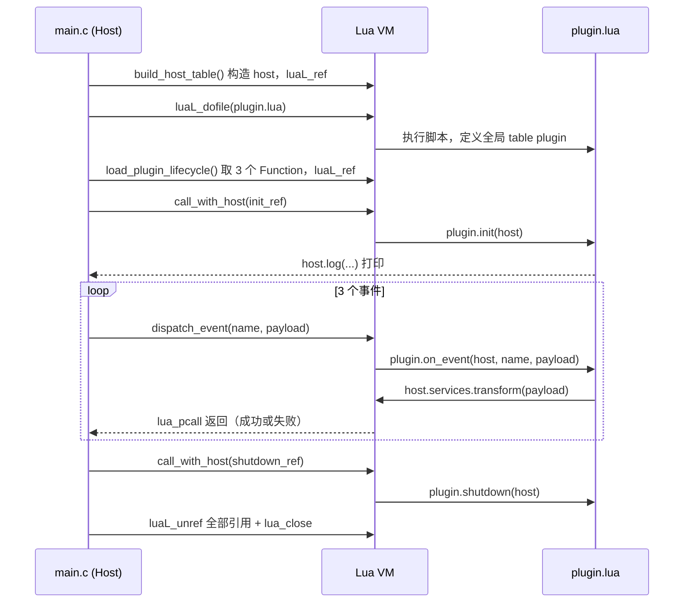

# Project 8：Plugin Architecture —— 全书压轴案例

> 完整可运行代码见 [`main.c`](main.c) / [`plugin.lua`](plugin.lua)（`make run` 已验证）。这是本教程的最后一个案例，把 Chapter 00-25 讲过的几乎所有机制都用在了一个真实的"插件宿主"场景里。

## 1. 场景简介

真实世界里的"插件系统"（Wireshark 的 `.lua` dissector 插件、Nginx 的 Lua 模块、游戏引擎的脚本层……）几乎都是同一个骨架：**一个 C 写的宿主程序，内嵌一个 Lua VM，把自己的能力包装成一份 C API 交给 Lua 插件使用，再按固定的生命周期驱动这个插件**。本例就实现这个骨架里最小但完整的一份：

- Host（`main.c`）构造一个 `host` table，包含 `host.version`（字段）、`host.log(msg)`（C Function）、`host.services.transform(x)`（嵌套 table 里的 C Function）；
- Host 加载 `plugin.lua`，取出插件定义的 `plugin.init` / `plugin.on_event` / `plugin.shutdown` 三个生命周期函数；
- Host 按 `init -> on_event（3 次）-> shutdown` 的顺序驱动插件，每一步都用 `lua_pcall` 兜住可能的 Lua Error，任何一步出错都不会让宿主程序崩溃或跳过后续步骤；
- 结束前把所有 Registry Reference 都 `luaL_unref`，最后 `lua_close`。

```lua
-- plugin.lua（用户需求原文）
plugin = {}

function plugin.init(host)
    print("plugin init, host version:", host.version)
    host.log("plugin initialized")
end

function plugin.on_event(host, name, payload)
    host.log("plugin got event: " .. name .. " = " .. tostring(payload))
    return host.services.transform(payload)
end

function plugin.shutdown(host)
    host.log("plugin shutting down")
end
```

## 2. Architecture

用户需求原文的架构图：

```text
Host Application
       |
       v
    Lua VM
       |
       v
 Lua Plugin
       |
       v
 C API
       |
       v
Host Services
```

对应到本例的具体实现：

```text
Host Application (main.c / 一个普通的 C 可执行文件)
       |
       | luaL_newstate + luaL_openlibs
       v
    Lua VM (lua_State *L)
       |
       | build_host_table(): 构造 host table，luaL_ref 存进 Registry
       | luaL_dofile("plugin.lua"): 加载并执行插件脚本
       v
 Lua Plugin (plugin.lua 里的 plugin.init/on_event/shutdown)
       |
       | 插件内部调用 host.log(...) / host.services.transform(...)
       v
     C API (l_host_log / l_host_services_transform，都是 C Function)
       |
       | printf / 字符串大写 / 数字翻倍
       v
Host Services (这里简化成两个纯 C 计算/打印过程，
                真实系统里会是文件/网络/协议解析等真正的系统能力)
```

Host 驱动插件的时序（Mermaid，因为涉及多个角色间的交互顺序）：



## 3. 完整代码

### 3.1 构造 host table（Chapter 06/07：Table 双向传递 + Chapter 16：C 创建 Lua Function）

```95:119:projects/08-plugin-architecture/main.c
static int build_host_table(lua_State *L)
{
    lua_newtable(L); /* host = {} */

    lua_pushstring(L, "1.0.0");
    lua_setfield(L, -2, "version"); /* host.version */

    lua_pushcfunction(L, l_host_log);
    lua_setfield(L, -2, "log"); /* host.log */

    lua_newtable(L); /* host.services = {} */
    lua_pushcfunction(L, l_host_services_transform);
    lua_setfield(L, -2, "transform"); /* host.services.transform */
    lua_setfield(L, -2, "services");  /* host.services = {...} */

    /* Stack 顶部现在是完整的 host table，luaL_ref 把它搬进 Registry 并弹出 */
    return luaL_ref(L, LUA_REGISTRYINDEX);
}
```

### 3.2 host.services.transform：C API 的具体实现

```61:93:projects/08-plugin-architecture/main.c
static int l_host_services_transform(lua_State *L)
{
    int type = lua_type(L, 1);

    if (type == LUA_TSTRING) {
        size_t len;
        const char *s = lua_tolstring(L, 1, &len);
        char *upper = (char *)malloc(len + 1);
        size_t i;
        for (i = 0; i < len; i++) {
            upper[i] = (char)toupper((unsigned char)s[i]);
        }
        upper[len] = '\0';
        lua_pushstring(L, upper);
        free(upper);
        return 1;
    }

    if (type == LUA_TNUMBER) {
        lua_Number n = lua_tonumber(L, 1);
        lua_pushnumber(L, n * 2);
        return 1;
    }

    return luaL_error(L, "host.services.transform: 不支持的 payload 类型 '%s'",
                       lua_typename(L, type));
}
```

### 3.3 取出插件的三个生命周期函数（Chapter 09：Registry Reference）

```181:206:projects/08-plugin-architecture/main.c
static int load_plugin_lifecycle(lua_State *L)
{
    lua_getglobal(L, "plugin"); /* [plugin] */
    if (!lua_istable(L, -1)) {
        fprintf(stderr, "[host] plugin.lua 没有定义全局 table 'plugin'（实际类型: %s）\n",
                lua_typename(L, lua_type(L, -1)));
        lua_pop(L, 1);
        return 0;
    }

    lua_getfield(L, -1, "init"); /* [plugin, init] */
    init_ref = grab_function_ref(L, "init"); /* 弹出 init，栈回到 [plugin] */

    lua_getfield(L, -1, "on_event");
    on_event_ref = grab_function_ref(L, "on_event");

    lua_getfield(L, -1, "shutdown");
    shutdown_ref = grab_function_ref(L, "shutdown");

    lua_pop(L, 1); /* 弹掉 plugin table，Stack 回到调用前的状态 */
    return 1;
}
```

### 3.4 dispatch_event：通用事件分发管道（Chapter 17：双向调用 + Chapter 18：错误处理）

```229:260:projects/08-plugin-architecture/main.c
static void dispatch_event(lua_State *L, const char *name, const struct payload *payload)
{
    if (on_event_ref == LUA_NOREF) {
        fprintf(stderr, "[host] plugin.on_event 未定义，忽略事件 '%s'\n", name);
        return;
    }

    lua_rawgeti(L, LUA_REGISTRYINDEX, on_event_ref); /* [on_event] */
    lua_rawgeti(L, LUA_REGISTRYINDEX, host_ref);     /* [on_event, host] */
    lua_pushstring(L, name);                         /* [on_event, host, name] */
    push_payload(L, payload);                        /* [on_event, host, name, payload] */

    if (lua_pcall(L, 3, 1, 0) != LUA_OK) {
        fprintf(stderr, "[host] plugin.on_event('%s') 出错: %s\n", name,
                lua_tostring(L, -1));
        lua_pop(L, 1);
        return;
    }

    if (lua_type(L, -1) == LUA_TSTRING || lua_type(L, -1) == LUA_TNUMBER) {
        printf("[host] on_event('%s') 返回值: %s\n", name, lua_tostring(L, -1));
    } else {
        printf("[host] on_event('%s') 返回值类型: %s\n", name,
               lua_typename(L, lua_type(L, -1)));
    }
    lua_pop(L, 1);
}
```

### 3.5 main()：完整驱动流程 + 收尾清理

```262:329:projects/08-plugin-architecture/main.c
int main(void)
{
    /* stdout 默认是"全缓冲"（fully buffered）当它不是一个交互式终端时
     * （比如被 make run 重定向到文件/管道）；而下面 fprintf(stderr, ...)
     * 用的 stderr 默认无缓冲。如果不强制 stdout 改成"行缓冲"，printf 和
     * fprintf(stderr, ...) 的输出顺序在重定向场景下会乱序交错，
     * 干扰阅读——这跟 Lua/C 交互本身无关，只是一个常见的 C 标准库坑，
     * 但会直接影响下面演示 Failure 时"谁先谁后"的可读性，所以先处理掉。 */
    setvbuf(stdout, NULL, _IOLBF, 0);

    lua_State *L = luaL_newstate();
    luaL_openlibs(L);

    printf("== Project 8: Plugin Architecture ==\n\n");

    host_ref = build_host_table(L);

    printf("-- load plugin.lua --\n");
    if (luaL_dofile(L, "plugin.lua") != LUA_OK) {
        fprintf(stderr, "[host] 加载 plugin.lua 失败: %s\n", lua_tostring(L, -1));
        lua_close(L);
        return 1;
    }

    if (!load_plugin_lifecycle(L)) {
        fprintf(stderr, "[host] 插件生命周期函数缺失，直接退出\n");
        lua_close(L);
        return 1;
    }

    printf("\n-- phase: init --\n");
    call_with_host(L, init_ref, "init");

    printf("\n-- phase: on_event (3 个事件) --\n");
    {
        struct payload greet = {.kind = PAYLOAD_STRING, .str = "hello"};
        dispatch_event(L, "greet", &greet);

        struct payload tick = {.kind = PAYLOAD_NUMBER, .num = 21};
        dispatch_event(L, "tick", &tick);

        /* 故意用一个 transform() 处理不了的 payload 触发插件内部出错，
         * 验证 on_event 出错不会影响后面 shutdown 依然被调用。 */
        struct payload boom = {.kind = PAYLOAD_UNSUPPORTED};
        dispatch_event(L, "boom", &boom);
    }

    printf("\n-- phase: shutdown --\n");
    call_with_host(L, shutdown_ref, "shutdown");

    printf("\n-- cleanup --\n");
    if (init_ref != LUA_NOREF) {
        luaL_unref(L, LUA_REGISTRYINDEX, init_ref);
    }
    if (on_event_ref != LUA_NOREF) {
        luaL_unref(L, LUA_REGISTRYINDEX, on_event_ref);
    }
    if (shutdown_ref != LUA_NOREF) {
        luaL_unref(L, LUA_REGISTRYINDEX, shutdown_ref);
    }
    if (host_ref != LUA_NOREF) {
        luaL_unref(L, LUA_REGISTRYINDEX, host_ref);
    }

    lua_close(L);
    printf("\n== done ==\n");
    return 0;
}
```

完整文件另见 [`main.c`](main.c)（含 `l_host_log`、`push_payload`、`grab_function_ref`、`call_with_host` 等）与配套脚本 [`plugin.lua`](plugin.lua)。

## 4. Stack Diagram

**`dispatch_event(L, "greet", &greet)` 的关键调用一步步展开**（`greet.kind == PAYLOAD_STRING`）：

```text
调用刚开始，Stack 上什么都没有（上一次调用已经清空）：
+-----+------------------------------+
| idx | value                        |
+-----+------------------------------+
|  (empty)                           |
+-----+------------------------------+

lua_rawgeti(L, LUA_REGISTRYINDEX, on_event_ref) 执行后：
+-----+------------------------------+
|  1  | Function（plugin.on_event）  |
+-----+------------------------------+

lua_rawgeti(L, LUA_REGISTRYINDEX, host_ref) 执行后：
+-----+------------------------------+
|  1  | Function                     |
|  2  | host（Table）                |
+-----+------------------------------+

lua_pushstring(L, "greet") 执行后：
+-----+------------------------------+
|  1  | Function                     |
|  2  | host                         |
|  3  | "greet"                      |
+-----+------------------------------+

push_payload() 执行后（PAYLOAD_STRING 分支：lua_pushstring(L, "hello")）：
+-----+------------------------------+
|  1  | Function                     |
|  2  | host                         |
|  3  | "greet"                      |
|  4  | "hello"                      |
+-----+------------------------------+

lua_pcall(L, 3, 1, 0) 执行后（3 个参数、期望 1 个返回值，正常返回）：
+-----+------------------------------+
|  1  | "HELLO"                      |  <- host.services.transform 的结果
+-----+------------------------------+
   <- Function 和它的 3 个参数全部被 pcall 内部消费掉了，
      只留下 1 个返回值（约定好的：return N 里 N=1）
```

**同一个 `dispatch_event`，换成 `boom`（`PAYLOAD_UNSUPPORTED`，触发插件内部出错）**：

```text
lua_pcall(L, 3, 1, 0) 执行前：
+-----+------------------------------+
|  1  | Function（plugin.on_event）  |
|  2  | host                         |
|  3  | "boom"                       |
|  4  | {}（push_payload 塞的空 table）|
+-----+------------------------------+

plugin.on_event 内部执行到
  host.services.transform(payload)
时，l_host_services_transform 发现 type == LUA_TTABLE，
直接 luaL_error(...)——这次调用从未正常 return，
错误沿着 Lua Call Stack 一路传播回最外层的 lua_pcall：

lua_pcall(L, 3, 1, 0) 返回非 LUA_OK 之后：
+-----+------------------------------+
|  1  | "plugin.lua:23: host.services.transform: ..." |
+-----+------------------------------+
   <- pcall 把错误对象放在栈顶（当作"1 个返回值"），
      dispatch_event 打印它、lua_pop(L, 1)，Stack 恢复到调用前的样子
```

## 5. Lifecycle（Registry Reference 如何管理回调）

本例一共有 **4 个** Registry Reference，生命周期各自独立、但都遵循同一套规律——存进去、用、最后释放：

```text
build_host_table()
        |
        v
host_ref = luaL_ref(...)         -- host table 从此"脱离"任何一次调用的
        |                            Stack，长期存在，直到程序快结束
        v
load_plugin_lifecycle()
        |
        v
init_ref / on_event_ref /        -- plugin.lua 跑完之后，三个 Function
shutdown_ref = luaL_ref(...)         各自被搬进 Registry 的独立槛位
        |
        v
call_with_host(init_ref, ...)    -- 每次都用 lua_rawgeti 重新取回，
dispatch_event(...) x3               不影响其它三个引用
call_with_host(shutdown_ref, ...)
        |
        v
main() 收尾：4 次 luaL_unref      -- 从 Registry 里删掉这 4 条记录，
        |                            此后 GC 才可能真正回收对应对象
        v
lua_close(L)                     -- 整个 lua_State 被销毁，
                                     即使漏了某个 luaL_unref 也无所谓了
                                     （但生产代码不能依赖这一点兜底）
```

**为什么 host table 也要 `luaL_ref`，而不是每次都重新 `build_host_table()`？** 因为 `init(host)` / `on_event(host, ...)` / `shutdown(host)` 三次调用共享同一个 `host` 对象——如果每次都重新构造一份新 table，插件在 `init` 里挂在 `host` 上的任何状态（本例没有，但真实插件系统常见）都会在下一次调用时丢失。用一个 Registry Reference 长期持有*同一个* `host` table，才能保证"host 在插件看来是同一个对象"这条语义。

**为什么 `plugin.on_event` 的 Registry Reference 不需要每次调用后重新获取？** 跟 Chapter 09 的道理完全一样：Stack index 只在一次 C 函数调用内有效，`dispatch_event` 每次被调用都是"全新进入 C"，必须用 `on_event_ref` 这个整数把当年那个 Lua Function 重新请回来，而不能假设"上次那次调用里它在 Stack 哪个位置"。

## 6. Failure

### Failure：插件 `on_event` 内部出错（`host.services.transform` 拒绝了一个不支持的 payload 类型）

实际运行输出（完整见第 8 节）：

```text
-- phase: on_event (3 个事件) --
[host] plugin got event: greet = hello
[host] on_event('greet') 返回值: HELLO
[host] plugin got event: tick = 21.0
[host] on_event('tick') 返回值: 42.0
[host] plugin got event: boom = table: 0x2a5f3f90
[host] plugin.on_event('boom') 出错: plugin.lua:23: host.services.transform: 不支持的 payload 类型 'table'

-- phase: shutdown --
[host] plugin shutting down
```

**发生了什么**：`boom` 事件的 payload 故意选了一个 `host.services.transform` 明确拒绝的类型（Table）。`plugin.on_event` 里先执行了 `host.log(...)`（所以"plugin got event: boom = table: ..."正常打印了），接着调用 `host.services.transform(payload)` 时，C 侧 `l_host_services_transform` 判断类型不对，直接 `luaL_error`。这个 Lua Error 沿着 Lua 的调用链一路向上传播，`plugin.on_event` 自己完全没有 `pcall` 包住这一行，所以它自己也"跟着出错"、没有正常 `return` 任何值。

**为什么宿主程序没有崩溃**：因为 `dispatch_event()` 是用 `lua_pcall`（而不是 `lua_call`）触发 `plugin.on_event` 的——错误在 `lua_pcall` 这一层被转成一个返回码（非 `LUA_OK`）和栈顶的一个错误对象，交还给 C，而不是像 `lua_call` 那样直接向上抛给整个宿主进程（对照 Chapter 18 的"保护调用 vs 普通调用"）。`dispatch_event` 打印这条错误消息、`lua_pop` 弹掉错误对象、`return`——函数正常退出，`main()` 完全不受影响，继续往下执行 `-- phase: shutdown --`。

**为什么 `shutdown` 依然被正常调用**：`main()` 里 `call_with_host(L, shutdown_ref, "shutdown")` 这一行跟前面 `on_event` 出错与否没有任何 C 层面的依赖关系——`dispatch_event` 只是"处理并吸收"了那次错误，没有用任何方式（比如设一个全局"出错了"标志位后 `return` 出 `main`）去中断后续流程。这正是用户需求里"on_event 出错不影响后面 shutdown 依然被调用"这条要求最直接的体现。

## 7. Mental Model

```text
Host Application
       |
       v   luaL_newstate + luaL_openlibs
    Lua VM
       |
       v   build_host_table(): Table 双向传递 + C 创建 Lua Function
 host table（C API 层，塞进 Registry 长期持有）
       |
       v   luaL_dofile("plugin.lua")
 Lua Plugin（plugin.init / on_event / shutdown，各自 luaL_ref 长期持有）
       |
       v   call_with_host() / dispatch_event()：全部走 lua_pcall
 C -> Lua 调用（生命周期驱动）
       |
       v   Lua Plugin 内部反过来调用
Lua -> C 调用（host.log / host.services.transform）
       |
       v   任何一步出错
lua_pcall 兜底，打印错误，不中断后续生命周期
       |
       v   驱动完成
4 个 Registry Reference 全部 luaL_unref -> lua_close
```

> **一句话**：一个插件宿主本质上就是"反复地、成对地做 Lua↔C 两个方向的 Stack 穿越"——C 用 Table + C Function 把自己的能力封装成一份"看起来像普通 Lua 值"的 API，Lua 插件用这份 API 实现业务逻辑，两边谁都不理解对方的内部实现，只通过 Lua Stack 和 Registry Reference 打交道；`lua_pcall` 保证这条反复穿越的链路上，任何一次 Lua 侧出错都只是"一次失败的调用"，不是"宿主程序的一次崩溃"。

## 8. 完整运行输出

```text
$ make run
== Project 8: Plugin Architecture ==

-- load plugin.lua --

-- phase: init --
plugin init, host version:	1.0.0
[host] plugin initialized

-- phase: on_event (3 个事件) --
[host] plugin got event: greet = hello
[host] on_event('greet') 返回值: HELLO
[host] plugin got event: tick = 21.0
[host] on_event('tick') 返回值: 42.0
[host] plugin got event: boom = table: 0x2a5f3f90
[host] plugin.on_event('boom') 出错: plugin.lua:23: host.services.transform: 不支持的 payload 类型 'table'

-- phase: shutdown --
[host] plugin shutting down

-- cleanup --

== done ==
```

## 9. 知识点回顾：这个项目具体用到了哪些章节

这是全书最后一个案例，几乎每一步都能对应回前面某一章讲过的具体机制。按用到的顺序列出：

| 章节 | 用在哪里 |
|---|---|
| Chapter 00（总体架构） | 整个 `main.c` 的骨架——`lua_State *L`、Lua Stack 作为唯一跨界通道——就是本章那张总图的具体落地。 |
| Chapter 01（第一次调用） | `l_host_log`、`l_host_services_transform` 都是最基础的 `int (*)(lua_State *)` 形态的 C Function，跟 Chapter 01 的 `add` 一模一样的写法。 |
| Chapter 02/03（Stack 基础与索引） | `build_host_table`、`dispatch_event` 里每一步 `push*` 之后 Stack 上多了什么、`lua_pcall` 消耗掉几个值，全靠正索引/负索引精确定位（见第 4 节 Stack Diagram）。 |
| Chapter 04（C 调用 Lua） | `call_with_host` / `dispatch_event` 是本例里"C 主动调用 Lua"的两个入口，对应本章第一次引入的方向。 |
| Chapter 05（基础类型双向转换） | `l_host_services_transform` 里 `lua_tolstring`/`lua_tonumber`/`lua_pushstring`/`lua_pushnumber` 是最基础的类型转换，用来判断并处理字符串/数字两种 payload。 |
| Chapter 06/07（Table 双向传递） | `build_host_table` 是"C 构造 Table 交给 Lua"（Chapter 07 方向）的完整示例：普通字段（`version`）、C Function（`log`）、嵌套 Table（`services`）全部涵盖。 |
| Chapter 08（Table 遍历） | `host.services` 这张嵌套 Table 的构造方式（先建内层 Table，塞完字段再 `setfield` 挂到外层）是 Chapter 08 讨论"Table 里能装什么"的直接应用。 |
| Chapter 09（Registry Reference） | `host_ref` / `init_ref` / `on_event_ref` / `shutdown_ref` 四个 Registry Reference，是本例能"跨越 `main()` 里相隔很远的几行代码，反复找回同一个 Lua Object"的唯一原因。 |
| Chapter 10（C 回调事件系统） | `dispatch_event(name, payload)` 本身就是一个"事件分发"系统的最小实现：事件名 + payload -> 找到订阅者（`on_event_ref`）-> 触发。 |
| Chapter 16（C 创建 Lua Function） | `host.log`、`host.services.transform` 都是 `lua_pushcfunction` 生成、对 Lua 脚本而言与普通函数无区别的值——这正是 Chapter 16 的核心命题。 |
| Chapter 17（双向调用） | 整个案例的调用链是"C 调 Lua（生命周期驱动）"与"Lua 调 C（host.log/transform）"交替发生的，是 Chapter 17 "双向调用"最完整的一次实战。 |
| Chapter 18（错误处理） | `luaL_error`（C 侧拒绝不支持的 payload 类型）+ `lua_pcall`（C 侧捕获插件内部错误）两条错误传播路径在本例里都出现了，对照第 6 节 Failure。 |
| Chapter 19（Stack Balance） | `dispatch_event`/`call_with_host` 里每一条 `lua_pop` 都不是随手加的——出错分支必须弹掉错误对象，成功分支必须弹掉返回值，保证函数返回时 Stack 深度跟进入时一致。 |
| Chapter 21（完整生命周期） | `luaL_newstate -> 构造 API -> 加载脚本 -> 驱动 -> luaL_unref -> lua_close` 这条主线，是 Chapter 21 那张生命周期图在一个真实场景里的完整走一遍。 |
| Chapter 22（Data Flow） | 第 2 节 Mermaid 时序图画的就是本例的数据流：谁在什么时候把什么值送到 Stack 上、又在什么时候被谁取走。 |
| Chapter 23（状态机视角） | `init -> on_event(重复 N 次) -> shutdown` 本身就是一个简化状态机（对照 Project 7），只是这里的"状态"是插件的生命周期阶段，不是业务状态。 |
| Chapter 24（Failure 模式分析） | 第 6 节演示的"插件内部出错但不拖垮宿主"，正是 Chapter 24 汇总的典型 Failure 模式之一（错误处理缺位 vs 到位的对比）。 |
| Chapter 25（Debugging Checklist） | 排查"事件返回值不对/回调没触发"这类问题时，本例的排查顺序（先看 `*_ref` 是否为 `LUA_NOREF`，再看 Stack 上有什么，再看 `lua_pcall` 返回值）完全遵循 Chapter 25 的检查清单顺序。 |

对照 Chapter 26 的"最终 5 个概念"：本例里 `lua_State *L` 贯穿全程、Lua Stack 是每一次调用的唯一交换场所、`lua_push*`/`lua_to*` 处理 C primitive、`lua_get*`/`lua_set*` 构造/读取 host 与 plugin 两张 Table、Registry Reference 让四个长期存活的 Lua Object 脱离任何单次调用的 Stack 状态——这五个概念在这一个案例里全部同时出现，也是它作为全书压轴案例的意义所在。
