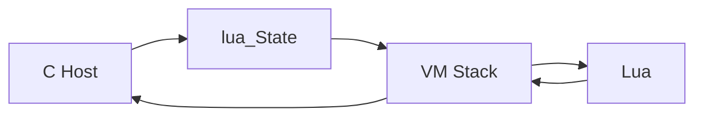

# C / Lua 交互心智模型：栈是唯一边界

> 本文回答一件事：C 和 Lua 跨边界时，**栈上发生了什么、谁 push、谁 pop**。
> 五种 Pattern 各自用了哪些 API、回调如何长期持有，见 [lua-patterns-mastery/06-c-lua-embedding-mental-model.md](lua-patterns-mastery/06-c-lua-embedding-mental-model.md)。
> 五个完整可运行工程（C + Lua + Makefile）都在 [lua-patterns-mastery](lua-patterns-mastery/README.md) 里，本文只拍关键栈快照。

## 1. 唯一通路

```text
     C Host
        |
        v
    lua_State
        |
        v
    VM Stack     <--- 唯一合法的数据通道
        |
        v
      Lua
```

C 拿着的是 `lua_State *`。没有这个指针，C 碰不到任何 Lua 值。C 也不能拿 Lua 内部对象的裸指针长期用：跨越边界的每一样东西，都必须先变成栈上的一个槽——number、string、table、function、userdata、nil、boolean。

一句话：**没有共享内存，没有直接函数指针调用，只有「往同一座栈上放值，再由对方按约定顺序取值」。**



## 2. 正负索引：同一格两个名字

正索引从栈底数，1 是第一个元素。负索引从栈顶数，-1 是栈顶。

```text
栈底                         栈顶
 1          2          3          4
-4         -3         -2         -1
+----------+----------+----------+----------+
|    A     |    B     |    C     |    D     |
+----------+----------+----------+----------+
```

`lua_push*` 永远加在栈顶。`lua_to*(L, -1)` 读的是刚刚压上去的那个。`lua_to*(L, 1)` 读的是当前这段调用里最底下那个——Lua 调 C 时，参数就从 1 开始排。

## 3. 两个方向是对偶

### C 调 Lua

C 负责摆函数和参数，也负责把返回值从栈上拿走。

```text
lua_getglobal / lua_rawgeti     -- 函数上栈
lua_push*                       -- 参数按顺序上栈
lua_pcall(L, nargs, nresults, 0)
lua_to*                         -- 读返回值
lua_pop                         -- C 清掉返回值（或错误串）
```

`pcall` 会弹掉函数和 nargs 个参数，再压上最多 nresults 个返回值。成功时栈净变化是：`- (1 + nargs) + nresults`。

```text
调用 add(10, 20)，期望 2 个返回值 30, "success"

getglobal + push + push
栈底 1/-3              栈顶 -1/3
+--------+--------+--------+
|  add   |   10   |   20   |
+--------+--------+--------+

lua_pcall(L, 2, 2, 0)
栈底 1/-2              栈顶 -1/2
+--------+-----------+
|   30   | "success" |
+--------+-----------+

C: lua_tostring(L, -1); lua_tonumber(L, -2); lua_pop(L, 2);
```

### Lua 调 C

VM 已经把参数摆在 1..n。C 函数签名永远是 `int (*)(lua_State *)`：从栈上读参数，把返回值 push 上去，**return 的整数 = 压了几个返回值**。C **不要** pop 掉参数。

```text
Lua 调用 multiply(5, 8)，C 返回 40.0, "ok"

进入 C 时（VM 准备好的）
栈底 1/-2              栈顶 -1/2
+--------+--------+
|   5    |   8    |
+--------+--------+

C: lua_tonumber(L, 1); lua_tonumber(L, 2);
   lua_pushnumber(L, 40.0); lua_pushstring(L, "ok");
   return 2;

VM 弹掉 C 函数和参数，留下返回值给 Lua
+--------+--------+
|  40.0  |  "ok"  |
+--------+--------+
```

差别只在谁摆参数、谁取返回值、谁清栈。通道是同一座栈。

## 4. 生命周期

```text
luaL_newstate
      |
      v
luaL_openlibs
      |
      v
load / pcall 脚本     -- 通常只是定义函数、填全局表
      |
      v
多次跨栈调用          -- 真正交换数据发生在这里
      |
      v
lua_close
```

加载脚本不等于调用业务函数。`pcall` 一段脚本只是让 Lua 把函数放进全局表；之后每一次 C 调 Lua、每一次 Lua 调 C，才是一次栈协议。

## 5. 错误边界：用 pcall，不用 call

`lua_call` 一旦 Lua 出错会 longjmp，C 侧没有保护点就等于进程结束。`lua_pcall` 把错误变成普通返回：返回值不是 `LUA_OK`，栈顶是错误字符串，C 像处理返回值一样 `lua_tostring` + `lua_pop`，进程继续。

五个完整示例里，凡是 C 调 Lua，用的都是 `lua_pcall`。

---

## 6. 五个完整示例：栈在练哪一招

每个工程都可以 `make && ./...`。这里只拍关键一帧。

### 6.1 Extension：Lua 调 C 注册，C 再调 Lua 回调

完整代码：[lua-patterns-mastery/01-extension/code/01-c-command-extension/](lua-patterns-mastery/01-extension/code/01-c-command-extension/)（`main.c` + `extension.lua` + `Makefile`）

这一招把两个方向合进同一个程序：脚本加载时 Lua 调用 `register_command(name, fn)`（Lua → C）；用户敲命令时 C 把存好的 fn 取回栈上 `pcall`（C → Lua）。

Lua → C，进入 `l_register_command`：

```text
栈底 1/-2                    栈顶 -1/2
+------------+---------------+
| "add"      |  <function>   |
+------------+---------------+
luaL_checkstring(L, 1)
luaL_checktype(L, 2, LUA_TFUNCTION)
lua_pushvalue(L, 2); luaL_ref(...)   -- 函数进注册表，栈恢复为参数
return 0                             -- C 不清参数，VM 清
```

C → Lua，`dispatch_command` 跑 `add 10 20`：

```text
lua_rawgeti(registry, ref)
lua_pushstring("10"); lua_pushstring("20")
+------------+--------+--------+
| <function> |  "10"  |  "20"  |
+------------+--------+--------+
lua_pcall(L, 2, 1, 0)
+------------+
|  result    |   -- C lua_pop(L, 1)
+------------+
```

函数值不能存成 C 函数指针。`luaL_ref` 把它钉在注册表里，换一个整数 ID；调用时再 `rawgeti` 请回栈顶。

### 6.2 Policy：C 把标量事实推进栈，Lua 只返回决策

完整代码：[lua-patterns-mastery/02-policy/code/01-c-server-access-policy/](lua-patterns-mastery/02-policy/code/01-c-server-access-policy/)（`server.c` + `policy.lua` + `Makefile`）

栈上没有组装 table。C 调 `allow_request(user, resource)`，拿走一个布尔值。决策函数出错时按 DENY 处理，并 `pop` 掉错误串。

```text
lua_getglobal(L, "allow_request")
lua_pushstring(L, user)
lua_pushstring(L, resource)
+----------------+--------+-----------+
| allow_request  | "alice"| "/secret" |
+----------------+--------+-----------+
lua_pcall(L, 2, 1, 0)
+-----------+
|  boolean  |   -- lua_toboolean(L, -1); lua_pop(L, 1)
+-----------+
```

谁 push：C。谁 pop：C。Lua 只负责在这次 `pcall` 窗口里活一会儿，算出 true/false。

### 6.3 Configuration：一次 pcall 执行脚本，再把 table 抠成 C struct

完整代码：[lua-patterns-mastery/03-configuration/code/01-c-app-configuration/](lua-patterns-mastery/03-configuration/code/01-c-app-configuration/)（`main.c` + `config.lua` + `Makefile`）

脚本跑完，配置已经是全局表。C 不反复问 Lua「现在 port 是多少」，而是把字段读进 C struct，之后业务只碰 C。

关键约束：**读字段必须栈平衡**。`lua_getfield` 压一个值，读完立刻 `lua_pop`，下面的 `server` 表还在原来的下标上。

```text
lua_getglobal(L, "server")
+--------+
| server |     -- 记为 table_idx
+--------+

lua_getfield(L, table_idx, "port")
+--------+--------+
| server |  8080  |
+--------+--------+
lua_tointeger(L, -1); lua_pop(L, 1)
+--------+
| server |     -- 表还在，可以继续 getfield
+--------+
```

漏一次 `pop`，`table_idx` 就会指错槽，后面所有字段都读歪。

### 6.4 Rule Engine：C 在栈上 newtable 当 Input，Lua 返回结果

完整代码：[lua-patterns-mastery/04-rule-engine/code/01-firewall-rule-engine/](lua-patterns-mastery/04-rule-engine/code/01-firewall-rule-engine/)（`main.c` + `rules.lua` + `Makefile`）

C 的 `Packet` 结构体不能递指针给 Lua。必须先在栈上建成一张表，再当唯一参数 `pcall`。

`push_packet_table` 当时：

```text
lua_newtable
+--------+
|  {}    |
+--------+
lua_pushstring(src); lua_setfield(-2, "src")   -- setfield 弹出 src，留下表
同理 dst / port
+----------------------+
| {src, dst, port}     |
+----------------------+
```

`call_match` 当时（规则表已在更低的槽）：

```text
+-------+--------+--------+------------------+
| rules | rule_i | match  | packet_table     |
+-------+--------+--------+------------------+
lua_pcall(L, 1, 1, 0)     -- 弹 match + packet，压 boolean
+-------+--------+--------+
| rules | rule_i |  bool  |
+-------+--------+--------+
lua_pop(L, 2)             -- 弹 bool 和 rule_i，rules 仍在
```

复杂值进出都要先变成栈上的 table（或从栈上的 table 再掏出来）。没有第三条路。

### 6.5 Plugin：栈是每个 lua_State 私有的

完整代码：[lua-patterns-mastery/05-plugin/code/01-c-plugin-manager/](lua-patterns-mastery/05-plugin/code/01-c-plugin-manager/)（`plugin_manager.c` + `plugin_*.lua` + `Makefile`）

每个插件一个 `lua_State`，也就一座私有栈。插件 A 的 `pcall` 失败只在 A 的栈顶留下错误串；插件 B 的栈根本看不见。

Lua → C：`host_log` 用闭包 upvalue 记住插件名，不占参数槽 1。

```text
lua_pushstring(L, plugin_name)
lua_pushcclosure(L, l_host_log, 1)   -- 吃掉栈上的名字，绑进闭包
lua_setglobal(L, "host_log")

Lua 调用 host_log("hello") 进入 C：
槽 1 = "hello"                       -- 普通参数
lua_upvalueindex(1) = 插件名         -- 不在 1..n 里
return 0
```

C → Lua：每次 `on_event` 单独 `pcall`。

```text
插件 A 的栈                          插件 B 的栈
lua_getglobal("on_event")            （另一座 lua_State，互不相干）
lua_pushstring(name)
lua_pushstring(payload)
lua_pcall(L, 2, 0, 0)
失败：栈顶是错误串，lua_pop，continue
```

「一个插件报错不能拖垮其它插件」落在栈模型上就是：**别共用一座栈，每次跨边界都用 pcall 包住。**

---

## 7. 五句话

1. C 和 Lua 之间只有 `lua_State` 上的那座栈。
2. 正索引从底、负索引从顶，同一格两个名字。
3. C 调 Lua：C 摆参数、C 取返回值、C `pop`；Lua 调 C：VM 摆参数在 1..n，C 只 `push` 返回值并 `return n`，C 不清参数。
4. 结构体和回调都不能递裸指针；table 走栈，函数走注册表或活在自己的 `lua_State` 里。
5. 跨边界必须 `lua_pcall`；错误是栈顶上的字符串，不是进程崩溃。

下一层（每种 Pattern 用哪些 API）：[06-c-lua-embedding-mental-model.md](lua-patterns-mastery/06-c-lua-embedding-mental-model.md)。
