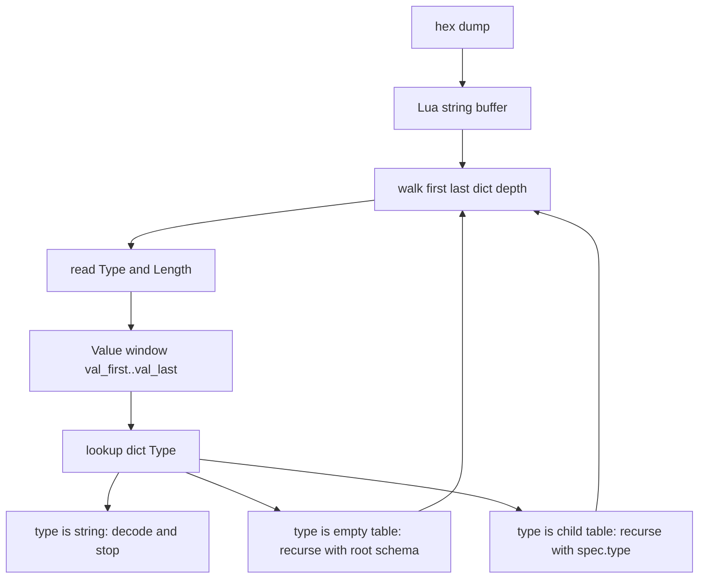

# 00 · 两套层级，不要叠成一套

> 前置：先建立心智，再看 [code/mini_tlv.lua](code/mini_tlv.lua)。语言点在 [01-lua-language-points.md](01-lua-language-points.md)，走路步骤在 [02-walk-algorithm.md](02-walk-algorithm.md)。

## 1. WHY：看见 hex 时容易犯的错

线上看见的永远是：

```text
+--------+-----------+------------------+
| Type   | Length    | Value            |
| 1 byte | 2 bytes   | Length bytes     |
|        | big-endian|                  |
+--------+-----------+------------------+
```

`Length` 只计 Value，不含 Type / Length 自己。所以：

```text
01 00 17
```

读成：Type = 1，Length = 0x0017 = 23，后面 23 字节都属于这个 TLV 的 Value。`walk` 把这 23 字节当成沙箱，递归不得走出窗口。

容易犯的错是：把 `schema` 里的并列关系，直接当成报文树的缩进。根表里 1 / 2 / 3 / 4 并列，只表示「当前词典 = 大厅时，这些门牌都能查到」，不表示它们在报文里同级。

Packet A 里 `SeqNum` 和 `Sequence` 在词典里同级，在树上 `SeqNum` 低于 `Sequence`——因为它的字节落在 `01 00 17` 的 23 字节 Value 里。

## 2. 词典：schema 是门牌本，不是报文

```text
schema (root dictionary / 大厅)
+---+-----------+---------------------------+
| 1 | Sequence  | type = {}                 |
| 2 | SeqNum    | type = "UINT16"           |
| 3 | Operation | type = "UINT8" + enum     |
| 4 | Device    | type = { 1 Name, 2 Id }   |
| 5 | Channel   | type = {}                 |
| 6 | ChanIndex | type = "UINT8"            |
+---+-----------+---------------------------+
```

`spec.type` 三种写法：

| `spec.type` | 名字 | `walk` 做什么 |
|---|---|---|
| `"UINT16"` / `"STRING"` ... | 叶子 | 解码 Value，停止，不再递归 |
| `{ [1]=..., [2]=... }` | 子馆 | 换这本子表当词典，对 Value 窗口递归 |
| `{}` | 大厅 / 袋子 | 词典改回根表 `schema`，对 Value 窗口递归 |

`type = {}` 不是「还没填完」。它的精确含义：人还在我的 Value 里，门牌却拿到大厅去对。这就是 Packet B 里 `Channel` 能直接装 `Device(4)` 的原因——`Device` 只登记在根表。

Type 不是全局 ID。Packet A 里根层的 Type 1 是 `Sequence`，走进 `Device` 之后 Type 1 是 `Name`。门牌号在当前词典里重新计数。

## 3. 报文树：缩进跟的是 Length 沙箱

```text
Packet A hex                         报文树
01 00 17                             Sequence (23-byte sandbox)
   02 00 02 00 07                      SeqNum = 7
   03 00 01 02                         Operation = 2 (Write)
   04 00 0B                            Device (11-byte sandbox)
      01 00 04 72 70 64 30               Name = rpd0
      02 00 01 03                        Id = 3
```

打印缩进跟的是「谁的字节在谁的 Value 里」，不是 schema 并列。

## 4. 两根指针一起走，但不是同一件事



`walk(buf, first, last, dict, depth)` 同时带着：

- `first` / `last`：当前沙箱，报文树上的窗口
- `depth`：打印缩进，只反映沙箱套了几层
- `dict`：当前门牌本，根表或某张子馆表

换词典不改变沙箱；走进 Value 不自动换词典。只有 `spec.type` 的三种写法决定下一跳用哪本词典。

## 5. 一句话

**schema 是平面图，walk 是讲解员：读门牌，查当前词典，用 Length 圈出沙箱，再走三种门之一。**
