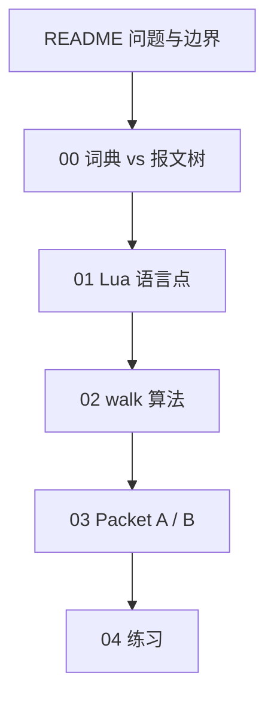

# Lua Mini TLV Walker：用一份纯 Lua 实现补语言点

一份"不教 Wireshark API，而是用一份可运行的 TLV walker 把若干 Lua 惯用法钉死"的精读笔记。完整代码：[code/mini_tlv.lua](code/mini_tlv.lua)。源实现：[code_extra/wireshark-plugins/examples/mini_tlv](/home/morrism/code_extra/wireshark-plugins/examples/mini_tlv)。

## 这份笔记要解决的问题

`lua.md` 里已经有类型、table 构造、循环、C 栈，但缺一组在协议解析里反复出现的语言点：

- 怎样把 Lua `string` 当成只读字节缓冲（1-based、`string.byte` / `string.sub`）
- `gsub` 带函数替换如何把 hex dump 变成二进制
- `next(t) == nil` 为什么能判空表，`#t == 0` 为什么不行
- `type()` 怎样把 `spec.type` 三分成叶子 / 子馆 / 大厅
- 递归函数怎样闭包引用根 `schema`，同时另带一把「当前词典」指针

这些问题在 [mini_tlv.lua](code/mini_tlv.lua) 里同时出现，而且这份文件故意不依赖 Wireshark：`Proto ~= nil` 时直接返回。算法对应真实插件 `rcp.lua` 的 `dissect_tlv`，规格表对应 `rcp_tlv_table.lua` 的 `M.tlv_table`。

读完应能回答：

- 为什么 Type 不是全局 ID，Packet A 里同是 Type 1 会先叫 Sequence 再叫 Name
- `spec.type` 三种写法（字符串 / 非空表 / `{}`）各自让 `walk` 做什么
- Length 沙箱和词典指针为什么必须是两根独立的指针

## 阅读路线图

```text
WHY: 两套层级不要叠成一套
 |
 v
LANGUAGE: 从实现抽出的 Lua 语言点
 |
 v
ALGORITHM: hex_to_bytes / decode_leaf / walk
 |
 v
PACKETS: Packet A 进子馆，Packet B 空表回大厅
 |
 v
EXERCISES: 只改表和 hex，不改 walk
```



## 目录

- [00-two-hierarchies.md](00-two-hierarchies.md) — 词典（schema）和报文树（Length 窗口）是两套层级
- [01-lua-language-points.md](01-lua-language-points.md) — 从实现抽出的 Lua 语言点
- [02-walk-algorithm.md](02-walk-algorithm.md) — `hex_to_bytes` / `u8` / `u16` / `decode_leaf` / `walk`
- [03-packet-walkthrough.md](03-packet-walkthrough.md) — Packet A / Packet B 逐步对照
- [04-exercises.md](04-exercises.md) — 三道练习，每题带预期树
- [code/mini_tlv.lua](code/mini_tlv.lua) — 可独立运行的教学副本

## 运行

```text
lua5.4 lua-mini-tlv-mastery/code/mini_tlv.lua
```

没有 `lua5.4` 时用系统里的 `lua`。先读源文件里 Packet A / B 的 Expected 注释，再跑，对一下打印树。

本文件若被整目录软链进 Wireshark 插件目录，开头的 `Proto` 防护会让它直接返回，避免误加载。

## 和真实插件 / 现有笔记的对照

| 本系列 | 真实插件 / 其它笔记 |
|---|---|
| `schema` | `rcp_tlv_table.lua` 的 `M.tlv_table` |
| `walk()` | `rcp.lua` 的 `dissect_tlv` |
| `type = {}` 回根表 | `Sequence` / `RfChannel` / `RfPort` |
| `Device.type = { ... }` | 有自己 sub-TLV 的复合对象 |
| Length 沙箱 | `cur_len` 切出的 `cur_value_tvb` |
| 本系列故意不做的 | GCP 头、`ProtoField` 编译、Info 栏、vendor overlay |

Wireshark 侧已有扁平 / 嵌套 TLV 示例，见 [wireshark/lua-plugin/11-design-patterns.md](../wireshark/lua-plugin/11-design-patterns.md) 8.7 节。那是 Host 侧对照（`Proto` / `Tvb` / `tree:add`），算法和「词典 vs 报文树」不在那里。

本系列也不属于 [lua-patterns-mastery](../lua-patterns-mastery/README.md) 的 Host/Lua 五种角色：`mini_tlv.lua` 没有 Host，它是一份纯 Lua 语言 + 表驱动 walker。
