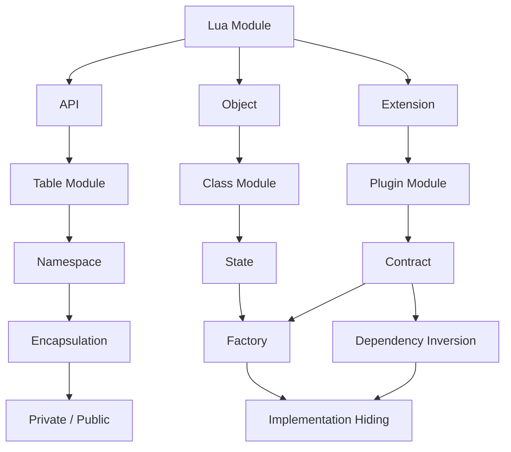

# 11 · 最终统一 Mental Model + 五句话记忆 + Code Reading Checklist

> 这是整套笔记的收尾文档。读完这一篇，应该能不看任何其它文件，独立推导出"看到一个陌生 Lua Module，怎么判断它是什么 Pattern、为什么这么设计"的完整思路。

## 1. 最终统一图



**怎么读这张图**：Lua Module 首先在架构里承担三种角色之一——**API**（我只是提供能力）、**Object**（我要表示一个有状态的实体）、**Extension**（我要给 Framework 留一个可扩展点）。API 这条线一路走到底会自然长出 Encapsulation（Table -> Namespace -> 需要隐藏实现时进一步分裂出 Private/Public）；Object 这条线的核心问题永远是 State 归属；Extension 这条线的核心问题永远是 Contract，最终指向 Dependency Inversion。**Factory 不在这三条主线上，而是横跨在 Object 和 Extension 之间**——它既可能是"决定 new 哪个 Class"（来自 Object 分支），也可能是"决定用哪个 Plugin 实现"（来自 Extension 分支），两者最终都收敛到同一个更底层的概念：**Implementation Hiding**——Dependency Inversion 本质上正是 Implementation Hiding 应用在"Framework 与外部扩展"这一特定关系上的具体形式。

## 2. 五句话记忆

```text
Table Module
    -> "我提供一组相关 API。"

Private + Public
    -> "我提供 API，但隐藏实现。"

Class / Constructor
    -> "我提供一种可以创建多个独立 State 的 Object。"

Factory
    -> "我提供能力，但隐藏具体实现如何被创建和选择。"

Plugin
    -> "Framework 定义 Contract，外部 Module 提供实现。"
```

把这五句话连起来读一遍，正好复现 [00-mental-model-overview.md](00-mental-model-overview.md) 第 2 节的演进链——每一句都比前一句多说明了"我在隐藏/管理一个新维度的复杂度"：API 本身 -> API 背后的实现步骤 -> 多个独立状态的存在 -> 状态的创建过程本身 -> 创建过程可以由外部提供。

## 3. 最重要的问题：怎么从代码结构反推架构职责

### Code Reading Checklist

拿到一个陌生的 Lua Module 文件，按下面 12 条顺序检查（不需要每一条都用得上，但顺序本身有意义——越靠前的问题越容易回答，回答完前几条通常已经能锁定 Pattern）：

1. **看 `return` 什么** —— 返回一个普通 table：候选是 Table Module / Private+Public / Factory / Plugin 之一，需要继续往下看才能分辨；返回一个"看起来像类"的 table（后面接着被 `setmetatable` 使用）：候选是 Class。
2. **看是否存在 `local function`（真正意义上的私有函数，不是 `M.xxx`）** —— 存在，且这些函数处理的是"某个公开函数内部的中间步骤"：这是 Private + Public 的强信号（对应 [02-private-public](02-private-public/00-why-and-architecture.md)）。
3. **看是否存在 `__index` / `setmetatable`** —— 存在：几乎可以直接确认是 Class / Constructor（对应 [03-class-constructor](03-class-constructor/00-why-and-architecture.md)），除非这段 `setmetatable` 只是用来做只读保护（那是一个更边缘的用法，本系列未展开）。
4. **看是否存在 `new()`（或语义等价的构造函数名，如 `create_instance`）** —— 存在，且每次调用返回一张*新* table：确认是 Class / Constructor 在负责创建对象这一步。
5. **看是否存在 `create()`（尤其是接受一个"kind/type"字符串参数的版本）** —— 存在，且函数体是"根据参数选择调用哪一个内部构造函数"：这是 Factory 的强信号（对应 [04-factory](04-factory/00-why-and-architecture.md)），注意与第 4 条区分——`new()` 通常只对应一种类型，`create(kind)` 通常在多种类型之间选择。
6. **看是否存在 `register()`（尤其是接受一个"实现了某种契约的对象/table"作为参数的版本）** —— 存在：这是 Plugin 的强信号（对应 [05-plugin](05-plugin/00-why-and-architecture.md)），因为"注册"这个动作本身就意味着"这个模块要管理一个数量不固定的、外部提供的集合"。
7. **看谁调用它（grep 整个项目里 `require("这个模块名")` 出现的位置）** —— 只有一两个固定的调用点：可能只是普通的内部工具模块；调用点分散在很多不同类型的文件里，且都是"传入自己实现的东西"给它：进一步确认是 Plugin/Framework。
8. **看谁创建 Object（如果第 3/4 条确认存在 Class）** —— 是 Application 代码直接 `Class.new(...)`：简单场景，未必需要 Factory；是某个 Factory 模块在其内部调用 `.new(...)`：确认存在 Factory + Class 的组合（对应 [08](08-pattern-composition-and-real-world-cases.md)）。
9. **看 State 存在哪里** —— 在文件顶层的 `local` 变量/直接挂在返回的 `M` 上：Module State（Table 可选、Private+Public 常见）；在每次 `.new()` 产出的实例表上（`self.xxx`）：Object State；在一个专门的"registry"表里，且只被注册/查询函数触碰：Framework State（对应 [06](06-require-and-state-mental-model.md)）。
10. **看依赖方向**（这个模块 `require` 了谁，又被谁 `require`）—— 只被别人 `require`、自己什么都不 `require`：很可能是 Table Module，处在依赖链的最底层；同时 `require` 了好几个"同类型"的具体实现模块，自己再对外暴露一个统一入口：是 Factory；完全不 `require` 任何具体实现，只在被调用时接收外部传入的对象：是 Plugin/Framework（对应 [07](07-dependency-direction.md) 的方案 A/B/C）。
11. **看是否存在 Contract（一份"必须实现哪些字段/函数"的隐性或显性约定，通常体现在 `register()` 函数内部有没有对传入对象做字段检查，或者项目里是否有一份专门描述"Plugin 必须实现什么"的文档/断言代码）** —— 存在：确认是 Plugin，而不是普通的 Factory（两者都可能有 `create`/`register` 这样的名字，但只有 Plugin 会真正校验"这个东西是否满足约定的形状"）。
12. **看 Framework 是否可以在不修改自身代码的情况下增加新 Module** —— 新增一种能力只需要新增一个文件、不需要改动这个 Framework 模块本身的任何一行：这是 Plugin Pattern 是否名副其实的最终验证标准；如果每加一种能力都要回来改这个"Framework"文件的 `if/elseif`，无论它自称什么名字，实际上都是 [05-plugin](05-plugin/00-why-and-architecture.md#anti-pattern) 里的 Anti-pattern，不是真正的 Plugin Pattern。

### 一张浓缩表

| 看到的代码特征 | 最可能的 Pattern |
|---|---|
| 只有 `return M`，全是函数/常量赋值 | Table Module |
| 有 `local function`，公开函数调用它们 | Private + Public |
| 有 `__index` + `setmetatable` + `.new()` | Class / Constructor |
| 有 `create(kind, ...)`，内部按 `kind` 选择构造函数 | Factory |
| 有 `register(plugin)`，内部保存到一个 registry 并校验形状 | Plugin |

## 4. Exercises

按顺序完成，建议不要跳过前面的题直接做后面的题——后面的题依赖前面题目建立的判断直觉。

1. **反推练习**：打开 [02-private-public/code/02-user-service/user_service.lua](02-private-public/code/02-user-service/user_service.lua)，不看对应的 `.md` 文档，只看代码，回答：它的 Public API 是什么？Private 实现是什么？State 存在哪里、生命周期是什么？写完答案后再对照 [02-example-user-service.md](02-private-public/02-example-user-service.md) 验证。
2. **改造练习（Table -> Private+Public）**：打开 [01-table-module/code/03-config-helper/config.lua](01-table-module/code/03-config-helper/config.lua)，给它加一个 `config.set(key, value)` 函数，要求写入前必须做类型校验（拒绝把一个 table 类型的值写进一个原本是 number 的 key），且校验逻辑不应该对外暴露。这一步应该会让你自然地引入至少一个 `local function`——写完后对照 [02-private-public/00-why-and-architecture.md](02-private-public/00-why-and-architecture.md) 检查你的改造是否真的做到了封装。
3. **改造练习（Anti-pattern -> 正确 Pattern）**：故意写一个 [03-class-constructor/00-why-and-architecture.md](03-class-constructor/00-why-and-architecture.md#anti-pattern) 里描述的 Anti-pattern（把某个字段错误地挂到 Class Table 而不是实例上），创建两个实例并打印，观察"意外共享"实际发生的输出；再修复它，重新运行，对比两次输出的差异。
4. **组合练习**：仿照 [04-factory/code/01-transport-factory/](04-factory/code/01-transport-factory/) 的结构，给 [05-plugin/code/02-protocol-handler-plugin/](05-plugin/code/02-protocol-handler-plugin/) 里的某一个 handler plugin（例如 `mqtt_handler.lua`）内部增加一个小 Factory，用来根据 payload 类型创建不同的"消息对象"（Class / Constructor）。完成后画一张类似 [08-pattern-composition-and-real-world-cases.md](08-pattern-composition-and-real-world-cases.md) 第 1 节的调用链图，标出哪一层是哪个 Pattern。
5. **决策树练习**：挑一个你自己手头正在维护、或者最熟悉的 Lua 项目（Neovim 配置、Wireshark 脚本、OpenResty 服务等都可以），随便选 3 个 `.lua` 文件，分别走一遍 [10-pattern-decision-tree.md](10-pattern-decision-tree.md) 的决策树，并用第 3 节的 Code Reading Checklist 逐条核对你的判断——如果某个文件的判断和它实际的用法有出入（比如你以为是 Table Module，但发现调用者其实在依赖某个"不该被依赖"的内部字段），把这个发现记下来，这通常就是这个文件真正该重构的地方。
6. **反问练习**：对你在练习 5 里选中的其中一个文件，回答 [00-mental-model-overview.md](00-mental-model-overview.md) 开头列出的十个问题（职责是什么/为什么这个组织方式/对外暴露什么/隐藏什么/谁创建/谁调用/是否持有 State/依赖方向/实现变化谁要改/扩展新实现改哪里）——如果有任何一个问题答不上来，说明这个文件的架构职责目前并不清晰，值得单独花时间重新设计。
