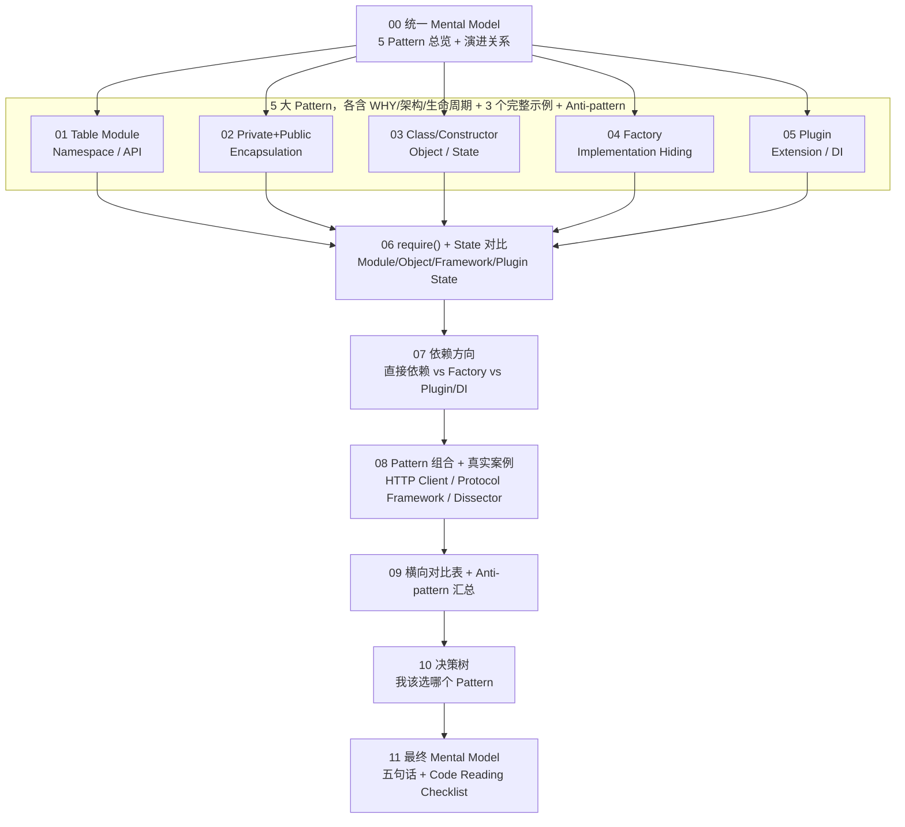

# Lua Module Architecture Patterns

一份"不教 Lua 语法，而是教你从代码结构反推架构职责"的系统性学习笔记，围绕 Lua Module 的 5 大核心组织 Pattern：**Table Module / Private+Public Module / Class-Constructor Module / Factory Module / Plugin Module**。

## 这份笔记要解决的问题

绝大多数 Lua 教程从语法讲起：`local M = {}`、`setmetatable`、`require`……学完之后能读懂一个 Module，但看到一个陌生的 Lua 项目时，仍然不知道：

- 这个 Module 为什么长这个样子？为什么不是另一种写法？
- 它对外暴露什么？隐藏什么？
- 它有没有 State？State 归谁？
- 它和 Framework 之间的依赖方向是什么？
- 如果要扩展新实现，应该改哪个文件，而不是到处加 `if`？

这份笔记反过来做：先建立"为什么是这样"的 Mental Model，再看 15 个完整可运行的示例，最后横向对比、给出决策树和 Code Reading Checklist。顺序是：

```text
WHY -> ARCHITECTURE -> LIFECYCLE -> RELATIONSHIP -> DATA/CONTROL FLOW -> STATE -> FAILURE -> MENTAL MODEL -> TRADE-OFFS -> EXAMPLES -> ANTI-PATTERN
```

## 阅读路线图



## 目录

- [00-mental-model-overview.md](00-mental-model-overview.md) —— 统一 Mental Model：五 Pattern 总览表、演进关系、五层抽象、统一分析框架
- **01-table-module/** —— Pattern 1：Table Module（Namespace / API）
  - [00-why-and-architecture.md](01-table-module/00-why-and-architecture.md)
  - [01-example-string-utils.md](01-table-module/01-example-string-utils.md) —— String Utility（`split`/`trim`/`join`）
  - [02-example-http-constants.md](01-table-module/02-example-http-constants.md) —— HTTP Constants / API
  - [03-example-config-helper.md](01-table-module/03-example-config-helper.md) —— Configuration Helper
- **02-private-public/** —— Pattern 2：Private + Public Module（Encapsulation）
  - [00-why-and-architecture.md](02-private-public/00-why-and-architecture.md)
  - [01-example-json-parser.md](02-private-public/01-example-json-parser.md) —— JSON-like Parser
  - [02-example-user-service.md](02-private-public/02-example-user-service.md) —— User Service
  - [03-example-protocol-encoder.md](02-private-public/03-example-protocol-encoder.md) —— Protocol Encoder
- **03-class-constructor/** —— Pattern 3：Class / Constructor Module（Object / State）
  - [00-why-and-architecture.md](03-class-constructor/00-why-and-architecture.md)
  - [01-example-tcp-connection.md](03-class-constructor/01-example-tcp-connection.md) —— TCP Connection
  - [02-example-device.md](03-class-constructor/02-example-device.md) —— Device
  - [03-example-session.md](03-class-constructor/03-example-session.md) —— Session
- **04-factory/** —— Pattern 4：Factory Module（Implementation Hiding）
  - [00-why-and-architecture.md](04-factory/00-why-and-architecture.md)
  - [01-example-transport-factory.md](04-factory/01-example-transport-factory.md) —— Transport Factory（tcp/udp/mock）
  - [02-example-db-client-factory.md](04-factory/02-example-db-client-factory.md) —— Database Client Factory（sqlite/postgres/memory）
  - [03-example-logger-factory.md](04-factory/03-example-logger-factory.md) —— Logger Factory（console/file/null）
- **05-plugin/** —— Pattern 5：Plugin Module（Extension / Dependency Inversion）
  - [00-why-and-architecture.md](05-plugin/00-why-and-architecture.md)
  - [01-example-command-plugin.md](05-plugin/01-example-command-plugin.md) —— Command Plugin
  - [02-example-protocol-handler-plugin.md](05-plugin/02-example-protocol-handler-plugin.md) —— Protocol Handler Plugin
  - [03-example-dissector-plugin.md](05-plugin/03-example-dissector-plugin.md) —— Wireshark-like Dissector Plugin
- [06-require-and-state-mental-model.md](06-require-and-state-mental-model.md) —— `require()` 运行时模型 + Module/Object/Framework/Plugin State 对比
- [07-dependency-direction.md](07-dependency-direction.md) —— 直接依赖 / Factory / Plugin 三种依赖方向对比
- [08-pattern-composition-and-real-world-cases.md](08-pattern-composition-and-real-world-cases.md) —— Pattern 组合 Mental Model + 3 个真实工程案例
- [09-cross-pattern-comparison.md](09-cross-pattern-comparison.md) —— 五 Pattern 横向对比表 + Anti-pattern 汇总
- [10-pattern-decision-tree.md](10-pattern-decision-tree.md) —— Pattern 选择决策树
- [11-final-mental-model.md](11-final-mental-model.md) —— 最终统一心智模型 + 五句话记忆 + Code Reading Checklist

## 每个 Example 的固定分析框架

15 个完整示例统一按以下步骤讲解，不按 Lua API 文档章节罗列：

1. Problem / Scenario 2. Architecture 3. Framework / Caller 4. Module 5. Complete Lua Code
6. Execution Flow 7. State 8. Why this Pattern fits 9. What would go wrong with another Pattern 10. Mental Model

## 代码目录结构

```text
lua-module-patterns-mastery/
+-- 01-table-module/code/
|   +-- 01-string-utils/{string_utils.lua, app.lua}
|   +-- 02-http-constants/{http.lua, app.lua}
|   +-- 03-config-helper/{config.lua, app.lua}
+-- 02-private-public/code/
|   +-- 01-json-parser/{parser.lua, app.lua}
|   +-- 02-user-service/{user_service.lua, app.lua}
|   +-- 03-protocol-encoder/{protocol.lua, app.lua}
+-- 03-class-constructor/code/
|   +-- 01-tcp-connection/{connection.lua, app.lua}
|   +-- 02-device/{device.lua, app.lua}
|   +-- 03-session/{session.lua, app.lua}
+-- 04-factory/code/
|   +-- 01-transport-factory/{transport/tcp.lua, transport/udp.lua, transport/mock.lua, factory.lua, app.lua}
|   +-- 02-db-client-factory/{drivers/sqlite.lua, drivers/postgres.lua, drivers/memory.lua, factory.lua, app.lua}
|   +-- 03-logger-factory/{loggers/console.lua, loggers/file.lua, loggers/null.lua, factory.lua, app.lua}
+-- 05-plugin/code/
    +-- 01-command-plugin/{framework.lua, plugins/hello_plugin.lua, plugins/status_plugin.lua, plugins/debug_plugin.lua, app.lua}
    +-- 02-protocol-handler-plugin/{framework.lua, plugins/http_handler.lua, plugins/dns_handler.lua, plugins/mqtt_handler.lua, app.lua}
    +-- 03-dissector-plugin/{framework.lua, plugins/http_plugin.lua, plugins/dns_plugin.lua, app.lua}
```

所有示例都是纯 Lua 5.3/5.4 兼容代码，不需要任何 C Host，可以直接 `lua5.4 app.lua` 运行；每个目录都用真实的 `require()` 划出 Module 边界（`require("transport.tcp")`、`require("plugins.http_handler")` 这类多层 require，也在示例里体现"包"的组织方式）。所有代码均已用本地编译的 Lua 5.4 解释器逐一执行验证。
