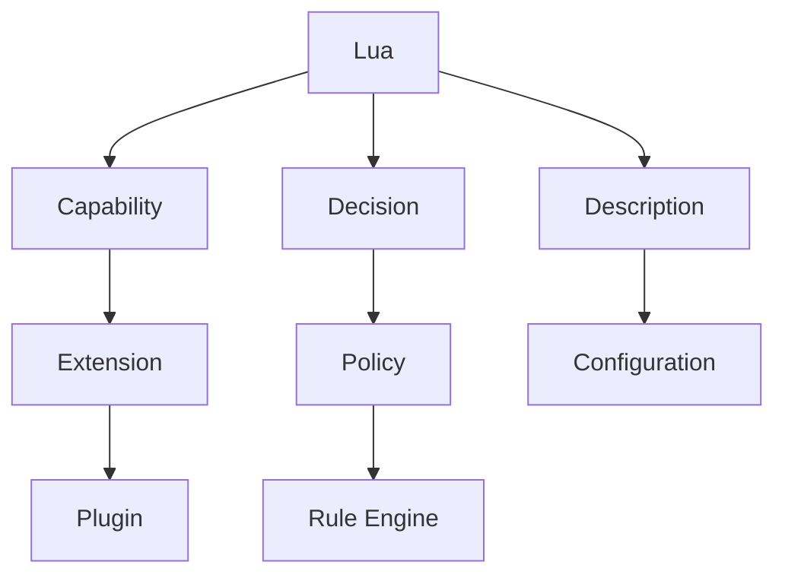

# 10 · 最终统一心智模型

> 前置阅读：全部前文，尤其 [00-mental-model-overview.md](00-mental-model-overview.md)、[06-c-lua-embedding-mental-model.md](06-c-lua-embedding-mental-model.md)、[07-cross-pattern-comparison.md](07-cross-pattern-comparison.md)、[09-pattern-decision-tree.md](09-pattern-decision-tree.md)。这是整套笔记的收尾：一张最终关系图、五句话记忆，以及回到 [00-mental-model-overview.md](00-mental-model-overview.md) 开篇提出的问题逐条作答。

## 1. 最终关系图

这张图表达的是：Lua 在一个 Host 系统里能扮演的角色，先分成三条主线——**Capability（能力）**、**Decision（决策）**、**Description（描述）**，再从其中两条主线上进一步分化出更工程化的形态：

- `Capability` 分化出 `Extension`（新增一种具体能力），`Extension` 再进一步工程化为 `Plugin`（把能力组织成可独立发现、加载、卸载的模块，见 [05-plugin/00-why-and-architecture.md](05-plugin/00-why-and-architecture.md)）。
- `Decision` 分化出 `Policy`（单次决策），`Policy` 再进一步结构化为 `Rule Engine`（当决策逻辑变成一组结构统一的 `match+action` 规则时，见 [04-rule-engine/00-why-and-architecture.md](04-rule-engine/00-why-and-architecture.md)）。
- `Description` 对应 `Configuration`——它没有再分化出下一层，因为"描述 Runtime 参数"这件事本身已经是最终形态，不需要再工程化成别的东西（[03-configuration/00-why-and-architecture.md](03-configuration/00-why-and-architecture.md) 里提到它是五种模式里边界最"薄"的一种）。

## 2. 五句话记忆

> **Extension** —— "我要给 Host 增加什么能力？"
>
> Host 原本不会做的事，因为一段 Lua 代码而存在了；Host 只提供稳定的注册入口，不关心注册进来的是什么，见 [01-extension/00-why-and-architecture.md](01-extension/00-why-and-architecture.md)。

> **Policy** —— "Host 已经会做了，那应该怎么选择？"
>
> Host 已经具备了若干种做法（ALLOW/DENY、ATTACK/FLEE），Lua 只负责在具体场景下选出一种，不创造新做法，见 [02-policy/00-why-and-architecture.md](02-policy/00-why-and-architecture.md)。

> **Configuration** —— "Runtime 应该使用什么参数/结构？"
>
> Lua 脚本执行一次，产出一份数据表，Host 转换成 C struct 后就与 Lua 脱钩，运行期间不再反复回问，见 [03-configuration/00-why-and-architecture.md](03-configuration/00-why-and-architecture.md)。

> **Rule Engine** —— "输入满足什么规则，然后执行什么 Action？"
>
> 一组结构统一的规则表，Host 把输入交给 Lua 逐条匹配，命中的规则各自带着一个 Action 描述交还给 Host 执行，见 [04-rule-engine/00-why-and-architecture.md](04-rule-engine/00-why-and-architecture.md)。

> **Plugin** —— "如何把一组扩展能力封装成独立、可加载、可管理的模块？"
>
> Discovery -> Load -> Register -> Lifecycle -> Event -> Unload 六步生命周期，Host 只认识"这是一个插件"，不关心插件内部具体用了 Policy、Configuration 还是 Rule Engine，见 [05-plugin/00-why-and-architecture.md](05-plugin/00-why-and-architecture.md)。

## 3. 回到最初的问题

[00-mental-model-overview.md](00-mental-model-overview.md) 开篇提出了 8 个问题，这里逐条简短作答，答案全部来自前面已经论证过的内容，不展开新论点：

1. **为什么这个系统需要 Lua？** —— 因为系统内部天然分裂出"稳定、改错代价高"的 Mechanism 和"易变、允许犯错"的 Behavior/Policy/Rules/Configuration/Extension 两类需求，Lua 是专门用来承接后一类需求、且可以被 `lua_pcall` 兜底、不会让改错的脚本拖垮整个进程的组件，见 [00-mental-model-overview.md](00-mental-model-overview.md) 第 1 节。

2. **Lua 位于系统架构的什么位置？** —— 不固定在一个位置，取决于挂在请求处理管线的哪个阶段：`parse` 阶段是 Extension，决策点是 Policy，启动阶段是 Configuration，批量匹配阶段是 Rule Engine，或者整体被委托给一个独立的 Manager 层就是 Plugin，见 [08-unified-case-network-server.md](08-unified-case-network-server.md) 第 6 节。

3. **Host 与 Lua 分别负责什么？** —— Host 拥有 Mechanism / Resource / Lifecycle / Stable API；Lua 拥有 Behavior / Policy / Rules / Configuration / Extension，两者之间只通过 Host 显式暴露的 Stable API 和 Lua 的值栈交互，见 [00-mental-model-overview.md](00-mental-model-overview.md) 第 2 节的职责表。

4. **数据如何从 Host 流向 Lua？** —— 只通过 Lua VM Stack：C 侧用 `lua_push*` 系列把 number/string/table 等基本类型压栈，没有共享内存和直接的结构体传递，复杂数据必须由 Binding 层显式拆解或包成 `userdata`，见 [06-c-lua-embedding-mental-model.md](06-c-lua-embedding-mental-model.md) 第 1、2 节。

5. **Lua 如何影响 Host？** —— 视 Pattern 而定：新增一条命令表记录（Extension）、返回一个 Decision（Policy）、返回一份参数表（Configuration）、返回一组 Action 描述（Rule Engine）、或者通过一套生命周期回调持续与 Host 交互（Plugin）；无论哪种，真正的副作用（读写 socket、发邮件、真正丢包）永远由 Host 执行，Lua 从不直接触碰真实资源，见 [00-mental-model-overview.md](00-mental-model-overview.md) 第 2 节"谁拥有资源"。

6. **Lua Script 的生命周期是什么？** —— 由 `lua_State` 的创建（`luaL_newstate`）到销毁（`lua_close`）界定，具体长短随 Pattern 差异很大：Configuration 通常"用一次就关"，Policy 随每次调用短暂存活，Extension 随 Host 整个进程存活，Plugin 有显式的 Discovery/Load/Register/Lifecycle/Event/Unload 六步状态机，见 [06-c-lua-embedding-mental-model.md](06-c-lua-embedding-mental-model.md) 与各 Pattern 的 Lifecycle 小节。

7. **这种模式与其他模式有什么本质区别？** —— 区别不在用了什么 Lua API（五种模式用的是同一套 `lua_State`/`lua_pcall`/回调机制），而在 Lua 挂在架构图里的哪一层、Host 调用它的触发时机、以及 Lua 返回值被如何使用这三个维度的组合，见 [07-cross-pattern-comparison.md](07-cross-pattern-comparison.md) 的对比表和 [08-unified-case-network-server.md](08-unified-case-network-server.md) 第 6 节的三维度总结。

8. **什么情况下应该使用这种模式？** —— 用 [09-pattern-decision-tree.md](09-pattern-decision-tree.md) 的决策树逐条自问：要新增能力选 Extension；要做选择选 Policy；要描述参数选 Configuration；要处理大量结构统一的 IF/THEN 选 Rule Engine；要做一个可独立加载卸载的模块选 Plugin；多个条件同时命中时，大概率应该用 Plugin 把其余几种手法组合封装起来，见 [07-cross-pattern-comparison.md](07-cross-pattern-comparison.md) 第 3 节。

至此，整套 Lua Patterns Mastery 笔记闭环：[00-mental-model-overview.md](00-mental-model-overview.md) 建立了统一词汇和分工模型，[01-extension](01-extension/00-why-and-architecture.md) ~ [05-plugin](05-plugin/00-why-and-architecture.md) 分别用 WHY/Architecture/Lifecycle 加 15 个完整示例把五种模式逐一落地，[06-c-lua-embedding-mental-model.md](06-c-lua-embedding-mental-model.md) 补齐了底层 C API 机制，[07-cross-pattern-comparison.md](07-cross-pattern-comparison.md)、[08-unified-case-network-server.md](08-unified-case-network-server.md)、[09-pattern-decision-tree.md](09-pattern-decision-tree.md) 做横向整合，本文收尾。下次遇到一个陌生的、嵌入了 Lua 的 C/C++ 项目，应该已经具备了"一眼看出它在做什么"的分类能力。
