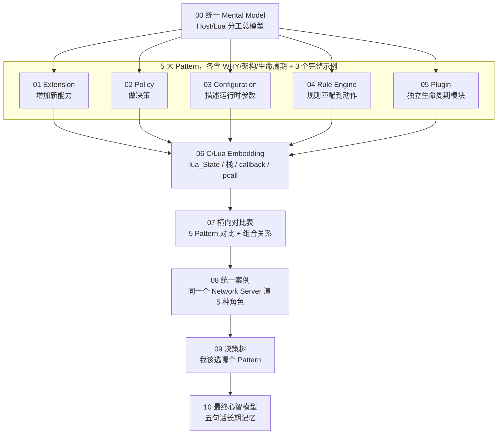

# Lua 应用模式 Mental Model：Extension / Policy / Configuration / Rule Engine / Plugin

一份"不教 Lua 语法，而是教你在陌生 C/C++ 系统里判断 Lua 到底扮演什么角色"的系统性学习笔记。

## 这份笔记要解决的问题

绝大多数 Lua 嵌入式教程都是从 API 讲起：`lua_State`、`lua_pcall`、`Proto`、`vim.opt`……学完之后能改小脚本，但看到一个陌生的、嵌入了 Lua 的 C/C++ 项目时，仍然不知道：

- 这个项目为什么要嵌入 Lua？
- Lua 在它的架构里属于哪一层？
- 它属于 Extension / Policy / Configuration / Rule Engine / Plugin 里的哪一种？
- Host 和 Lua 的边界画在哪里？数据怎么进去，控制怎么回来？
- 如果 Lua 消失，Host 还能做什么？如果换成 JSON/YAML/纯 C，这个模式还成立吗？

这份笔记反过来做：先建立"为什么是这样"的心智模型，再看 15 个完整可运行的示例，最后横向对比、给出决策树。顺序是：

```text
WHY -> ARCHITECTURE -> LIFECYCLE -> RELATIONSHIP -> DATA/CONTROL FLOW -> STATE -> FAILURE -> EXAMPLES -> COMPARISON
```

## 阅读路线图



## 目录

- [00-mental-model-overview.md](00-mental-model-overview.md) — 统一 Mental Model：为什么是 Lua，Host/Lua 各自拥有什么
- **01-extension/** — Pattern A：给 Host 增加新能力
  - [00-why-and-architecture.md](01-extension/00-why-and-architecture.md)
  - [01-example-c-command-extension.md](01-extension/01-example-c-command-extension.md) — C Host + Lua Command Extension
  - [02-example-wireshark-dissector.md](01-extension/02-example-wireshark-dissector.md) — Wireshark Lua Dissector
  - [03-example-neovim-extension.md](01-extension/03-example-neovim-extension.md) — Neovim Lua Extension
- **02-policy/** — Pattern B：在已有能力之间做决策
  - [00-why-and-architecture.md](02-policy/00-why-and-architecture.md)
  - [01-example-c-server-access-policy.md](02-policy/01-example-c-server-access-policy.md) — C Server + Lua Access Policy
  - [02-example-openresty-request-policy.md](02-policy/02-example-openresty-request-policy.md) — OpenResty/Nginx 风格 Request Policy
  - [03-example-npc-decision-policy.md](02-policy/03-example-npc-decision-policy.md) — 游戏 NPC Decision Policy
- **03-configuration/** — Pattern C：让配置具备计算能力
  - [00-why-and-architecture.md](03-configuration/00-why-and-architecture.md)
  - [01-example-c-app-configuration.md](03-configuration/01-example-c-app-configuration.md) — C Application + Lua Configuration
  - [02-example-neovim-configuration.md](03-configuration/02-example-neovim-configuration.md) — Neovim Configuration
  - [03-example-game-configuration.md](03-configuration/03-example-game-configuration.md) — Game Configuration
- **04-rule-engine/** — Pattern D：输入 -> 规则匹配 -> 动作
  - [00-why-and-architecture.md](04-rule-engine/00-why-and-architecture.md)
  - [01-example-firewall-rule-engine.md](04-rule-engine/01-example-firewall-rule-engine.md) — Firewall Rule Engine
  - [02-example-http-routing-rule-engine.md](04-rule-engine/02-example-http-routing-rule-engine.md) — HTTP Routing Rule Engine
  - [03-example-device-alarm-rule-engine.md](04-rule-engine/03-example-device-alarm-rule-engine.md) — Device Alarm Rule Engine
- **05-plugin/** — Pattern E：独立生命周期的可插拔模块
  - [00-why-and-architecture.md](05-plugin/00-why-and-architecture.md)
  - [01-example-c-plugin-manager.md](05-plugin/01-example-c-plugin-manager.md) — C + Lua Plugin Manager
  - [02-example-wireshark-plugin.md](05-plugin/02-example-wireshark-plugin.md) — Wireshark Lua Plugin
  - [03-example-neovim-plugin.md](05-plugin/03-example-neovim-plugin.md) — Neovim Lua Plugin
- [06-c-lua-embedding-mental-model.md](06-c-lua-embedding-mental-model.md) — `lua_State` / 栈 / C 调 Lua / Lua 调 C / callback / 错误边界
- [07-cross-pattern-comparison.md](07-cross-pattern-comparison.md) — 5 种模式横向对比表 + 组合关系
- [08-unified-case-network-server.md](08-unified-case-network-server.md) — 同一个 Network Server 演出 5 种角色
- [09-pattern-decision-tree.md](09-pattern-decision-tree.md) — Pattern 选择决策树
- [10-final-mental-model.md](10-final-mental-model.md) — 最终统一心智模型 + 五句话记忆

## 每个示例的固定分析框架

15 个完整示例统一按以下 16 步讲解，不按 Lua API 文档章节罗列：

1. Problem 2. Why Lua 3. Architecture 4. Host responsibilities 5. Lua responsibilities
6. Lifecycle 7. Data Flow（C -> Lua） 8. Control Flow（Lua -> C） 9. State 10. Failure
11. Complete Host Code 12. Complete Lua Code 13. Execution 14. Step-by-step walkthrough
15. Mental Model 16. Why this is this Pattern

## 代码目录结构

```text
lua-patterns-mastery/
+-- 01-extension/code/
|   +-- 01-c-command-extension/{main.c, extension.lua, Makefile}
|   +-- 02-wireshark-dissector/mini_extension.lua
|   +-- 03-neovim-extension/{plugin/myext.lua, lua/myext/init.lua}
+-- 02-policy/code/
|   +-- 01-c-server-access-policy/{server.c, policy.lua, Makefile}
|   +-- 02-openresty-request-policy/policy.lua
|   +-- 03-npc-decision-policy/{npc_engine.c, npc_policy.lua, Makefile}
+-- 03-configuration/code/
|   +-- 01-c-app-configuration/{main.c, config.lua, Makefile}
|   +-- 02-neovim-configuration/init.lua
|   +-- 03-game-configuration/{main.c, game_config.lua, Makefile}
+-- 04-rule-engine/code/
|   +-- 01-firewall-rule-engine/{main.c, rules.lua, Makefile}
|   +-- 02-http-routing-rule-engine/rules.lua
|   +-- 03-device-alarm-rule-engine/{main.c, rules.lua, Makefile}
+-- 05-plugin/code/
    +-- 01-c-plugin-manager/{plugin_manager.c, plugin_a.lua, plugin_b.lua, Makefile}
    +-- 02-wireshark-plugin/plugin.lua
    +-- 03-neovim-plugin/{plugin/myplugin.lua, lua/myplugin/init.lua}
```

所有 C 示例都提供完整可编译的 `.c` + `.lua` + `Makefile`（`make && ./xxx` 直接运行），不省略 VM 创建、脚本加载、`lua_pcall` 错误处理、`lua_close` 资源释放等关键步骤；教学性简化的地方会在对应 `.md` 里明确标注。Wireshark 示例给出真实可加载的 `.lua`（`Proto`/`ProtoField`/`dissector`/`DissectorTable`），Neovim 示例给出真实的 `plugin/` + `lua/<name>/init.lua` 目录结构。
