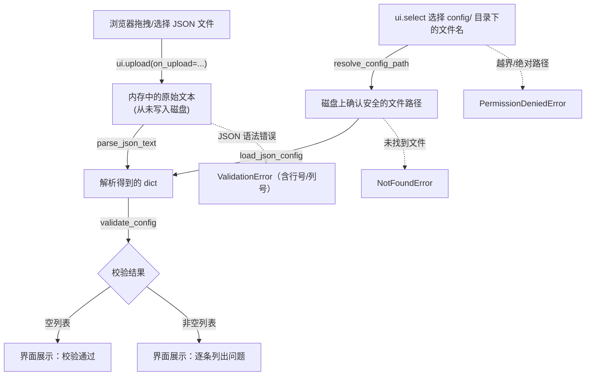
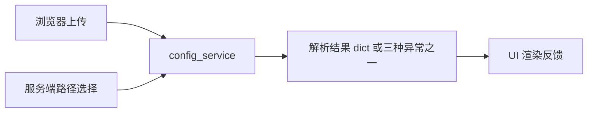

# 示例 4：JSON 配置检查器（`examples/04_config_checker.py`）

## 1. Why（为什么需要这个示例）

如果你写过 C/C++/Go/Rust 的运维工具，大概率写过这样的代码：读一个配置文件、
`json.loads`（或者对应语言的解析函数）、检查几个必填字段是不是都在、哪里写错
了告诉用户第几行第几列出了问题。这是工程 GUI 里最常见的需求之一：**配置校验
工具**。

这个示例要解决两个具体问题：

1. 工程师经常需要"校验一份还没有放到服务器上的配置"——比如同事发来一个 JSON
   片段，想知道格式对不对。这时候最自然的交互是直接把文件拖进浏览器，而不是
   先 `scp` 到服务器再用命令行工具跑一遍。
2. 工程师也经常需要"查看/校验服务器上已经存在的某个配置文件"——但是不能让
   界面变成一个"任意读文件"的后门：用户不能通过构造文件名读到 `/etc/passwd`
   或者本项目自己的 `requirements.txt`。

这两类需求背后是同一套"解析 + 校验"逻辑，但"从哪里拿到原始内容"的安全模型
完全不同。这正是本示例要展示的核心张力。

## 2. Mental Model（心智模型）



核心抽象只有一句话：**不管内容来自"浏览器上传"还是"服务端路径"，一旦变成了
一段文本，后面"解析成 dict"和"校验字段"用的是完全相同的函数
（`parse_json_text()` / `validate_config()`）**。两条路径唯一的区别在于"怎么
安全地拿到这段文本"：

- 上传路径：内容只存在于这次 HTTP 请求里，天然没有"越界读到别的文件"的风险，
  所以不需要、也不应该经过任何路径检查。
- 服务端路径：用户提供的只是一个"文件名"，必须先经过
  `resolve_config_path()`（内部调用 `services/path_guard.confine_path()`）
  确认它落在 `config/` 目录内部，才允许真正去读磁盘。

## 3. Architecture（模块职责与依赖方向）

```
+--------------------------------+
| examples/04_config_checker.py  |   UI 层：组装 ui.upload / ui.select /
| (依赖 nicegui)                  |   ui.button / ui.code，把 Service 的
|                                 |   返回值或异常渲染成界面文案
+--------------------------------+
              |
              | 调用（不关心解析细节/校验规则）
              v
+--------------------------------+
| services/config_service.py     |   业务层：文件名安全解析、JSON 解析、
| resolve_config_path()          |   字段校验；不 import nicegui
| load_json_config()             |
| parse_json_text()              |
| validate_config()              |
+--------------------------------+
              |
              | 复用
              v
+----------------------+  +----------------------+
| services/path_guard.py|  | services/errors.py   |
| confine_path()        |  | NotFoundError         |
|                        |  | PermissionDeniedError |
|                        |  | ValidationError       |
+----------------------+  +----------------------+
```

调用链（服务端路径分支）：

```
UI 事件处理函数 _handle_server_path_lookup()
  -> resolve_config_path(filename, CONFIG_DIR)   # services/config_service.py
       -> confine_path(filename, base_dir)        # services/path_guard.py
  -> load_json_config(path)                       # services/config_service.py
       -> parse_json_text(text)
  -> validate_config(data, REQUIRED_FIELDS)
  -> _render_outcome(...)                         # 回到 UI 层渲染
```

依赖方向严格单向：`examples -> services -> {path_guard, errors}`，`services`
下的任何模块都不 `import nicegui`，因此 `services/config_service.py` 本身可以
在没有安装 nicegui 的机器上被单独测试（参见 `tests/test_config_service.py`）。

## 4. Complete Code（完整源码位置）

- 服务层：`services/config_service.py`
- UI 层：`examples/04_config_checker.py`
- 测试：`tests/test_config_service.py`

关键片段 —— 两种错误处理风格在服务层的体现：

```python
def load_json_config(path: Path) -> dict:
    try:
        text = path.read_text(encoding='utf-8')
    except FileNotFoundError as exc:
        raise NotFoundError(f'文件不存在: {path}') from exc
    except PermissionError as exc:
        raise PermissionDeniedError(f'没有权限读取文件: {path}') from exc
    return parse_json_text(text)


def validate_config(data: dict, required_fields: list[str]) -> list[str]:
    errors: list[str] = []
    for field_name in required_fields:
        if field_name not in data:
            errors.append(f"缺少必需字段: '{field_name}'")
            continue
        ...
    return errors  # 空列表 = 校验通过；不抛异常
```

UI 层处理上传文件、从不落盘：

```python
def _handle_upload(event: events.UploadEventArguments, container: ui.column) -> None:
    raw_bytes = event.content.read()
    text = raw_bytes.decode('utf-8')
    data = parse_json_text(text)       # 直接在内存里解析，没有任何文件路径参与
    errors = validate_config(data, REQUIRED_FIELDS)
    ...
```

## 5. Execution（安装 / 启动 / 验证）

```bash
cd /home/morrism/myNote/nicegui_learning_lab

# 1) 安装依赖（包含 nicegui 与 pytest）
python3 -m pip install -r requirements.txt

# 2) 单独验证 services/config_service.py 的语法与单元测试
python3 -m py_compile services/config_service.py examples/04_config_checker.py
python3 -m pytest -q tests/test_config_service.py

# 3) 启动示例（需要已安装 nicegui）
python3 examples/04_config_checker.py
# 启动后浏览器访问 http://localhost:8080
# - 左侧卡片：拖拽或选择任意 .json 文件上传
# - 右侧卡片：从下拉框选择 example.json 或 example_invalid.json，点击"读取并校验"
```

> 本机环境在编写本文档时尚未安装 nicegui，因此"启动示例"这一步由协调者在
> 集成阶段统一验证；本文档中的 `py_compile` 与 `pytest` 命令已经在本机真实
> 执行过，结果见协作报告。

## 6. Lifecycle（以"选择 example_invalid.json 并点击读取"为例）

1. **User Action**：用户在右侧卡片的下拉框里选中 `example_invalid.json`，
   点击"读取并校验"按钮。
2. **Event Handler**：按钮的 `on_click` 触发
   `_handle_server_path_lookup('example_invalid.json', result_container)`。
3. **State/Service 调用 1**：调用
   `resolve_config_path('example_invalid.json', CONFIG_DIR)`，内部的
   `confine_path()` 确认 `config/example_invalid.json` 确实落在 `config/`
   目录内且文件存在，返回绝对路径。
4. **State/Service 调用 2**：调用 `load_json_config(path)`，文件被成功读成
   字符串后交给 `parse_json_text()`；`json.loads()` 在解析末尾那个多余的逗号
   时抛出 `json.JSONDecodeError`。
5. **Business Operation 内部转换**：`parse_json_text()` 捕获该异常，重新包装
   成 `ValidationError('JSON 语法错误（第 N 行，第 M 列）: ...')` 并向上抛出。
6. **Result/Exception 传播**：异常沿调用栈从 `load_json_config()` 一路冒泡回
   `_handle_server_path_lookup()`。
7. **UI Feedback**：`except ValidationError as exc` 分支捕获到它，调用
   `_render_outcome(..., failure_kind='validation', failure_message=str(exc))`，
   在结果区域显示一行醒目的红色文案 `[JSON 语法错误] ...`，用户不需要打开
   浏览器控制台或服务器日志就能知道具体哪一行哪一列写错了。

## 7. API Reference

| API / 概念 | 作用 | 输入 | 输出 / 效果 | 常见使用场景 |
| --- | --- | --- | --- | --- |
| `ui.upload(on_upload=..., auto_upload=True)` | 浏览器端文件上传控件 | 用户选择/拖拽的文件 | 触发 `on_upload` 回调，回调参数含 `content`（可读字节流）与 `name` | 让用户直接上传一份未落盘的配置做校验 |
| `events.UploadEventArguments` | 上传事件的参数对象 | - | `.content.read()` 读取字节内容；`.name` 原始文件名 | 在 `on_upload` 回调里取出上传内容 |
| `ui.select(options, value=...)` | 下拉选择框 | 候选项列表 | 用户选中的值（通过 `.value` 读取） | 从 `config/` 目录候选文件名中选一个 |
| `ui.code(content, language='json')` | 带语法高亮的代码展示块 | 字符串 | 渲染为带高亮的只读代码块 | 展示格式化后的 JSON 内容 |
| `.mark('some-id')` | 给元素打标记 | 字符串 id | 之后可用于无浏览器冒烟测试定位元素 | 标记关键交互元素，如 `upload-widget` |
| `resolve_config_path(filename, base_dir)` | 把文件名安全解析到 `config/` 目录内 | 文件名、基准目录 | 绝对路径 / 抛 `PermissionDeniedError` / `NotFoundError` | 服务端路径读取分支的第一步 |
| `load_json_config(path)` | 读文件并解析 JSON | 文件路径 | `dict` / 抛三种异常之一 | "单点致命错误"场景 |
| `parse_json_text(text)` | 把内存中的字符串解析为 JSON | 字符串 | `dict` / 抛 `ValidationError` | 上传文件内容解析 |
| `validate_config(data, required_fields)` | 校验必填字段是否齐全、取值是否合法 | 字典、必填字段列表 | 问题列表（空代表通过），不抛异常 | "一次性展示所有问题"场景 |

## 8. Failure Modes（真实问题与修复方法）

1. **现象**：点击"读取并校验"后界面显示"[文件不存在] 文件不存在: .../config/xxx.json"。
   **原因**：`config/` 目录下的候选文件列表是页面渲染那一刻读取的；如果文件在
   页面打开后被外部进程删除/移动，再点击读取就会触发 `NotFoundError`。
   **修复**：刷新页面重新获取候选文件列表；或者在点击前调用
   `_list_config_filenames()` 重新渲染下拉框选项。

2. **现象**：界面显示"[权限不足 / 路径越界] 路径越界，禁止访问基准目录之外的
   文件"，即便用户只是通过浏览器开发者工具直接调用了后端接口传入
   `../requirements.txt` 或绝对路径。
   **原因**：`resolve_config_path()` 内部的 `confine_path()` 检测到解析后的
   路径逃逸出了 `config/` 目录（或者一开始就是绝对路径），按设计直接拒绝，
   不会尝试"修正"成一个安全路径。
   **修复**：这是预期行为，不需要修复；如果确实需要访问 `config/` 之外的
   文件，应该新增一个显式的、经过安全评审的基准目录，而不是放宽这次检查。

3. **现象**：上传一个保存为 GBK/GB2312 编码的 JSON 文件，界面显示
   "文件不是合法的 UTF-8 文本"。
   **原因**：`_handle_upload()` 用 `raw_bytes.decode('utf-8')` 严格按 UTF-8
   解码；这是本项目的既定约定（配置文件应统一用 UTF-8），非 UTF-8 编码会在
   解码阶段就被拦下，而不是等到 `json.loads()` 报出一个更难理解的错误。
   **修复**：让用户把文件另存为 UTF-8 编码后重新上传；如果业务上确实需要
   支持多种编码，需要显式扩展 `_handle_upload()` 并与团队约定好优先级。

4. **现象**：本机环境下很难自然触发 `PermissionDeniedError` 里"操作系统拒绝
   读取"这个分支（因为运行示例的用户通常对 `config/` 目录下的文件有读权限）。
   **原因 / 验证方法**：可以手动执行
   `chmod 000 config/example.json`（验证后记得 `chmod 644` 改回来）人为制造
   一个只有权限位被拒绝读取的场景，确认 `load_json_config()` 能正确捕获
   `PermissionError` 并转换成 `PermissionDeniedError`。

## 9. Exercises（练习）

1. **练习：给 `validate_config` 增加一条新规则。**
   要求：当 `environment` 字段存在但取值不属于 `{'dev', 'staging',
   'production'}` 时，追加一条形如 `"字段 'environment' 取值不合法: xxx"`
   的错误信息。
   **验收标准**：为 `tests/test_config_service.py` 新增一个测试用例，构造一
   个 `environment='prod-typo'` 的配置字典，断言 `validate_config()` 的返回
   列表里包含这条新错误；原有测试全部继续通过。

2. **练习：在界面上展示"最近一次读取时间"。**
   要求：每次 `_handle_server_path_lookup()` 或 `_handle_upload()` 成功读取
   配置后，在结果区域顶部追加一行"最后读取时间: YYYY-MM-DD HH:MM:SS"。
   **验收标准**：连续读取两次不同的文件，界面上的时间戳要随之更新；不能把
   这个时间戳逻辑写进 `services/config_service.py`（它是纯 UI 展示状态，不
   属于业务规则）。

3. **练习：限制上传文件大小。**
   要求：如果上传的文件内容超过 1MB，直接在界面提示"文件过大"，不要尝试
   解析。
   **验收标准**：构造一个超过 1MB 的字符串写入临时文件后上传，界面应显示
   明确的"文件过大"提示，而不是卡顿或抛出未处理的异常；1MB 以内的正常配置
   文件行为不受影响。

## 10. Summary（小结）



这个示例的核心教学点是：**UI 不应该知道"JSON 怎么解析、一份合法配置长什么
样"**，这些规则全部收敛在 `services/config_service.py` 里，可以脱离 nicegui
单独测试；同时，"内容从浏览器内存直接来"和"内容要从服务器磁盘读"是两种本质
不同的信任边界，后者必须经过目录限制（`resolve_config_path`），前者天然不需要。

适用场景：任何"用户提供一份结构化配置，需要先解析再按业务规则校验"的工程
GUI 小工具，例如设备配置下发前的预检、CI 流水线参数校验、命令面板的参数
文件校验等。

下一步扩展方向：

- 支持 YAML/TOML 等更多配置格式，在 `config_service` 里增加
  `parse_yaml_text()` 之类的同构函数，保持"解析"与"校验"分离的结构不变。
- 把 `validate_config` 的规则表（必填字段、类型、取值范围）做成可配置的
  schema，而不是在函数体内硬编码判断逻辑。
- 结合示例 8（如果未来有命令执行类示例）对校验通过的配置发起真正的下发
  操作，这时需要区分清楚"校验通过"与"下发成功"是两个独立的状态。
