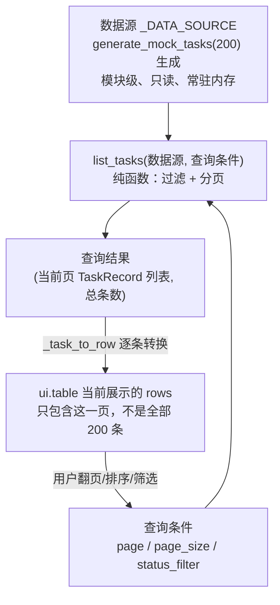
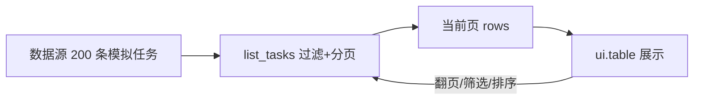

# 示例 5：任务表格（`examples/05_task_table.py`）

## 1. Why（为什么需要这个示例）

工程 GUI 里经常要展示"一大堆同类记录"：任务列表、告警列表、设备列表……
数量可能是几十条，也可能是几千条。如果你习惯了用 C/C++/Go/Rust 写命令行
工具，可能会本能地把所有数据都塞进一个结构体数组、一次性打印出来——命令行
场景下这没问题，但在浏览器里，这意味着：

- 把几千条记录一次性序列化成 JSON 发给浏览器，首屏加载变慢；
- 浏览器要为每一行创建真实的 DOM 节点，数据量一大页面会明显卡顿；
- 大部分数据用户根本不会翻到，白白浪费了内存和带宽。

这个示例演示"分页表格"这一套标准解法：**服务端（或者这里的模拟数据层）永远
只在被明确要求时才交出当前这一页的数据，而不是把全部数据一次性交给前端。**

## 2. Mental Model（心智模型）



三个关键概念的关系：

- **数据源**（`_DATA_SOURCE`）：`generate_mock_tasks(200, seed=42)` 在模块
  导入时生成一次，代表"后端持有的全部记录"，整个示例运行期间不会变化
  （它是只读的演示数据，不是一个真实可写的数据库）。
- **查询结果**（`list_tasks()` 的返回值）：每次用户翻页、切换筛选条件、
  点击表头排序，都会重新调用一次 `list_tasks()`，只拿回"过滤后符合条件的
  这一页"，以及过滤后的总条数（用于告诉表格组件一共有多少页）。
- **UI 当前展示的那一页**：`ui.table` 组件的 `rows` 属性，任何时刻都只是
  "查询结果"里的那一小部分数据——这正是本示例要教的核心技巧。

## 3. Architecture（模块职责与依赖方向）

```
+-------------------------------+
| examples/05_task_table.py     |   UI 层：ui.table / ui.select / ui.dialog，
| (依赖 nicegui)                 |   持有当前会话的分页/筛选状态 (_TableState)
+-------------------------------+
              |
              | 调用（不关心分页/过滤怎么实现）
              v
+-------------------------------+
| services/task_query_service.py|   业务层：生成模拟数据、纯函数式分页查询；
| generate_mock_tasks()         |   不 import nicegui
| list_tasks()                  |
+-------------------------------+
              |
              | 使用
              v
+-------------------------------+
| models/task.py                |   数据层：TaskRecord / TaskStatus，
| TaskRecord / TaskStatus        |   状态迁移规则 (transition_to)
+-------------------------------+
```

调用链（用户切换状态筛选为例）：

```
ui.select 的 on_change 回调 _on_status_filter_change()
  -> 更新 _TableState.status_filter / 重置 page=1
  -> _refresh() -> _apply_query_result()
       -> _sorted_source(sort_by, descending)         # 示例层自己排序
       -> list_tasks(source, page=, page_size=, status_filter=)  # services 层
       -> [_task_to_row(task) for task in page_tasks]  # 转换成 ui.table 需要的 dict
  -> table.rows = 新的一页数据；table.pagination 更新总条数
```

依赖方向严格单向：`examples -> services -> models`。`list_tasks()` 是一个
不依赖任何全局状态的纯函数（输入决定输出），所以 `tests/test_task_query_service.py`
可以完全脱离 nicegui、脱离 UI 状态单独测试分页边界条件。

## 4. Complete Code（完整源码位置）

- 服务层：`services/task_query_service.py`
- UI 层：`examples/05_task_table.py`
- 测试：`tests/test_task_query_service.py`

关键片段 —— Python 的 list/dict 如何变成 `ui.table` 需要的结构：

```python
_COLUMNS = [
    {'name': 'id', 'label': 'ID', 'field': 'id', 'sortable': True, 'align': 'left'},
    {'name': 'name', 'label': '名称', 'field': 'name', 'sortable': True, 'align': 'left'},
    {'name': 'status', 'label': '状态', 'field': 'status', 'sortable': True, 'align': 'left'},
    {'name': 'created_at', 'label': '创建时间', 'field': 'created_at', 'sortable': True, 'align': 'left'},
]

def _task_to_row(task: TaskRecord) -> dict:
    """TaskRecord（Python 对象） -> ui.table 需要的一行 dict。

    dict 的 key 必须和 columns 里的 'field' 一一对应；ui.table 并不知道
    TaskRecord 是什么，它只认识这种"扁平字典列表"的 rows 格式。
    """
    return {
        'id': task.id,
        'name': task.name,
        'status': task.status.value,
        'created_at': task.created_at.strftime('%Y-%m-%d %H:%M'),
    }
```

关键片段 —— 每次只查询"当前这一页"，而不是把全部数据塞进 rows：

```python
def _apply_query_result() -> None:
    rows, total, error_message = _query_current_page(state)
    ...
    table.rows = rows                      # 永远只是这一页，不是 _DATA_SOURCE 全部
    table.pagination = {
        'rowsPerPage': state.rows_per_page,
        'page': state.page,
        'sortBy': state.sort_by,
        'descending': state.descending,
        'rowsNumber': total,               # 告诉表格"总共有多少条"，用于渲染页码
    }
    table.update()
```

## 5. Execution（安装 / 启动 / 验证）

```bash
cd /home/morrism/myNote/nicegui_learning_lab

# 1) 安装依赖（包含 nicegui 与 pytest）
python3 -m pip install -r requirements.txt

# 2) 单独验证 services/task_query_service.py 的语法与单元测试
python3 -m py_compile services/task_query_service.py examples/05_task_table.py
python3 -m pytest -q tests/test_task_query_service.py

# 3) 启动示例（需要已安装 nicegui）
python3 examples/05_task_table.py
# 启动后浏览器访问 http://localhost:8080
# - 表格默认每页 10 条，共 200 条模拟数据
# - 切换右上角的状态筛选下拉框，观察总条数 / 页数随之变化
# - 点击某一行，弹出详情对话框，查看 logs / result / error
# - 点击"模拟一次加载失败"按钮，观察错误状态展示；再点击"刷新"恢复正常
```

> 本机环境在编写本文档时尚未安装 nicegui，因此"启动示例"这一步由协调者在
> 集成阶段统一验证；本文档中的 `py_compile` 与 `pytest` 命令已经在本机真实
> 执行过，结果见协作报告。

## 6. Lifecycle（以"用户把状态筛选切换为 FAILED"为例）

1. **User Action**：用户点开"按状态筛选"下拉框，选择 `FAILED`。
2. **Event Handler**：`ui.select` 的 `on_change` 触发
   `_on_status_filter_change()`。
3. **State 更新**：`state.status_filter = TaskStatus('FAILED')`；同时把
   `state.page` 重置为 1（切换筛选条件后应该从第一页重新看，而不是停留在
   切换前的页码，否则可能出现"第 5 页"但筛选后总共只有 1 页的尴尬情况）。
4. **Business Operation**：`_refresh()` 调用 `_apply_query_result()`，内部
   先用 `_sorted_source()` 对 `_DATA_SOURCE` 排序（如果用户之前点过表头），
   再调用 `list_tasks(source, page=1, page_size=10, status_filter=TaskStatus.FAILED)`。
5. **Result**：`list_tasks()` 先过滤出所有 `status == FAILED` 的任务，取
   总数 `total`，再按 `page=1, page_size=10` 切出前 10 条（如果总数不足 10
   条，就是全部），返回 `(这 10 条或更少, total)`。
6. **UI Feedback（两种分支）**：
   - 如果 `total > 0`：`table.rows` 被替换成这一页数据，`table.pagination`
     里的 `rowsNumber` 更新为新的 `total`，`status_message` 更新成
     "共 N 条（筛选条件: FAILED），第 1 页"。
   - 如果 `total == 0`（例如模拟数据里恰好没有生成任何 FAILED 任务）：
     表格被隐藏，`empty_state_label` 显示"没有符合筛选条件的任务。"——这就
     是"空状态"的真实触发路径，不需要额外构造数据去演示。

## 7. API Reference

| API / 概念 | 作用 | 输入 | 输出 / 效果 | 常见使用场景 |
| --- | --- | --- | --- | --- |
| `ui.table(columns=, rows=, row_key=, pagination=, on_pagination_change=)` | 分页/排序表格组件 | 列定义、当前页数据、分页状态、翻页回调 | 渲染表格；翻页/排序时触发回调 | 展示任意结构化列表数据 |
| `table.pagination = {...}` | 更新表格的分页状态 | 含 `page`/`rowsPerPage`/`sortBy`/`descending`/`rowsNumber` 的字典 | 控制表格显示的页码、每页条数、总页数 | 服务端分页场景下告知前端"总共有多少条" |
| `table.on('rowClick', handler)` | 监听行点击事件 | 事件处理函数 | `event.args` 形如 `[原生事件, 行 dict, 行索引]` | 点击某行弹出详情 |
| `ui.select(options, value=, on_change=)` | 下拉选择框 | 候选项、当前值、变更回调 | 用户选择后触发回调 | 状态筛选 |
| `ui.dialog()` | 模态对话框 | - | `.open()` / `.close()` 控制显隐 | 展示单条记录详情 |
| `.set_visibility(bool)` | 控制元素显隐 | 布尔值 | 元素显示或隐藏（不销毁） | 在表格 / 空状态 / 错误状态之间切换 |
| `generate_mock_tasks(count, seed=)` | 生成可复现的模拟任务数据源 | 数量、随机种子 | `list[TaskRecord]`，全部 `is_simulated=True` | 构建示例用的"数据库" |
| `list_tasks(tasks, page=, page_size=, status_filter=)` | 纯函数式过滤 + 分页 | 完整数据源、分页参数、可选状态过滤 | `(当前页记录列表, 过滤后总条数)` | 每次翻页/筛选时重新查询 |

## 8. Failure Modes（真实问题与修复方法）

1. **现象**：切换筛选条件后，表格短暂显示"没有符合筛选条件的任务"，但其实
   该状态下应该有数据。
   **原因**：`generate_mock_tasks()` 的状态分布是随机的（虽然可复现），
   200 条数据里某个具体状态（比如 `CANCELLED`）凑巧数量很少；如果筛选条件
   和分页参数本身没有问题，这其实是"真空状态"而不是 bug——这正是本示例要
   演示的"空状态"分支。
   **排查方法**：可以临时在 `_apply_query_result()` 里打印 `total`，或者
   直接在 Python REPL 里跑
   `sum(1 for t in generate_mock_tasks(200, seed=42) if t.status is TaskStatus.CANCELLED)`
   确认真实数量。

2. **现象**：点击表头排序后，翻到第二页，发现数据顺序和预期不一致（比如
   感觉像是"先翻页再排序"而不是"先排序再翻页"）。
   **原因**：排序逻辑（`_sorted_source()`）在示例层，发生在"过滤 + 分页"
   之前；但如果事件触发顺序出现意外（例如同一次用户操作里 `sortBy` 和
   `page` 没有在同一个 `on_pagination_change` 事件里一起回传），状态更新
   顺序可能和预期不一致。
   **修复**：`_on_pagination_change()` 里要一次性从 `event.args` 读出
   `page`/`rowsPerPage`/`sortBy`/`descending` 四个字段再统一调用一次
   `_apply_query_result()`，不要分成多次增量更新，避免中间状态被渲染出来。

3. **现象**：点击"模拟一次加载失败"后，表格区域短暂消失，显示红色错误文案；
   但紧接着点击"刷新"，错误却没有消失。
   **原因**：如果错误状态展示逻辑忘记在 `_apply_query_result()` 成功分支里
   显式调用 `error_state_label.set_visibility(False)`，错误提示会一直停留
   在界面上，即使后续查询已经成功。
   **修复**：确认 `_apply_query_result()` 的每一条代码路径（成功 / 空结果 /
   异常）都明确设置了三个状态标签（表格、空状态、错误状态）各自的可见性，
   不能只在出错时设置可见性而忘记在恢复正常时取消。

## 9. Exercises（练习）

1. **练习：支持"每页条数"下拉框。**
   要求：新增一个 `ui.select`，可选 10/20/50 条每页，切换后立即重新查询
   第一页。
   **验收标准**：切换为 50 条/页后，表格应展示最多 50 行数据，
   `status_message` 显示的总条数不变，但页数相应减少；`list_tasks()` 本身
   不需要任何改动。

2. **练习：把排序能力下沉到 `list_tasks()`。**
   要求：扩展 `list_tasks()` 增加可选的 `sort_by` / `descending` 参数
   （注意：这会改变已冻结的函数签名，需要先确认这是否破坏现有调用方），
   让排序和过滤、分页在同一个纯函数里完成，并为新增参数补充单元测试。
   **验收标准**：新增至少 2 个测试用例覆盖升序/降序排序；
   `examples/05_task_table.py` 里的 `_sorted_source()` 可以被完全移除，
   改为直接把 `sort_by`/`descending` 传给 `list_tasks()`。

3. **练习：给详情对话框增加"模拟取消任务"按钮。**
   要求：在详情对话框里，如果任务状态是 `PENDING` 或 `RUNNING`，展示一个
   "取消"按钮，点击后调用 `task.transition_to(TaskStatus.CANCELLED)` 并
   刷新表格。
   **验收标准**：对一个 `SUCCEEDED`/`FAILED`/`CANCELLED` 状态的任务，不应
   该展示"取消"按钮（因为这些是终止状态，`can_transition()` 会返回
   `False`）；对 `PENDING`/`RUNNING` 的任务点击取消后，表格里对应行的状态
   列要立刻变成 `CANCELLED`。

## 10. Summary（小结）



这个示例的核心教学点是：**数据源、查询结果、UI 当前展示的那一页是三个不同
的东西，`ui.table` 的 `rows` 永远只应该持有"查询结果"这一层，而不是整个
数据源**。当数据量从 200 条变成 20 万条时，这套结构完全不需要改变——唯一
需要确认的是 `list_tasks()` 背后的数据源（未来可能换成数据库查询）能不能
高效地"只取出这一页"，而不是先加载全部再在内存里切片。

适用场景：任何"展示大量同类记录 + 需要翻页/筛选"的工程 GUI，例如任务队列
监控面板、设备列表、日志条目列表（结合示例 6 的日志查看器）等。

下一步扩展方向：

- 把 `generate_mock_tasks()` 换成真实数据源（例如从数据库或某个 API 拉取），
  只要新数据源也能提供"按条件过滤 + 分页返回"的能力，`list_tasks()` 这一层
  完全不需要改动——这也是示例 8（如果需要展示真实任务执行记录）可以直接
  复用本示例 UI 结构的原因。
- 把 `_TableState` 的筛选条件持久化到 `app.storage.user`，让用户刷新页面后
  筛选条件不丢失。
- 结合 WebSocket 或轮询，在后台任务状态变化时主动刷新当前页，而不是只在
  用户点击"刷新"时才更新。
