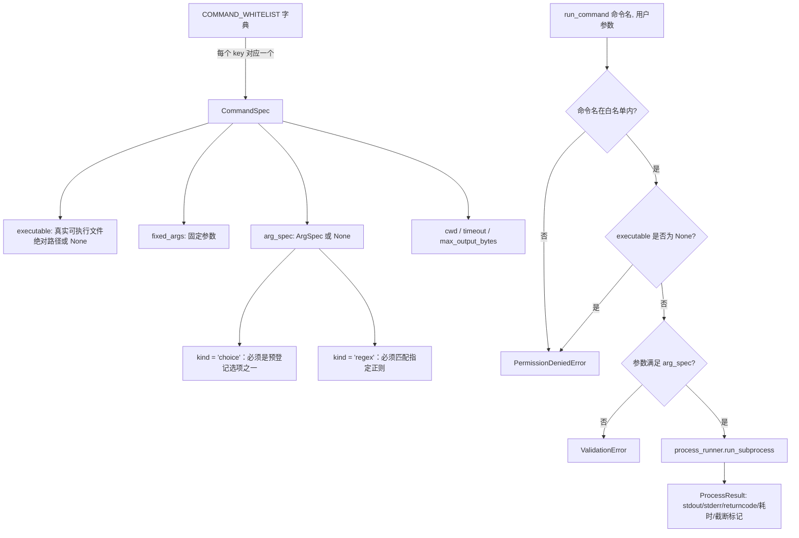

# 示例 6：命令控制台

> 对应代码：
> `infrastructure/process_runner.py`、`services/command_service.py`、
> `services/file_service.py`、`examples/06_command_console.py`
> 对应测试：`tests/test_command_service.py`

## 1. Why

前面的示例大多是"界面摆弄数据"：填表单、校验 JSON、展示任务状态。但很多
工程 GUI 小工具最终都会走到这一步——用户希望点一个按钮，就能在**服务器**
上跑一条真正的诊断命令：看看磁盘还剩多少空间、ping 一下某台边缘设备是否
在线、列一下某个目录下有什么文件。这正是"Web 界面"与"命令行工具"之间最
危险的一条边界：只要界面上出现"用户可以输入任意命令名/任意参数"的入口，
这个页面实质上就是一个远程命令执行（RCE）后门，哪怕它的初衷只是一个内部
运维小工具。

本示例要回答的问题是：**在坚持"绝不允许执行任意命令"这条底线的前提下，
如何仍然给用户提供"点按钮跑命令"的体验？** 答案是把"能跑什么"从运行时
决策变成编译期/上线前就已经审查过的固定事实——一张写死在源代码里的白名单，
用户能做的只有"从这张列表里选一项，并填一个会被严格校验的参数"，没有任何
第二条路径能绕开这张列表。

## 2. Mental Model

核心抽象只有三个：**白名单条目（`CommandSpec`）**、**参数校验规则
（`ArgSpec`）**、**进程执行结果（`ProcessResult`）**。它们的关系如下：



一句话心智模型：**`COMMAND_WHITELIST` 是唯一的事实来源（source of
truth），`run_command()` 只是"沿着这张表做校验、再转发给下层"的一个纯函数
式网关，它自己不包含任何"怎么跑一个进程"的细节**——那部分细节全部封装在
`infrastructure/process_runner.py` 里，Service 层和 UI 层都看不到、也不需要
关心 `subprocess.run()` 的参数长什么样。

## 3. Architecture

调用链自上而下只有四层，每一层各自负责不同的安全校验，没有任何一层可以
跳过前一层直接触达下一层：

```
+------------------------------------------------------------------+
| UI 层：examples/06_command_console.py                             |
| - 收集"命令名"（下拉框，只能选 COMMAND_WHITELIST 里 executable    |
|   不为 None 的 key，不存在自由输入框）                             |
| - 收集"一个可变参数"（控件类型由 arg_spec.kind 决定：choice 用     |
|   下拉框，regex 用文本框）                                         |
| - 把异常类型翻译成用户可读的文案，不做任何安全判断                 |
+------------------------------------------------------------------+
                              |
                              v  调用 command_service.run_command(name, args)
+------------------------------------------------------------------+
| Service 层：services/command_service.py                           |
| - 校验 1：命令名是否在 COMMAND_WHITELIST 内                        |
| - 校验 2：该命令在当前机器上是否可用（executable is not None）     |
| - 校验 3：参数数量、参数内容是否满足 arg_spec（choice / regex）     |
| - 以上任意一步失败：PermissionDeniedError / ValidationError，      |
|   流程在这里终止，绝不会走到 subprocess                            |
+------------------------------------------------------------------+
                              |
                              v  调用 process_runner.run_subprocess(
                              |      executable, final_args, cwd, timeout, ...)
+------------------------------------------------------------------+
| Infrastructure 层：infrastructure/process_runner.py               |
| - 校验/防护 4：用 list[str] 形式调用 subprocess.run()，            |
|   绝不 shell=True，杜绝 shell 注入                                 |
| - 校验/防护 5：超时则强制 kill 子进程，转换为 CommandTimeoutError  |
| - 校验/防护 6：stdout/stderr 分别按字节截断，返回截断标记           |
+------------------------------------------------------------------+
                              |
                              v  subprocess.run([executable, *args], ...)
+------------------------------------------------------------------+
| 操作系统：真正 fork/exec 出的子进程（ls / df / ping / echo）       |
+------------------------------------------------------------------+
```

文件查看面板是一条独立的、更短的调用链：

```
UI (examples/06_command_console.py)
  -> file_service.list_viewable_files(base_dir, allowed_suffixes)   # 浅层遍历 + 扩展名过滤
  -> file_service.read_text_file(filename, base_dir, ...)
       -> 校验 1：扩展名是否在 allowed_suffixes 内
       -> 校验 2：services.path_guard.confine_path() 校验路径未越界
       -> 按 max_bytes 截断文件内容
  -> 操作系统文件系统
```

### 关于 `process_runner.py` 对 `services.errors` 的依赖：一个刻意的例外

项目的总原则是"`infrastructure/` 绝不 import `services/*`"。但本次任务
同时要求：(1) 所有抛出的异常必须是 `services/errors.py` 里已有类型的实例；
(2) 测试规格明确要求**直接**调用 `process_runner.run_subprocess()`
（不经过 `command_service`）并断言它直接抛出 `CommandTimeoutError`。这两条
更具体的硬性要求，和"绝不 import services/\*"这条总原则在字面上是冲突的。

本实现选择的折中方案是：`process_runner.py` 只 import `services.errors`
这一个模块——它不依赖 nicegui、不包含任何业务逻辑、本身也不 import 项目里
任何其他模块，是一个纯粹的、无依赖的异常词汇表（`services/path_guard.py`
对它的依赖方式也是如此）。`process_runner.py` 绝不 import
`services.command_service`、`services.file_service`、`services.path_guard`
或 nicegui。这样既满足了"异常类型统一"和"测试直接验证 process_runner 的
超时行为"这两条更具体的要求，又把真正意义上的业务逻辑（白名单、参数校验）
严格留在 Service 层，没有让 infrastructure 反向依赖任何业务规则。

## 4. Complete Code

### 4.1 `infrastructure/process_runner.py`

```python
"""Infrastructure 层：对子进程执行的唯一封装。

为什么需要这个模块
------------------
整个项目里"真正会调用操作系统去跑一个外部程序"的代码，只允许出现在这一个
文件里。`services/command_service.py` 只负责"这个命令名是否在白名单
内、参数合不合法"这类业务规则，具体"怎么跑、怎么限时、怎么限制输出大小"
这些与操作系统打交道的细节，全部下沉到这里——这样将来如果要把执行方式从
本地 subprocess 换成别的东西（比如通过某种沙箱、容器），只需要改这一个
文件，`command_service.py` 的调用方式完全不用变。

心智模型
--------
本模块提供两种"跑一个子进程"的方式，对应两种不同的使用场景：

- `run_subprocess()`：阻塞调用，"等它跑完，一次性把 stdout/stderr/退出码
  都拿回来"。适合那些本来就跑得很快、不需要用户在界面上看到"实时滚动日志"
  的命令（本项目示例 6 的四个白名单命令都属于这一类）。因为它是阻塞的，
  调用方（Service/UI）如果在 NiceGUI 的事件循环里直接调用它会卡住整个
  界面，所以必须用 `nicegui.run.io_bound(...)` 丢到线程池里执行。
- `stream_subprocess()`：非阻塞（`async def`），"边跑边把每一行输出实时
  回调出去"。适合那些跑得比较久、用户希望看到类似终端滚动效果的场景
  （本项目暂时没有在示例 6 的 UI 里使用它，但 `command_service.py` 提供了
  对应的 `stream_command()`，留给后续示例或读者练习复用）。

两者都必须做到同一件事：**超时之后，子进程必须被真正杀掉**，而不是让它在
后台继续跑、只是 Python 这边"假装不管它了"——那样会在服务器上留下僵尸进程
或者失控的长命令。

层次说明（一个刻意的、狭窄的例外，请知悉）
--------------------------------------------
项目的总原则是"infrastructure/ 绝不 import services/*"。但本次任务同时
提出了两条更具体、互相之间会和这条总原则冲突的硬性要求：

1. "所有你抛出的异常必须是 `services/errors.py` 里已有类型的实例"；
2. 测试规格明确要求**直接**调用 `process_runner.run_subprocess()`（不经过
   `command_service`）来触发超时场景，并断言它直接抛出
   `services.errors.CommandTimeoutError`。

要同时满足这两条，`process_runner.py` 就必须能够直接抛出
`services.errors` 里定义的异常类型，这意味着它必须 import `services.errors`。
本模块因此只做了这一个狭窄的例外：只 import `services.errors`（一个不依赖
nicegui、不包含任何业务逻辑、本身也不 import 本项目其他任何模块的纯异常
定义模块），绝不 import `services/` 下的其他任何模块（不 import
`command_service`、`file_service`、`path_guard`），也绝不 import nicegui。
这和 `services/path_guard.py` 把 `services.errors` 当作"公共、无依赖的叶子
模块"来使用是同一种处理方式。这个设计取舍在交付报告与文档的 Architecture
小节里也有说明。
"""

from __future__ import annotations

import subprocess
import time
from dataclasses import dataclass
from pathlib import Path
from typing import Callable

from services.errors import CommandExecutionError, CommandTimeoutError

#: `run_subprocess()` / `stream_subprocess()` 默认的单路输出（stdout 或
#: stderr 各自独立计算）截断上限，单位字节。
DEFAULT_MAX_OUTPUT_BYTES = 65536


@dataclass
class ProcessResult:
    """一次阻塞子进程执行的结果快照。"""

    returncode: int
    stdout: str
    stderr: str
    duration_seconds: float
    stdout_truncated: bool = False
    stderr_truncated: bool = False


def _truncate_bytes(data: bytes, max_bytes: int) -> tuple[str, bool]:
    """把字节串截断到 `max_bytes` 以内，再解码成文本。

    截断点可能恰好落在一个多字节 UTF-8 字符中间，所以解码时用
    `errors='replace'`，宁可在截断边界出现一个替换字符，也不能因为解码失败
    而让整个命令执行流程抛出一个意料之外的 `UnicodeDecodeError`。
    """
    truncated = len(data) > max_bytes
    clipped = data[:max_bytes]
    text = clipped.decode("utf-8", errors="replace")
    return text, truncated


def run_subprocess(
    executable: str,
    args: list[str],
    *,
    cwd: Path,
    timeout: float,
    max_output_bytes: int = DEFAULT_MAX_OUTPUT_BYTES,
) -> ProcessResult:
    """阻塞地执行一个子进程，并对结果做超时与输出大小的双重防护。

    这是一个纯粹的"可执行文件路径 + 参数列表 + 工作目录"接口：调用方必须
    已经把命令名、参数校验这些业务规则处理完毕，这里只管"安全地跑一次
    外部程序"，不关心也不校验 `executable`/`args` 的业务含义。本函数绝不
    会把 `executable`/`args` 拼接成一个 shell 字符串——`subprocess.run()`
    在传入 `list[str]` 且不设置 `shell=True` 时，参数之间不会经过任何
    shell 解析（没有 `;`、`|`、`` ` `` 之类的特殊字符含义），这正是本项目
    "绝不给 shell 注入留任何口子"这条安全要求的底层保障。

    Args:
        executable: 真正会被执行的可执行文件绝对路径（调用方应提前用
            `shutil.which()` 解析好，这里不再做任何猜测或 PATH 查找）。
        args: 传给可执行文件的参数列表，每个参数都是独立的 argv 元素。
        cwd: 子进程的工作目录。
        timeout: 超时时间（秒），超过后子进程会被强制杀掉。
        max_output_bytes: stdout/stderr 各自独立的截断上限（字节）。

    Returns:
        一个 `ProcessResult`，其中 `stdout`/`stderr` 已经按字节截断过。

    Raises:
        CommandTimeoutError: 子进程运行超过 `timeout` 秒，已被强制终止。
        CommandExecutionError: 可执行文件不存在、没有执行权限，或者操作
            系统因为其他原因（`OSError`）无法启动该进程。
    """
    argv = [executable, *args]
    start = time.monotonic()
    try:
        completed = subprocess.run(
            argv,
            cwd=str(cwd),
            capture_output=True,
            timeout=timeout,
        )
    except subprocess.TimeoutExpired as exc:
        # 标准库的 subprocess.run() 在捕获到 TimeoutExpired 时，内部已经对
        # 子进程调用过一次 kill()（POSIX 下随后还会 wait() 回收，避免产生
        # 僵尸进程）。这里再做一次防御性的"保险"：如果这个异常对象恰好带有
        # 对应的 Popen 对象引用（不同 Python 版本/平台的内部实现细节可能
        # 变化），就再显式 kill + wait 一次，绝不依赖"应该已经被杀掉了"这种
        # 假设。
        process = getattr(exc, "process", None)
        if process is not None:
            process.kill()
            process.wait()
        duration = time.monotonic() - start
        raise CommandTimeoutError(
            f"命令执行超时（超过 {timeout} 秒），已强制终止："
            f"{executable} {' '.join(args)}；已运行 {duration:.3f} 秒"
        ) from exc
    except OSError as exc:
        raise CommandExecutionError(f"无法启动命令 {executable!r}：{exc}") from exc

    duration = time.monotonic() - start
    stdout_text, stdout_truncated = _truncate_bytes(completed.stdout or b"", max_output_bytes)
    stderr_text, stderr_truncated = _truncate_bytes(completed.stderr or b"", max_output_bytes)

    return ProcessResult(
        returncode=completed.returncode,
        stdout=stdout_text,
        stderr=stderr_text,
        duration_seconds=duration,
        stdout_truncated=stdout_truncated,
        stderr_truncated=stderr_truncated,
    )


async def stream_subprocess(
    executable: str,
    args: list[str],
    *,
    cwd: Path,
    timeout: float,
    on_stdout_line: Callable[[str], None],
    on_stderr_line: Callable[[str], None],
) -> int:
    """非阻塞地执行一个子进程，逐行实时回调 stdout/stderr。

    与 `run_subprocess()` 的阻塞式"一次性拿到完整结果"不同，这个函数是一个
    协程：它会在子进程还在运行的过程中，每读到一行输出就立刻调用一次对应
    的回调函数，调用方可以在回调里把这一行推到 `ui.log` 之类的组件上，做出
    "实时滚动日志"的效果。

    Args:
        executable: 真正会被执行的可执行文件绝对路径。
        args: 传给可执行文件的参数列表。
        cwd: 子进程的工作目录。
        timeout: 从进程启动到必须结束的总超时时间（秒）。
        on_stdout_line: 每读到一行 stdout（已去掉行尾换行符）就调用一次。
        on_stderr_line: 每读到一行 stderr（已去掉行尾换行符）就调用一次。

    Returns:
        子进程的退出码。

    Raises:
        CommandTimeoutError: 运行超过 `timeout` 秒，子进程已被强制终止
            （`proc.kill()` + `await proc.wait()`，确保不会留下僵尸进程）。
        CommandExecutionError: 可执行文件不存在、没有执行权限，或者操作
            系统因为其他原因（`OSError`）无法启动该进程。
    """
    import asyncio  # 延迟导入：只有真正用到异步路径时才需要 asyncio.subprocess。

    start = time.monotonic()
    try:
        proc = await asyncio.create_subprocess_exec(
            executable,
            *args,
            cwd=str(cwd),
            stdout=asyncio.subprocess.PIPE,
            stderr=asyncio.subprocess.PIPE,
        )
    except OSError as exc:
        raise CommandExecutionError(f"无法启动命令 {executable!r}：{exc}") from exc

    async def _pump(stream: asyncio.StreamReader, callback: Callable[[str], None]) -> None:
        """不断读取一个流的每一行，解码后回调出去，直到流结束（EOF）。"""
        while True:
            raw_line = await stream.readline()
            if not raw_line:
                break
            callback(raw_line.decode("utf-8", errors="replace").rstrip("\n"))

    async def _run_to_completion() -> int:
        if proc.stdout is None or proc.stderr is None:
            # 理论上不会发生（我们显式用 PIPE 创建了两个流），这里只是让
            # 类型检查器和阅读者都能确认这一点，并避免后面对 None 调用方法。
            raise CommandExecutionError("子进程未能正确创建 stdout/stderr 管道")
        await asyncio.gather(
            _pump(proc.stdout, on_stdout_line),
            _pump(proc.stderr, on_stderr_line),
        )
        return await proc.wait()

    try:
        return await asyncio.wait_for(_run_to_completion(), timeout=timeout)
    except asyncio.TimeoutError as exc:
        proc.kill()
        await proc.wait()
        duration = time.monotonic() - start
        raise CommandTimeoutError(
            f"命令执行超时（超过 {timeout} 秒），已强制终止："
            f"{executable} {' '.join(args)}；已运行 {duration:.3f} 秒"
        ) from exc
```

### 4.2 `services/command_service.py`

```python
"""Service 层：服务器端"可执行命令"的固定白名单与参数校验规则。

为什么需要这个模块
------------------
示例 6 的卖点是"从网页触发一个在服务器上真正执行的命令"，这同时也是整个
项目里风险最高的一块：一旦界面上出现"用户可以输入任意命令名或任意参数"的
入口，就等于在生产环境里放了一个远程命令执行后门。本模块的职责就是把
"能跑什么、怎么跑、跑多久"这几件事,从"UI 想怎么用"这件事里彻底分离出来：
UI 层永远只能从 `COMMAND_WHITELIST` 里选一个已经登记好的命令名，再提供一个
该命令要求的、会被严格校验的参数，除此之外没有任何其他入口。

心智模型
--------
把 `COMMAND_WHITELIST` 想象成一张"预先审批过的操作列表"，列表上的每一项
（`CommandSpec`）回答的是同一组问题：

- 这条命令真正对应哪个可执行文件？（`executable`，在模块加载时用
  `shutil.which()` 解析一次；解析不到就记为 `None`，代表"这台机器上不可用"，
  而不是让整个模块导入失败。）
- 调用时固定会带上哪些参数？（`fixed_args`，例如 `ls -la` 里的 `-la`。）
- 除了固定参数之外，还允许用户提供哪一个"可变参数"，以及这个参数必须满足
  什么规则？（`arg_spec`：可以是"必须是预先登记的几个选项之一"
  （`kind='choice'`，例如目录名），也可以是"必须匹配某个正则表达式"
  （`kind='regex'`，例如主机名、回显文本）。没有 `arg_spec` 就代表这条命令
  根本不接受任何用户输入（例如 `df -h`）。
- 在哪个目录下跑、最多跑多久、输出最多保留多少字节？（`cwd` / `timeout` /
  `max_output_bytes`。）

`run_command()` / `stream_command()` 是这张列表唯一的两个"执行入口"：
它们先用 `_resolve_args()` 把"命令名 + 用户参数"翻译成一份确定的、安全的
`[executable, *final_args]` 列表（翻译失败就直接抛异常，连
`infrastructure.process_runner` 都不会被调用到），再把这份已经验证过的
列表交给下层去真正执行。

安全边界说明
------------
本模块能做到的安全承诺，仅限于：
1. 只能执行 `COMMAND_WHITELIST` 里登记过、且在当前机器上找到了可执行文件
   的命令，不存在"传一个命令名字符串就能跑"的通用入口。
2. 每条命令的参数要么被限制为预先登记的固定选项，要么必须匹配一个专门为
   它设计的正则表达式；任何不满足规则的输入在到达 `subprocess`/
   `asyncio.create_subprocess_exec` 之前就会被 `ValidationError` 拦下。
3. 每条命令都有固定的工作目录和超时时间，调用方（UI）无法覆盖它们。

这不是、也不能被当作一个"通用远程命令执行入口"：它能跑的永远只是这四个
预先审查过的只读命令，参数空间也被压缩到了"几个选项"或"一个正则表达式"，
不存在任何"拼接出一条完整命令行再交给 shell"的路径。
"""

from __future__ import annotations

import re
import shutil
from dataclasses import dataclass, field
from pathlib import Path
from typing import Callable, Optional

from infrastructure import process_runner
from services.errors import PermissionDeniedError, ValidationError

#: 本项目的项目根目录——`list_directory` 白名单目录、各命令默认工作目录都
#: 以它为基准，避免在模块里出现写死的绝对路径字符串。
PROJECT_ROOT = Path(__file__).resolve().parents[1]

#: `ping_once` 的主机名/IPv4 校验规则：只允许字母、数字、点、短横线，
#: 长度 1~253（DNS 主机名的理论长度上限）。不允许分号、管道符、反引号、
#: 空格等任何 shell 特殊字符——即使本项目从不把参数交给 shell 解析，这里
#: 依然按照"防御性校验"的思路收紧规则，避免把明显异常的输入当成合法主机名。
_HOSTNAME_PATTERN = re.compile(r"^[A-Za-z0-9.-]{1,253}$")

#: `echo_text` 的回显文本校验规则：长度 1~200 字符，且不允许换行符（避免
#: 一次"回显"在 `ui.log` 里被拆成好几行，造成误导）。
_ECHO_TEXT_PATTERN = re.compile(r"^[^\r\n]{1,200}$")

#: `list_directory` 允许查看的目录——键是展示给用户、会出现在下拉框里的
#: 短名字，值是真正会被传给 `ls -la` 的绝对路径。用户永远只能从这几个键里
#: 选择，不可能自己输入一个任意路径。
LIST_DIRECTORY_CHOICES: dict[str, Path] = {
    "project_root": PROJECT_ROOT,
    "examples": PROJECT_ROOT / "examples",
    "docs": PROJECT_ROOT / "docs",
    "tmp": Path("/tmp"),
}


@dataclass(frozen=True)
class ArgSpec:
    """描述一个白名单命令"唯一允许的可变参数"该如何被校验与翻译。

    `kind` 目前支持两种取值：

    - `'choice'`：用户的输入必须恰好等于 `choices` 中的一个；如果
      `choice_map` 非空，真正传给可执行文件的参数是 `choice_map[用户输入]`
      （例如把目录的短名字 `'docs'` 翻译成它的绝对路径），否则直接使用用户
      输入本身。
    - `'regex'`：用户的输入必须能被 `pattern` 完整匹配（`re.match`）。
    """

    label: str
    kind: str
    pattern: Optional[re.Pattern[str]] = None
    choices: tuple[str, ...] = ()
    choice_map: dict[str, str] = field(default_factory=dict)
    error_hint: str = ""


@dataclass(frozen=True)
class CommandSpec:
    """一条白名单命令的完整定义：是什么、怎么跑、跑多久。"""

    name: str
    description: str
    executable: Optional[str]
    fixed_args: tuple[str, ...]
    arg_spec: Optional[ArgSpec]
    cwd: Path
    timeout: float
    max_output_bytes: int = process_runner.DEFAULT_MAX_OUTPUT_BYTES


@dataclass
class CommandResult:
    """`run_command()` 的返回值：命令名 + 底层进程执行结果。"""

    command_name: str
    process_result: process_runner.ProcessResult


def _build_whitelist() -> dict[str, CommandSpec]:
    """在模块加载时构建一次固定白名单。

    对每一条命令都用 `shutil.which()` 解析一次真正的可执行文件绝对路径；
    解析不到就把 `executable` 记为 `None`——代表"这条命令在当前机器上不
    可用"，调用方（`run_command`/`stream_command`）和 UI 都必须据此把它当成
    不可执行的选项处理，而不是让导入这个模块本身失败。
    """
    whitelist: dict[str, CommandSpec] = {}

    whitelist["list_directory"] = CommandSpec(
        name="list_directory",
        description="列出一个预先登记的目录内容（ls -la <目录>）",
        executable=shutil.which("ls"),
        fixed_args=("-la",),
        arg_spec=ArgSpec(
            label="目录",
            kind="choice",
            choices=tuple(LIST_DIRECTORY_CHOICES.keys()),
            choice_map={name: str(path) for name, path in LIST_DIRECTORY_CHOICES.items()},
            error_hint="必须是预先登记的目录选项之一",
        ),
        cwd=PROJECT_ROOT,
        timeout=5.0,
    )

    whitelist["show_disk_usage"] = CommandSpec(
        name="show_disk_usage",
        description="显示磁盘使用情况（df -h），不需要任何参数",
        executable=shutil.which("df"),
        fixed_args=("-h",),
        arg_spec=None,
        cwd=PROJECT_ROOT,
        timeout=5.0,
    )

    whitelist["ping_once"] = CommandSpec(
        name="ping_once",
        description="向指定主机发送一次 ICMP 探测（ping -c 1 -W 2 <host>）",
        executable=shutil.which("ping"),
        fixed_args=("-c", "1", "-W", "2"),
        arg_spec=ArgSpec(
            label="主机名 / IP",
            kind="regex",
            pattern=_HOSTNAME_PATTERN,
            error_hint="只能包含字母、数字、点（.）和短横线（-），长度 1~253",
        ),
        # ping 本身自带 -W 2（等待回复最多 2 秒），这里的 timeout 比它稍长，
        # 用作"ping 进程本身卡死不退出"时的兜底防线。
        cwd=PROJECT_ROOT,
        timeout=5.0,
    )

    whitelist["echo_text"] = CommandSpec(
        name="echo_text",
        description="回显一段文本（echo <text>），用于演示最简单的命令执行",
        executable=shutil.which("echo"),
        fixed_args=(),
        arg_spec=ArgSpec(
            label="要回显的文本",
            kind="regex",
            pattern=_ECHO_TEXT_PATTERN,
            error_hint="长度必须在 1~200 字符之间，且不能包含换行符",
        ),
        cwd=PROJECT_ROOT,
        timeout=5.0,
    )

    return whitelist


#: 固定白名单：模块加载时构建一次，之后在整个进程生命周期内只读，不提供
#: 任何"运行时注册新命令"的接口——新增命令只能通过修改这份源代码来完成。
COMMAND_WHITELIST: dict[str, CommandSpec] = _build_whitelist()


def _resolve_args(spec: CommandSpec, user_args: list[str]) -> list[str]:
    """校验 `user_args` 是否满足 `spec.arg_spec` 的规则，并翻译成最终 argv。

    这是整条安全链路里最关键的一步：翻译失败（参数数量不对、不在选项内、
    不匹配正则）一律抛出 `ValidationError`，调用方必须保证这个函数抛异常
    之后，流程不会继续往下走到任何 `subprocess`/`asyncio` 调用。

    Returns:
        不包含可执行文件本身、可以直接交给 `process_runner` 的参数列表
        （`[*fixed_args, 已校验的可变参数]`，如果该命令没有 `arg_spec` 则
        就是 `[*fixed_args]`）。
    """
    if spec.arg_spec is None:
        if user_args:
            raise ValidationError(f"命令 {spec.name!r} 不接受任何参数，但收到了 {user_args!r}")
        return list(spec.fixed_args)

    if len(user_args) != 1:
        raise ValidationError(
            f"命令 {spec.name!r} 需要且只需要一个参数（{spec.arg_spec.label}），"
            f"但收到了 {len(user_args)} 个"
        )

    value = user_args[0]

    if spec.arg_spec.kind == "choice":
        if value not in spec.arg_spec.choices:
            raise ValidationError(
                f"{spec.arg_spec.label} 不合法：{value!r}。{spec.arg_spec.error_hint}"
            )
        actual_value = spec.arg_spec.choice_map.get(value, value)
        return [*spec.fixed_args, actual_value]

    if spec.arg_spec.kind == "regex":
        pattern = spec.arg_spec.pattern
        if pattern is None or pattern.match(value) is None:
            raise ValidationError(
                f"{spec.arg_spec.label} 不合法：{value!r}。{spec.arg_spec.error_hint}"
            )
        return [*spec.fixed_args, value]

    raise ValidationError(f"未知的参数校验类型：{spec.arg_spec.kind!r}")


def _lookup_runnable_spec(command_name: str) -> CommandSpec:
    """公共的"命令名 -> 可执行的 CommandSpec"校验逻辑，供两个执行入口共用。

    Raises:
        PermissionDeniedError: `command_name` 不在白名单内，或者虽然在白
            名单内、但在当前机器上没有找到对应的可执行文件。
    """
    spec = COMMAND_WHITELIST.get(command_name)
    if spec is None:
        raise PermissionDeniedError(f"命令不在白名单内，拒绝执行：{command_name!r}")
    if spec.executable is None:
        raise PermissionDeniedError(
            f"命令 {command_name!r} 在当前机器上不可用（未找到对应的可执行文件）"
        )
    return spec


def run_command(command_name: str, user_args: list[str]) -> CommandResult:
    """校验命令名与参数后，阻塞地执行一次白名单命令。

    这是一个阻塞调用（内部直接调用 `process_runner.run_subprocess()`），
    在 NiceGUI 的事件处理函数里必须用 `await run.io_bound(run_command, ...)`
    调用，否则会卡住整个页面的事件循环。

    Args:
        command_name: 必须是 `COMMAND_WHITELIST` 中的一个键。
        user_args: 用户提供的可变参数；不需要参数的命令传空列表。

    Raises:
        PermissionDeniedError: 命令名不在白名单内，或在当前机器上不可用。
        ValidationError: 参数数量或内容不满足该命令的校验规则。
        CommandTimeoutError: 见 `infrastructure.process_runner.run_subprocess`。
        CommandExecutionError: 见 `infrastructure.process_runner.run_subprocess`。
    """
    spec = _lookup_runnable_spec(command_name)
    final_args = _resolve_args(spec, user_args)

    process_result = process_runner.run_subprocess(
        spec.executable,  # type: ignore[arg-type]  # 上面已确认非 None
        final_args,
        cwd=spec.cwd,
        timeout=spec.timeout,
        max_output_bytes=spec.max_output_bytes,
    )
    return CommandResult(command_name=command_name, process_result=process_result)


async def stream_command(
    command_name: str,
    user_args: list[str],
    on_stdout: Callable[[str], None],
    on_stderr: Callable[[str], None],
) -> int:
    """校验命令名与参数后，以非阻塞方式执行一次白名单命令并实时回调输出。

    校验规则与 `run_command()` 完全一致（同一个 `_resolve_args()`），区别
    只在于底层调用的是 `process_runner.stream_subprocess()`，适合需要在
    UI 上实时展示滚动日志的场景。本项目示例 6 的 UI 目前优先使用阻塞式的
    `run_command()`（命令本身跑得很快，不需要流式展示），这个函数留给
    有"实时查看长时间运行命令输出"需求的后续示例或读者练习复用。

    Returns:
        子进程的退出码。

    Raises:
        PermissionDeniedError / ValidationError / CommandTimeoutError /
        CommandExecutionError：含义与 `run_command()` 一致。
    """
    spec = _lookup_runnable_spec(command_name)
    final_args = _resolve_args(spec, user_args)

    return await process_runner.stream_subprocess(
        spec.executable,  # type: ignore[arg-type]
        final_args,
        cwd=spec.cwd,
        timeout=spec.timeout,
        on_stdout_line=on_stdout,
        on_stderr_line=on_stderr,
    )
```

### 4.3 `services/file_service.py`

```python
"""Service 层：命令控制台"文件查看面板"背后的受限文件读取规则。

为什么需要这个模块
------------------
示例 6 除了"执行命令"之外，还提供一个只读的文件查看面板，方便用户在不
打开终端的情况下查看项目里的文档、日志、配置文件。这同样是一个"界面上有
一个看起来像'随便填个文件名'的输入框，但背后必须有严格边界"的场景——本
模块就是那条边界：只允许列出/读取某个指定基准目录下、扩展名在白名单内的
文件，并且把真正的越界检查全权委托给已经在别处验证过的
`services.path_guard.confine_path()`，自己不再重新发明一套路径安全逻辑。

心智模型
--------
`list_viewable_files()` 负责"告诉 UI 有哪些文件可以选"——它只做浅层遍历
（不递归进子目录），并按扩展名过滤，返回的是**文件名**而不是完整路径，
UI 层应当只把这些文件名原样传回 `read_text_file()`，不应该自己拼接路径。

`read_text_file()` 负责"真正把文件内容读出来"，它的安全检查分两层：

1. 扩展名检查（本模块自己做）：如果调用方传入的文件名扩展名不在
   `allowed_suffixes` 里，直接拒绝——这是一层"防御性收紧"，防止将来有代码
   路径绕过 `list_viewable_files()` 的过滤，直接拿一个任意扩展名的文件名
   调用 `read_text_file()`。
2. 路径越界检查（委托给 `path_guard.confine_path()`）：确保最终解析出的
   绝对路径确实落在 `base_dir` 内部，拒绝 `../`、绝对路径等任何越界尝试。

读取到文件内容之后，还会按字节数截断到 `max_bytes` 以内，并明确告诉调用方
"有没有被截断"，由 UI 决定要不要提示用户"内容已截断"。
"""

from __future__ import annotations

from pathlib import Path
from typing import Optional

from services.errors import PermissionDeniedError
from services.path_guard import confine_path

#: `read_text_file()` 的默认最大读取字节数（200KB）。超过这个大小只会读取
#: 文件的前 `max_bytes` 字节，不会把整个大文件都加载进内存。
DEFAULT_MAX_BYTES = 200_000


def list_viewable_files(base_dir: Path, allowed_suffixes: tuple[str, ...]) -> list[str]:
    """列出 `base_dir` 下（仅浅层遍历，不递归子目录）符合扩展名白名单的文件名。

    Args:
        base_dir: 允许查看的基准目录，调用方需保证它本身是一个存在的目录。
        allowed_suffixes: 允许的扩展名集合，例如 `('.md', '.txt')`；比较时
            大小写敏感，与 `Path.suffix` 的返回值（包含前导 `.`）直接比较。

    Returns:
        按文件名排序后的文件名列表（不含路径、不含目录项）。
    """
    base = base_dir.resolve()
    names = [
        entry.name
        for entry in base.iterdir()
        if entry.is_file() and entry.suffix in allowed_suffixes
    ]
    return sorted(names)


def read_text_file(
    filename: str,
    base_dir: Path,
    *,
    max_bytes: int = DEFAULT_MAX_BYTES,
    allowed_suffixes: Optional[tuple[str, ...]] = None,
) -> tuple[str, bool]:
    """读取 `base_dir` 下某个文件的文本内容，并限制最大读取字节数。

    Args:
        filename: 文件名（可以带子目录，但不能是绝对路径），通常应当来自
            `list_viewable_files()` 的返回值。
        base_dir: 允许访问的基准目录。
        max_bytes: 最多读取的字节数；超过时只返回前 `max_bytes` 字节解码
            后的文本，并把第二个返回值标记为 `True`。
        allowed_suffixes: 如果提供，会在做路径越界检查之后先校验扩展名，
            不在列表内直接拒绝。传 `None` 表示不做扩展名限制（调用方自己
            保证只会传入已经过滤好的文件名）。本项目示例 6 的 UI 会显式
            传入与 `list_viewable_files()` 相同的扩展名白名单，做到
            "双重校验"而不是只依赖下拉框本身的过滤。

    Returns:
        一个 `(文本内容, 是否被截断)` 二元组。

    Raises:
        PermissionDeniedError: 扩展名不在 `allowed_suffixes` 内；或者
            `filename` 是绝对路径，或解析后的路径逃逸出了 `base_dir`
            （由 `path_guard.confine_path()` 负责判定）。
        NotFoundError: 解析出的路径不存在（由 `path_guard.confine_path()`
            负责判定）。
    """
    resolved_path = confine_path(filename, base_dir, must_exist=True)

    if allowed_suffixes is not None and resolved_path.suffix not in allowed_suffixes:
        raise PermissionDeniedError(
            f"不允许读取该扩展名的文件：{filename!r}（仅允许 {allowed_suffixes!r}）"
        )

    data = resolved_path.read_bytes()
    truncated = len(data) > max_bytes
    clipped = data[:max_bytes]
    # 截断点可能落在一个多字节 UTF-8 字符中间，用 errors='replace' 避免
    # 因为解码失败而让一次"查看文件"操作直接抛出意料之外的异常。
    text = clipped.decode("utf-8", errors="replace")
    return text, truncated
```

### 4.4 `examples/06_command_console.py`

```python
"""示例 6：命令控制台 —— 在浏览器里安全地触发服务器端命令。

为什么需要这个示例
------------------
很多工程 GUI 小工具最终都需要"点一个按钮，在服务器上跑一条诊断命令"这种
能力（查看磁盘空间、ping 一下某台设备、看看某个目录下有什么文件）。这个
能力一旦做得不好，就是一个远程命令执行漏洞；做得好，就必须把"界面上能点
什么"和"服务器上会跑什么"之间的关系收得非常紧——紧到即使页面被篡改、
即使有人直接拿开发者工具伪造请求，服务器端也只会执行
`services.command_service.COMMAND_WHITELIST` 里登记过的那几个命令，且
参数永远要先通过校验。本示例的全部代码都在演示"界面层该如何正确地使用
一个已经做好安全加固的 Service"，而不是自己去实现任何安全逻辑——所有安全
判断都发生在 `services/command_service.py`、`services/file_service.py`、
`services/path_guard.py` 里，本文件只负责把结果展示出来、把异常翻译成
对用户友好的提示文案。

心智模型
--------
页面分成两个独立的区域（用 `ui.tabs()`/`ui.tab_panels()` 隔开）：

- **命令执行区**：下拉框 -> （根据选择动态生成的）参数输入框 -> "执行"
  按钮。点击执行后，真正的子进程调用发生在线程池里
  （`await run.io_bound(command_service.run_command, ...)`），绝不会在
  NiceGUI 的事件循环线程里直接调用阻塞的 `subprocess.run()`——否则在命令
  还没跑完之前，整个页面（包括其他正在看这个页面的用户）都会被卡住。
- **文件查看区**：下拉框列出 `file_service.list_viewable_files()` 筛选出的
  文件名，选中后调用 `file_service.read_text_file()` 展示内容。

本文件不实现任何新的安全规则，它的职责边界非常窄：收集用户输入 ->
调用 Service -> 把 Service 返回的结果或抛出的具体异常类型，翻译成界面上
的文字。
"""

from __future__ import annotations

from pathlib import Path

from nicegui import run, ui

from services import command_service, file_service
from services.command_service import CommandSpec
from services.errors import (
    CommandExecutionError,
    CommandTimeoutError,
    NotFoundError,
    PermissionDeniedError,
    ValidationError,
)

#: 文件查看面板的基准目录：项目根目录本身。`Path(__file__).resolve()` 先
#: 得到本文件（`examples/06_command_console.py`）的绝对路径，`.parents[1]`
#: 再向上一级得到项目根目录——这与 `command_service.PROJECT_ROOT` 的算法
#: 完全一致，只是各自独立计算，不互相依赖对方的内部实现细节。
FILE_VIEW_BASE_DIR = Path(__file__).resolve().parents[1]

#: 文件查看面板允许的扩展名白名单。
FILE_VIEW_ALLOWED_SUFFIXES: tuple[str, ...] = (".md", ".txt", ".json", ".log", ".py")

#: 文件查看面板单次读取的最大字节数。
FILE_VIEW_MAX_BYTES = 200_000


def _available_commands() -> dict[str, CommandSpec]:
    """只返回在当前机器上真正可用（找到了可执行文件）的白名单命令。"""
    return {
        name: spec
        for name, spec in command_service.COMMAND_WHITELIST.items()
        if spec.executable is not None
    }


def _unavailable_commands() -> dict[str, CommandSpec]:
    """返回登记在白名单里、但在当前机器上找不到可执行文件的命令。"""
    return {
        name: spec
        for name, spec in command_service.COMMAND_WHITELIST.items()
        if spec.executable is None
    }


@ui.page("/command-console")
def index() -> None:
    """命令控制台页面：命令执行区 + 文件查看区。"""
    ui.label("示例 6：命令控制台").classes("text-2xl font-bold").mark("console-title")
    ui.label(
        "本页面演示如何在浏览器里安全地触发服务器端命令：所有可执行的命令都必须"
        "预先在 command_service.COMMAND_WHITELIST 里登记（固定可执行文件 + 严格"
        "校验的参数），不存在"输入任意命令"的入口。"
    ).classes("text-sm text-gray-600").mark("console-description")

    with ui.tabs().classes("w-full") as tabs:
        command_tab = ui.tab("命令执行").mark("tab-command")
        file_tab = ui.tab("文件查看").mark("tab-file")

    with ui.tab_panels(tabs, value=command_tab).classes("w-full"):
        with ui.tab_panel(command_tab):
            _build_command_panel()
        with ui.tab_panel(file_tab):
            _build_file_panel()


def _build_command_panel() -> None:
    """构建"命令执行区"：下拉框 + 动态参数输入 + 执行按钮 + 结果展示。"""
    available = _available_commands()
    unavailable = _unavailable_commands()

    if unavailable:
        hint_text = "、".join(
            f"{name}（{spec.description}）" for name, spec in unavailable.items()
        )
        ui.label(
            f"以下命令在当前机器上不可用（未找到对应的可执行文件），已从下拉框中"
            f"隐藏：{hint_text}"
        ).classes("text-orange-600 text-sm").mark("unavailable-commands-hint")

    if not available:
        ui.label("当前机器上没有任何可用的白名单命令。").classes(
            "text-red-600 font-bold"
        ).mark("no-available-commands")
        return

    command_names = list(available.keys())
    command_select = (
        ui.select(options=command_names, value=command_names[0], label="选择命令")
        .classes("w-72")
        .mark("command-select")
    )
    command_hint = ui.label().classes("text-xs text-gray-500").mark("command-description-hint")

    # `arg_widget_box` 用一个一元素字典作为"可写的闭包状态"：Python 的闭包
    # 不允许在内层函数里直接给外层的简单变量重新赋值（会被当成局部变量），
    # 用字典的一个键来持有"当前参数输入控件"的引用，可以绕开这个限制。
    arg_widget_box: dict[str, ui.element | None] = {"widget": None}
    arg_container = ui.column().classes("w-72")

    def rebuild_arg_input() -> None:
        """根据当前选中的命令，重新生成它需要的参数输入控件（如果需要的话）。"""
        spec = available[command_select.value]
        command_hint.text = spec.description
        arg_container.clear()
        with arg_container:
            if spec.arg_spec is None:
                ui.label("该命令不需要任何参数。").classes("text-xs text-gray-500")
                arg_widget_box["widget"] = None
            elif spec.arg_spec.kind == "choice":
                choices = list(spec.arg_spec.choices)
                widget = ui.select(
                    options=choices,
                    value=choices[0] if choices else None,
                    label=spec.arg_spec.label,
                ).mark("command-arg-input")
                arg_widget_box["widget"] = widget
            else:
                widget = ui.input(
                    label=spec.arg_spec.label,
                    placeholder=spec.arg_spec.error_hint,
                ).mark("command-arg-input")
                arg_widget_box["widget"] = widget

    command_select.on_value_change(lambda _event: rebuild_arg_input())
    rebuild_arg_input()

    with ui.row().classes("items-center gap-2"):
        run_button = ui.button("执行").mark("run-command-button")
        spinner = ui.spinner(size="lg")
        spinner.set_visibility(False)

    status_label = ui.label().classes("text-sm").mark("command-status-label")
    with ui.row().classes("gap-4"):
        returncode_label = ui.label().mark("command-returncode-label")
        duration_label = ui.label().mark("command-duration-label")
    truncated_hint = ui.label().classes("text-orange-600 text-sm").mark("command-truncated-hint")

    ui.label("stdout").classes("text-xs text-gray-500 mt-2")
    stdout_log = ui.log(max_lines=200).classes("w-full h-48").mark("command-stdout-log")
    ui.label("stderr").classes("text-xs text-gray-500 mt-2")
    stderr_log = ui.log(max_lines=200).classes("w-full h-48").mark("command-stderr-log")

    async def handle_run() -> None:
        """"执行"按钮的事件回调：收集参数、在线程池里跑命令、展示结果。"""
        spec = available[command_select.value]
        widget = arg_widget_box["widget"]
        if widget is None:
            user_args: list[str] = []
        else:
            raw_value = widget.value
            user_args = [] if raw_value is None else [str(raw_value)]

        run_button.disable()
        spinner.set_visibility(True)
        status_label.text = "正在执行…"
        returncode_label.text = ""
        duration_label.text = ""
        truncated_hint.text = ""
        stdout_log.clear()
        stderr_log.clear()

        try:
            # command_service.run_command() 内部直接调用标准库的阻塞
            # subprocess.run()，必须丢进线程池执行，否则会卡住 NiceGUI 的
            # 事件循环，导致整个页面（乃至同一进程里其他用户的页面）卡死。
            result = await run.io_bound(
                command_service.run_command, command_select.value, user_args
            )
        except PermissionDeniedError as exc:
            status_label.text = f"权限被拒绝：{exc}"
            ui.notify(f"权限被拒绝：{exc}", type="negative")
        except ValidationError as exc:
            status_label.text = f"参数不合法：{exc}"
            ui.notify(f"参数不合法：{exc}", type="negative")
        except CommandTimeoutError as exc:
            status_label.text = f"命令执行超时：{exc}"
            ui.notify(f"命令执行超时：{exc}", type="negative")
        except CommandExecutionError as exc:
            status_label.text = f"命令无法执行：{exc}"
            ui.notify(f"命令无法执行：{exc}", type="negative")
        else:
            status_label.text = "执行完成"
            process_result = result.process_result
            returncode_label.text = f"退出码：{process_result.returncode}"
            duration_label.text = f"耗时：{process_result.duration_seconds:.3f} 秒"
            for line in process_result.stdout.splitlines():
                stdout_log.push(line)
            for line in process_result.stderr.splitlines():
                stderr_log.push(line)
            hints = []
            if process_result.stdout_truncated:
                hints.append("stdout 输出已截断")
            if process_result.stderr_truncated:
                hints.append("stderr 输出已截断")
            truncated_hint.text = "；".join(hints)
        finally:
            run_button.enable()
            spinner.set_visibility(False)

    run_button.on_click(handle_run)


def _build_file_panel() -> None:
    """构建"文件查看区"：下拉框列出可查看文件，选中后展示（受限的）内容。"""
    files = file_service.list_viewable_files(FILE_VIEW_BASE_DIR, FILE_VIEW_ALLOWED_SUFFIXES)

    ui.label(
        f"只能查看项目根目录（{FILE_VIEW_BASE_DIR}）下、扩展名在 "
        f"{FILE_VIEW_ALLOWED_SUFFIXES} 内的文件，且单个文件最多读取 "
        f"{FILE_VIEW_MAX_BYTES} 字节。"
    ).classes("text-xs text-gray-500").mark("file-panel-hint")

    if not files:
        ui.label("当前没有可查看的文件。").classes("text-red-600").mark("no-viewable-files")
        return

    file_select = (
        ui.select(options=files, value=files[0], label="选择文件")
        .classes("w-72")
        .mark("file-select")
    )
    file_truncated_hint = ui.label().classes("text-orange-600 text-sm").mark("file-truncated-hint")
    file_content_view = ui.code("").classes("w-full").mark("file-content-view")

    async def handle_file_select_change() -> None:
        """文件下拉框变化时的回调：读取选中文件内容并展示。"""
        filename = file_select.value
        if not filename:
            return

        file_truncated_hint.text = ""
        try:
            text, truncated = await run.io_bound(
                file_service.read_text_file,
                filename,
                FILE_VIEW_BASE_DIR,
                max_bytes=FILE_VIEW_MAX_BYTES,
                allowed_suffixes=FILE_VIEW_ALLOWED_SUFFIXES,
            )
        except PermissionDeniedError as exc:
            file_content_view.content = ""
            ui.notify(f"权限被拒绝：{exc}", type="negative")
            return
        except NotFoundError as exc:
            file_content_view.content = ""
            ui.notify(f"文件不存在：{exc}", type="negative")
            return

        file_content_view.content = text
        if truncated:
            file_truncated_hint.text = f"内容已截断，仅显示前 {FILE_VIEW_MAX_BYTES} 字节。"

    file_select.on_value_change(lambda _event: handle_file_select_change())
    # 页面首次渲染后立刻加载一次默认选中的文件内容，不需要用户手动再点一次
    # 下拉框才能看到内容。`once=True` 让这个定时器只触发一次，相当于"页面
    # 加载完成后的一次性初始化回调"。
    ui.timer(0.01, handle_file_select_change, once=True)


if __name__ in {"__main__", "__mp_main__"}:
    ui.run(title="示例 6：命令控制台")
```

> 测试代码 `tests/test_command_service.py` 请直接查看仓库源文件（本文档
> 不再重复粘贴一份，避免两处代码在后续修改时出现不一致）。

## 5. Execution

```bash
# 1. 安装依赖（本机尚未安装 nicegui，运行真实页面前需要先装）
pip install -r requirements.txt

# 2. 运行命令控制台页面
python3 examples/06_command_console.py
# 浏览器访问 http://localhost:8080/command-console

# 3. 只想验证 Service/Infrastructure 层逻辑（不需要装 nicegui）
python3 -m pytest -q tests/test_command_service.py
```

打开页面后：

1. "命令执行"标签页：下拉框选一个命令（例如 `ping_once`），根据命令类型
   会出现对应的参数输入框；点击"执行"，按钮会变为禁用状态并显示
   spinner，执行结束后在下方看到退出码、耗时、stdout、stderr。
2. "文件查看"标签页：下拉框选一个文件，下方 `ui.code` 区域会展示文件内容；
   如果文件超过 200KB，会额外看到"内容已截断"的提示。

## 6. Lifecycle

以用户在界面上"选择 `ping_once`、在主机名输入框填一个值、点击执行"这个
真实操作为例，逐步追踪代码路径：

1. **页面加载时**：`_build_command_panel()` 已经把 `command_select` 的默认
   选项设为白名单里第一个可用命令；用户把下拉框切换到 `ping_once` 时，
   `on_value_change` 回调触发 `rebuild_arg_input()`，发现
   `COMMAND_WHITELIST['ping_once'].arg_spec.kind == 'regex'`，于是渲染出一个
   `ui.input(label='主机名 / IP', placeholder='只能包含字母、数字、点（.）和
   短横线（-），长度 1~253')` 文本框。
2. **用户输入主机名**：这一步纯粹是浏览器端的状态变化（NiceGUI 通过
   WebSocket 把输入框的值同步到服务器端的 `widget.value`），**此时还没有
   发生任何校验**——`ArgSpec.pattern` 只在真正点击"执行"之后才会被用到。
3. **用户点击"执行"**：触发 `handle_run()`。它先把 `widget.value`（也就是
   用户刚输入的主机名字符串）包装成 `user_args = [raw_value]`，然后调用
   `await run.io_bound(command_service.run_command, 'ping_once', user_args)`
   ——这一步把真正的调用丢进线程池，NiceGUI 的事件循环不会被阻塞。
4. **进入 `command_service.run_command()`**：
   a. `_lookup_runnable_spec('ping_once')` 确认命令名在白名单内、且
      `executable` 不是 `None`（否则这一步就会抛 `PermissionDeniedError`，
      流程到此结束，**根本不会看一眼用户填的主机名**）。
   b. `_resolve_args(spec, user_args)` 校验 `len(user_args) == 1`（否则抛
      `ValidationError`），然后用 `_HOSTNAME_PATTERN.match(value)` 校验主机
      名格式。**如果用户填的是一个不合法的值（例如包含分号、空格，或者是
      一个空字符串），`ValidationError` 就在这一步被抛出，流程到此为止，
      `process_runner.run_subprocess()` 根本不会被调用——这也是
      `tests/test_command_service.py` 里专门用 mock 验证过的行为。**
   c. 校验通过后，`_resolve_args()` 返回
      `['-c', '1', '-W', '2', <合法的主机名>]`。
5. **进入 `process_runner.run_subprocess()`**：以
   `[executable, '-c', '1', '-W', '2', <主机名>]` 这个 `list[str]` 直接调用
   `subprocess.run(..., timeout=5.0, capture_output=True)`，不经过任何
   shell 解析。如果 5 秒内没有返回，`subprocess.TimeoutExpired` 被捕获并
   转换为 `CommandTimeoutError`；否则把 stdout/stderr 按 64KB 截断，包装成
   `ProcessResult` 一路返回给 UI。
6. **回到 `handle_run()` 的 `except`/`else` 分支**：根据具体抛出的异常类型
   （`PermissionDeniedError` / `ValidationError` / `CommandTimeoutError` /
   `CommandExecutionError`）或者正常返回的 `CommandResult`，分别更新界面上
   的提示文案、stdout/stderr 日志、退出码、耗时。

可以看到，"主机名校验失败"这件事，**永远发生在第 4.b 步**（Service 层的
`_resolve_args()`），绝不可能发生在第 5 步（已经在跑子进程了）或更晚——这
正是"校验必须先于执行"这条安全要求在代码里的具体体现。

## 7. API Reference

### `infrastructure/process_runner.py`

| 名称 | 说明 |
| --- | --- |
| `ProcessResult` | dataclass：`returncode`、`stdout`、`stderr`、`duration_seconds`、`stdout_truncated`、`stderr_truncated`。 |
| `run_subprocess(executable, args, *, cwd, timeout, max_output_bytes=65536) -> ProcessResult` | 阻塞执行；超时抛 `CommandTimeoutError`；启动失败抛 `CommandExecutionError`。 |
| `stream_subprocess(executable, args, *, cwd, timeout, on_stdout_line, on_stderr_line) -> int` | 协程，逐行回调；超时/启动失败的异常类型与 `run_subprocess` 一致。 |

### `services/command_service.py`

| 名称 | 说明 |
| --- | --- |
| `ArgSpec` | frozen dataclass：描述一个命令唯一允许的可变参数（`kind='choice'` 或 `'regex'`）。 |
| `CommandSpec` | frozen dataclass：一条白名单命令的完整定义（见第 2 节）。 |
| `CommandResult` | dataclass：`command_name` + `process_result`。 |
| `COMMAND_WHITELIST: dict[str, CommandSpec]` | 模块加载时构建一次的固定白名单，键为 `list_directory` / `show_disk_usage` / `ping_once` / `echo_text`。 |
| `LIST_DIRECTORY_CHOICES: dict[str, Path]` | `list_directory` 允许选择的目录短名 -> 绝对路径映射。 |
| `run_command(command_name, user_args) -> CommandResult` | 校验 + 阻塞执行；异常：`PermissionDeniedError` / `ValidationError` / `CommandTimeoutError` / `CommandExecutionError`。 |
| `stream_command(command_name, user_args, on_stdout, on_stderr) -> int`（协程） | 校验 + 流式执行，异常类型同上。 |

### `services/file_service.py`

| 名称 | 说明 |
| --- | --- |
| `list_viewable_files(base_dir, allowed_suffixes) -> list[str]` | 浅层遍历 + 扩展名过滤，返回排序后的文件名列表。 |
| `read_text_file(filename, base_dir, *, max_bytes=200_000, allowed_suffixes=None) -> tuple[str, bool]` | 返回 `(内容, 是否被截断)`；异常：`PermissionDeniedError`（扩展名不合法 / 路径越界）、`NotFoundError`（文件不存在）。 |

## 8. Failure Modes

1. **命令执行超时**
   - 现象：`ping_once` 对一个不可达的主机发起探测，或者某个命令本身卡住
     不退出。
   - 表现：`process_runner.run_subprocess()` 抛出 `CommandTimeoutError`，
     UI 的 `handle_run()` 捕获后在 `status_label` 上显示"命令执行超时：
     ..."，而不是笼统的"执行失败"。
   - 修复/验证方法：确认子进程真的被杀掉了（本项目的测试
     `test_run_subprocess_timeout_kills_process_quickly` 用 `/bin/sleep 5`
     配合 `timeout=0.5` 验证了这一点，真实耗时约 0.5 秒而不是 5 秒）；如果
     发现某台机器上超时后进程没有被杀掉，需要检查该平台下
     `subprocess.TimeoutExpired` 的行为是否符合预期（POSIX 下标准库已经
     处理好了，Windows 下可能需要额外关注）。

2. **可执行文件在某些机器上不存在**
   - 现象：把本项目部署到一台没有装 `ping`（例如某些极简容器镜像）的机器
     上，`shutil.which('ping')` 在模块加载时返回 `None`。
   - 表现：`COMMAND_WHITELIST['ping_once'].executable` 为 `None`；UI 的
     `_available_commands()` 会把它从下拉框里过滤掉，并在"不可用命令"提示
     区域里列出来；如果有代码路径绕过 UI 直接调用
     `command_service.run_command('ping_once', ...)`，会在
     `_lookup_runnable_spec()` 里被 `PermissionDeniedError` 拦下，而不是在
     尝试 `subprocess.run(None, ...)` 时抛出一个难以理解的 `TypeError`。
   - 修复方法：在目标机器上安装对应的工具包（例如 `iputils-ping`），或者
     把该条目换成一个等价的、确实存在的只读命令。

3. **参数校验正则写得过松，导致意外输入被接受**
   - 现象：假设有人把 `ping_once` 的正则从
     `^[A-Za-z0-9.-]{1,253}$` 误改成了 `^.+$`（"只要非空就行"），那么
     `; rm -rf /` 这种字符串就会通过校验。
   - 风险：虽然本项目坚持"绝不 `shell=True`、绝不拼接 shell 字符串"，`;`
     这种字符即使被传给 `ping` 作为单个 argv 参数，也只会被 `ping` 当成
     一个无意义的主机名处理并报错退出——**不会**真的执行 `rm -rf /`。但这
     依然是一个危险信号：说明校验规则已经失去了设计意图，万一将来某个
     命令的实现方式变成会解析自己收到的参数字符串（例如某些命令支持
     `--exec` 之类的选项），过松的正则就会变成真正的风险入口。
   - 修复方法：`tests/test_command_service.py` 里的
     `test_run_command_rejects_shell_injection_attempt_without_executing`
     就是为了在代码评审/CI 阶段尽早抓住这类回归——任何放松正则的改动，都
     应该先让这个测试通过，而不是靠人工审查正则表达式。定期 review 每条
     `ArgSpec.pattern`，确保它仍然是"白名单式"（明确列出允许的字符集合），
     而不是"黑名单式"（试图列举所有危险字符，容易遗漏）。

## 9. Exercises

1. **给白名单新增一个命令**
   - 任务：在 `command_service._build_whitelist()` 里新增一条
     `show_uptime`（对应 `uptime` 命令，无参数），参照 `show_disk_usage`
     的写法。
   - 验收标准：`python3 -m pytest -q tests/test_command_service.py` 全部
     通过；新增一个测试，断言 `command_service.run_command('show_uptime',
     [])` 的 `returncode == 0`；UI 的命令下拉框里能看到新选项（如果本机
     装有 nicegui，可以手动打开页面验证）。

2. **把超时时间做成可配置**
   - 任务：把 `CommandSpec.timeout` 从写死的 `5.0` 改成可以通过环境变量
     （例如 `COMMAND_CONSOLE_TIMEOUT_SECONDS`）覆盖默认值，环境变量未设置
     时回退到 `5.0`。
   - 验收标准：设置环境变量后重新导入 `command_service` 模块，
     `COMMAND_WHITELIST['echo_text'].timeout` 应该等于环境变量指定的值；
     未设置环境变量时行为与现在完全一致（已有测试不应因此失败）。

3. **给 `list_directory` 增加一个新的可选目录**
   - 任务：在 `LIST_DIRECTORY_CHOICES` 里新增一个 `'config'` ->
     `PROJECT_ROOT / 'config'` 的映射。
   - 验收标准：`command_service.run_command('list_directory', ['config'])`
     能成功执行并且 `stdout` 里包含 `example.json`；同时验证
     `command_service.run_command('list_directory', ['/etc'])`（一个没有
     登记过的路径）仍然会抛出 `ValidationError`——确认新增选项没有意外放宽
     "只能选预先登记目录"这条规则。

4.（进阶）**把 `stream_command()` 接入 UI，实现真正的实时滚动日志**
   - 任务：在命令执行区增加一个"流式执行"按钮，调用
     `command_service.stream_command()`，把每一行输出通过回调实时
     `ui.log.push()` 出来，而不是等命令完全结束后才一次性展示。
   - 验收标准：对着一个会持续输出多行内容的命令（可以临时在白名单里加一个
     类似 `seq 1 5`、每行之间无需等待的命令做实验），能在命令还没结束之前
     就看到前几行日志已经出现在界面上。

## 10. Summary

命令控制台这个示例的核心教训是：**"允许用户触发服务器端操作"和"允许用户
执行任意命令"之间，必须用一张写死在源代码里的白名单、外加对每个参数的
严格校验来分隔开**，而不是依赖"界面上看起来只能这样用"这种脆弱的假设。
具体落到分层上：

- `infrastructure/process_runner.py` 只管"安全地跑一个已经确定的
  `[可执行文件, 参数...]`"，不理解、也不校验任何业务含义，用
  `list[str]` + 无 `shell=True` 的调用方式从根源上杜绝 shell 注入，并且
  对超时和输出大小都有硬性上限。
- `services/command_service.py` 是唯一知道"有哪些命令可以跑、每个命令的
  参数规则是什么"的地方——`COMMAND_WHITELIST` 是整条安全链路的单一事实
  来源，任何校验失败都在真正执行子进程之前就被拦截。
- `services/file_service.py` 用同样的思路处理"查看文件"这个看似无害、
  实则同样需要严格边界的功能，把路径安全判断委托给已经验证过的
  `path_guard.confine_path()`。
- `examples/06_command_console.py` 作为最上层的 UI，只负责收集输入、展示
  结果、把具体的异常类型翻译成对用户有意义的提示——它本身不包含、也不应该
  包含任何安全判断逻辑。

这套设计不是、也不能被当作一个通用远程命令执行入口：它的能力边界被压缩到
了"四个预先审查过的只读命令 + 项目内一小撮文件"，任何想要扩大这个边界的
改动，都必须回到源代码里显式地修改 `COMMAND_WHITELIST` 或
`FILE_VIEW_ALLOWED_SUFFIXES`，而不能通过操纵界面输入来实现。
