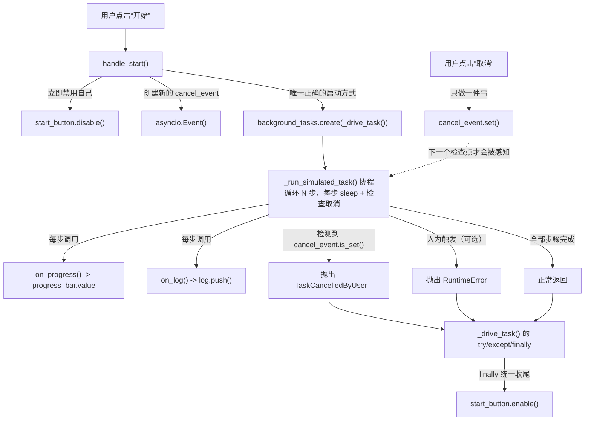

# 示例 7：后台任务与实时日志

> 对应代码：`examples/07_background_task.py`
> 本示例没有独立的 Service/测试文件——它故意只演示"后台任务机制本身"，
> 不涉及任何可复用的业务逻辑（那是示例 8 的话题）。

## 1. Why

如果你写惯了 C/C++/Go/Rust 的命令行工具，大概率非常熟悉"起一个线程/
goroutine 跑一个长任务，主线程继续处理别的事"这种模式。但第一次在 Web
界面里做类似的事情时，很容易撞上几个新问题：

- 点击按钮触发的事件处理函数如果直接在里面死等任务跑完，**整个页面的事件
  循环会被卡住**——不仅是当前用户的浏览器标签页卡住，同一进程里其他正在
  使用这个应用的用户也会被一起拖慢。
- 即使改成"异步"，Python 的 `asyncio.create_task()` 有一个很容易被忽略的
  陷阱：如果没有任何代码变量持有对这个 task 对象的引用，Python 的垃圾
  回收器有可能在任务还没跑完时就把它回收掉，导致任务不可预测地"跑到一半
  突然消失"，而且不会有任何报错提示你发生了什么。
- "取消"一个后台任务和"杀掉"一个外部进程完全是两回事，用错了模型会导致
  "点了取消按钮，但任务好像根本没反应"。

本示例的唯一目标：**在不掺杂任何具体业务逻辑的前提下，把"后台协程"这套
机制的四个核心动作讲透彻**——正确地启动、实时汇报进度、协作式地取消、
捕获并展示协程内部的意外异常。下一个示例（08）会在此基础上，把这里的
"裸协程"升级成一个正式的、可复用、可单元测试的 Service。

## 2. Mental Model



核心抽象只有三个：

- **任务协程**（`_run_simulated_task()`）：一个纯粹的 `async def`，内部是
  "循环 + `await asyncio.sleep(...)` + 每步检查取消标志 + 回调汇报进度/
  日志"。它不知道、也不关心自己是被谁调用、调用方打算怎么处理它的结果。
- **取消标志**（`cancel_event: asyncio.Event`）：一个纯粹的布尔信号，协程
  自己决定在哪些点检查它、检查到之后做什么。它本身**不会**让协程立即
  停下来——这是"协作式取消"和"抢占式终止"最根本的区别。
- **驱动函数**（`_drive_task()`）：真正被 `background_tasks.create()`
  启动的那个协程，负责 `try`/`except`/`finally`，把任务协程的"结局"
  （成功 / 取消 / 异常）翻译成界面更新，并保证无论哪种结局，"开始"按钮
  最终都会被重新启用。

## 3. Architecture

```
+--------------------------------------------------------------------+
| UI 事件：用户点击 "开始" 按钮                                       |
+--------------------------------------------------------------------+
                              |
                              v
+--------------------------------------------------------------------+
| handle_start()                                                     |
| - 创建新的 asyncio.Event() 赋给 state.cancel_event                  |
| - 清空进度条 / 日志 / 禁用开始按钮 / 启用取消按钮                   |
| - background_tasks.create(_drive_task(), name=...)  <- 唯一正确方式 |
| - 函数立即返回，不等待任务跑完                                      |
+--------------------------------------------------------------------+
                              |
                              v （后台独立运行，不阻塞上面这条调用链）
+--------------------------------------------------------------------+
| _drive_task()：真正被 background_tasks 管理的协程                   |
| try:                                                                |
|     await _run_simulated_task(cancel_event, ..., on_progress, on_log)|
| except _TaskCancelledByUser: ... 更新状态为"已取消"                  |
| except Exception: ...          更新状态为"出现异常"（演示用）        |
| else: ...                      更新状态为"已成功完成"                |
| finally:                                                            |
|     start_button.enable(); cancel_button.disable()                 |
+--------------------------------------------------------------------+
                              |
                              v
+--------------------------------------------------------------------+
| _run_simulated_task()：纯协程，循环 N 步                             |
| 每一步：                                                             |
|   1. if cancel_event.is_set(): raise _TaskCancelledByUser()         |
|   2. await asyncio.sleep(_STEP_DELAY)                               |
|   3. （可选）人为触发 RuntimeError，演示异常处理分支                |
|   4. on_progress(step/total); on_log(f'第 N 步完成')                |
+--------------------------------------------------------------------+

与上面这条链路并行、完全独立的另一条路径：
+--------------------------------------------------------------------+
| UI 事件：用户点击 "取消" 按钮                                       |
+--------------------------------------------------------------------+
                              |
                              v
+--------------------------------------------------------------------+
| handle_cancel()                                                     |
| state.cancel_event.set()   <- 只做这一件事，不直接更新任何 UI 状态   |
+--------------------------------------------------------------------+
```

依赖方向：`examples/07_background_task.py` 只依赖 `nicegui`（`ui` 与
`background_tasks`）和标准库 `asyncio`，不依赖本项目任何其他模块——这是
刻意的：本示例要讲的是"机制"，不应该被任何业务数据结构干扰视线。

## 4. Complete Code

```python
"""示例 7：后台任务与实时日志 —— 只讲清楚"后台任务机制本身"。

为什么需要这个示例
------------------
前面的示例要么是纯粹的同步界面逻辑（填表单、翻页），要么是"调用一次就
结束"的操作（执行一条命令、读一个文件）。但很多工程 GUI 的核心需求是：
点一个按钮，启动一个**会持续运行一段时间**的后台工作（巡检一圈设备、跑一
轮自动化测试、同步一批配置），同时界面上要能实时看到进度、实时看到滚动
日志，并且中途要能安全地把它停下来。这正是本项目里"后台任务"这一整块的
入口：本示例的唯一目标是把这套机制本身讲清楚——如何启动、如何汇报进度、
如何取消、如何处理异常——**不**掺杂任何具体业务逻辑。下一个示例（08）会
在此基础上，把这里的"裸协程"升级成一个正式的、可复用的 Service（见
`services/test_service.py`），读者可以直接对比这两个示例，看清楚这次
"从机制到业务"的演进关系。

心智模型：协程 / 线程池 / 外部进程，三种"耗时操作"分别怎么处理
----------------------------------------------------------------
在 NiceGUI 里，"耗时操作"大致分三类，处理方式完全不同：

1. **本身就是协程、用 `await asyncio.sleep(...)` 模拟耗时**（本示例）：
   用 `from nicegui import background_tasks; background_tasks.create(coro,
   name=...)` 发起一个"即发即忘"的后台协程。这是本项目**唯一**正确的
   做法——**绝不要**裸用 `asyncio.create_task()`：`background_tasks.create()`
   内部会把创建出来的 task 持有在一个模块级集合里，防止它在还没执行完时
   就被垃圾回收器意外回收（这是 `asyncio.create_task()` 一个广为人知的
   陷阱：如果没有任何代码持有对 task 对象的强引用，Python 的 GC 有可能在
   任意时刻把它回收掉，导致协程莫名其妙地"跑到一半就消失了"）；
   `background_tasks.create()` 还会在协程抛出未捕获异常时，把异常记录到
   NiceGUI 的日志里，而不是让它静默消失。
2. **本身是阻塞的 Python 函数（例如调用标准库 `subprocess.run()`）**：
   见 `infrastructure/process_runner.run_subprocess()` 和
   `services/command_service.run_command()`（示例 6 使用）。这类函数必须用
   `await run.io_bound(阻塞函数, *args)` 丢进线程池执行，绝不能在 NiceGUI
   的事件循环线程里直接调用，否则会卡住整个页面（乃至同一进程里其他用户
   的页面）。
3. **需要启动一个真正独立的外部进程**：见
   `infrastructure/process_runner.stream_subprocess()`（基于
   `asyncio.create_subprocess_exec()`），它本身已经是协程，同样可以配合
   `background_tasks.create()` 使用。

本示例属于第 1 类：`_run_simulated_task()` 从头到尾都是纯 Python 协程，
没有任何阻塞调用，也没有启动任何外部进程。

协作式取消 vs. 杀掉一个外部子进程：本质不同的两件事
----------------------------------------------------
本示例的"取消"是**协作式**的：`cancel_event: asyncio.Event` 只是一个标志
位，`_run_simulated_task()` 在每一步循环开始前检查一次这个标志位，发现
已经被设置就主动抛出一个内部信号异常、结束自己。这要求被取消的协程
"愿意"在某个检查点主动配合——如果某一步忘了检查（见本文档"Failure Modes"
小节），取消请求会被无限期地晾在一边，协程会假装什么都没发生地继续跑
下去，直到自然结束。

这和"杀掉一个正在运行的外部子进程"是完全不同的机制：示例 6 背后的
`infrastructure/process_runner.py`，在超时或需要终止时调用的是操作系统
级别的 `proc.kill()`（再 `await proc.wait()` 回收，避免产生僵尸进程）——
这是**抢占式**的，操作系统强制结束那个进程，不需要、也不可能"等它自己
配合"。协作式取消的好处是可以在退出前做清理工作（记日志、更新状态），
代价是**完全依赖代码里每一步是否记得检查**；抢占式终止不需要目标配合，
但代价是目标进程来不及做任何清理，直接被结束。
"""

from __future__ import annotations

import asyncio
from typing import Callable

from nicegui import background_tasks, ui

#: 模拟任务一共要跑多少"步"；每一步之间 `await asyncio.sleep(_STEP_DELAY)`。
_TOTAL_STEPS = 8

#: 每一步模拟耗时（秒）。选一个让用户能在界面上看清进度条逐步前进的值，
#: 又不至于让示例演示起来太慢。
_STEP_DELAY = 0.4

#: 如果用户勾选了"模拟一次意外异常"，会在跑到这一步时人为抛出异常。
_UNEXPECTED_ERROR_AT_STEP = 3


class _TaskCancelledByUser(Exception):
    """内部信号异常：仅用于把"检测到取消请求"这件事从循环内部带回调用方的
    `try`/`except`，不代表程序出现了任何错误，不应该被当作"异常处理"的
    失败案例看待——它是协作式取消这套机制里**预期内**的一条正常退出路径。
    """


async def _run_simulated_task(
    *,
    cancel_event: asyncio.Event,
    raise_unexpected_error: bool,
    on_progress: Callable[[float], None],
    on_log: Callable[[str], None],
) -> None:
    """一个极简的"本地模拟任务"协程：循环 + `asyncio.sleep` + 进度/日志回调。

    这个函数故意**不**使用 `models.task.TaskRecord`，也不 import
    `services/test_service.py`——本示例的教学目标是先让读者看清"后台任务
    机制本身"长什么样（启动、取消检查点、异常处理、如何汇报进度），不引入
    任何额外的数据结构。下一个示例（08）会展示如何把这里的"裸协程"改造成
    一个正式的、状态机驱动的 Service。
    """
    on_log(f'任务开始（共 {_TOTAL_STEPS} 步，每步约 {_STEP_DELAY} 秒）')

    for step in range(1, _TOTAL_STEPS + 1):
        if cancel_event.is_set():
            on_log(f'在第 {step} 步开始前检测到取消请求（cancel_event 已置位），提前结束')
            raise _TaskCancelledByUser()

        await asyncio.sleep(_STEP_DELAY)

        if raise_unexpected_error and step == _UNEXPECTED_ERROR_AT_STEP:
            raise RuntimeError(
                f'模拟的意外异常（在第 {step} 步人为触发，用于演示"协程抛出异常'
                '时不能让界面卡死"这条要求）'
            )

        on_progress(step / _TOTAL_STEPS)
        on_log(f'第 {step}/{_TOTAL_STEPS} 步完成')

    on_log('全部步骤已完成')


class _PageState:
    """保存"这一个浏览器会话当前后台任务状态"的小容器。

    每次用户点击"开始"，都会在这里创建一枚**全新的** `asyncio.Event`
    （而不是复用上一次任务用过的那一枚）：如果复用旧对象，上一次任务
    结束时它可能已经被设置过，新任务一启动就会立刻看到"已取消"，这是一个
    很容易被忽略的陷阱。
    """

    def __init__(self) -> None:
        self.cancel_event = asyncio.Event()


@ui.page('/background-task')
def background_task_page() -> None:
    """示例 7 页面：开始/取消按钮 + 进度条 + 实时日志，纯机制演示。"""
    state = _PageState()

    ui.label('示例 7：后台任务与实时日志').classes('text-2xl font-bold').mark('page-title')
    ui.label(
        '本页面只演示后台任务机制本身（启动 / 实时进度 / 协作式取消 / 异常处理），'
        '不涉及任何真实业务逻辑；点击"开始"后台的模拟任务纯粹是内存里的循环 + 延时。'
    ).classes('text-sm text-gray-600').mark('page-description')

    raise_error_checkbox = ui.checkbox(
        '勾选后：本次运行会在第 3 步人为触发一个意外异常（用于演示异常处理分支）'
    ).mark('raise-error-checkbox')

    status_label = ui.label('尚未开始').classes('text-sm font-bold mt-2').mark('status-label')

    with ui.row().classes('items-center gap-2 mt-2'):
        start_button = ui.button('开始').mark('start-button')
        cancel_button = ui.button('取消').mark('cancel-button')
        cancel_button.disable()

    progress_bar = ui.linear_progress(value=0.0).classes('mt-2').mark('progress-bar')
    log = ui.log(max_lines=100).classes('w-full h-64 mt-2').mark('task-log')

    async def _drive_task() -> None:
        """驱动一次 `_run_simulated_task()` 的运行，并把结果翻译成界面状态。"""
        try:
            await _run_simulated_task(
                cancel_event=state.cancel_event,
                raise_unexpected_error=raise_error_checkbox.value,
                on_progress=lambda value: setattr(progress_bar, 'value', value),
                on_log=log.push,
            )
        except _TaskCancelledByUser:
            status_label.text = '已取消'
            ui.notify('任务已被取消', type='warning')
        except Exception as exc:  # noqa: BLE001 - 这里就是要演示"捕获协程内部的
            # 任何意外异常"：如果不加这一层，异常会从 background_tasks.create()
            # 启动的协程里一路冒出去，NiceGUI 会把它记到日志里，但"开始"按钮
            # 永远不会被重新启用——用户看到的就是一个"卡死"的页面。
            status_label.text = f'出现异常：{exc}'
            log.push(f'[异常] {exc}')
            ui.notify(f'任务出现意外异常：{exc}', type='negative')
        else:
            status_label.text = '已成功完成'
            ui.notify('任务已成功完成', type='positive')
        finally:
            start_button.enable()
            cancel_button.disable()

    def handle_start() -> None:
        """"开始"按钮的点击回调：立即禁用自己，再把真正的任务丢给后台。"""
        state.cancel_event = asyncio.Event()
        progress_bar.value = 0.0
        log.clear()
        status_label.text = '运行中…'

        start_button.disable()
        cancel_button.enable()

        background_tasks.create(_drive_task(), name='example-07-background-task')

    def handle_cancel() -> None:
        """"取消"按钮的点击回调：只设置标志位，不做任何其他事情。"""
        state.cancel_event.set()

    start_button.on_click(handle_start)
    cancel_button.on_click(handle_cancel)


if __name__ in {'__main__', '__mp_main__'}:
    ui.run(title='示例 7：后台任务与实时日志')
```

## 5. Execution

```bash
cd /home/morrism/myNote/nicegui_learning_lab

# 1) 安装依赖（本机截至编写本文档时尚未安装 nicegui）
python3 -m pip install -r requirements.txt

# 2) 语法检查（不需要 nicegui 即可执行）
python3 -m py_compile examples/07_background_task.py

# 3) 启动示例（需要已安装 nicegui）
python3 examples/07_background_task.py
# 浏览器访问 http://localhost:8080/background-task
```

打开页面后：

1. 不勾选"模拟一次意外异常"，直接点击"开始"：观察进度条每约 0.4 秒前进
   一格，日志区逐行滚动，大约 3.2 秒后状态变为"已成功完成"，弹出绿色
   通知。
2. 点击"开始"后立刻点击"取消"：日志里会出现"检测到取消请求…提前结束"，
   状态变为"已取消"，弹出橙色通知。
3. 勾选"模拟一次意外异常"后点击"开始"：跑到第 3 步时会抛出
   `RuntimeError`，状态变为"出现异常：…"，日志里多一行 `[异常] ...`，
   弹出红色通知——并且"开始"按钮会被重新启用，而不是停留在禁用状态。

## 6. Lifecycle

以"点击开始，几秒后再点击取消"这个真实操作为例：

1. **用户点击"开始"**：触发 `handle_start()`。它做了四件事：
   a. 创建一枚全新的 `asyncio.Event()` 赋给 `state.cancel_event`（丢弃
      上一次运行可能已经 `set()` 过的旧对象）；
   b. 重置进度条、清空日志、把状态文案改成"运行中…"；
   c. **立即**调用 `start_button.disable()`——这一步必须在
      `background_tasks.create()` 之前完成，否则用户理论上能在任务开始
      运行前的极短窗口内再点一次"开始"；
   d. 调用 `background_tasks.create(_drive_task(), name=...)`，然后
      `handle_start()` 自己**立即返回**——它不会等 `_drive_task()` 跑完。
2. **后台开始运行**：`_drive_task()` 作为一个独立调度的协程开始执行，
   调用 `_run_simulated_task()`，后者进入它的 for 循环，第 1 步开始前先
   检查 `cancel_event.is_set()`（此时还是 `False`），然后
   `await asyncio.sleep(0.4)`，再调用 `on_progress(1/8)` 和
   `on_log('第 1/8 步完成')`——这两个回调分别把 `progress_bar.value` 更新
   为 `0.125`、把一行文字 `push` 进 `log` 组件，用户在浏览器里能立刻看到
   进度条前进、日志增加一行。
3. **用户（比如在第 3 步执行期间）点击"取消"**：触发 `handle_cancel()`，
   它**只**做一件事——`state.cancel_event.set()`。此时第 3 步可能正在
   `await asyncio.sleep(0.4)` 里等待，这次点击不会让它立刻中断；
   `_run_simulated_task()` 要等到**第 4 步循环开始、检查点再次被执行到**
   时，才会发现 `cancel_event.is_set()` 已经变成 `True`。
4. **下一个检查点命中**：第 4 步开始前的 `if cancel_event.is_set():` 判断
   为真，`on_log(...)` 记一行"检测到取消请求…提前结束"，然后
   `raise _TaskCancelledByUser()`——注意这个异常是从 `_run_simulated_task()`
   内部抛出的，会一路传播到 `_drive_task()` 的 `try` 块。
5. **`_drive_task()` 的 `except _TaskCancelledByUser:` 分支被命中**：
   把 `status_label.text` 设为"已取消"，弹出一条 `type='warning'` 的
   `ui.notify`。
6. **`finally` 块统一收尾**：无论上面走的是成功、取消还是异常分支，
   `finally` 都会执行 `start_button.enable()` 和
   `cancel_button.disable()`——用户现在又可以点击"开始"发起下一次运行了。

可以看到，**"点击取消"和"任务真正停下来"之间永远隔着一段不确定的时间**
（从点击的那一刻，到下一个检查点被执行到为止）——这正是协作式取消的核心
特征，也是本示例希望读者牢牢记住的一点。

## 7. API Reference

| API / 概念 | 说明 |
| --- | --- |
| `background_tasks.create(coro, name='...')` | 发起一个"即发即忘"的后台协程；本项目**唯一**正确的启动方式，绝不要裸用 `asyncio.create_task()`。 |
| `ui.linear_progress(value=0.0)` | 进度条组件；`.value` 属性可读写，赋值后组件会自动重新渲染。 |
| `ui.log(max_lines=100)` | 自动滚动的日志组件；`.push(line)` 追加一行，超过 `max_lines` 自动丢弃最旧的行；`.clear()` 清空。 |
| `ui.spinner()` | 转圈加载指示器（本示例未使用，示例 8 会用到）；`.set_visibility(bool)` 控制显隐。 |
| `ui.notify(message, type=...)` | 弹出一次性通知；`type` 可以是 `'positive'`/`'negative'`/`'warning'`/`'ongoing'` 等。 |
| `ui.button(text, on_click=...)` | 按钮组件；`on_click` 可以直接传一个 `async def` 协程函数。 |
| `asyncio.Event` | 标准库的事件标志；`.set()` 置位，`.is_set()` 查询，本示例用作"协作式取消"的信号载体。 |
| `.mark('some-id')` | 给元素打一个稳定标记，便于浏览器端自动化测试/调试时定位元素。 |

## 8. Failure Modes

1. **忘记在循环里检查 `cancel_event`，导致取消按钮形同虚设**
   - 现象：如果 `_run_simulated_task()` 的 for 循环里漏掉了
     `if cancel_event.is_set(): raise _TaskCancelledByUser()` 这一行，
     用户点击"取消"之后 `cancel_event.set()` 确实被调用了，但没有任何
     代码会去读它——任务会假装什么都没发生，一直跑到自然结束为止，
     "取消"按钮点了跟没点一样。
   - 排查方法：在怀疑"取消没生效"时，先确认循环体内是否存在检查
     `cancel_event.is_set()` 的代码路径，并且这条路径必须被**每一次**
     循环迭代都执行到（而不是只在第一次迭代时检查一次）。
   - 修复方法：检查点越密集，取消请求被响应得越快；对于本来就要分成
     多个小步骤的任务，最自然的做法就是在每个步骤开始前都加一次检查。

2. **在协程里直接改 UI 对象的属性，但协程本身从未被 `await` 到**
   - 现象：如果某处代码写成了 `asyncio.create_task(_drive_task())`（而不是
     `background_tasks.create(...)`），表面上看起来完全正常——任务通常也
     能正常跑完。但在某些时序下（例如页面在任务跑到一半时被关闭、或者
     Python 垃圾回收器恰好在那个时间点运行），这个"裸" task 对象可能
     会因为没有任何强引用而被提前回收，协程被静默中断，UI 永远停在
     "运行中…"，"开始"按钮也永远不会被重新启用。
   - 排查方法：全局搜索代码库里是否存在 `asyncio.create_task(` 字样
     （本项目的 lint/code review 应当把它当作一个明确的反模式标记）。
   - 修复方法：统一改用 `background_tasks.create(coro, name='...')`——
     `name` 参数不是可选的装饰，给每个后台任务起一个有辨识度的名字，
     方便在日志里定位"是哪一个任务抛出的异常"。

3. **重复点击"开始"按钮，导致意外启动多个并发任务**
   - 现象：如果 `handle_start()` 忘记在函数开头调用
     `start_button.disable()`（或者把这一步放在了
     `background_tasks.create(...)` 之后），用户在网络稍有延迟、或者单纯
     手快的情况下连续点击两次"开始"，会启动两个完全独立的
     `_drive_task()` 协程，它们共享同一个 `progress_bar`/`log` 组件，
     两边的 `on_progress`/`on_log` 回调会互相"打架"，进度条和日志会出现
     完全无法理解的跳动。
   - 排查方法：如果发现进度条数值不单调递增、或者日志行看起来像是两个
     任务的输出交织在一起，第一时间怀疑"是不是启动了多个并发任务"。
   - 修复方法：`disable()` 必须是 `handle_start()` 函数体内**第一批**
     执行的语句之一（在任何 `await`/`background_tasks.create()` 之前），
     这样即使两次点击在极短时间内先后到达，第二次点击时按钮已经处于
     禁用状态，NiceGUI 不会再次触发 `on_click`。

## 9. Exercises

1. **练习：把总步数和每步耗时做成可配置的输入框。**
   要求：新增两个 `ui.number` 输入框，分别对应"总步数"和"每步耗时
   （秒）"，点击"开始"时读取它们的当前值传给 `_run_simulated_task()`，
   而不是使用写死的模块级常量。
   验收标准：把总步数改成 3、每步耗时改成 0.1 后点击"开始"，整个任务应
   该在 1 秒以内就跑完成功；把总步数改成一个非正数（比如 0）时，点击
   "开始"应当弹出一条警告通知并且不启动任何后台任务，而不是让循环直接
   跳过、进度条永远停在 0%。

2. **练习：允许用户设置"取消等待确认"。**
   要求：点击"取消"后不要立刻 `set()` 标志位，而是先弹出一个
   `ui.dialog()` 确认框（"确定要取消当前任务吗？"），用户确认后才真正
   调用 `cancel_event.set()`。
   验收标准：点击"取消"后任务不会立即停止（因为标志位还没被设置）；
   在确认框里点"取消"（放弃取消操作）后，后台任务应当继续正常运行，
   不受任何影响。

3. **练习：给任务加一个"暂停/继续"功能（进阶）。**
   要求：在"取消"按钮旁边新增一个"暂停"按钮，点击后任务在当前步骤完成
   后暂停（不再继续推进后面的步骤，但也不结束），再点击"继续"后从暂停的
   地方接着跑。提示：可以用另一个 `asyncio.Event`（例如 `resume_event`）
   并在每一步循环里 `await resume_event.wait()`。
   验收标准：点击"暂停"后，进度条和日志应当停止变化；点击"继续"后，
   任务应当从暂停前的那一步之后继续推进，而不是从头开始；"暂停"状态下
   点击"取消"应当仍然能正常取消任务（不应该因为暂停而卡死在
   `resume_event.wait()` 上无法响应取消）。

## 10. Summary

本示例把"后台任务"这件事拆成了四个独立的动作，并且演示了每一个动作在
NiceGUI + `asyncio` 组合下的正确写法：

- **启动**：`background_tasks.create(coro, name=...)` 是唯一正确的"即发
  即忘"方式，裸用 `asyncio.create_task()` 有被垃圾回收器提前回收的风险。
- **汇报进度/日志**：协程通过回调函数（`on_progress`/`on_log`）把信息
  推给调用方持有的 UI 组件（`ui.linear_progress.value`/`ui.log.push()`），
  协程本身不需要知道这些组件具体是什么。
- **取消**：`asyncio.Event` 实现的是**协作式**取消——取消方只能"请求"，
  真正停下来要靠被取消的协程在某个检查点主动配合；这和"杀掉一个外部
  子进程"（`infrastructure/process_runner.py` 用的 `proc.kill()`，**抢占
  式**、不需要目标配合）是完全不同的两种机制，不能混为一谈。
- **异常处理**：协程内部抛出的任何异常都必须在驱动函数（`_drive_task()`）
  里被捕获并翻译成界面反馈，并且**无论走哪条分支都要在 `finally` 里做
  收尾**（本示例是重新启用"开始"按钮），否则用户会被卡在一个看起来
  "坏掉了"的页面前面。

下一步：示例 8 会把本示例里这个没有名字、没有历史的"裸协程"，改造成一个
有唯一 `id`、有正式生命周期状态机（`models.task.TaskRecord`）、可以独立
做单元测试（不依赖 nicegui）的 Service——`services/test_service.py`。
