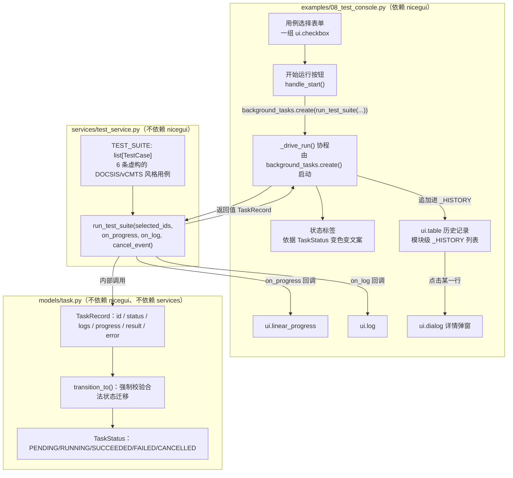

# 示例 8：综合自动化测试控制台

> 对应代码：`services/test_service.py`、`examples/08_test_console.py`
> 对应测试：`tests/test_test_service.py`

## 1. Why

示例 7 把"后台任务机制"本身讲清楚了：启动、进度、取消、异常处理。但那个
示例里的任务是一个完全匿名的本地协程——它没有名字，没有历史，运行结束后
除了界面上那条一闪而过的通知，什么都不会留下。真实的工程 GUI 几乎总是要
回答这些问题："刚才这次运行测了哪些用例？""结果是成功还是失败？为什么
失败？""上一次、上上次跑的结果分别是什么？"——这些问题的答案都需要"一次
运行"本身变成一个可以被查询、有唯一标识、有明确生命周期的对象，而不是一
个转瞬即逝的局部变量。

本示例要做两件事：第一，把一组"看起来像真实 vCMTS/CM 诊断"的测试用例
（完全虚构、纯内存模拟）封装成一个独立于 nicegui 的 Service
（`services/test_service.py`），让核心业务逻辑可以脱离浏览器单独做单元
测试；第二，在 UI 层把示例 7 的机制和这个新 Service 组合起来，加上一份
最简单的历史记录展示，演示"选用例 -> 跑测试 -> 看历史 -> 看详情"这一条
完整的工程 GUI 工作流。

## 2. Mental Model



三层关系是严格单向的：**UI 调用 Service，Service 使用 Model，反过来永远
不成立**。`run_test_suite()` 自己不知道、也不关心调用它的是 UI 还是
测试代码——它只认 `on_progress`/`on_log` 这两个普通的 Python 回调函数，
以及一个 `asyncio.Event`；`examples/08_test_console.py` 的职责被压缩到
"把这些回调接到具体的 NiceGUI 组件上"这一件事。

## 3. Architecture

```
+------------------------------------------------------------------+
| UI 层：examples/08_test_console.py                               |
| - 渲染 TEST_SUITE 对应的 checkbox 表单                            |
| - handle_start()：收集勾选结果，防止重复启动                       |
| - background_tasks.create(_drive_run(...))：发起后台协程           |
| - _drive_run()：等待 run_test_suite() 返回/抛出，翻译成界面更新     |
| - on_progress / on_log 回调，分别接到 ui.linear_progress / ui.log  |
| - 把每次运行结束后的 TaskRecord 追加进模块级 _HISTORY               |
| - ui.table 展示历史，点击某行用 ui.dialog 展示完整详情              |
+------------------------------------------------------------------+
                              |
                              v  调用 test_service.run_test_suite(
                              |      selected_ids, on_progress=, on_log=,
                              |      cancel_event=, step_delay=)
+------------------------------------------------------------------+
| Service 层：services/test_service.py（不依赖 nicegui）            |
| - TEST_SUITE：6 条固定的虚构测试用例（TestCase 冻结 dataclass）    |
| - run_test_suite()：                                               |
|   1. 校验 selected_ids（非空、id 全部存在）-> 否则 ValidationError  |
|   2. new_task() 创建 TaskRecord，transition_to(RUNNING)             |
|   3. 按 selected_ids 给定顺序逐条执行：                             |
|      检查 cancel_event -> 记日志 -> sleep(step_delay) ->            |
|      若是 simulate_failure_case 则 FAILED 并提前 return ->          |
|      否则记完成日志 + 汇报进度                                     |
|   4. 全部完成 -> transition_to(SUCCEEDED)，返回 TaskRecord          |
+------------------------------------------------------------------+
                              |
                              v  使用
+------------------------------------------------------------------+
| Model 层：models/task.py（不依赖 nicegui、不依赖 services）        |
| - TaskRecord：统一的任务快照（id / status / logs / progress / ...） |
| - TaskStatus + _ALLOWED_TRANSITIONS：唯一合法的状态迁移表           |
| - transition_to()：任何非法迁移立即抛 ValueError，不会悄悄污染状态  |
+------------------------------------------------------------------+
```

依赖方向验证：`services/test_service.py` 只 import `models.task` 与
`services.errors`（以及标准库 `asyncio`/`dataclasses`/`typing`），不
`import nicegui`——这正是 `tests/test_test_service.py` 能够在本机
**完全没有安装 nicegui** 的情况下照常运行并通过的原因。

## 4. Complete Code

### 4.1 `services/test_service.py`

```python
"""Service 层：一套完全模拟的"vCMTS 自动化测试用例"执行引擎。

为什么需要这个模块
------------------
示例 8（综合自动化测试控制台）需要演示一个在真实工程 GUI 里极其常见、也
极其容易写错的场景："点一个按钮，后台跑一长串步骤，界面上要实时看到进度
和日志，并且中途要能安全地取消"。这个场景本身的复杂度——进度回调、日志
回调、协作式取消、状态机——和"这些步骤具体做什么业务"是两件可以彻底分开
的事情。本模块只负责后者的一个**完全虚构的教学示例**：6 条命名风格借用了
DOCSIS/vCMTS 术语的"测试用例"，但它们的全部"执行逻辑"只是
`await asyncio.sleep(...)` 加几行字符串日志，**不连接任何真实设备，不发出
任何真实网络请求，也不调用 `services/command_service.py` 里任何真正会跑
子进程的命令**。

心智模型
--------
把 `run_test_suite()` 想象成一个"模拟测试跑道"：调用方先从 `TEST_SUITE`
里选出若干个 `TestCase`，`run_test_suite()` 负责按顺序把它们一个个"跑"
一遍，每一步都做三件事——检查有没有被取消、模拟耗时、汇报进度/日志——
全程只通过 `models.task.TaskRecord` 这一套统一的生命周期状态机对外暴露
"现在跑到哪了"，不额外发明第二套状态表示法。

两种"取消"的区别（请读者务必注意，另见示例 7/8 文档的详细讨论）：这里的
取消是**协作式**的——`cancel_event: asyncio.Event` 只是一个标志位，本模块
只在每个测试用例*开始之前*检查一次这个标志位，如果已经被设置就提前退出。
这和"杀掉一个正在运行的外部子进程"（需要操作系统级的 `proc.kill()`，见
`infrastructure/process_runner.py`）是两种完全不同的机制：协作式取消永远
需要被取消的那一方"愿意"在某个检查点主动配合，如果某一步忘记检查，取消
请求会被无限期地晾在一边。

模拟与真实的边界
----------------
本模块创建的所有 `TaskRecord` 都必须是 `is_simulated=True`（这也是
`models.task.new_task()` 的默认值，这里仍然显式传入以便一眼看出意图）。
UI 层（`examples/08_test_console.py`）必须用明显的"[模拟]"文案标注，绝不能
让使用者误以为这是在访问真实的 vCMTS/CM 设备。

关于 `simulate_failure_case` 的设计取舍
----------------------------------------
`TEST_SUITE` 里特意包含一条必定失败的用例，用来演示 `FAILED` 这条状态路径
以及 `TaskRecord.error` 字段该怎么用。一旦跑到这一条，`run_test_suite()`
会立刻把任务迁移到 `FAILED` 并返回，**不会继续执行后面排在它之后的用例**
——这是刻意设计的行为，模拟"一个关键依赖项检查失败后，没有必要继续跑后面
依赖它的测试"这种常见的真实工程逻辑，而不是一个疏漏。

本模块的依赖边界
----------------
本文件只允许 import `models/*`、`services/errors.py` 和标准库（包括
`asyncio`），**绝不 import nicegui**，这样 `tests/test_test_service.py`
即使在没有安装 nicegui 的环境下也能正常运行。本模块也不需要
`command_service`/`process_runner`：这里的"测试"是完全独立的内存模拟，
不会去真的执行示例 6 的任何白名单命令，避免给一套本该稳定可重复的单元
测试引入真实网络/进程依赖。

未来的可能演进
--------------
如果以后想让某条用例真的去跑一个只读诊断命令（例如把 `run_ping_sweep`
换成真正调用示例 6 的 `services.command_service.run_command('ping_once',
...)`），需要新增一个 `is_simulated=False` 的执行路径，并在 UI 上去掉
"[模拟]"标签——这不是本模块当前的职责范围，这里只负责把"后台任务 + 实时
日志 + 协作式取消"这套机制演示清楚。
"""

from __future__ import annotations

import asyncio
from dataclasses import dataclass
from typing import Callable

from models.task import TaskRecord, TaskStatus, new_task
from services.errors import ValidationError


@dataclass(frozen=True)
class TestCase:
    """一条模拟测试用例的静态描述（不含任何执行逻辑，执行逻辑在
    `run_test_suite()` 里统一处理）。
    """

    id: str
    name: str
    description: str


#: 模块级固定清单：全部是教学用途的虚构测试用例，命名借用了 DOCSIS/vCMTS
#: 领域术语，但**不连接任何真实设备，不发出任何真实网络请求**。顺序即
#: `run_test_suite()` 默认的执行顺序（见该函数文档）。
TEST_SUITE: list[TestCase] = [
    TestCase(
        id='check_cm_registration',
        name='检查调制解调器注册状态',
        description='（模拟）检查 CM 是否已在 CMTS 完成注册流程；纯内存模拟，不连接任何真实设备。',
    ),
    TestCase(
        id='check_downstream_snr',
        name='检查下行信噪比',
        description='（模拟）检查下行信道信噪比（SNR）是否处于正常范围；纯内存模拟，不连接任何真实设备。',
    ),
    TestCase(
        id='check_upstream_power',
        name='检查上行发射功率',
        description='（模拟）检查上行发射功率是否处于合理范围；纯内存模拟，不连接任何真实设备。',
    ),
    TestCase(
        id='verify_firmware_version',
        name='校验固件版本',
        description='（模拟）校验设备固件版本是否符合预期版本号；纯内存模拟，不连接任何真实设备。',
    ),
    TestCase(
        id='run_ping_sweep',
        name='执行一次 ping 扫描',
        description=(
            '（模拟）对一组模拟地址执行一次 ping 扫描；这是纯内存的教学模拟，'
            '不调用示例 6 命令控制台里真正会发出 ICMP 报文的 ping_once，不产生任何真实网络流量。'
        ),
    ),
    TestCase(
        id='simulate_failure_case',
        name='模拟失败用例（教学用，必定失败）',
        description=(
            '（模拟，教学用途）这条用例被刻意设计为必定失败，专门用来演示 '
            'FAILED 状态与 record.error 字段该如何展示；它不代表任何真实故障，'
            '也不说明被测设备有任何问题。'
        ),
    ),
]

#: id -> TestCase 的查找表，供校验 `selected_ids` 时使用。
_TEST_CASES_BY_ID: dict[str, TestCase] = {case.id: case for case in TEST_SUITE}

#: `run_test_suite()` 刻意必定失败的用例 id，集中定义成常量，避免在函数体
#: 内出现一处"魔法字符串"。
_GUARANTEED_FAILURE_ID = 'simulate_failure_case'


def _resolve_selected_cases(selected_ids: list[str]) -> list[TestCase]:
    """校验 `selected_ids` 并翻译成按**传入顺序**排列的用例列表。

    故意保留调用方传入的顺序（而不是改用 `TEST_SUITE` 的展示顺序）：这样
    "跑到 `simulate_failure_case` 就不再执行后面排队的用例"这条行为才有
    意义——调用方（通常是 UI 层按用户勾选顺序，或者测试代码按场景需要）
    决定执行顺序，本函数只负责校验，不重新排序。

    Raises:
        ValidationError: `selected_ids` 为空列表，或包含不存在的 id。
    """
    if not selected_ids:
        raise ValidationError('必须至少选择一个测试用例，selected_ids 不能为空')

    unknown_ids = [case_id for case_id in selected_ids if case_id not in _TEST_CASES_BY_ID]
    if unknown_ids:
        raise ValidationError(f'selected_ids 中包含未知的测试用例 id：{unknown_ids!r}')

    return [_TEST_CASES_BY_ID[case_id] for case_id in selected_ids]


async def run_test_suite(
    selected_ids: list[str],
    *,
    on_progress: Callable[[float], None],
    on_log: Callable[[str], None],
    cancel_event: asyncio.Event,
    step_delay: float = 0.3,
) -> TaskRecord:
    """按顺序模拟执行一组测试用例，返回全程记录状态/日志/进度的 `TaskRecord`。

    这是一个纯粹的协程：它本身不关心自己是被 `background_tasks.create()`
    即发即忘地启动，还是被 `asyncio.run()` 在测试里直接 `await`——两种
    调用方式下行为完全一致，这也是 `tests/test_test_service.py` 可以直接
    `asyncio.run(run_test_suite(...))` 测试的原因。

    执行流程（对 `selected_ids` 按传入顺序排列后的每一条用例依次执行）：

    1. 检查 `cancel_event.is_set()`：如果已经被设置，把任务迁移到
       `CANCELLED` 并立即返回，**不会再执行这一条、也不会执行后面排队的
       用例**。
    2. 通过 `on_log(...)` 和 `record.append_log(...)` 同时记录一条"开始
       执行某用例"的日志——两者都要写，因为 `on_log` 是用来实时推给 UI
       （例如 `ui.log.push()`）的，而 `record.logs` 是留给历史详情页回放
       用的；两份日志内容完全一致。
    3. `await asyncio.sleep(step_delay)` 模拟这一步的执行耗时。
    4. 如果这一条用例的 id 是 `'simulate_failure_case'`：记一条失败日志、
       设置 `record.error`、把任务迁移到 `FAILED`，然后**立即返回**，不再
       继续跑后面的用例（这是刻意设计的行为，见模块顶部文档说明）。
    5. 否则记一条"执行完成"日志，并通过 `on_progress(当前完成比例)` 和
       `record.progress = 当前完成比例` 汇报进度（比例 = 已完成用例数 /
       选中的用例总数）。
    6. 全部用例都跑完且没有触发失败路径时，通过 `on_log(...)` 和
       `record.append_log(...)` 记一条"全部执行成功"的日志，设置
       `record.result`，把任务迁移到 `SUCCEEDED`，并返回这个
       `TaskRecord`。

    Args:
        selected_ids: 要执行的 `TestCase.id` 列表，**按传入顺序执行**（不会
            被重新排序成 `TEST_SUITE` 的展示顺序），这样调用方可以精确控制
            "先跑哪个、后跑哪个"，也让"失败后不再执行后面排队的用例"这条
            行为可以被直接观察到。
        on_progress: 每完成一条非失败用例时调用一次，参数是 0.0~1.0 之间
            的完成比例，典型用法是更新 `ui.linear_progress.value`。
        on_log: 每产生一条日志时调用一次（开始/完成/失败都会触发），典型
            用法是 `ui.log.push(line)`。
        cancel_event: 调用方新建的 `asyncio.Event`；在任意时刻调用
            `cancel_event.set()`，本协程会在下一个用例开始前的检查点感知
            到并停下来——这是"协作式取消"，不是立即中断。
        step_delay: 每个模拟步骤的模拟耗时（秒）。生产教学场景下用默认值
            `0.3` 让用户能在界面上看清进度变化；单元测试里应传入很小的值
            （例如 `0.01`）让测试快速跑完。

    Returns:
        执行结束时的 `TaskRecord`（终态为 `SUCCEEDED` / `FAILED` /
        `CANCELLED` 三者之一），`is_simulated` 恒为 `True`。

    Raises:
        ValidationError: `selected_ids` 为空，或包含 `TEST_SUITE` 里不存在
            的 id。这个校验在创建 `TaskRecord` 之前就完成，所以校验失败时
            不会产生任何"半途而废"的任务记录。
    """
    selected_cases = _resolve_selected_cases(selected_ids)
    total = len(selected_cases)

    record = new_task(
        name=f'vCMTS 模拟自动化测试（{total} 项用例）',
        is_simulated=True,
    )
    record.transition_to(TaskStatus.RUNNING)

    for index, case in enumerate(selected_cases):
        if cancel_event.is_set():
            cancel_message = f'[模拟] 检测到取消请求，任务在执行用例 {case.name!r} 之前被取消'
            on_log(cancel_message)
            record.append_log(cancel_message)
            record.transition_to(TaskStatus.CANCELLED)
            return record

        start_message = f'[模拟] 开始执行用例「{case.name}」（{case.id}）'
        on_log(start_message)
        record.append_log(start_message)

        await asyncio.sleep(step_delay)

        if case.id == _GUARANTEED_FAILURE_ID:
            error_message = (
                f'[模拟] 用例「{case.name}」执行失败（这是教学用途的、刻意设计的'
                '必然失败分支，不代表任何真实设备故障）'
            )
            on_log(error_message)
            record.append_log(error_message)
            record.error = error_message
            record.transition_to(TaskStatus.FAILED)
            return record

        finish_message = f'[模拟] 用例「{case.name}」执行完成'
        on_log(finish_message)
        record.append_log(finish_message)

        progress = (index + 1) / total
        on_progress(progress)
        record.progress = progress

    success_message = f'[模拟] 全部 {total} 项用例执行成功'
    on_log(success_message)
    record.append_log(success_message)
    record.result = success_message
    record.transition_to(TaskStatus.SUCCEEDED)
    return record
```

### 4.2 `examples/08_test_console.py`

> 完整源码请直接查看仓库文件 `examples/08_test_console.py`（本文档不再
> 重复粘贴一份，避免两处代码在后续修改时出现不一致）。核心片段摘录如下：

```python
async def _drive_run(selected_ids: list[str], cancel_event: asyncio.Event) -> None:
    """驱动一次 test_service.run_test_suite()，并把结果同步到界面与历史记录。"""
    _set_status(TaskStatus.RUNNING)
    try:
        record = await test_service.run_test_suite(
            selected_ids,
            on_progress=lambda value: setattr(progress_bar, 'value', value),
            on_log=log.push,
            cancel_event=cancel_event,
        )
    except ValidationError as exc:
        status_label.text = f'启动失败：{exc}'
        ui.notify(f'启动失败：{exc}', type='negative')
    else:
        _set_status(record.status)
        _HISTORY.append(record)
        _HISTORY_BY_ID[record.id] = record
        _refresh_history_table()
        _notify_result(record)
    finally:
        state.is_task_running = False
        start_button.enable()
        cancel_button.disable()
        spinner.set_visibility(False)


def handle_start() -> None:
    selected_ids = [case_id for case_id, checkbox in checkboxes.items() if checkbox.value]
    if not selected_ids:
        ui.notify('请至少勾选一个测试用例', type='warning')
        return
    ...
    start_button.disable()
    cancel_button.enable()
    background_tasks.create(
        _drive_run(selected_ids, state.cancel_event),
        name='example-08-test-run',
    )
```

### 4.3 `tests/test_test_service.py`

> 完整源码请直接查看仓库文件 `tests/test_test_service.py`。测试覆盖见
> 本文档"Execution"小节的真实运行结果。

## 5. Execution

```bash
cd /home/morrism/myNote/nicegui_learning_lab

# 1) 单独验证 services/test_service.py（不需要安装 nicegui）
python3 -m py_compile services/test_service.py tests/test_test_service.py
python3 -m pytest -q tests/test_test_service.py
# 或者：python3 tests/test_test_service.py

# 2) 语法检查 UI 文件（本机截至编写本文档时尚未安装 nicegui，
#    这一步只做 py_compile，不启动页面）
python3 -m py_compile examples/08_test_console.py

# 3) 安装 nicegui 后启动示例
python3 -m pip install -r requirements.txt
python3 examples/08_test_console.py
# 浏览器访问 http://localhost:8080/test-console
```

打开页面后：

1. 勾选若干测试用例（例如前两条 `check_cm_registration` 和
   `check_downstream_snr`），点击"开始运行"：观察进度条每约 0.3 秒前进
   一格，日志区实时滚动，状态标签从"等待中"变为"运行中"再变为"成功"。
2. 跑完一次后，历史记录表格里会多出一行；点击该行，弹出详情对话框，
   能看到完整的日志、进度、结果字段。
3. 勾选包含"模拟失败用例"的一组用例并运行，观察状态变为红色的"失败"，
   详情对话框里能看到 `error` 字段的具体内容。
4. 运行期间点击"取消"，观察状态变为橙色的"已取消"，历史记录里也会记录
   这一次被取消的运行。

## 6. Lifecycle

以"选择两个用例、跑完、再点开历史记录看详情"这个真实操作为例：

1. **用户勾选用例**：勾选 `check_cm_registration` 和
   `check_downstream_snr` 两个 `ui.checkbox`，此时它们的 `.value` 变为
   `True`，纯粹是浏览器端状态同步，还没有触发任何业务逻辑。
2. **用户点击"开始运行"**：触发 `handle_start()`：
   a. 从 `checkboxes` 字典里筛出 `.value is True` 的两个 id，得到
      `selected_ids = ['check_cm_registration', 'check_downstream_snr']`；
   b. 因为列表非空，跳过"至少勾选一个"的早期校验；
   c. 创建新的 `asyncio.Event()`，重置进度条/日志，状态文案设为
      "[模拟] 当前状态：等待中（PENDING）"；
   d. **立即**禁用"开始运行"按钮、启用"取消"按钮、显示 spinner；
   e. 调用 `background_tasks.create(_drive_run(selected_ids,
      state.cancel_event), name='example-08-test-run')`，然后
      `handle_start()` 自己立即返回。
3. **`_drive_run()` 作为独立协程开始执行**：先把状态更新为"运行中"，再
   调用 `await test_service.run_test_suite(selected_ids, on_progress=...,
   on_log=..., cancel_event=...)`。
4. **进入 `run_test_suite()`**：`_resolve_selected_cases()` 校验两个 id
   都存在于 `TEST_SUITE` 中，返回按传入顺序排列的两个 `TestCase`；
   `new_task(name='vCMTS 模拟自动化测试（2 项用例）')` 创建一个
   `TaskRecord`（此时 `status=PENDING`），紧接着
   `record.transition_to(RUNNING)`。
5. **第一条用例执行**：检查 `cancel_event.is_set()`（`False`），通过
   `on_log(...)` 把一行"开始执行用例「检查调制解调器注册状态」…"推给
   `log.push()`（用户立刻在浏览器里看到这行日志），同时写进
   `record.logs`；`await asyncio.sleep(0.3)`；因为这条用例不是
   `simulate_failure_case`，记一条"执行完成"日志，调用
   `on_progress(1/2)` 把 `progress_bar.value` 更新为 `0.5`，同时
   `record.progress = 0.5`。
6. **第二条用例执行**：同样的流程再走一遍，`on_progress(2/2)` 把
   `progress_bar.value` 更新为 `1.0`。
7. **全部用例完成**：`run_test_suite()` 记一条"全部 2 项用例执行成功"的
   日志，设置 `record.result`，`record.transition_to(SUCCEEDED)`，返回
   这个 `TaskRecord`。
8. **回到 `_drive_run()` 的 `else` 分支**：`_set_status(SUCCEEDED)` 把状态
   标签改成绿色的"成功"；把 `record` 追加进模块级 `_HISTORY` 列表，同步
   更新 `_HISTORY_BY_ID[record.id] = record`；调用
   `_refresh_history_table()` 重新渲染历史表格（新这一条排在最前面）；
   `_notify_result(record)` 弹出一条绿色的成功通知。
9. **`finally` 收尾**：重新启用"开始运行"按钮、禁用"取消"按钮、隐藏
   spinner。
10. **用户点击历史表格里刚新增的那一行**：触发 `_on_history_row_click()`，
    从 `event.args[1]`（被点击的行 dict）里取出完整 `id`，调用
    `_render_detail(task_id)`：在 `_HISTORY_BY_ID` 里查到完整的
    `TaskRecord`，在详情对话框里依次展示名称、状态、创建/开始/结束时间、
    进度、结果，以及**全部**日志行（`record.logs`，不只是最近几行），
    最后调用 `detail_dialog.open()`。

## 7. API Reference

### `services/test_service.py`

| 名称 | 说明 |
| --- | --- |
| `TestCase` | frozen dataclass：`id` / `name` / `description`。 |
| `TEST_SUITE: list[TestCase]` | 模块级固定清单，6 条虚构的 DOCSIS/vCMTS 风格模拟用例，末尾一条 `simulate_failure_case` 恒定失败。 |
| `run_test_suite(selected_ids, *, on_progress, on_log, cancel_event, step_delay=0.3) -> TaskRecord`（协程） | 按 `selected_ids` 传入顺序逐条模拟执行；异常：`ValidationError`（`selected_ids` 为空或含未知 id）。 |

### `examples/08_test_console.py`

| 名称 / 组件 | 说明 |
| --- | --- |
| `checkboxes: dict[str, ui.checkbox]` | `TestCase.id -> ui.checkbox` 的映射，决定 `handle_start()` 收集到的 `selected_ids`。 |
| `_PageState` | 每个浏览器会话一份：持有 `cancel_event` 和防重复点击用的 `is_task_running`。 |
| `_HISTORY: list[TaskRecord]` / `_HISTORY_BY_ID: dict[str, TaskRecord]` | 模块级、进程内存里的历史记录（所有会话共享，见 Failure Modes 第 3 条）。 |
| `_set_status(status)` | 把 `TaskStatus` 翻译成状态标签的文案与颜色 class。 |
| `history_table.on('rowClick', handler)` | 点击某一行历史记录时触发，`event.args[1]` 是被点击的行 dict。 |

### 复用自 `models/task.py`（见示例 1~6 的文档，这里不重复展开）

| 名称 | 说明 |
| --- | --- |
| `TaskRecord` | 统一的任务快照：`id` / `status` / `progress` / `logs` / `result` / `error` / `is_simulated` 等。 |
| `TaskStatus` | `PENDING` / `RUNNING` / `SUCCEEDED` / `FAILED` / `CANCELLED`。 |
| `TaskRecord.transition_to(new_status)` | 唯一允许修改 `.status` 的方式，非法迁移直接抛 `ValueError`。 |
| `TaskRecord.append_log(line)` | 追加一行日志，自动按 `MAX_LOG_LINES` 裁剪。 |

## 8. Failure Modes

1. **忘记检查 `cancel_event`，导致"取消"按钮形同虚设**
   - 现象：如果 `run_test_suite()` 的 for 循环里漏掉了
     `if cancel_event.is_set(): ...` 这一段，用户点击"取消"后
     `state.cancel_event.set()` 确实被调用了，但没有任何代码会去读它，
     整套测试会一直跑到自然结束（或者跑到 `simulate_failure_case`）为止。
   - 排查方法：`tests/test_test_service.py` 里的
     `test_run_test_suite_cancel_event_set_during_first_log_stops_early`
     就是专门为了在 CI/评审阶段尽早发现这类回归——任何改动这段逻辑后，
     都应该先确认这个测试仍然通过。
   - 修复方法：检查点必须出现在**每一条**用例开始之前，而不是只在整个
     循环开始前检查一次。

2. **在协程里直接操作 UI 对象，但没有先确认"这个组件所属的客户端连接
   仍然存在"**
   - 现象：`_drive_run()` 是一个在后台独立调度的协程，如果用户在任务还
     没跑完时就关闭了浏览器标签页（或者刷新了页面），`progress_bar`、
     `log`、`status_label` 这些组件对应的前端连接已经不存在了，但
     `_drive_run()` 协程仍然会继续尝试给它们赋值
     （`progress_bar.value = ...`、`log.push(...)`）。
   - 后果：NiceGUI 通常会静默忽略对一个已断开连接的组件的更新（不会让
     整个协程崩溃），但这意味着这次运行的"实时反馈"从用户关闭页面那一刻
     起就彻底失效了——不过 `run_test_suite()` 返回的 `TaskRecord` 仍然会
     被正确地写进 `_HISTORY`，所以这次运行的最终结果不会丢失，只是用户
     看不到过程了。
   - 修复/缓解方法：如果需要在用户重新打开页面后"接上"一个仍在运行的
     任务的实时进度，需要一套更完整的"任务 id -> 实时状态"查询机制（比
     如轮询 `_HISTORY_BY_ID[task_id].progress`），这超出了本示例的范围，
     属于"任务管理"这个更大话题的一部分。

3. **模块级 `_HISTORY` 被所有浏览器标签页共享，不区分用户**
   - 现象：如果两个不同的人同时打开这个页面，他们会看到**完全相同**的
     历史记录列表——甲跑的测试，乙也能在历史记录里看到并点开详情。这在
     教学演示场景下无伤大雅，但绝对不是一个可以直接搬进生产环境的设计。
   - 排查方法：如果发现"历史记录里出现了我没跑过的记录"，先确认是不是
     这个已知的设计简化在起作用，而不是代码出现了某种数据串扰的 bug。
   - 修复方法：改用 `app.storage.user`（NiceGUI 提供的、按浏览器会话
     隔离的存储）来保存每个用户自己的历史记录——这正是示例 9 要展开的
     话题，本示例的 Exercise 1 也会引导读者朝这个方向迈出第一步。

## 9. Exercises

1. **练习：把历史记录持久化到文件。**
   要求：每次 `_HISTORY.append(record)` 之后，额外把 `_HISTORY` 序列化成
   JSON 写入一个本地文件（例如 `config/test_history.json`，注意
   `TaskRecord` 里的 `datetime` 字段需要先转换成字符串）；页面首次加载时
   如果该文件存在，先从文件里恢复 `_HISTORY`。
   验收标准：重启 Python 进程（相当于重启应用）后重新打开页面，之前跑过
   的历史记录仍然能在表格里看到；新增的序列化/反序列化逻辑需要能正确
   处理空文件（第一次运行、文件还不存在）的情况，不能抛出未处理的异常。

2. **练习：给 `run_test_suite()` 增加一个"仅校验不执行"的 dry-run 模式。**
   要求：新增一个可选参数 `dry_run: bool = False`；当为 `True` 时，函数
   只做 `selected_ids` 的校验（复用现有的 `_resolve_selected_cases()`），
   不创建 `TaskRecord`、不 `sleep`、不调用任何回调，直接返回 `None`。
   验收标准：`run_test_suite(['不存在的id'], ..., dry_run=True)` 仍然抛出
   `ValidationError`；`run_test_suite(有效id列表, ..., dry_run=True)` 应当
   几乎立即返回（耗时应远小于 `step_delay * 用例数`），且不应该调用
   `on_log`/`on_progress` 哪怕一次；补充至少 2 个新的单元测试覆盖这个
   新参数的两种分支。

3. **练习：在用例选择表单上方增加"全选 / 全不选"按钮。**
   要求：新增两个按钮，点击"全选"把 `checkboxes` 里所有 checkbox 的
   `.value` 设为 `True`，点击"全不选"全部设为 `False`。
   验收标准：点击"全选"后点击"开始运行"，传给 `run_test_suite()` 的
   `selected_ids` 长度应当等于 `len(test_service.TEST_SUITE)`；点击
   "全不选"后点击"开始运行"，应当弹出"请至少勾选一个测试用例"的警告，
   且不应该调用 `background_tasks.create()`（即不应该启动任何后台任务）。

4.（进阶，呼应 Failure Modes 第 3 条）**把历史记录按浏览器会话隔离。**
   要求：把 `_HISTORY`/`_HISTORY_BY_ID` 从模块级变量改成存放在
   `app.storage.user`（或者至少先改造成每个 `_PageState` 实例各自持有
   一份，模拟"会话隔离"的效果，为真正接入 `app.storage` 的示例 9 做
   铺垫）。
   验收标准：开两个不同的浏览器（或一个普通窗口 + 一个隐身窗口，确保
   NiceGUI 认为它们是不同的会话）访问这个页面，各自跑测试后，彼此的
   历史记录表格里不应该出现对方跑过的记录。

## 10. Summary

示例 8 完成了一次关键的架构演进：把示例 7 里那个"能跑、但没有身份、没有
历史"的裸协程，升级成了一个**有唯一 id、有正式生命周期状态机、可以脱离
浏览器单独做单元测试**的 Service。具体来说：

- `services/test_service.py` 证明了"后台任务的核心业务逻辑完全不需要
  依赖 nicegui"——`TEST_SUITE` 和 `run_test_suite()` 只依赖
  `models/task.py` 和标准库，`tests/test_test_service.py` 能在没有安装
  nicegui 的机器上完整跑通，这是分层设计带来的直接好处。
- `TaskRecord` + `TaskStatus` 取代了"一个全局 `running: bool`"：每一次
  运行都是一个独立的、可以被追溯的对象，状态迁移永远受
  `transition_to()` 的合法性检查约束，不可能出现"看起来在运行、但其实
  已经失败了"这种自相矛盾的中间态。
- `examples/08_test_console.py` 展示了"UI 层该怎么正确地使用一个已经
  写好的 Service"：收集用户输入 -> `background_tasks.create()` 启动 ->
  用回调把进度/日志接到具体组件上 -> 把返回的 `TaskRecord` 存进历史、
  展示详情——它本身不重新实现任何一条业务规则。

这套"UI -> Service -> Model"的三层结构，以及"历史记录目前只是一个简化的
模块级列表"这个刻意留下的缺口，都会在示例 9 里被进一步展开——那里要解决
的问题正是"如何用 `app.storage` 把这类状态做成真正可持久化、按用户隔离
的数据"。
