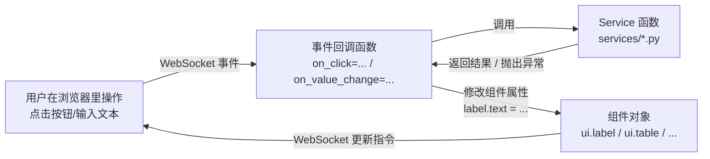

# 心智模型

本文档面向有 C/C++/Go/Rust 背景、熟悉基础 Python 语法、但不熟悉 Web
前端的读者，解释 NiceGUI 应用运行时到底发生了什么。全部结论均以本项目
实际安装、实际读过源码、实际跑过的 NiceGUI 3.18.0 为依据（具体文件路径
见 `docs/examples/09_multi_user_state.md` 与 `docs/security_review.md`
里引用的源码位置），不是凭记忆转述官方文档。

## 1. 应用运行模型：一个 NiceGUI 程序到底是什么

对一个习惯了 Tkinter/Qt 这类桌面 GUI 的读者，最大的心智转变是：**NiceGUI
程序本质上是一个 Web 服务器**（底层是 FastAPI + Uvicorn + Starlette 的
`SessionMiddleware`），不是一个直接控制某块屏幕像素的桌面程序。

```text
+------------------+        HTTP / WebSocket         +----------------------+
|  浏览器标签页 A    | <-----------------------------> |                      |
+------------------+                                 |                      |
+------------------+        HTTP / WebSocket         |  一个 Python 进程     |
|  浏览器标签页 B    | <-----------------------------> |  （运行 ui.run()）    |
+------------------+                                 |                      |
+------------------+        HTTP / WebSocket         |  - @ui.page 函数体    |
|  另一台电脑的浏览器 | <-----------------------------> |  - services/*        |
+------------------+                                 |  - infrastructure/*  |
                                                     +----------------------+
```

关键事实：

1. `ui.run()` 启动一个长期运行的 ASGI 服务进程，监听一个 TCP 端口
   （默认 8080）。这个进程在你按 Ctrl+C 之前会一直运行，这和桌面程序
   "关掉窗口=程序退出"完全不同。
2. 每当浏览器发出第一次 HTTP GET 请求访问某个 `@ui.page('/xxx')` 装饰的
   路径时，**对应的 Python 函数体会被重新执行一次**，为这次访问构建出
   一整套新的组件树；浏览器随后与服务端建立一条 WebSocket 连接，
   之后的交互（点击按钮、输入文本）都通过这条 WebSocket 双向传递事件和
   更新指令，而不是每次点击都发一次 HTTP 请求。
3. 一次 `curl http://.../xxx` 请求拿到的**不是**最终渲染出来的页面内容，
   而是一个空的 Vue/Quasar 应用外壳——真正的组件由客户端 JS 在建立
   WebSocket 连接后渲染出来（这正是本项目 `docs/architecture.md` 第 2 节
   解释的"为什么不能用 curl 验证渲染结果"的根本原因）。
4. 同一个进程会同时服务**所有**浏览器连接。这意味着任何写在模块级别的
   Python 变量（而不是 `@ui.page` 函数体内的局部变量）都会被所有连接共享
   ——这正是 `examples/09_multi_user_state.py` 要讲清楚的核心问题。

## 2. UI / 状态 / 事件 / Service 的关系



几个必须分清楚的"状态"：

| 状态存在哪 | 生命周期 | 典型例子 | 本项目对应示例 |
| --- | --- | --- | --- |
| 组件自己的属性（`.value`/`.text`） | 页面刷新/重新打开即丢失 | `ui.input().value` | 示例 2/3 |
| `@ui.page` 函数体内的局部变量/闭包 | 同上，天然按浏览器连接隔离 | 示例 7 的 `_PageState` | 示例 7 |
| 模块级 Python 变量 | 整个进程存活期间一直存在，**所有连接共享** | 示例 8 的 `_HISTORY`（反面教材，已在文档里承认局限） | 示例 8（局限）、示例 9（正式解法） |
| `app.storage.*` | 见下表，按作用域持久化/隔离 | 示例 9 的四个并排计数器 | 示例 9 |

"事件 -> Service -> UI"这条链路里，Service 函数**永远不直接操作任何
NiceGUI 组件**——它只接收普通 Python 参数、返回普通 Python 值或抛出
`services/errors.py` 里的异常；"怎么把这个值显示成一个 `ui.label` 还是
`ui.table`"完全是 UI 层的职责。这是本项目能做到"`services/`、`models/`、
大多数 `tests/` 完全不依赖 nicegui"的根本原因。

## 3. 异步执行模型：协程 / 阻塞调用 / 线程池 / 外部进程

NiceGUI 的事件循环是**单线程异步**的（基于 `asyncio`）。这意味着：如果
某个事件回调函数本身是阻塞的（例如直接调用 `time.sleep()` 或
`subprocess.run()`），**会卡住整个事件循环**——不只是这一个用户的页面卡住，
同一进程里其他所有用户的页面也会一起卡住，直到这次阻塞调用结束。

本项目用到的四种"耗时操作"处理方式，按使用场景分类：

| 场景 | 正确做法 | 本项目对应代码 |
| --- | --- | --- |
| 耗时操作本身就是协程（用 `await asyncio.sleep()` 模拟） | `from nicegui import background_tasks; background_tasks.create(coro, name=...)` 发起"即发即忘"任务；**绝不裸用 `asyncio.create_task()`**（没有强引用时可能被 GC 意外回收） | 示例 7（纯机制）、示例 8（接入 `test_service.run_test_suite()`） |
| 耗时操作是阻塞的 Python 函数（如 `subprocess.run()`） | `await run.io_bound(阻塞函数, *args)` 丢进线程池执行 | 示例 6 / `ui/command_panel.py` 调用 `command_service.run_command()` |
| 需要启动一个真正独立的外部进程、并实时读取其输出 | `asyncio.create_subprocess_exec()`（本身已是协程，可直接 `await` 或配合 `background_tasks.create()`） | `infrastructure/process_runner.stream_subprocess()`（已实现，作为练习留给读者在示例 6 里接入） |
| CPU 密集型纯计算（本项目未实际用到，仅作对比） | `await run.cpu_bound(函数, *args)` 丢进进程池执行 | — |

**"取消一个协程"与"终止一个外部进程"是两种本质不同的机制**，这一点在
示例 7/8/9 的文档里反复强调：

- **协作式取消**（`asyncio.Event`）：只是一个标志位，正在运行的协程需要
  在自己的循环里主动检查 `cancel_event.is_set()` 并决定提前退出——如果
  某一步忘了检查，取消请求会被无限期晾在一边。好处是可以在退出前做清理
  工作。
- **抢占式终止**（`proc.kill()` + `await proc.wait()`）：操作系统强制结束
  目标进程，不需要、也不可能"等它自己配合"，但目标进程来不及做任何清理。
  `infrastructure/process_runner.py` 在超时场景下使用的正是这种机制。

## 4. 多用户状态模型：五种 `app.storage.*` 的真实语义

以下结论全部来自**实际阅读**本项目 `.venv` 里安装的 `nicegui==3.18.0`
源码（`nicegui/storage.py`、`nicegui/ui_run.py`、
`nicegui/persistence/file_persistent_dict.py`）得出，详细的文件路径/行为
引用见 [`docs/examples/09_multi_user_state.md`](examples/09_multi_user_state.md)
第 2 节。

| 作用域 | 隔离粒度 | 是否持久化 | 是否需要 `storage_secret` |
| --- | --- | --- | --- |
| `app.storage.client` | 单次 WebSocket 连接（比标签页还短命，刷新即丢） | 否（纯内存） | 否 |
| `app.storage.tab` | 单个浏览器标签页（必须等 `await ui.context.client.connected()` 之后才能访问） | 否（纯内存） | 否 |
| `app.storage.user` | 单个浏览器/用户会话（同一浏览器多个标签页共享） | 是（默认落盘为 JSON） | 是 |
| `app.storage.browser` | 同 `user`，但数据直接放进加密 cookie，响应发出后不可再修改 | 是（cookie 本身） | 是 |
| `app.storage.general` | 所有用户共享（官方认可的"故意共享"，区别于"不小心用错的模块级全局变量"） | 是（默认落盘为 JSON） | 否 |

详见 `examples/09_multi_user_state.py` 的真实并排对比演示与
`tests/test_multi_user_state.py` 的真实多用户集成测试（使用独立
`httpx.AsyncClient` + 独立 cookie jar 模拟不同浏览器/用户）。

## 5. 本项目如何体现这些心智模型

- 示例 1~3：建立"事件 -> Python 回调 -> 修改组件"这条最基本的链路。
- 示例 4~6：引入 Service 层，展示"UI 不做任何业务判断"的分层方式。
- 示例 7~8：展示协程/线程池的正确用法与协作式取消。
- 示例 9：展示多用户状态隔离，并明确指出"模块级全局变量"这种反面教材
  在多用户场景下的真实后果。
- `app.py` + `ui/*.py`：把以上全部心智模型组装成一个真实可用的小工具。
