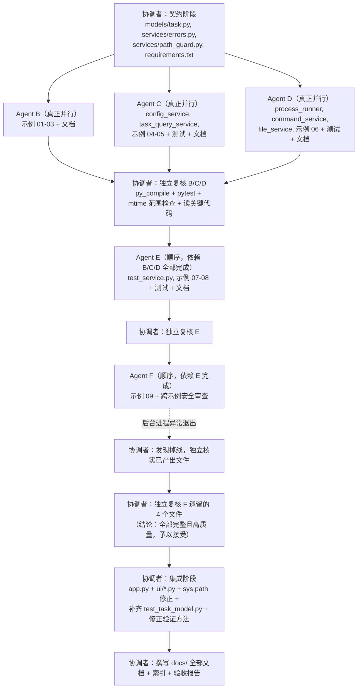

# Multitask 执行记录（真实发生的情况，而非计划本身）

本文档记录本项目并行开发的**实际执行过程**，包括哪些阶段真正并行、哪些是
顺序执行、过程中出现的真实问题（包括一次子代理掉线事故）及其处理方式，以及
集成阶段做过的全部契约修正。原始任务计划另见协调者使用的 Plan 文档（不在
本仓库内，按用户要求集成阶段不对其做任何修改）。

## 1. 实际使用的并行机制

本环境下真实可用的机制是 Cursor 的 `Task` 工具，`subagent_type` 使用
`generalPurpose`，`run_in_background: true`。真正的并行通过"在同一条回复
里一次性发出多个工具调用"实现（依据 `dispatching-parallel-agents` 技能
文档）。每一波任务的文件所有权严格互不重叠，确保并发写入者不会碰到同一个
文件。

## 2. 实际执行时间线



- **第一波（B、C、D）**：真正并行——三个 `Task` 调用在同一条消息里一次性
  发出，各自只写互不重叠的文件清单。
- **第一波后的复核**：协调者对三个子代理的交付逐一独立复核（重新执行
  `py_compile`/`pytest`，用文件修改时间戳确认没有越权写文件，通读安全
  相关代码），确认无误后才进入下一波。
- **第二波（E）**：顺序执行，真实依赖第一波的产出（`models/task.py` 的
  冻结契约、Agent D 产出的 `command_service`/`process_runner`，用于
  "示例 8 需要明确区分模拟与真实"这一要求）。
- **第二波后的复核**：同上，独立复核 E 的交付。
- **第三波（F）**：顺序执行，依赖 E 完成的示例 8（`_HISTORY` 的"已知局限"
  需要被示例 9 正式解决）以及此时已经稳定下来的全部代码（用于跨示例安全
  审查）。
- **第四波（协调者本人）**：整合、补漏、验证、撰写文档。

## 3. 真实问题 1：Agent F 的后台进程掉线

Agent F 被派发后在后台运行；在协调者于中途检查时，其后台 shell 已经在
真实执行一次"用 nohup+disown 启动示例 9、curl 探测、准备停止"的冒烟测试
（这一步本身被协调者实时观察到并确认是 Agent F 自己工作流程的一部分，
不是异常）。但在后续更长时间之后，该子代理的任务转录文件停止更新超过
1.5 小时，且系统中已经没有任何与之相关的运行进程，也始终没有收到
正常的"子代理已完成"结构化通知——**它在真正完成最终交付报告之前异常
终止了**（具体原因不明：可能是会话边界、沙箱重启或其他基础设施问题，
超出协调者可诊断的范围）。

按照用户"若后台任务未能及时完成，应及时退出进行下一步"的明确指示，
协调者没有继续等待，而是：

1. 核实 Agent F 已经创建的文件是否完整存在：
   `examples/09_multi_user_state.py`、`docs/examples/09_multi_user_state.md`、
   `docs/security_review.md`、`tests/test_multi_user_state.py` —— 四个文件
   全部存在，且从内容上看逻辑完整、有结尾（不是写到一半的残篇）。
2. 独立重新执行验证，而不是信任任何未收到的自我报告：
   - `python3 -m py_compile` 全部通过。
   - 用项目的 `.venv`（Agent F 创建、已安装 `nicegui==3.18.0`）运行
     `pytest -q tests/test_multi_user_state.py`：**3 个真实的多用户集成
     测试全部通过**（使用独立 `httpx.AsyncClient` + 独立 cookie jar 模拟
     不同浏览器/标签页，真实验证 `app.storage.tab`/`.user`/`.general`
     的隔离/共享语义）。
   - 用文件修改时间戳确认 Agent F 没有越权修改任何不属于它的文件。
   - 通读 `examples/09_multi_user_state.py`、`tests/test_multi_user_state.py`
     与 `docs/security_review.md` 全文，确认：内容真实、结论均标注了
     具体的源码引用路径（而非凭记忆），且其中记录了一次真实复现的
     `RuntimeError: app.storage.tab can only be used with a client
     connection`（已在代码里修正为"先占位、等 `await
     ui.context.client.connected()` 之后再填充"的写法）。
3. 结论：**尽管这个子代理没有完成最终的结构化交付握手，但它实际产出的
   工作本身是完整、经过真实验证、高质量的**，予以接受，不重新派发。这是
   一个关于"交付协议"与"实际产出质量"要分开判断的真实教训——协议层面的
   失败（没有收到报告）不等于工作本身失败，但也必须靠协调者自己重新
   独立验证，而不能跳过复核直接采信。

## 4. 真实问题 2：`examples/*.py` 直接运行时的 `ModuleNotFoundError`

Agent F 在 `docs/examples/09_multi_user_state.md` 的 Execution 一节里
如实记录了一个顺带发现的现象：`examples/04/05/06/08/09` 这几个会
`import models`/`import services` 的示例，如果直接用
`python3 examples/0N_xxx.py` 启动（而不是设置 `PYTHONPATH=.`），会抛出
`ModuleNotFoundError: No module named 'models'`（或 `'services'`）——
原因是 Python 只会把"脚本自身所在目录"（即 `examples/`）加入
`sys.path`，不包含项目根目录。

协调者在集成阶段真实复现了这个问题（`.venv/bin/python3
examples/04_config_checker.py` 报错），并在以下 5 个文件的 import 区块
前面加入了统一的 sys.path 自举代码：

```python
_PROJECT_ROOT = Path(__file__).resolve().parent.parent
if str(_PROJECT_ROOT) not in sys.path:
    sys.path.insert(0, str(_PROJECT_ROOT))
```

修正文件：`examples/04_config_checker.py`、`examples/05_task_table.py`、
`examples/06_command_console.py`、`examples/08_test_console.py`、
`examples/09_multi_user_state.py`。修正后重新验证：
`.venv/bin/python3 examples/04_config_checker.py`（不设置
`PYTHONPATH`）可以正常启动并返回 `NiceGUI ready to go on
http://localhost:8080`，且全部 5 个文件的 `py_compile` 与相关 `pytest`
均重新跑过一遍，无回归。`app.py` 本身不需要这个修正——它位于项目根目录，
脚本自身所在目录就是项目根目录。

## 5. 真实问题 3：最初设想的"curl + 检查 HTML"验证方法本身是错的

最初的验证计划设想"用 `curl` 请求页面、在返回的原始 HTML 里确认某个
`.mark()` 元素的文本确实出现"。协调者在集成阶段真实启动 `app.py`
（临时监听 18080 端口）并执行：

```bash
curl -s -o /tmp/app_smoke_body.html -w 'HTTP %{http_code}\n' http://127.0.0.1:18080/
grep -o 'dashboard-title' /tmp/app_smoke_body.html
```

结果：HTTP 状态码确实是 `200`，`<title>` 标签内容正确，但 `grep` **没有
匹配到任何 `.mark()` 文本**——人工检查返回的 HTML 后确认，NiceGUI 3.18
的首次响应只是一个空的 Vue/Quasar 应用外壳，真正的组件要等浏览器建立
WebSocket 连接后才会由客户端渲染出来。这意味着最初的验证计划本身的
假设不成立：`curl` 能证明"进程启动、路由没有返回 500"，但不能证明
"页面真的渲染出了预期的组件"。

修正做法：改用 NiceGUI 官方提供的 `nicegui.testing.User` /
`user_simulation()`（Agent F 已经在 `tests/test_multi_user_state.py` 里
验证过这套机制真实可用），新增 `tests/test_app_integration.py`，对
`app.py` 主页面与全部 9 个 `examples/*.py` 做真实的无头渲染验证（不是
只验证语法/启动，而是验证关键 `.mark()` 元素确实可见）。过程中还发现
一处"假阳性"：`examples/08_test_console.py` 的 `history-table` 在历史
为空时被 `set_visibility(False)` 隐藏是**正确行为**（改为展示
`history-empty-state`），而不是渲染失败——最初写的断言搞错了应该检查
哪个 marker，被真实的测试失败纠正，调整断言后 10 个测试全部通过。

## 6. 真实问题 4：`tests/test_task_model.py` 的缺口

协调者在集成阶段核对最终目录结构时，发现最初规划的目录树里包含
`tests/test_task_model.py`，但这个文件在整个并行开发过程中始终没有被
任何一个子代理创建（`models/task.py` 的行为此前只在契约阶段用一次性
shell 命令手动验证过，没有固化成一个会被 `pytest` 持续收集的测试文件）。
协调者据此补写了 `tests/test_task_model.py`，覆盖 `can_transition()`/
`is_terminal()`/`TaskRecord.transition_to()`/`append_log()`/`new_task()`，
共 27 个测试，全部通过（不依赖 nicegui，用系统 Python 直接可跑）。

## 7. 最终的真实验证结果（集成阶段结束时）

```bash
$ .venv/bin/python3 -m compileall -q app.py examples ui models services infrastructure tests
# 无输出 = 全部编译通过

$ .venv/bin/python3 -m pytest -q
........................................................................ [ 87%]
..........                                                               [100%]
82 passed, 1 warning in 5.07s
```

按文件拆分的测试数量：

| 测试文件 | 数量 | 是否需要 nicegui |
| --- | --- | --- |
| `tests/test_task_model.py` | 27 | 否 |
| `tests/test_command_service.py` | 16 | 否 |
| `tests/test_task_query_service.py` | 11 | 否 |
| `tests/test_config_service.py` | 8 | 否 |
| `tests/test_test_service.py` | 7 | 否 |
| `tests/test_app_integration.py` | 10 | 是（无头渲染 `app.py` + 全部 9 个示例） |
| `tests/test_multi_user_state.py` | 3 | 是（真实多用户 httpx 集成测试） |
| **合计** | **82** | — |

唯一的警告：`services/test_service.py:74` 处 pytest 把冻结契约里命名为
`TestCase` 的 `@dataclass(frozen=True)` 误判为"测试类"并尝试收集（因为
类名以 `Test` 开头、又带 `__init__`）。这是一个纯粹的命名巧合导致的
`PytestCollectionWarning`，不影响任何测试的收集或执行结果，不重命名
`TestCase` 是因为这是契约阶段冻结、且已被示例 7/8/9 与多份文档引用的
公共类型，重命名的影响范围超出集成阶段的职责。记录于此，供后续维护者
知悉。
