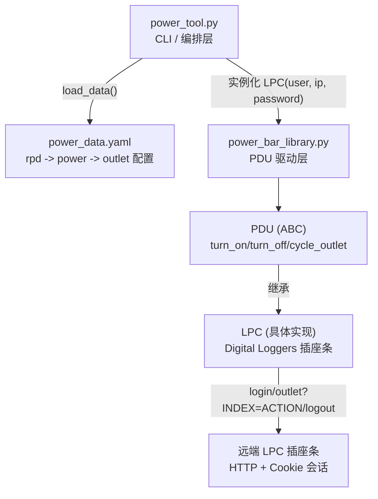
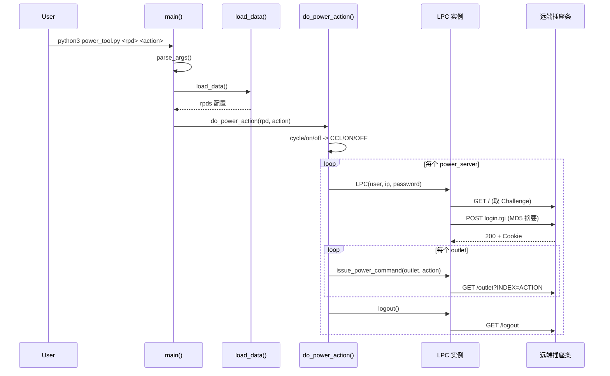

# power_control：远程电源控制工具实现总结

对 [power_tool.py](power_tool.py) / [power_bar_library.py](power_bar_library.py) / [power_data.yaml](power_data.yaml) 的实现分析，并提炼出可复用的代码模板、心智模式与最佳实践。

---

## 1. 概述

`power_control` 是一个命令行工具，用于按 YAML 配置对 RPD（Remote PHY Device）背后挂载的
Digital Loggers **LPC** 远程电源插座条（PDU, Power Distribution Unit）执行开机（`on`）、
关机（`off`）、重启（`cycle`）操作。

典型用法：

```bash
python3 power_tool.py astatine cycle   # 重启 astatine 这台 RPD 的所有电源插座
python3 power_tool.py all off          # 关闭所有 RPD 的电源插座
```

## 2. 架构图



- `power_tool.py`：只做参数解析、配置加载、动作分发，不直接碰 HTTP。
- `power_bar_library.py`：定义厂商无关的 `PDU` 接口，`LPC` 是其中一个具体厂商实现。
- `power_data.yaml`：纯数据，描述"哪个 RPD 对应哪几个电源控制器的哪些插座"。

## 3. 核心执行流程



对应源码（[power_tool.py:69-71](power_tool.py)）：

```69:71:python/power_control/power_tool.py
def main():
	args = parse_args()
	data = load_data()
```

## 4. 关键实现细节

### 4.1 PDU 抽象基类：厂商适配层

```8:38:python/power_control/power_bar_library.py
class PDU(ABC):
    def __init__(self, **kwargs):
        self.user = kwargs.pop('user_name', None)
        self.ip = kwargs.pop('ip_address', None)
        self.password = kwargs.pop('password', None)
        if self.user is None or self.ip is None or self.password is None:
            raise ValueError("'user_name', 'password' and 'ip address' are required to create PDU.")
        self.disabled_outlet = {}
        self.outlet_index_map = None
        self.outlets = {}
    @abstractmethod
    def turn_off_outlet(self, outlet_index:str) -> bool:
        pass
    @abstractmethod
    def turn_on_outlet(self, outlet_index:str) -> bool:
        pass
    @abstractmethod
    def cycle_outlet(self, outlet_index:str) -> bool:
        pass
```

用 `ABC` + `@abstractmethod` 把"开/关/重启一个插座"定义成厂商无关的协议接口，
`LPC` 是当前唯一的具体实现。以后要支持别的品牌 PDU，只需要新增一个子类实现这三个方法，
`power_tool.py` 里的调用方代码完全不用改。

### 4.2 MD5 Challenge-Response 认证 + Cookie 会话

```61:74:python/power_control/power_bar_library.py
get_res = requests.get(self.host, timeout=DEF_REST_TIMEOUT)
matches = findall('name="Challenge" value=".*"', get_res.text)
if matches:
    challenge_value = matches[0].split('=')[2][1:-1]
    h = hashlib.new('md5', bytearray(challenge_value+self.user+self.password+challenge_value, 'utf-8'))
    remote_power_password = h.hexdigest()
    post_res = requests.post(self.host+'login.tgi', data={'Username':self.user,'Password': remote_power_password},
                             timeout=DEF_REST_TIMEOUT)
    if post_res.status_code == 200:
        self.cookies = post_res.cookies
```

先 `GET` 首页拿到设备返回的一次性 `Challenge` 值，再用
`MD5(challenge + user + password + challenge)` 算出一次性摘要去登录 —— 这是设备侧要求的
挑战-应答认证方式（避免明文密码在网络上传输），登录成功后把返回的 `Cookie` 存到实例上，
后续每次操作插座都带着这个 Cookie。

### 4.3 会话生命周期：login 在构造函数里，logout 需要手动调用

`LPC.__init__` 里直接调用了 `self.login()`（[power_bar_library.py:56](power_bar_library.py)），
即"构造即登录"；而 `logout()` 需要调用方显式调用
（见 [power_tool.py:67](power_tool.py) 的 `power_device.logout()`）。这类似 context manager
的语义（获取资源、使用、释放资源），但目前**没有**用 `with` 语句或 `try/finally` 包裹，
如果 `issue_power_command` 在循环中抛异常，`logout()` 会被跳过，Cookie 会话不会被主动释放。

## 5. 通用代码处理模板与心智模式

对应引用代码（[power_tool.py:70-71](power_tool.py)）：

```70:71:python/power_control/power_tool.py
	args = parse_args()
	data = load_data()
```

### 5.1 模板：CLI 工具的 "Parse → Load → Validate → Dispatch" 四段式骨架

这两行看似简单，但体现了一个非常通用、值得沉淀成模板的 CLI 编排心智模式。把
`power_tool.py` 的 `main()` 抽象出来，就是下面这个骨架：

```python
def main():
    # 1. Parse：只做命令行解析，不做业务判断
    args = parse_args()

    # 2. Load：加载外部配置/数据源，与命令行参数解耦
    data = load_data()

    # 3. Validate：校验数据结构 + 校验参数指向的目标是否存在
    if 'rpds' not in data:
        print('...', file=sys.stderr)
        sys.exit(1)

    target = resolve_target(data, args.rpd)  # 找不到就报错退出

    # 4. Dispatch：把已校验好的输入，转交给纯业务函数
    do_action(target, args.action)
```

四个阶段职责单一、互不干扰：

| 阶段 | 函数 | 职责 | 不应该做的事 |
|---|---|---|---|
| Parse | `parse_args()` | 定义/解析 CLI 参数 | 不读文件、不做业务校验 |
| Load | `load_data()` | 读取外部配置（YAML/JSON/DB） | 不关心命令行参数是什么 |
| Validate | `main()` 内联判断 | 校验数据结构、目标是否存在 | 不执行具体的业务动作 |
| Dispatch | `do_power_action()` | 把动作码映射并转发给驱动层 | 不解析参数、不读配置文件 |

### 5.2 心智模式：编排层要"薄"（thin orchestrator）

`main()` 全程没有一行 HTTP 请求、没有一行 YAML 解析细节，它只是把已经准备好的
`args` 和 `data` 传递下去。这是一种"胶水代码应保持薄"的心智模式：

- **编排层（orchestrator）**：只做流程控制和参数传递（`main`、`do_power_action`）。
- **数据层（data）**：只关心如何拿到干净的数据（`load_data`、`parse_args`）。
- **驱动层（driver）**：只关心如何跟外部系统交互（`LPC` 类）。

好处是每一层都可以独立测试：`parse_args()`/`load_data()` 可以用假数据单测，
`do_power_action` 可以 mock 掉 `LPC` 来测试分发逻辑是否正确，而不需要真的连一台设备。

反例（同一份代码里的真实 bug，恰好说明"编排层也需要测试"）：

```87:87:python/power_control/power_tool.py
		print("Performing {args.action} for all RPDs")
```

这一行漏了 `f` 前缀，`{args.action}` 不会被替换成实际值，只会原样打印。这类"看起来能跑、
输出却是错的"的问题，正是薄编排层缺少单元测试时最容易漏掉的一类 bug —— 逻辑本身没错，
错在"胶水"部分的字符串格式化，而这恰恰是最容易被忽视、又最该被测试覆盖的部分。

## 6. 最佳实践技巧

对应引用代码（[power_bar_library.py:22-24](power_bar_library.py)）：

```22:24:python/power_control/power_bar_library.py
        self.user = kwargs.pop('user_name', None)
        self.ip = kwargs.pop('ip_address', None)
        self.password = kwargs.pop('password', None)
```

### 6.1 技巧：`**kwargs` + `pop(key, default)` 实现"可预处理的必需参数"

这段代码用了一个很实用的组合拳：

1. 基类构造函数接受 `**kwargs`，而不是显式具名参数 `(user_name, ip_address, password)`。
2. 用 `kwargs.pop(key, None)` 取值——既取出了值，又不会因为 key 不存在而报 `KeyError`。
3. 取完之后立刻做 fail-fast 校验，任何一个必需字段缺失就抛 `ValueError`，绝不允许对象
   带着不完整状态被创建出来。

这样设计的关键收益在子类里体现出来（[power_bar_library.py:50-53](power_bar_library.py)）：

```50:53:python/power_control/power_bar_library.py
    def __init__(self,**kwargs):
        if kwargs.get('password', None) is None:
            kwargs['password'] = kwargs.get('user_name', None)
        super().__init__(**kwargs)
```

`LPC` 子类可以在调用 `super().__init__(**kwargs)` **之前**，对 `kwargs` 字典做拦截和改写
（这里是"密码缺省等于用户名"的业务规则），然后再整体转交给基类做统一校验。如果基类用的是
显式具名参数 `def __init__(self, user_name, ip_address, password)`，子类就没有这种"先改写
再转发"的空间，必须把默认值逻辑写死在参数默认值里，或者重复一遍校验逻辑。

**取舍**：这种写法牺牲了类型提示和 IDE 自动补全（看函数签名看不出到底需要哪些参数，
必须读 docstring 或者实现），换来了子类拦截、改写关键字参数的灵活性。如果不需要这种
"子类预处理"的场景，`dataclass` 或 `attrs`（配合 `field(default=...)`）通常是更现代、
类型更安全的替代方案；但如果本来就要支持"多个子类、各自有不同的默认值填充规则"，
`**kwargs` + `pop` + fail-fast 校验仍然是一个务实的选择。

### 6.2 技巧：抽象基类定义"可插拔驱动"接口

`PDU(ABC)` + `@abstractmethod` 把厂商差异隔离在子类里，调用方（`power_tool.py`）永远只面向
`PDU` 接口编程（`power_device.cycle_outlet(outlet)`），不关心背后是哪个品牌的设备。
新增一个品牌只需要：

```python
class NewBrandPDU(PDU):
    def turn_off_outlet(self, outlet_index: str) -> bool: ...
    def turn_on_outlet(self, outlet_index: str) -> bool: ...
    def cycle_outlet(self, outlet_index: str) -> bool: ...
```

`power_tool.py` 的 `do_power_action` 一行都不用改。

### 6.3 其他值得留意的小技巧

- **脚本自定位资源文件**：`SCRIPT_DIR = Path(__file__).resolve().parent`
  （[power_tool.py:12](power_tool.py)），确保无论从哪个工作目录运行脚本，
  都能正确找到同目录下的 `power_data.yaml`，而不依赖当前工作目录（cwd）。
- **统一的超时常量**：`DEF_REST_TIMEOUT = 20`（[power_bar_library.py:7](power_bar_library.py)），
  所有 `requests` 调用共用一个超时值，避免网络请求无限期挂起，也方便以后统一调参。
- **布尔返回值 + 状态码判断的简单错误处理模式**：`turn_on_outlet`/`turn_off_outlet`/
  `cycle_outlet` 都用 "`status_code == 200` 则返回 `True`，否则返回 `False`" 的模式，
  调用方通过返回值就能判断操作是否成功，不需要处理异常，是一种轻量但足够用的错误处理方式。

## 7. 已发现的潜在改进点（仅记录，本次未修改代码）

- 电源设备密码以明文形式保存在 [power_data.yaml](power_data.yaml) 中，存在安全隐患。
- [requirements.txt](requirements.txt) 只声明了 `pyyaml`，但代码里实际用到的
  `requests`、`beautifulsoup4`（`bs4`）并未列出，新环境安装依赖会直接报错。
- 所有 `requests.get/post` 调用都没有捕获网络异常（超时、连接失败等会直接抛出未处理的
  `requests.exceptions.*`，导致整个脚本崩溃退出）。
- `logout()` 没有用 `try/finally` 保护，如果 `issue_power_command` 在循环中途抛异常，
  远端会话不会被释放。
- `PDU` 基类里的 `disabled_outlet`、`outlet_index_map`、`outlets` 三个属性目前没有被
  `LPC` 或调用方实际使用，用途不明确，后续可以确认是否为预留扩展位或可以清理的死代码。
