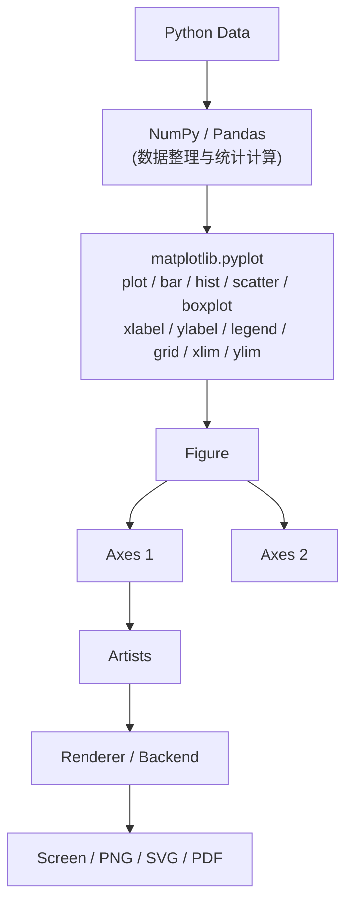
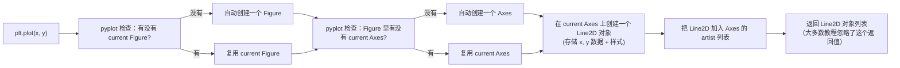

# 00. pyplot 总览：它到底是什么

## Why（为什么要先建立这个模型）

大多数人学 `matplotlib.pyplot` 的方式是"查一个函数、抄一段代码、能跑就行"。这样做的问题是：一旦场景稍微复杂（多子图、双 Y 轴、动态生成图表数量），代码就会开始出错，而你不知道错在哪里，因为你脑子里没有"这些函数到底在操作什么对象"的模型。

所以在看任何一个 API 之前，必须先回答一个问题：

> `plt.plot(...)` 这一行代码执行的时候，到底发生了什么？

## Architecture（整体架构）

先看数据是怎么一步步变成屏幕上的像素/文件里的图像的：



这张图里有 7 个关键概念，必须先分清楚它们各自是什么、彼此是什么关系：

| 概念 | 是什么 | 类比 |
|---|---|---|
| `pyplot` | Matplotlib 提供的一个**模块**，里面是一组"状态式"的便捷函数 | 遥控器 |
| `Figure` | 整张画布/整个窗口，一次 `savefig` 保存的就是一个 `Figure` | 一张纸 |
| `Axes` | 画布里的一个**绘图区域**（有坐标系、有刻度），一个 `Figure` 可以有多个 `Axes` | 纸上的一个格子 |
| `Axis` | `Axes` 里的**某一根坐标轴**（x 轴或 y 轴对象），注意 `Axes`(有 s，绘图区域) 和 `Axis`(坐标轴) 是两个完全不同的对象，拼写很像但含义不同 | 格子的边框刻度 |
| `Artist` | 所有"画在 `Axes` 上的东西"的统称：线（`Line2D`）、文字（`Text`）、矩形（`Rectangle`/`Patch`）、图例（`Legend`）… | 纸上的每一笔 |
| `backend` | 决定"图最终画到哪里"的引擎：弹出窗口（`TkAgg`/`Qt5Agg`）、无 GUI 静态渲染（`Agg`）、内嵌到 Notebook（`inline`）等 | 打印机型号 |
| `renderer` | backend 内部真正做"把 Artist 画成像素"这件事的组件 | 打印机的打印头 |

对象包含关系可以画成一棵树：

```text
Figure
 ├── Axes
 │    ├── X Axis
 │    ├── Y Axis
 │    ├── Line2D（plot 产生）
 │    ├── Text（title/xlabel/annotate 产生）
 │    ├── Legend（legend 产生）
 │    └── ...
 │
 └── Axes
      └── ...
```

## Lifecycle（`plt.plot(...)` 这一行到底做了什么）

这是本节最核心的问题。不要把它理解成"画一条线"，而要理解成一条**对象操作链**：



用文字再说一遍这条链路：

```text
plt
 ↓  (pyplot 内部维护一个"当前状态")
current Figure
 ↓
current Axes
 ↓
create/update Line2D   ← 这一步才是"画线"真正发生的地方
 ↓
（等到 show() / savefig() 触发）render
```

**关键认知**：`plt.plot()` 本身并不会立刻把像素画到屏幕/文件上。它只是往 `Axes` 里添加/更新了一个 `Line2D` 这个 Artist 对象。真正的"渲染"（把 Artist 变成像素）发生在 `plt.show()` 或 `fig.savefig()` 被调用、backend 的 `renderer` 介入的那一刻。

## Relationship（关系澄清）

- `pyplot` 不持有绘图数据本身，它只是**代持有一个"当前活跃的 Figure/Axes 是哪个"的全局状态**，然后把你调用的函数转发给这个 `Axes` 对象的对应方法。
- 一个 `Figure` 可以有 0 个、1 个或多个 `Axes`；一个 `Axes` 属于且只属于一个 `Figure`。
- 一个 `Axes` 可以有任意多个 `Artist`（多条线、多个文字、一个图例等）。
- `backend` 和 `renderer` 是"下游"的东西，正常写分析代码时几乎不用关心，除非遇到"图不显示"之类的环境问题（见 [08_failure_and_debug.md](08_failure_and_debug.md)）。

## Data Flow（数据从哪来，图从哪去）

```text
你的原始数据（list / np.ndarray / pd.Series / pd.DataFrame）
      │  作为参数传入
      ▼
plt.plot(x, y) / ax.plot(x, y)
      │  被复制/引用进 Line2D 内部
      ▼
Axes.artists（该 Axes 上所有 Artist 的集合）
      │  render() 时被遍历
      ▼
Renderer 把每个 Artist 转成像素
      │
      ▼
屏幕窗口 / PNG / SVG / PDF 文件
```

## State（本节要记住的状态模型）

pyplot 内部维护着两层"当前指针"：

```text
matplotlib.pyplot（模块级全局状态）
      │
      ▼
current Figure（"最近一次创建或激活的 Figure"）
      │
      ▼
current Axes（"该 Figure 里最近一次创建或激活的 Axes"）
```

之后所有裸调用的 `plt.xxx()`，本质上都是：“找到 current Axes，在它上面调用对应的方法”。这一点在 [01_two_apis.md](01_two_apis.md) 会展开讲。

## Failure（本节常见误区）

| 误区 | 正确理解 |
|---|---|
| "`plt.plot()` 就是把线画到屏幕上" | 实际上只是创建/更新了 `Line2D` 这个对象，真正渲染发生在 `show()`/`savefig()` |
| "`Axes` 和 `Axis` 是同一个东西" | `Axes`(带 s) 是绘图区域；`Axis`(不带 s) 是坐标轴对象，是 `Axes` 的一个属性 |
| "pyplot 和 Matplotlib 是两个不同的库" | `pyplot` 只是 `matplotlib` 包里的一个模块，是它的高层状态式接口，不是独立的库 |
| "一个 Figure 只能有一个图" | 一个 `Figure` 可以通过 `subplots()` 包含任意多个 `Axes`，即任意多张子图 |

## 下一步

理解了"对象是谁、谁包含谁、`plot()`发生了什么"之后，下一步要建立两个并行存在的编程接口风格：**状态机接口（pyplot）** 和 **面向对象接口（OO API）**。见 [01_two_apis.md](01_two_apis.md)。
