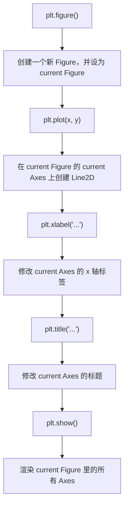

# 01. 两个并行的心智模型：状态机接口 vs 面向对象接口

## Why

Matplotlib 的教程和网上代码里，你会同时看到两种风格：

```python
# 风格 A
plt.figure()
plt.plot(x, y)
plt.xlabel("x")
plt.title("...")
plt.show()
```

```python
# 风格 B
fig, ax = plt.subplots()
ax.plot(x, y)
ax.set_xlabel("x")
ax.set_title("...")
plt.show()
```

如果不理解这两者的关系，你会：
- 不知道该用哪一种；
- 在混用两种风格时（这是允许的，但要理解原理）出现"改错对象"的 bug；
- 看不懂为什么有的函数叫 `xlabel()`，有的叫 `set_xlabel()`。

## Mental Model A：Pyplot 是"状态机式接口"

### 架构



用状态图来看，pyplot 本质上一直在操作**同一个隐式对象**：

```text
Current Figure
      │
      ▼
Current Axes
      │
      ▼
plt.plot()  ──┐
plt.title() ──┼──→ 都在修改 Current Axes
plt.xlabel()──┤
plt.grid()  ──┘
```

**关键认知**：`plt.plot()`、`plt.title()`、`plt.xlabel()`、`plt.grid()` 这些函数**不需要你显式传入 Figure/Axes**，是因为它们内部都在做同一件事——先找到"当前"的 Figure 和 Axes，再把调用转发给它。可以理解成：

```python
# plt.title("hello") 大致等价于：
plt.gcf().gca().set_title("hello")
# gcf = get current figure, gca = get current axes
```

### 使用场景

- 快速在 REPL / Jupyter 里试验一张简单图；
- 只有一张 `Axes` 的临时脚本、教学演示。

### 最容易犯的错误

- **在多子图场景下混淆"当前 Axes"**：调用 `plt.subplot(2,1,1)` 之后，后续的 `plt.plot()` 都画到第一个子图；如果忘了切换 `plt.subplot(2,1,2)`，第二个子图就会是空的，而你以为自己已经画了。
- **在循环里生成多张图却一直用裸 `plt.xxx()`**：容易把不同循环轮次的内容画到同一个 `Axes` 上，而不是各自独立的图。

### 排查方法

```python
print(plt.gcf())   # 看当前 Figure 是谁
print(plt.gca())   # 看当前 Axes 是谁
print(plt.gcf().axes)  # 看当前 Figure 里有几个 Axes
```

## Mental Model B：Object-Oriented（OO）API

### 架构

```python
fig, ax = plt.subplots()

ax.plot(x, y)
ax.set_title("...")
ax.set_xlabel("...")
ax.grid(True)
```

这里 `fig` 和 `ax` 是**显式的 Python 对象**，你直接调用它们的方法，不再依赖"当前指针"。对象关系图：

```text
Figure
 ├── Axes
 │    ├── X Axis
 │    ├── Y Axis
 │    ├── Line2D
 │    ├── Text
 │    ├── Legend
 │    └── ...
 │
 └── Axes
      └── ...
```

### pyplot API 与 OO API 的对照表

| pyplot（隐式，操作 current Axes） | OO API（显式，操作指定 Axes） | 备注 |
|---|---|---|
| `plt.plot(x, y)` | `ax.plot(x, y)` | 完全一致的绘图逻辑 |
| `plt.title(s)` | `ax.set_title(s)` | 注意 OO 版本前面多了 `set_` |
| `plt.xlabel(s)` | `ax.set_xlabel(s)` | 同上 |
| `plt.ylabel(s)` | `ax.set_ylabel(s)` | 同上 |
| `plt.xlim(a, b)` | `ax.set_xlim(a, b)` | 同上 |
| `plt.grid(True)` | `ax.grid(True)` | 名字相同，因为 `Axes.grid` 本身就叫这个名字 |
| `plt.legend()` | `ax.legend()` | 同上 |
| `plt.figure()` | `fig = plt.figure()` | pyplot 版本不返回也能用，因为它设为了 current |

**规律**：pyplot 里那些"设置属性"的函数，在 OO API 里几乎都变成了 `ax.set_xxx()`；而那些"添加内容"的函数（`plot/bar/hist/scatter/legend/grid`），在 OO API 里方法名不变，只是从 `plt.` 换成 `ax.`。

### 为什么工程代码应该优先用 OO API

1. **可以同时操作多个 Axes，不依赖"当前指针"**，例如 `axes[0].plot(...)`、`axes[1].plot(...)`，不用来回切换"current"。
2. **函数签名里显式写出 `fig`/`ax`，代码可读性和可维护性更强**，尤其是把绘图逻辑封装成函数时：
   ```python
   def plot_latency(ax, latency):
       ax.hist(latency, bins=30)
       ax.set_title("Latency Distribution")
   ```
   这个函数不依赖任何全局状态，可以被安全地在任意上下文调用、测试、复用。
3. **多线程/多进程场景下更安全**（pyplot 的全局状态在这些场景下容易出问题）。

### 使用场景

- 任何超过"一张简单图"的场景：多子图、dashboard、封装成函数/类的绘图代码、需要单元测试的绘图逻辑。

### 最容易犯的错误

- 忘记 `ax.set_xlabel()` 前面的 `set_`，误写成 `ax.xlabel()`（会报 `AttributeError`，因为 `Axes` 对象没有这个方法，只有 `set_xlabel`）。
- 在 `plt.subplots(2, 2)` 场景下，`axes` 是一个二维 `numpy.ndarray`，需要 `axes[0, 0]` 而不是 `axes[0]`；容易和 `plt.subplots(2, 1)`（一维数组）搞混。

### 排查方法

```python
print(type(axes))     # numpy.ndarray 还是单个 Axes？
print(axes.shape)     # 多维时确认下标怎么取
```

## 关键结论

> pyplot 不是另一套完全不同的绘图库，它主要是 Matplotlib 的高层状态式接口；`plt.subplots()` 本身也是 pyplot 提供的函数，它的作用是"帮你创建好 Figure/Axes 对象，然后把它们显式地返回给你"，之后你就切换到了 OO 写法。

也就是说：**pyplot 和 OO API 不是两个互斥的世界**，`plt.subplots()` 正是这两者的桥梁——用 pyplot 的便捷函数创建对象，再用 OO 方法操作对象。这也是本教程后续所有示例统一采用的写法：

```python
fig, ax = plt.subplots()   # ← pyplot：创建对象
ax.plot(...)                # ← OO：操作对象
ax.set_title(...)           # ← OO：操作对象
plt.show()                   # ← pyplot：触发渲染/展示（这个动作本身就是全局的，没有"OO版"）
```

## 下一步

理解了两套 API 的关系后，下一步要把"画一张图"看作一个完整的生命周期，见 [02_lifecycle.md](02_lifecycle.md)。
