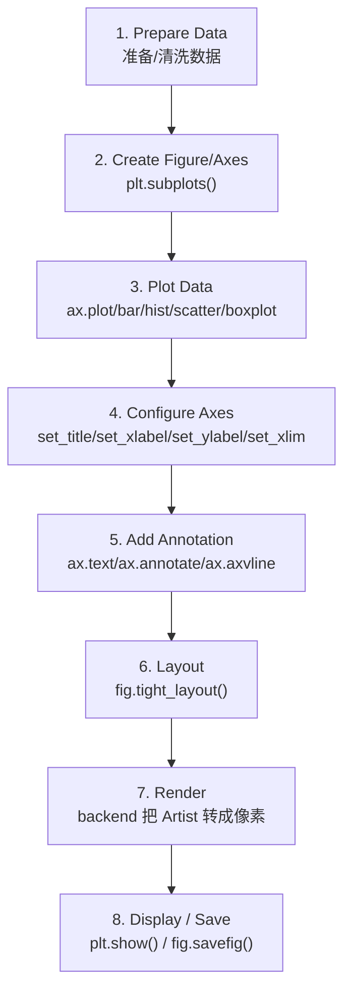

# 02. 完整绘图 Lifecycle

## Why

如果你只会"复制一段代码改改数字"，遇到新场景时会不知道该往哪加代码。但如果你脑子里有一条固定的"生命周期"，任何新图都只是往这条链路里填内容。

## Lifecycle 总览



## 端到端示例

```python
import numpy as np
import matplotlib.pyplot as plt

# --- 1. Prepare Data ---
x = np.arange(1, 31)
y = 100 + 20 * np.sin(x / 3) + np.random.normal(0, 5, size=len(x))

# --- 2. Create Figure/Axes ---
fig, ax = plt.subplots(figsize=(9, 5))

# --- 3. Plot Data ---
ax.plot(x, y, marker="o", linewidth=1.5, label="signal")

# --- 4. Configure Axes ---
ax.set_title("Lifecycle Demo")
ax.set_xlabel("x")
ax.set_ylabel("y")

# --- 5. Add Annotation ---
ax.axhline(y.mean(), color="gray", linestyle="--", label="mean")

# --- 6. Layout ---
ax.grid(True, alpha=0.3)
ax.legend()
fig.tight_layout()

# --- 7 & 8. Render + Display/Save ---
fig.savefig("lifecycle_demo.png", dpi=150, bbox_inches="tight")
plt.show()
```

## 逐步骤：修改了哪个对象？

| 步骤 | 代码 | 被修改/创建的对象 | 说明 |
|---|---|---|---|
| 1. Prepare Data | `x = ...; y = ...` | 纯 Python/NumPy 对象，还没进入 Matplotlib | 这一步和 Matplotlib 完全无关，是"数据整理"阶段 |
| 2. Create Figure/Axes | `fig, ax = plt.subplots()` | 创建 `Figure` 对象和 `Axes` 对象 | 此时画布是空的，没有任何数据被画上去 |
| 3. Plot Data | `ax.plot(x, y, ...)` | 在 `ax` 上创建一个 `Line2D` Artist，加入 `ax.lines` | 这一步是"数据 → 图形编码"真正发生的地方 |
| 4. Configure Axes | `ax.set_title/xlabel/ylabel` | 修改 `Axes` 的 `title` `xaxis.label` `yaxis.label` 等 `Text` 对象 | 不影响数据本身，只影响"怎么呈现" |
| 5. Add Annotation | `ax.axhline/text/annotate` | 在 `ax` 上新增额外的 Artist（`Line2D`/`Text`） | 通常用来叠加统计量（见 [06_statistics_and_viz.md](06_statistics_and_viz.md)） |
| 6. Layout | `fig.tight_layout()` | 调整 `Figure` 内各 `Axes` 的位置/边距 | 解决标签被裁剪、子图重叠等问题 |
| 7. Render | （隐式，由 show/savefig 触发） | `renderer` 遍历所有 Artist，生成像素 | 这一步你写代码时看不到，但理解它有助于排查"图不对"的问题 |
| 8. Display/Save | `plt.show()` / `fig.savefig()` | 输出到屏幕窗口 或 磁盘文件 | 两者都会触发第 7 步的渲染，可以只调用其中一个，也可以都调用 |

## Relationship

- 第 3～5 步都是在往同一个 `Axes` 里"堆" Artist；一个 `Axes` 最终画出来的图，就是它所有 Artist 叠加渲染的结果。
- 第 6 步 `tight_layout()` 操作的是 `Figure` 级别（因为要协调 `Figure` 内所有 `Axes` 的位置），不是单个 `Axes` 级别。
- 第 8 步 `show()` 和 `savefig()` 是两条独立的"输出通道"，共享同一个渲染结果，但目标不同（屏幕 vs 文件）。

## Failure（这个阶段常见的错误）

| 现象 | 对应哪一步出了问题 |
|---|---|
| 图是空的 | 第 1 步：数据本身是空的/全是 NaN；或第 3 步：忘了调用 `ax.plot`，只创建了 Axes |
| 坐标轴标签/标题不显示或乱码 | 第 4 步：字体配置问题（见 [08_failure_and_debug.md](08_failure_and_debug.md)） |
| 标签被裁掉一半 | 第 6 步：没有调用 `tight_layout()`，或 `savefig` 时没加 `bbox_inches="tight"` |
| 保存的图是旧数据 | 顺序错误：在 `plot()` 之前调用了 `savefig()`，或者复用了旧的 `fig` 对象却没有清空 |

完整可运行的对应示例见 [examples/](../examples/) 目录，逐个示例的讲解见 [04_examples_walkthrough.md](04_examples_walkthrough.md)。

## 下一步

在真正开始写 `ax.plot()` 之前，还差一步：怎么决定"这个数据该用哪种图"。见 [03_chart_selection.md](03_chart_selection.md)。
