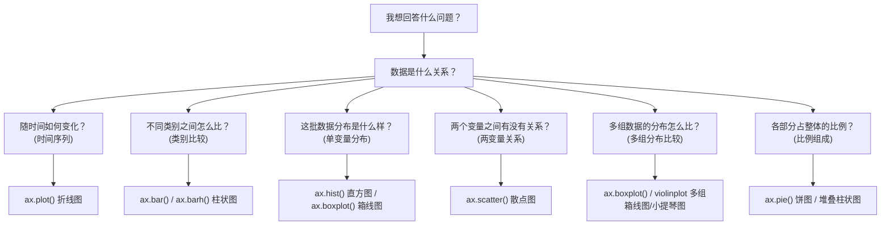

# 03. "数据 → 图形"的选择心智模型

## Why

初学者最容易犯的错误是：先想"我要用什么图"，再去凑数据。正确的顺序应该反过来：

> 图形不是目的，回答问题才是目的。

先问自己"我想回答什么问题"，再决定"数据之间是什么关系"，最后才落到"用哪个 API"。

## 决策树

## 每一类问题的判断标准

| 问题类型 | 判断标准（数据结构特征） | 首选图形 | 典型场景 |
|---|---|---|---|
| 时间序列 | x 轴是有序的时间/序号，y 轴是随之变化的数值 | `ax.plot()` | 每日流量、每小时请求量 |
| 类别比较 | x 轴是离散、无序的类别标签 | `ax.bar()` / `ax.barh()` | 各服务请求数、各地区销量 |
| 单变量分布 | 只有一列数值，想知道它的"形状"（集中、分散、偏态） | `ax.hist()` / `ax.boxplot()` | HTTP 延迟分布 |
| 两变量关系 | 每个观测有两个数值属性，想看它们是否相关 | `ax.scatter()` | CPU 使用率 vs 延迟 |
| 多组分布比较 | 想比较多组数据各自的分布，而不是单个数值 | `ax.boxplot()` / `violinplot` | 多个服务的延迟对比 |
| 比例组成 | 想看"各部分占整体的比例"而不是绝对数值趋势 | `ax.pie()` / 堆叠 `bar` | 错误类型占比 |

## 为什么不能死记硬背

同一份数据，问题不同，图形就应该不同。例如"每个服务的延迟"这份数据：

- 如果问题是"哪个服务平均延迟最高？" → 用 `bar`（比较均值这个单一统计量）。
- 如果问题是"哪个服务的延迟波动最大、有没有长尾？" → 用 `boxplot`（比较整个分布，而不只是均值）。
- 如果问题是"延迟随时间是不是在变差？" → 用 `line`（引入时间维度）。

**同一份原始数据，不同问题会导向完全不同的图形和统计量**，这就是为什么本教程反复强调"先问问题，再选图"。

## Failure（常见误用）

| 误用 | 问题 |
|---|---|
| 用 `line` 画类别数据 | 类别之间本身没有"顺序"和"连续性"，用折线暗示了一种不存在的连续过渡关系 |
| 用 `bar` 画分布 | `bar` 只能表达单个统计量（比如均值），无法表达分布的形状、离散程度、异常值 |
| 用 `pie` 表达超过 5-6 个类别的占比 | 人眼很难精确比较多个扇形的角度大小，类别一多就完全看不清 |
| 用 `scatter` 表达类别比较 | 散点图假设两个轴都是连续数值，类别轴上的散点会失去意义 |

## 下一步

有了这套决策树，就可以看完整代码示例了：8 个示例分别对应上面 6 类问题（外加多子图、双 Y 轴两种"组合技巧"），见 [04_examples_walkthrough.md](04_examples_walkthrough.md) 与 [examples/](../examples/) 目录。
