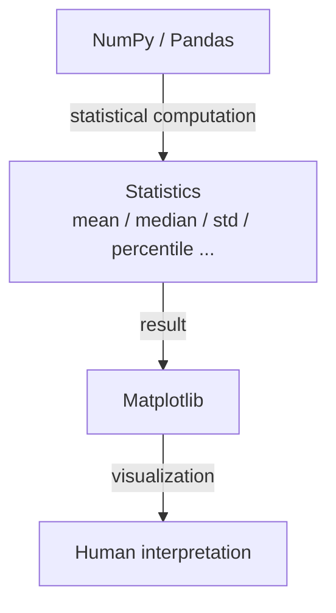

# 06. "统计分析 + pyplot" 的心智模型

## Why

一个常见的误区是把 Matplotlib 当成"统计工具"，以为它能帮你算均值、算相关系数。**Matplotlib 不做任何统计计算**，它只负责把已经算好的数字画成人眼能读懂的图形。

## Architecture：数据流必须是单向的



也就是说，正确的分工永远是：

1. **NumPy/Pandas** 负责"算数"：`np.mean()`、`np.percentile()`、`df.groupby().agg()` 等。
2. **Matplotlib** 负责"画图"：拿到算好的数字，用 `ax.axvline()`/`ax.bar()` 等方式呈现出来。
3. **人** 负责"解释"：从图上读出结论，做出判断。

反面例子（错误的心智模型）："我要用 Matplotlib 算一下这批数据的均值" —— 这句话本身就是错的，均值永远是 `np.mean()` 算出来的，Matplotlib 只是把这个已经算好的数字**画成一条线**。

## 完整示例：把统计量画成可视化标记

代码见 [stats_markers/distribution_stats_overlay.py](../stats_markers/distribution_stats_overlay.py)，核心片段：

```python
p50 = np.percentile(latency, 50)
p95 = np.percentile(latency, 95)
p99 = np.percentile(latency, 99)

ax.axvline(p50, color="tab:green", linestyle="--", label=f"P50={p50:.0f}")
ax.axvline(p95, color="tab:orange", linestyle="--", label=f"P95={p95:.0f}")
ax.axvline(p99, color="tab:red", linestyle="--", label=f"P99={p99:.0f}")
```

链路：

```text
统计量（数字） → 可视化标记（一条竖线 + 图例文字） → 人类理解（"P99 处才是最差 1% 用户的体验"）
```

`ax.axvline(x, ...)` 画一条**竖线**（贯穿整个 y 轴范围，x 位置固定），`ax.axhline(y, ...)` 画一条**横线**（贯穿整个 x 轴范围，y 位置固定）——两者是 `axline` 家族里最常用的两个，专门用来标出"某个固定数值"，而不是一段数据。

## 常见统计量如何映射到图形

把统计量按"分布的三个维度"分类，比逐个记忆更容易迁移：

```text
Distribution
     │
     ├── center（数据的"典型值"在哪）
     │     ├── mean   —— np.mean()，对极端值敏感（会被拉偏）
     │     └── median —— np.median()，对极端值稳健（更能代表"多数情况"）
     │
     ├── spread（数据的"波动程度"有多大）
     │     ├── std / variance —— np.std() / np.var()，全局波动，对极端值敏感
     │     └── IQR (Q3-Q1)    —— np.percentile(data,75) - np.percentile(data,25)，只看中间 50%，更稳健
     │
     └── tail（"最坏情况"有多差）
           └── P95 / P99 —— np.percentile(data, 95/99)，专门回答"少数最差样本"的情况
```

| 统计量 | 计算方式 | 常见可视化手法 |
|---|---|---|
| mean | `np.mean(data)` | `ax.axvline(mean)`；或在 bar chart 上直接用柱高表示 |
| median | `np.median(data)` | `ax.axvline(median)`；boxplot 里箱体中间的横线 |
| std / variance | `np.std(data)` / `np.var(data)` | 误差棒 `ax.errorbar(yerr=std)`；或用文字标注在图上 |
| percentile / quantile | `np.percentile(data, q)` | `ax.axvline(p)`；boxplot 的箱体边缘就是 Q1/Q3 |
| min / max | `np.min(data)` / `np.max(data)` | boxplot 胡须末端（排除异常值后）；`ax.set_ylim` 参考范围 |
| IQR | `q3 - q1` | boxplot 箱体的高度本身就是 IQR 的可视化 |

## Relationship：为什么 P95/P99 比 mean 更重要（工程场景）

在监控系统延迟这类场景里，**mean 会被少数极端值"稀释"或"拉偏"**：假设 1000 个请求里 950 个是 100ms，50 个是 300ms（慢请求），mean 会被拉到 110ms 左右，看起来"还不错"；但 P95/P99 会诚实地告诉你"最差的 5%/1% 用户，体验其实很差"。这就是为什么线上 SLA 通常用 P95/P99 而不是 mean 作为核心指标。

## Failure（这个环节常见误区）

| 误区 | 正确理解 |
|---|---|
| "画个图就能看出均值是多少" | 图只能帮你**大致**估计，精确值必须用 `np.mean()` 算出来再标注到图上 |
| "std 越大说明数据越'差'" | std 只衡量波动程度，不代表好坏；波动大也可能是正常的业务特征 |
| "只看 mean 就够了" | mean 掩盖分布形状（对称/长尾）和极端情况，务必配合 median/percentile 一起看 |
| "boxplot 的异常点一定是错误数据" | 箱线图的 outlier 只是"超出 1.5*IQR 范围"的统计定义，需要结合业务背景判断是否真的异常 |

## 下一步

理解了统计量如何变成可视化标记之后，下一步要认识图形本身可能"说谎"的几种典型场景，见 [07_misleading_charts.md](07_misleading_charts.md)。
