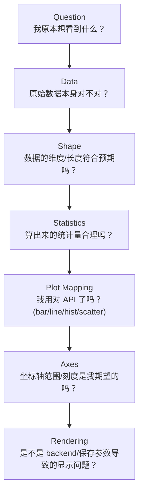

# 08. 常见 Failure Mode 与 Debug Mental Model

## Why

当图"看起来不对"时，最没有效率的做法是直接开始改绘图代码——因为大多数"图不对"的问题，根源其实在数据，不在 pyplot。本章建立一套固定的排查顺序，让你每次遇到问题都能按同一条路径快速定位。

## Failure Mode 排查表

| 问题 | 可能原因 | 排查方式 |
|---|---|---|
| 图为空 | 数据本身是空的 / 全是 NaN；或忘了调用 `ax.plot()` 只创建了 Axes | `len(x)` / `df.empty` / `np.isnan(y).all()` |
| x/y 长度不一致 | 数据 shape 错误（比如筛选后两个数组长度不同步） | `print(x.shape, y.shape)` |
| 中文乱码（图里出现方框□□） | 当前环境没有安装中文字体，Matplotlib 默认字体（DejaVu Sans）不含中文字形 | 图表内文字全部改用英文（本教程约定）；或安装中文字体并配置 `plt.rcParams["font.sans-serif"]` |
| 图例为空/缺项 | 对应 Artist 创建时没有传 `label=` | 检查 `ax.plot(..., label=...)` 是否遗漏；双 Y 轴场景检查是否漏合并另一个 Axes 的 handles |
| 图被裁剪（标签缺一半） | 没有调用 `tight_layout()`，或 `savefig` 时没加 `bbox_inches="tight"` | 补上 `fig.tight_layout()` + `bbox_inches="tight"` |
| 子图重叠 | Figure 尺寸太小，装不下所有子图内容 | 增大 `figsize`，或用 `fig.tight_layout()`/`subplots_adjust` |
| 数据看起来异常（全是 0、全部堆在一起） | 单位不一致、量级差异悬殊、或存在极端 outlier 压缩了正常数据的可视范围 | 画 `histogram`/`boxplot` 单独看这一列数据的分布 |
| 图像过于拥挤（刻度重叠、标签挤在一起） | 数据点/类别数量过多，或标签文字过长 | `ax.tick_params(rotation=45)` 旋转刻度标签；减少展示的类别数量；改用 `barh` |
| 保存的图片不完整 | 布局/边距问题，或调用顺序错误（`show()` 在某些 backend 下会关闭 Figure） | 加 `bbox_inches="tight"`；确保先 `savefig()` 再 `show()` |
| notebook 中图不显示 | backend 配置问题，或忘了 `%matplotlib inline` | `print(matplotlib.get_backend())` 检查当前 backend |

## Debug Mental Model：逐层排查



### 第一层：Data（数据本身对不对）

```python
print(df.shape)
print(df.dtypes)
print(df.head())
print(df.describe())
```

先确认：有没有数据？数据类型对不对（比如时间列是不是被误读成字符串）？有没有明显异常（describe 里 min/max/mean 是否合理）？

### 第二层：Shape（维度是否符合预期）

```python
print(x.shape)
print(y.shape)
```

`ax.plot(x, y)` 最常见的报错就是 x/y 长度不一致；多子图场景下还要确认 `axes` 数组的维度和下标是否匹配（`plt.subplots(2,2)` 返回二维数组，`plt.subplots(3,1)` 返回一维数组）。

### 第三层：Statistics（统计量是否合理）

```python
print(np.mean(y), np.median(y), np.std(y))
print(np.percentile(y, [50, 95, 99]))
```

如果统计量本身不合理（比如 P99 比 P50 还小），说明问题出在数据处理阶段，不是绘图阶段。

### 第四层：Plot Mapping（选的 API 对不对）

回顾 [03_chart_selection.md](03_chart_selection.md)：这份数据的关系类型（时间序列/类别/分布/两变量关系/多组比较/比例组成）和你选的图形函数是否匹配？

### 第五层：Axes（坐标轴范围/刻度是否符合预期）

```python
print(ax.get_xlim(), ax.get_ylim())
print(ax.get_xticks())
```

数据范围（`x.min()/x.max()`）和显示范围（`ax.get_xlim()`）不是一回事——如果发现"部分数据好像不见了"，很可能是 `xlim`/`ylim` 被意外设置得比数据范围更窄。

### 第六层：Rendering（渲染/环境问题）

```python
import matplotlib
print(matplotlib.get_backend())
```

如果前面几层都排查完毕、数据和配置都没问题，但图还是显示不对，才需要怀疑是 backend/环境层面的问题（字体缺失、无 GUI 环境下 `show()` 不生效等，详见上面的排查表）。

## 关键结论

> 数据问题 ≠ pyplot 问题。

按照 `Question -> Data -> Shape -> Statistics -> Plot Mapping -> Axes -> Rendering` 的顺序逐层排查，可以确保你不会在"数据本身就是错的"情况下，浪费时间去调整绘图参数。绝大多数"图不对"的问题，答案都在第一层或第二层就能找到。

## 下一步

理解了排查思路之后，可以进入两个完整的工程案例，把前面所有的心智模型串起来实际应用一次：[workflows/log_analysis/](../workflows/log_analysis/) 和 [workflows/network_analysis/](../workflows/network_analysis/)。
