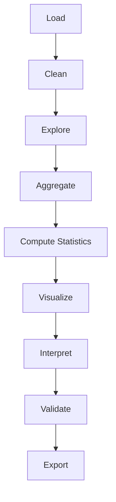

# 09. 分析工作流模板

## Why

前面的所有示例和工程案例，其实都遵循同一套固定流程。把这套流程模板化之后，以后遇到新的分析任务，不再需要"从零开始想该怎么写"，只需要复制模板、按 `TODO` 填充即可。

## 流程总览



对应到代码骨架：

```python
import pandas as pd
import numpy as np
import matplotlib.pyplot as plt


# 1. Load
df = pd.read_csv("data.csv")


# 2. Clean
...


# 3. Understand
print(df.info())
print(df.describe())


# 4. Compute statistics
...


# 5. Visualize
fig, axes = plt.subplots(...)


# 6. Interpret
...


# 7. Save
fig.savefig(...)
```

完整可复用版本见 [templates/analysis_workflow_template.py](../templates/analysis_workflow_template.py)，比上面的骨架多了两步：**Validate**（验证图形是否可能误导，对应 [07_misleading_charts.md](07_misleading_charts.md)）和显式的函数拆分（`load_data/clean_data/explore_data/compute_statistics/visualize/interpret/validate`），这样每一步都可以独立测试、独立复用。

## 每一步对应哪个心智模型

| 步骤 | 负责方 | 对应文档 |
|---|---|---|
| Load / Clean | Pandas | 无特殊心智模型，是数据工程范畴 |
| Explore | Pandas（`shape/dtypes/head/describe`） | [08_failure_and_debug.md](08_failure_and_debug.md) Debug 第一、二层 |
| Aggregate / Compute Statistics | NumPy/Pandas | [06_statistics_and_viz.md](06_statistics_and_viz.md) |
| Visualize | Matplotlib（`fig, ax = plt.subplots()` OO 写法） | [03_chart_selection.md](03_chart_selection.md) + [05_api_reference.md](05_api_reference.md) |
| Interpret | 人（写在 print/注释里） | 06 章"统计量 -> 可视化标记 -> 人类理解" |
| Validate | 人 + 检查清单 | [07_misleading_charts.md](07_misleading_charts.md) |
| Export | `fig.savefig()` / `df.to_csv()` | 05 章 Save 小节 |

## 怎么使用这个模板

1. 复制 `templates/analysis_workflow_template.py` 到你的新分析任务目录。
2. 把 `load_data()` 换成真实的数据读取逻辑（CSV/日志/数据库/API）。
3. 在 `explore_data()` 跑一遍，确认数据长什么样、有没有明显问题。
4. 在 `compute_statistics()` 里写清楚这次分析需要哪些统计量（mean/median/percentile/groupby 等）。
5. 在 `visualize()` 里参考 [03_chart_selection.md](03_chart_selection.md) 的决策树选图形，参考 [05_api_reference.md](05_api_reference.md) 找到对应 API。
6. 在 `interpret()` 里用人类语言写清楚"这次分析的结论是什么"。
7. 在 `validate()` 里对照 [07_misleading_charts.md](07_misleading_charts.md) 的排查清单自查一遍。
8. `main()` 里按顺序调用以上函数，跑通整个流程。

## 下一步

模板讲完之后，回过头总结一下 pyplot 的"State Mental Model"，并说明为什么工程代码应该优先用 OO API，见 [10_state_model_recap.md](10_state_model_recap.md)。
