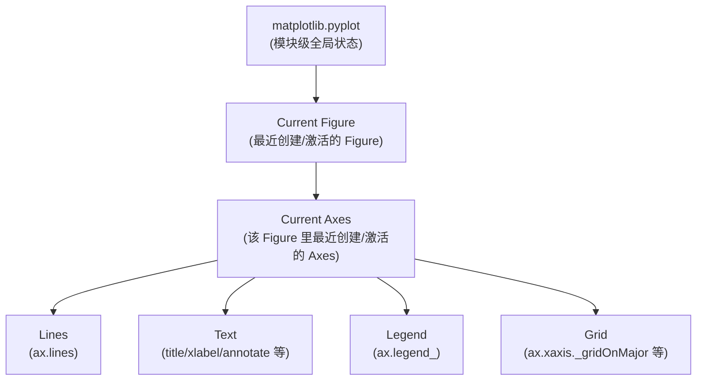

# 10. pyplot 的 State Mental Model 总结

## Why

学完前面所有内容之后，回到最初的问题："为什么 `plt.plot()`、`plt.title()`、`plt.xlabel()` 能够连续工作，不需要互相传参数？" 现在应该能给出完整答案了，本章做一次收束总结。

## State 模型



用一句话概括：**pyplot 维护着一条"当前指针链"（module -> current Figure -> current Axes），所有裸调用的 `plt.xxx()` 本质上都是"沿着这条指针链找到 current Axes，再调用它的对应方法"**。

## 为什么工程代码通常更推荐 OO 写法

```python
# 状态机写法（pyplot）
plt.plot(x1, y1)
plt.title("Chart 1")

plt.figure()          # 创建第二个 Figure，current 指针切换到它
plt.plot(x2, y2)
plt.title("Chart 2")  # 这行改的是第二个 Figure 的标题，不是第一个
```

```python
# OO 写法
fig1, ax1 = plt.subplots()
ax1.plot(x1, y1)
ax1.set_title("Chart 1")

fig2, ax2 = plt.subplots()
ax2.plot(x2, y2)
ax2.set_title("Chart 2")
```

两段代码效果一样，但 OO 写法**不依赖"当前指针"这个隐藏状态**，你随时可以明确知道 `ax1.set_title(...)` 改的是哪个对象。在下面几种场景中，这个差异会直接决定代码是否好维护：

1. **多子图/多 Figure 场景**：状态机写法必须小心"当前指针"有没有切换对；一旦某一行忘了切换（比如忘了先 `plt.sca(ax)` 切换回某个 Axes），后续调用就会画到错误的对象上。OO 写法完全没有这个问题，因为每次调用都显式指定了对象。
2. **把绘图逻辑封装成函数**：
   ```python
   def plot_latency_hist(ax, latency, bins=30):
       ax.hist(latency, bins=bins)
       ax.set_title("Latency Distribution")
   ```
   这个函数不依赖任何全局状态，可以在任意上下文被调用、被单元测试、被复用到不同的 Figure 里。状态机写法很难写出这种"纯函数式"的绘图代码。
3. **循环批量生成图表**：
   ```python
   for service in services:
       fig, ax = plt.subplots()
       ax.hist(df.loc[df.service == service, "latency"])
       ax.set_title(service)
       fig.savefig(f"{service}.png")
       plt.close(fig)  # 显式关闭，避免内存累积
   ```
   显式拿到 `fig`/`ax` 后可以精确地 `plt.close(fig)` 释放资源；状态机写法下容易在循环里混用/遗漏，导致内存持续增长（大量未关闭的 Figure）。

## 什么时候裸 `plt.xxx()` 仍然合理

- 在 Notebook/REPL 里快速试验一张简单图，只有一个 Figure、一个 Axes，写起来更短。
- 教学演示第一次介绍某个 API 时（本教程第 [01_two_apis.md](01_two_apis.md) 就是这样用的）。

## 本教程的统一约定

从 [examples/](../examples/) 开始，本教程所有"正式代码"都统一使用：

```python
fig, ax = plt.subplots()
ax.plot(...)
ax.set_title(...)
ax.set_xlabel(...)
```

只有 `plt.subplots()`（创建对象）、`plt.show()`（触发展示，这个动作本身就是全局的）这两个函数会保留 `plt.` 前缀，其余全部通过 `ax`/`fig` 显式调用。

## 下一步

理论部分到此结束。接下来通过 [11_exercises.md](11_exercises.md) 的递进练习，检验自己是否真正建立起了这些心智模型。
