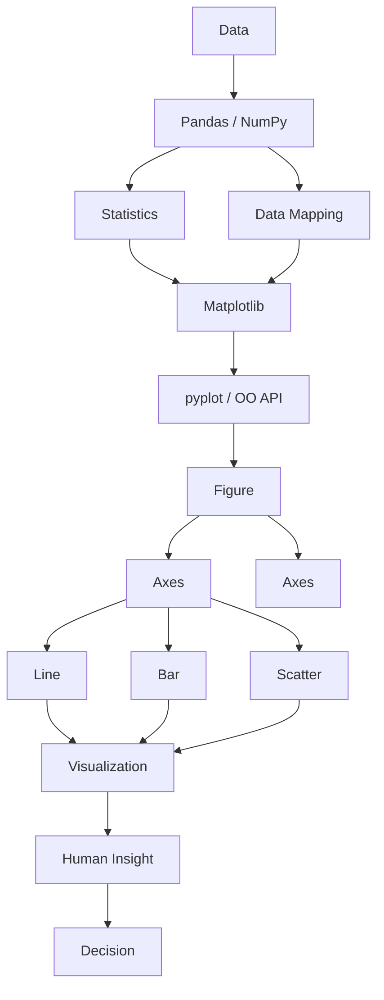

# 12. 最终 Mental Model Map

## 总图



## 用文字再走一遍这条链路

1. **Data**：原始数据，可能是 CSV、日志、数据库查询结果。
2. **Pandas / NumPy**：负责数据整理（清洗、类型转换、聚合）和统计计算（mean/median/percentile/corr 等）。
3. **Statistics**：整理计算出的具体数字（这批数据的中心、分散程度、分位数等）。
4. **Data Mapping**：决定"用什么视觉元素编码这些数字"（位置、高度、颜色、大小），对应 [03_chart_selection.md](03_chart_selection.md) 的决策树。
5. **Matplotlib**：接收 Statistics 和 Data Mapping 的结果，通过 `pyplot`（状态机接口）或 `OO API`（显式对象接口）两种途径操作对象。
6. **Figure -> Axes -> {Line/Bar/Scatter/...}**：具体的对象层级，参见 [00_overview.md](00_overview.md)。
7. **Visualization**：最终渲染出来的图形（屏幕/PNG/SVG/PDF）。
8. **Human Insight**：人从图形中读出的观察和结论。
9. **Decision**：基于结论采取的实际行动（比如"payment 服务延迟异常，需要排查"）。

## 一句话总结

> NumPy/Pandas 负责理解和计算数据，Matplotlib 负责把数据和统计结果编码成人可以观察和理解的视觉结构。

## 三条必须记住的边界

1. **Matplotlib 不做统计计算**（见 [06_statistics_and_viz.md](06_statistics_and_viz.md)）——所有 mean/median/percentile 都由 NumPy/Pandas 算出，Matplotlib 只负责呈现。
2. **相关性不是因果性**（见 [07_misleading_charts.md](07_misleading_charts.md) 误读 4）——scatter plot 只能告诉你"两个变量一起变化的程度"。
3. **数据问题不是 pyplot 问题**（见 [08_failure_and_debug.md](08_failure_and_debug.md)）——图"看起来不对"时，先从 `Question -> Data -> Shape` 排查，而不是直接改绘图代码。

## 两套 API 的最终定位

```text
pyplot API                          OO API
    │                                  │
    ▼                                  ▼
隐式操作 current Figure/Axes      显式操作 fig/ax 对象
    │                                  │
    ▼                                  ▼
适合：快速试验、教学演示           适合：工程代码、多子图、封装成函数
```

**结论**：pyplot 不是另一套完全不同的绘图库，它主要是 Matplotlib 的高层状态式接口；`plt.subplots()` 正是这两套 API 的桥梁。

## 下一步

最后一步：把所有核心 API 和这条决策链浓缩成一张随时可以查阅的 Cheat Sheet，见 [13_cheat_sheet.md](13_cheat_sheet.md)。
