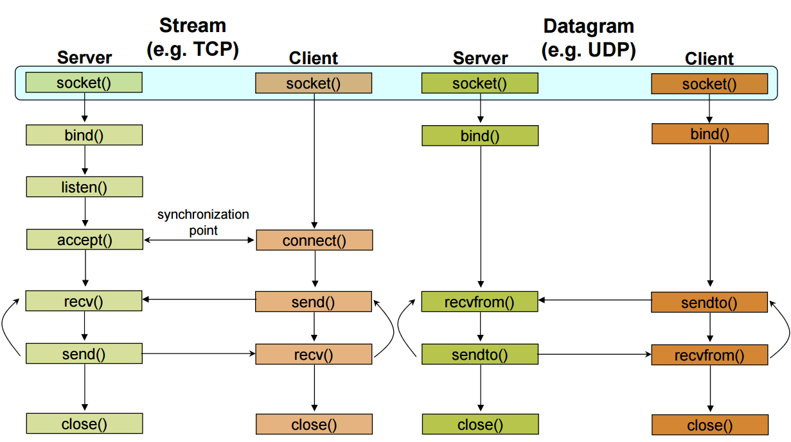
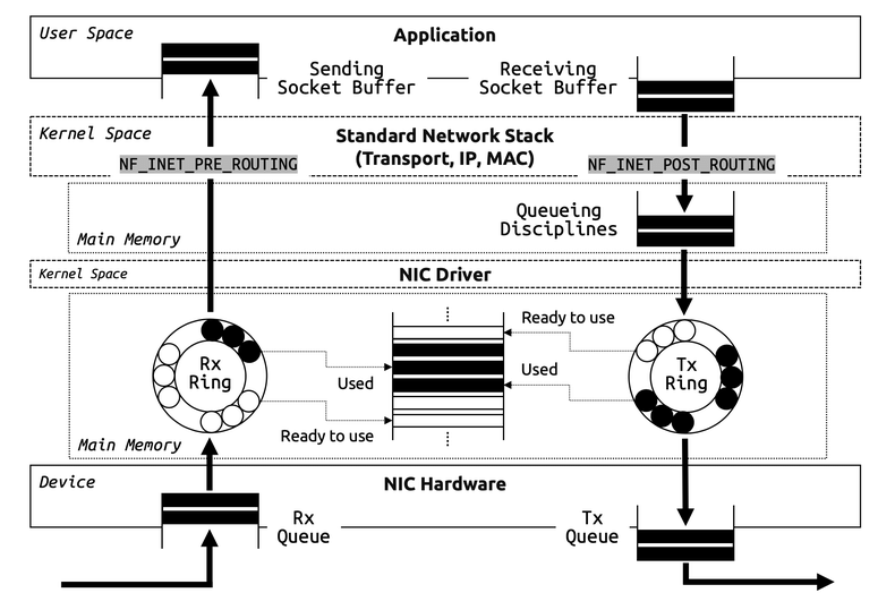

## MAC芯片 vs PHY芯片
- MAC 负责“帧”，PHY 负责“比特 + 电气”
### PHY 芯片 (完全硬件)
- PHY 的世界里，没有“以太网帧”这个概念，对应 OSI 第一层（物理层）

- PHY 芯片 只关心
	比特流（0 / 1）
	编码方式
	电压 / 光信号
	链路训练

- PHY 具体做什么
	- 以 1000BASE-T 为例：
		模拟 / 数字信号处理
		编码 / 解码
		8b/10b（千兆以下）
		PAM-5 / PAM-16（千兆及以上）
		自动协商（Auto-Negotiation）
		链路建立 / Link Up / Down
		Clock recovery
		信号均衡、回声消除

- PHY 不知道 MAC 地址、CRC、VLAN、IP
### MAC芯片 (硬件 + 很薄的逻辑)
- MAC 是“以太网帧”的第一位理解者，对应 OSI 第二层（数据链路层）
- MAC 负责
	帧封装 / 解封装
	MAC 地址识别
	帧边界（Preamble / SFD）
	CRC32 计算 / 校验
	最小帧填充（Padding）
	Flow Control（PAUSE 帧）
	VLAN Tag 解析（有的 MAC）
	DMA 到内存（绝大多数 SoC / NIC
- MAC 不懂 IP / TCP，但它懂“以太网帧”

### MAC 和 PHY 的“硬边界”
```
            数字接口（并行 / 串行）
MAC  <-------------------------------->  PHY
        MII / GMII / RGMII / SGMII
```
- PHY 输出的是 已解码的比特流
- MAC 接收的是 有节拍的 nibble / byte / symbol

### 一次以太网“发送”涉及哪些硬件模块
```
1️⃣ 软件阶段（CPU）
	应用 → socket → TCP/IP → skb → driver

	构造 skb
	填写 L2/L3/L4 头
	调用 ndo_start_xmit()

	这是软件的最后一次“主动行为”

2️⃣ MAC + DMA（硬件主导）
	驱动只是配置，不是搬数据

	CPU
	└─ 写 Tx Descriptor
		└─ 指向 skb data

	然后：
		DMA 从内存拉数据
		MAC 做的事情：
		加 Preamble + SFD
		计算 CRC
		插入 VLAN（如果 offload）
		处理 IFG

	此时 CPU 已经“撒手不管”

3️⃣ MAC → PHY

	MAC 输出
		[字节流 / symbol] + clock
	给 PHY

4️⃣ PHY → 网线（纯硬件）

PHY：
	编码
	调制
	放大
	输出到双绞线 / 光纤
```

#### 发送流程
1. RAM (内存)： 数据最初存在系统内存的缓冲区中。
2. DMA (直接存储器访问)： 为了不占用 CPU，DMA 控制器负责把数据从 RAM 搬运到 MAC 的 FIFO 缓存。
3. MAC 芯片： 给原始数据加上包头（前导码）、帧起始符、源/目的地址、长度信息，并在末尾计算 CRC 校验码，组成完整的以太网帧。
4. MII 接口： MAC 将帧转换成位流，通过 MII 接口传给 PHY。
5. PHY 芯片： 进行 8b/10b 或类似编码，转换成模拟信号。
6. 网络变压器 (Magnetics)： 起到电气隔离和阻抗匹配的作用，滤除噪声。
7. RJ45 接口： 信号通过网线物理发出。

### 一次“接收”涉及哪些硬件模块
```
1️⃣ PHY 接收（纯硬件）
网线 → PHY

PHY 做：
	信号恢复
	解码
	Clock recovery
	Link 状态维护

输出给 MAC：
	干净的 bit / symbol

2️⃣ MAC 解帧（硬件）

MAC 做：
	找 Preamble / SFD
	识别帧边界
	校验 CRC
	判断目的 MAC
	丢弃错误帧（绝大多数）

📌 很多“坏包”在这里就死掉了

3️⃣ DMA 到内存（硬件）

MAC：
	把帧 DMA 到 Rx ring buffer
	更新 Rx descriptor
	触发中断 / NAPI poll

4️⃣ 软件首次参与（关键边界）

完整的、CRC 正确的以太网帧已经在内存里之后

此时：
	硬件完成
	────────
	skb 在内存中
	↓
	驱动 NAPI poll()
	↓
	netif_receive_skb()
```

### 责任边界图
```
┌────────────┐
│  Software  │
│  TCP/IP    │
│  Driver    │
└─────▲──────┘
      │ skb / descriptor
┌─────┴──────┐
│   MAC      │  ← 帧的世界
│ CRC / DMA  │
└─────▲──────┘
      │ MII / RGMII / SGMII
┌─────┴──────┐
│   PHY      │  ← 比特 + 电气世界
│  Cod/Dec   │  编解码
└─────▲──────┘
      │ 电信号 / 光信号
┌─────┴──────┐
│   Cable    │
└────────────┘
```

## 客户-服务器模型
	- server
		- 服务器被动等待和响应客户端的请求
		- 被动socket
	- client
		- 客户端初始化通信
		- 必须知道服务器的地址和端口
		- 主动socket
- socket通信过程
	- 
		- socket
			- `int sockid = socket(family, type, protocol)`
			- 创建通信的端点
		- bind
			- `int status = bind(sockid, &addrport, size)`
			- 绑定本地地址至socket
		- listen
			- `int status = listen(sockid, queueLimit)`
			- 声明接收客户端的连接
		- accept
			- `int s = accept(sockid, &clientAddr, &addrLen)`
			- 阻塞调用者直到收到连接请求
		- connect
			- `int status = connect(sockid, &foreignAddr, addrlen)`
			- 主动尝试建立连接
		- send
			- `int count = send(sockid, msg, msgLen, flags)`
			- `int count = sendto(sockid, msg, msgLen, flags, &freignAddr, addrlen)`
			- 通过连接发送数据
		- receive
			- `int count = recv(sockid, recvBuf, bufLen, flags)`
			- `int count = recvfrom(sockid, recvBuf, bufLen, flags, &clientAddr, addrlen)`
			- 通过连接接收数据
		- close
			- `int status = close(sockid)`
			- 释放连接
		- setsockopt
			- `int r = setsockopt(sockid, level, optName, optVal, optLen)`
		- getsockopt
			- `int r = getsockopt(sockid, level, optName, optVal, optLen)`
- Packet queueing in the Linux network stack
	- 
- [packet(7)](https://linux.die.net/man/7/packet)
	- ```bash
	  # packet - packet interface on device level
	  Packet sockets are used to receive or send raw packets at the device driver (OSI Layer 2) 
	  level. They allow the user to implement protocol modules in user space on top of the physical
	  layer.
	  
	  packet_socket = socket(AF_PACKET, int socket_type, int protocol);
	  ```
- 参考文档
	- [**Socket Options**](https://notes.shichao.io/unp/ch7/)

	- [Linux Documentation/networking](https://www.kernel.org/doc/Documentation/networking/)
	- [Inter-process communication in Linux: Shared storage](https://opensource.com/article/19/4/interprocess-communication-linux-storage)
	- [Introducing the guide to inter-process communication in Linux](https://opensource.com/article/20/1/inter-process-communication-linux)
	- [Inter-process communication in Linux: Using pipes and message queues](https://opensource.com/article/19/4/interprocess-communication-linux-channels)
	- [Inter-process communication in Linux: Sockets and signals](https://opensource.com/article/19/4/interprocess-communication-linux-networking)
	- [Socket Programming in Linux](https://www.hitchhikersguidetolearning.com/socket-programming-in-linux/)
	- [Socket programming in C on Linux](https://www.binarytides.com/socket-programming-c-linux-tutorial/)
	- [**Internet Communications Engineering**](http://blake.erg.abdn.ac.uk/users/gorry/course/)
	- [**H3C 网络互通配置指导**](https://www.h3c.com/cn/d_202203/1578744_30005_0.htm)
	- [**Huawei Technical Guides**](https://support.huawei.com/enterprise/en/routers/ar100-200-pid-256863195?category=configuration-commissioning&subcategory=technical-guides)
	- [**Keyword Search the Single UNIX Specification**](https://pubs.opengroup.org/onlinepubs/7908799/)
	- [The Open Group Base Specifications](https://pubs.opengroup.org/onlinepubs/9699919799/)
	- [C Language Examples of IPv4 and IPv6 Raw Sockets for Linux](https://www.pdbuchan.com/rawsock/rawsock.html)
	- [linux socket](https://liuhangbin.netlify.app/post/linux-socket/)
	- [raw(7)](https://man7.org/linux/man-pages/man7/raw.7.html)
	- [socket(7)](https://man7.org/linux/man-pages/man7/socket.7.html)
	- [Beej's Guide to Network Programming 简体中文](https://beej-zhcn.netdpi.net/)
	- [Beej's Guide to Network Programming](https://www2.cs.uh.edu/~gnawali/courses/cosc4377-s12/readings/beejs.pdf)
	- [Beej's Guide to Network Programming](https://teoriadeisegnali.it/appint/html/altro/bgnet/index.html)
	- [Socket Programming HOWTO](https://docs.python.org/3/howto/sockets.html)
	- [A Guide to Java Sockets](https://www.baeldung.com/a-guide-to-java-sockets)
	- [A Complete Guide to Socket Programming in Python](https://www.datacamp.com/tutorial/a-complete-guide-to-socket-programming-in-python)
	- [Socket programming](https://www.ibm.com/docs/en/i/7.5?topic=communications-socket-programming)
	- [UDP and the sendto Socket API](https://people.computing.clemson.edu/~westall/853/notes/udpsend.pdf)
	- [**Manpages**](https://man.cx/) #online
	- [Socket Programming in Python (Guide)](https://realpython.com/python-sockets/)
	- [C socket calls](https://www.ibm.com/docs/en/zos/3.1.0?topic=interface-c-socket-calls)
	- [Linux Raw Sockets](https://www.schoenitzer.de/blog/2018/Linux%20Raw%20Sockets.html)
	- [**Beej's Guide to Network Programming**](https://beej.us/guide/bgnet/)
	- [socket参数对用户接收报文的影响](https://segmentfault.com/a/1190000020103410)
	- [Netfilter 是如何工作的](https://segmentfault.com/t/netfilter)
	- [通俗理解IP路由](https://segmentfault.com/a/1190000019363010)
	- [backlog参数对TCP连接建立的影响](https://segmentfault.com/a/1190000019252960)
	- [TCP拥塞控制之基础](https://segmentfault.com/a/1190000019102072)
	- [图解 epoll 是如何工作的](https://segmentfault.com/a/1190000018517562)
	- [The Implementation of epoll](https://idndx.com/the-implementation-of-epoll-1/)
	- [linu内核协议栈源码阅读理解详细注释](https://github.com/y123456yz/Reading-and-comprehense-linux-Kernel-network-protocol-stack)
	- [Linux Network Stack Walkthrough (2.4.20)](https://jsevy.com/network/Linux_network_stack_walkthrough.html)
	- [Networking](https://www.kernel.org/doc/html/latest/networking/)
	- [Queueing in the Linux Network Stack](https://www.coverfire.com/articles/queueing-in-the-linux-network-stack/)
	- 
	- [[bpf]]
	- [The Linux Socket Filter: Sniffing Bytes over the Network](https://www.linuxjournal.com/article/4659)
	- [Inside the Linux Packet Filter](https://www.linuxjournal.com/article/4852)
	- [Inside the Linux Packet Filter, Part II](https://www.linuxjournal.com/article/5617)
	- [man 2 getsockopt](https://man7.org/linux/man-pages/man2/setsockopt.2.html)
	- [Sending raw Ethernet packets from a specific interface in C on Linux](https://austinmarton.wordpress.com/2011/09/14/sending-raw-ethernet-packets-from-a-specific-interface-in-c-on-linux/)
	- [Receiving raw packets in Linux without pcap](https://austinmarton.wordpress.com/tag/raw-sockets/)
	- [Raw Socket 接收和发送数据包](https://github.com/xgfone/snippet/blob/master/snippet/docs/linux/program/raw-socket.md) #github
	- [rawSocketToolkit](http://csci.viu.ca/~pwalsh/teaching/460/atLabTools24jan06a/rawSocketToolkit/)
	- [**Advanced Sockets API for IPv6**](https://datatracker.ietf.org/doc/html/rfc2292)
	- [How to: Raw sockets in IPv6](https://blog.apnic.net/2017/10/24/raw-sockets-ipv6/)
	- [**Guide to IP Layer Network Administration with Linux**](http://linux-ip.net/html/index.html)
	- [RIB and FIB – Understanding the terminology](https://www.dasblinkenlichten.com/rib-and-fib-understanding-the-terminology/)
	- [计算机网络](https://kiprey.github.io/tags/%E8%AE%A1%E7%AE%97%E6%9C%BA%E7%BD%91%E7%BB%9C/)
	- [CS144-Computer-Network](https://github.com/PKUFlyingPig/CS144-Computer-Network/tree/master)
	- [CS144: Introduction to Computer Networking](https://www.scs.stanford.edu/10au-cs144/)
	- [PcapPlusPlus](https://pcapplusplus.github.io/v1912/docs/)
	- [**PcapPlusPlus Example Applications**](https://pcapplusplus.github.io/v1912/docs/examples)
	- [raw - Linux IPv4 raw sockets](https://manpages.ubuntu.com/manpages/jammy/man7/raw.7.html)
	- [**Introduction to RAW-sockets**](https://tuprints.ulb.tu-darmstadt.de/6243/1/TR-18.pdf)
	- 
	- [**network programming**](https://www.tenouk.com/Module42a.html)
	- [Network Programming Guide](https://techpubs.jurassic.nl/library/manuals/0000/007-0810-050/sgi_html/index.html)
	- [What Are Raw Sockets?](https://www.baeldung.com/cs/raw-sockets)
	- [Packet MMAP](https://www.kernel.org/doc/html/latest/networking/packet_mmap.html#packet-mmap)
	- [packet(7)](https://man7.org/linux/man-pages/man7/packet.7.html)
	- [Introduction to AF_PACKET sockets](https://googleprojectzero.blogspot.com/2017/05/exploiting-linux-kernel-via-packet.html)
	- [Deep dive into AF_PACKET socket](https://csulrong.github.io/blogs/2022/03/10/linux-afpacket/)
	- [What Is Maximum Transmission Unit (MTU)?](https://support.huawei.com/enterprise/en/doc/EDOC1100202534)
	- [MTU and MSS: What You Need to Know](https://www.imperva.com/learn/application-security/what-is-mtu-mss/)
	- [DHCP Relay](https://support.huawei.com/enterprise/en/doc/EDOC1100172313/eff6c15f/how-to-configure-security-policies-to-allow-dhcp)
	- [What is NAT](https://support.huawei.com/enterprise/en/doc/EDOC1100086645#EN-US_TOPIC_0170224627)
	- [L2TP VPN](https://support.huawei.com/enterprise/en/doc/EDOC1100176155)
	- [IP Routing Basics](https://support.huawei.com/enterprise/en/doc/EDOC1100086956?idPath=24030814%7C21782164%7C7923148%7C256863195)
	- [What Is LACP?](https://support.huawei.com/enterprise/en/doc/EDOC1100086560)
	- [Wireshark User’s Guide](https://www.wireshark.org/docs/wsug_html_chunked/index.html)
	- [IPv4 and IPv6 Header Checksum Algorithm Explained](https://www.packetmania.net/en/2021/12/26/IPv4-IPv6-checksum/)
	- [IPv6 Dynamic Address Allocation Mechanism Illustrated](https://www.packetmania.net/en/2022/03/13/IPv6-Addressing/)
	- [TCP IP Sockets in C](https://github.com/bilalmohib/ProgrammingBooks/blob/crystal/TCP%20IP%20Sockets%20in%20C%2C%20Second%20Edition_%20Practical%20Guide%20for%20Programmers%20(The%20Morgan%20Kaufmann%20Practical%20Guides%20Series)%20(%20PDFDrive%20).pdf) #pdf
	- [microtcp](https://github.com/cozis/microtcp/tree/main) #github
	- [Hands-On-Network-Programming-with-C](https://github.com/codeplea/Hands-On-Network-Programming-with-C/tree/master) #github
	- [**thePacketGeek**](https://thepacketgeek.com/)
	- [Socket Interface](https://0xbharath.github.io/art-of-packet-crafting-with-scapy/networking/socket_interface/index.html)
	- [Linux TCP/IP Connections Limit](https://www.baeldung.com/linux/tcp-ip-connections-limit)