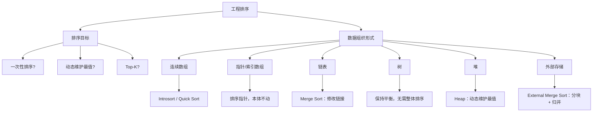

# 工程排序最佳实践总结

本文档汇总 [`sorting_mental_model.md`](../sorting_mental_model.md) 第五、六、七、八节的核心内容，
并结合本目录下 10 个分类、30 个可运行示例的实践经验，给出最终的最佳实践表格与心智模型总结。

> **一句话结论：排序算法只是实现手段，真正决定性能的是数据组织方式。**

---

## 一、数据组织形式 → 排序策略对照表

| 数据组织形式 | 是否连续 | 随机访问成本 | 最佳策略 | 常用算法 | 对应示例目录 |
|---|---|---|---|---|---|
| 基本类型数组 | 是 | O(1) | 直接排序 | Introsort / Quick Sort | [01-array](01-array/README.md) |
| 小对象数组 | 是 | O(1) | 直接排序 | Quick Sort | [01-array](01-array/README.md) |
| 大对象数组 | 是 | O(1) | 排序指针/索引 | Quick Sort + Pointer | [02-large-object-array](02-large-object-array/README.md) |
| 指针 / 引用数组 | 是（指针连续） | O(1) | 排序指针 | Introsort / Stable Sort | [03-pointer-array](03-pointer-array/README.md) |
| 单链表 | 否 | O(n) | 修改 next | Merge Sort | [04-linked-list](04-linked-list/README.md) |
| 双向链表 | 否 | O(n) | 修改 prev/next | Merge Sort | [04-linked-list](04-linked-list/README.md) |
| 平衡树 | 否（指针结构） | O(log n) | 维持平衡 | 无需整体排序（中序遍历天然有序） | [05-tree](05-tree/README.md) |
| 堆 | 是（数组实现） | O(1) 取堆顶 | 动态维护最值 | Heap（Push/Pop） | [06-heap](06-heap/README.md) |
| 数据库记录 | 页面存储 | O(1)（经索引） | 排序 RowID / 页偏移 | External Sort + Index | [07-database-records](07-database-records/README.md) |
| 超大文件 | 磁盘顺序 IO | 顺序访问 | 分块 + 归并 | External Merge Sort | [08-external-sort](08-external-sort/README.md) |
| 批量缓冲区（消息/帧/包） | 指针数组连续 | O(1) | 只排指针，不排本体 | Stable Sort + Pointer | [09-bulk-buffer](09-bulk-buffer/README.md) |
| 任务调度队列 | 数组/堆 | O(1)~O(log n) | 增量维护优先级，而非整体重排 | Incremental Reinsert / Heap | [10-task-scheduler](10-task-scheduler/README.md) |

---

## 二、四条设计原则

### 原则一：尽量减少数据移动

移动成本从高到低排列：

```
移动对象（大结构体值拷贝）
   │  成本最高
   ▼
移动结构体（中小型值拷贝）
   │
   ▼
移动指针（8 字节地址）
   │
   ▼
移动索引（整数下标）
   │
   ▼
修改链接（只改 next/prev，数据完全不动）
   │  成本最低
   ▼
```

数据组织形式越"重"（对象越大、越难拷贝），越应该向"移动索引/修改链接"靠拢。
`02-large-object-array`、`09-bulk-buffer` 的示例都用实测字节数直观展示了这个差距。

### 原则二：比较（Comparator）与移动（Move Strategy）解耦

排序算法本身并不知道排序对象是什么类型，它只依赖两件事：

```
                 Sort
                   |
        +----------+----------+
        |                     |
   Comparator            Move Strategy
   (谁大/谁小/         (交换对象? 交换指针?
    谁排前面)           修改链表? 交换索引?)
```

- **Comparator** 决定排序的"语义"（按薪资、按截止时间、按优先级……）。
- **Move Strategy** 决定排序的"成本"（真正影响性能的部分）。

`03-pointer-array` 与 `07-database-records` 的示例反复验证：无论 Comparator 多复杂
（多字段、多级排序），只要 Move Strategy 保持"只搬指针/索引"，性能几乎不受影响。

### 原则三：建立"有序视图"（Ordered View）

很多场景下，原始数据从未被移动过，移动的只是一份"指向数据的有序索引"：

```
原始数据（未移动）:  Employee   Employee   Employee   Employee
                        ^          ^          ^          ^
                        |          |          |          |
有序索引（真正排序的对象）: idx[2]     idx[0]     idx[3]     idx[1]
```

访问路径变为 `索引 -> 原始数据`，从而以极低成本获得任意多个不同维度的"有序视图"，
且互不冲突。`02-large-object-array/example-3` 与 `07-database-records` 都是这一原则
的直接体现。

### 原则四：数据结构决定排序策略，而不是反过来

工程中常见的错误思路是"先选一个喜欢的排序算法，再削足适履地套用到数据上"。正确的顺序应该是：

```
数据结构（连续数组？链表？树？外部存储？）
        |
        v
   数据移动成本评估
        |
        v
   排序 / 维护策略（一次性排序？增量维护？分块归并？）
        |
        v
      具体算法
```

`04-linked-list/example-3` 专门演示了反例：对链表使用快速排序，由于随机访问成本是
O(n)，整体复杂度会退化到 O(n²)，远不如把链表结构特点纳入考虑后选用的归并排序。

---

## 三、整体心智模型



---

## 四、四条工程经验法则

1. **连续内存 + 小对象 → 直接排序**（Introsort / Quick Sort）。
   对应 `01-array`：数据小、访问快、Cache 友好，没有必要引入额外的间接层。

2. **大对象 → 排序指针或索引，避免大量数据移动**。
   对应 `02-large-object-array`、`03-pointer-array`、`07-database-records`、`09-bulk-buffer`：
   只要对象足够大（或搬运成本足够高——包括数据库整行记录、大缓冲区、大帧数据），
   就应该把"排序对象"从数据本体换成指向数据的轻量标识符。

3. **链表 / 树等指针结构 → 利用结构特性，而不是暴力排序**。
   对应 `04-linked-list`（归并排序修改 next/prev）、`05-tree`（维持平衡而非重排）、
   `06-heap`（动态维护最值而非一次性排序）、`10-task-scheduler`（增量重新插入/堆维护）。

4. **超大数据 / 持续变化的数据流 → 分阶段处理，而不是一次性内存排序**。
   对应 `08-external-sort`：切块、块内排序、落盘、K 路归并，用顺序 I/O 换取可行性；
   `10-task-scheduler`：任务持续到达和完成，调度器只维护局部有序（队首/堆顶），
   而不是每次都对全部任务重新排序。

> **最终的工程心智模式：**
>
> **先分析数据是如何组织的，再评估移动数据的真实成本，最后才选择合适的数据结构与排序策略。**
> **排序算法只是最后一步，而不是第一步。**
