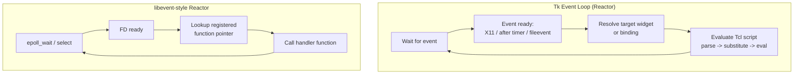

# Layer 10：Tcl/Tk 与 C/C++ 的概念映射

> 核心问题：**哪些 C/C++/Go/Rust 里的直觉可以直接搬到 Tcl/Tk，哪些会在什么地方"看起来像、实际不一样"？**

本层不引入任何新的 Tcl/Tk 机制——前面 9 层已经把 Widget、Event Loop、
变量绑定、`proc`/namespace、综合项目都讲完了。这一层的任务是**回头把
它们和你已有的 C/C++ 知识对齐一遍**，但对齐的目的不是"证明它们是一回事"，
而是**精确标注每一条类比在哪里会断裂**。类比断裂的地方，正是从 C/C++
背景转过来的人最容易写出 bug、做出错误性能/并发假设的地方。

---

## 1. Why（这一层解决什么问题）

有 C/C++ 背景的人学 Tcl/Tk 时，大脑会自动做"模式匹配"：看到 `proc` 就
默认它是函数；看到 `-command {script}` 就默认它是函数指针回调；看到
`after 1000 {...}` 就默认它开了个定时器线程。这些类比**在大多数时候
够用**，能让你快速读懂代码、快速写出第一版实现——但它们都是**近似**，
不是**同构**。

本层给出一张概念映射表，并对每一行给出：

1. 相似点（为什么这个类比直觉上说得通）；
2. 关键区别（Tcl/Tk 实际的执行模型）；
3. **这个类比会在什么场景下误导你**——这是最重要的部分，因为"知道
   类比在哪断裂"比"知道类比是什么"更能防止写出错误代码。

---

## 2. 概念映射表（总览）

| Tcl/Tk 概念 | C/C++ 中的类比 | 关键区别 |
|---|---|---|
| Tcl Interpreter | Runtime / Bytecode Interpreter | 不是普通的函数调用；每条命令都要经过 parse → substitute → evaluate 三步,没有链接期/编译期绑定 |
| Widget Command | Object's Method Table（对象的方法调度表） | 通过 Tcl 命令系统暴露,widget 路径本身就是一个动态注册进解释器的命令名,不是语言层面的"对象类型" |
| `proc` | Function | 调用是对命令名的一次字符串查找再求值,参数始终是字符串,没有编译期类型检查和重载 |
| Namespace | Namespace（C++）/ Module Boundary（C） | 等于名字作用域边界,不等于独立编译单元,运行时仍共享同一个解释器和全局符号表 |
| Callback | Function Pointer Callback | 存的不是代码地址,是一段 Tcl 脚本字符串,真正执行时才被 parse + eval |
| Event Loop | Event Dispatch Loop（Reactor） | 控制 GUI 响应与回调调度,单线程、非抢占,不是多路复用到多个 worker 的调度器 |
| `after` | Timer Callback（不是 Thread） | 注册的是"延后在同一线程执行"的任务,不等于创建一个后台线程,不会并发运行 |
| Tk Variable Binding | Observer Pattern / Shared State Binding | 共享状态绑定,只负责"变量变 → 界面变/界面变 → 变量变",不等于所有业务逻辑自动执行 |
| Geometry Manager | Layout Strategy（不是 State Owner） | 只负责布局策略,不负责业务状态管理,不持有应用数据 |
| `destroy` | Resource Lifecycle End（不是 RAII Destructor） | 需要考虑相关回调与引用,不会自动触发自定义清理逻辑,没有语言层面的析构函数 |

下面逐条展开。每一条都包含：相似点、Tcl 代码片段、对应 C/C++ 概念、
关键区别、以及"这个类比会在什么场景下误导你"。

---

## 3. 逐条展开

### 3.1 Tcl Interpreter vs Runtime / Interpreter

**相似点**：都是"执行代码的那个东西"——C 程序员心里，解释器大概等价于
"一个一直在跑的虚拟机，读代码、执行代码"，这个直觉基本没错。

```tcl
# 任何一行 Tcl 代码的执行都遵循同一套三步机制
set x [expr {1 + 2}]
```

对比 C：

```c
/* 编译期已经确定 x 的类型、+ 运算的指令、内存布局 */
int x = 1 + 2;
```

**关键区别**：C 的 `int x = 1 + 2;` 在编译期就已经把类型、运算指令、
栈帧布局全部确定下来，运行时只是执行一串机器指令。Tcl 的
`set x [expr {1 + 2}]` 在**运行时**才经历"解析这一行文本 → 替换
`[expr {...}]` 这种嵌套命令替换 → 把结果字符串 `3` 赋给 `x`"的完整过程，
`set`、`expr` 本身都是**可以被用户重新定义的普通命令**，不是语言关键字。

**这个类比会在什么场景下误导你**：如果把 Tcl Interpreter 等同于"C 的
运行时系统"，会默认"变量有固定类型""同一段代码每次执行路径完全相同"。
但 Tcl 里 `set x 1` 之后 `set x hello` 完全合法，`x` 没有类型可言；
`rename set oldSet` 之后甚至可以让 `set` 这个"关键字"在运行时变成别的
行为。如果照搬 C 的"编译期确定一切"的心智模型，会在调试阶段困惑于
"为什么这段代码每次结果不一样"——根源往往是某个命令在运行时被
`rename`/`proc` 重新定义了，这种事在 C 里几乎不可能发生（除非用宏或者
动态链接黑魔法）。

### 3.2 Widget Command vs Object's Method Table

**相似点**：`.btn configure -text "OK"` 读起来很像 `btn->configure("OK")`
或 `btn.Configure("OK")`——"一个对象,调用它的方法"。

```tcl
button .btn -text "Click"
.btn configure -text "Clicked!"
```

对比 C++：

```cpp
Button btn("Click");
btn.configure("Clicked!");
```

**关键区别**：C++ 的 `btn.configure(...)` 是编译期确定的虚函数表查找
（或直接地址调用），`btn` 是一个有明确类型的栈/堆对象。Tcl 的
`.btn` 不是"对象"，它是 Tk 在创建 widget 时**向 Tcl 解释器注册的一个
新命令名**——本质上和你自己写的 `proc` 没有区别，只是它的 C 实现
内部维护了一份指向真实 widget 数据结构的指针。`.btn configure ...`
走的是和 `button`、`pack`、`set` 完全相同的命令求值路径,没有"类型"
和"虚函数表"的概念。

**这个类比会在什么场景下误导你**：如果以为 widget 命令像 C++ 对象一样
有"类型"，会尝试做类型检查（例如"判断 `.btn` 是不是一个 button"）,
但 Tcl 根本没有这个概念——你只能通过 `winfo class .btn` 这种运行时
查询命令去问 Tk"这个路径对应的 widget 是什么类"，这是一次命令调用,
不是语言内建的 `typeid`/`dynamic_cast`。另外,因为 widget 命令就是
普通 Tcl 命令,你可以用 `rename .btn {}` 把它删掉而不真正销毁 widget
本身的底层资源（这是一种容易踩的坑,真正销毁资源要用 `destroy`）。

### 3.3 `proc` vs Function

**相似点**：都接受参数、有返回值、有局部作用域,`return` 的语义也直觉一致。

```tcl
proc add {a b} {
    return [expr {$a + $b}]
}
puts [add 2 3]
```

对比 C：

```c
int add(int a, int b) {
    return a + b;
}
```

**关键区别**：`proc` 的调用是解释器对命令名 `add` 做一次字符串查找
再对函数体求值,参数在调用时**全部是字符串**（即使看起来像数字）,
没有编译期类型检查,也没有函数重载——`proc add {a b} {...}` 和后面再定义
一个 `proc add {a b c} {...}` 不是重载,是**覆盖**,旧的 `add` 直接消失。

**这个类比会在什么场景下误导你**：如果以为 `proc` 和 C 函数一样有
"编译期绑定、原生类型"的语义,调用性能预期和类型安全预期都会落空——
`add hello world` 不会在"编译"时报错,而是运行到 `expr {$a + $b}} `
这一行才因为 `hello` 不是数字而抛出运行时错误;另外每次调用 `add`
都要经过一次命令名查找,不存在 C 编译器可能做的 inline 优化（虽然
现代 Tcl 字节码编译器对简单 `proc` 也做了一些优化,但这和 C 的
"地址直接跳转"仍然是不同量级的开销）。

### 3.4 Namespace vs Namespace（C++）/ Module Boundary（C）

**相似点**：都是"给一组名字加前缀、避免冲突"的机制。

```tcl
namespace eval ::app::config {
    variable settings
    proc load {} { ... }
}
::app::config::load
```

对比 C++：

```cpp
namespace app::config {
    void load() { /* ... */ }
}
app::config::load();
```

**关键区别**：C++ 的 `namespace` 是**编译期**概念,`app::config::load`
在链接之后对应一个固定的符号地址,不同翻译单元可以分别编译、最后
链接在一起,彼此没有运行时依赖。Tcl 的 `namespace` 是**运行时**存在的
一棵名字树,`::app::config::load` 本质上还是解释器里的一个普通命令,
只是名字带了前缀;所有 namespace 都活在同一个解释器实例里,共享同一份
全局解释器状态（比如同一个事件循环、同一套已加载的包）。

**这个类比会在什么场景下误导你**：如果把 Tcl namespace 当成 C++ 的
独立编译单元,会误以为"把代码放进不同 namespace 就有了隔离性"——
但两个 namespace 里的 `proc` 仍然可以用 `namespace eval` 互相修改
对方的变量、重新定义对方的命令,没有访问控制、没有链接期的符号隔离。
另外 namespace 是在脚本**执行到** `namespace eval` 这一行时才被创建的,
不像 C++ namespace 在编译期就"存在";如果提前引用一个还没被
`namespace eval` 过的命名空间下的命令,会得到运行时的"找不到命令"错误,
而不是编译错误。

### 3.5 Callback vs Function Pointer Callback

**相似点**：都是"先存一个要执行的东西,之后再触发执行"。

```tcl
button .btn -command {puts "clicked"}
```

对比 C：

```c
void on_click(void) { printf("clicked\n"); }
btn_set_callback(btn, on_click);   /* 存的是函数地址 */
```

**关键区别**：C 的函数指针回调存的是**代码的内存地址**,调用时是一次
直接的跳转(或者通过虚函数表再跳转一次),参数传递遵循调用约定,有
编译期类型检查(函数签名必须匹配)。Tcl 的 `-command {puts "clicked"}`
存的是**一段 Tcl 脚本的字符串**,触发时 Tk 内部用类似 `uplevel #0`
的方式把这段字符串重新交给解释器走一遍 parse → substitute → evaluate,
没有"函数签名"这个概念——`-command` 可以是任意一段合法 Tcl 代码,
不止是单个命令调用。

**这个类比会在什么场景下误导你**：如果以为"回调注册"和 C 的函数指针
一样是"零成本的地址存储",会低估 `-command` 里拼接大段逻辑的开销——
每次触发,这段字符串都要重新走一次解析求值(尽管 Tcl 字节码缓存能
降低部分重复解析成本,但仍然不是函数指针调用那种近乎零开销的跳转)。
更隐蔽的陷阱是**变量替换时机**:如果写 `-command "puts $x"`(用双引号
而不是花括号),`$x` 会在**注册回调的那一刻**就被替换成当时的值,
而不是回调真正触发时的值——这和 C 里"回调执行时读取闭包捕获的变量"
的直觉完全不同,是新手最常踩的坑之一。

### 3.6 Event Loop vs Event Dispatch Loop（Reactor）

**相似点**：都是"不断等待事件、分发给对应处理逻辑"的主循环。

```tcl
button .exit -command {destroy .}
# 脚本执行完毕后,wish 自动进入事件循环,等待点击事件
```

对比用 `select`/`epoll` 手写的 C 风格 Reactor：

```c
while (1) {
    int n = epoll_wait(epfd, events, MAX_EVENTS, -1);
    for (int i = 0; i < n; i++)
        dispatch(events[i]);   /* 调用注册的 handler 函数指针 */
}
```

**关键区别**：两者的骨架一致（等待 → 取事件 → 分发 → 处理 → 循环）,
Tk 的事件循环控制 GUI 响应与回调调度,本质上就是一个**单线程、
非抢占式**的 Reactor;区别在于 C 版本分发的是函数指针,Tk 分发的是
一段 Tcl 脚本,并且 Tk 的事件源不止是文件描述符,还包括 `after` 定时器、
窗口系统事件、空闲回调（`after idle`）等多种事件类型,统一进同一个
队列调度。

**这个类比会在什么场景下误导你**：如果把 Tk 的 Event Loop 想象成
支持多路并发处理的调度器(比如以为它会像某些线程池版本的 Reactor
那样把不同事件分发给不同 worker 线程并行处理),会错误地认为"两个
按钮的回调可能同时执行"。实际上 Tk 的事件循环**永远是单线程**,
一次只处理一个事件,当前回调没执行完,下一个事件绝不会被分发——
这个特性在 3.7 节的 `after` 类比里会讲得更细。

### 3.7 `after` vs Timer Callback（不是 Thread）

**相似点**："过一段时间/之后执行某段代码"这个表层语义完全一致。

```tcl
after 1000 {puts "one second later"}
```

对比 C（用 `pthread_create` 开线程做延迟任务,一种常见但错误的类比）：

```c
void *delayed_task(void *arg) {
    sleep(1);
    printf("one second later\n");
    return NULL;
}
pthread_create(&tid, NULL, delayed_task, NULL);
```

**关键区别**：相似点是"过一段时间/之后执行某段代码";关键区别是
`after` 注册的回调仍然在**同一个线程、同一个事件循环**里执行,不会
并发运行,也不会抢占当前正在执行的回调,必须等当前回调返回、控制权
交还事件循环后才可能被调度。

**这个类比会在什么场景下误导你**：如果以为 `after 0 longRunningTask`
能像开一个线程一样"并行"跑,会写出阻塞界面的代码——`after 0` 只是
"尽快在下一次事件循环迭代时执行",如果 `longRunningTask` 本身要跑
5 秒且中途不交还控制权,这 5 秒内整个 GUI(包括重绘、其他按钮点击、
甚至窗口拖动)都会完全卡死,因为事件循环被这一个回调独占了。这和
C/pthread 里"开个线程,主线程和 UI 继续响应"的直觉正好相反,
是 Tcl/Tk 里最容易让 C/C++/Go 背景的人写出卡死界面 bug 的地方。

### 3.8 Tk Variable Binding vs Observer Pattern / Shared State Binding

**相似点**：都是"一个状态变了,相关的另一方自动得到通知/更新"。

```tcl
entry .e -textvariable ::userName
# ::userName 变化会自动刷新 .e 显示的内容,反之用户输入也会更新 ::userName
```

对比 C++ 的观察者模式：

```cpp
userNameSubject.subscribe([&entry](const std::string& v) {
    entry.setText(v);
});
```

**关键区别**：共享状态绑定只负责"变量变 → 界面变/界面变 → 变量变"
这一条双向同步通道,不等于所有业务逻辑自动执行——它背后是 Tcl 的
`trace add variable ... write/read/unset`,运行时只是**这一个变量**
和**这一个 widget 显示内容**之间的同步,不会自动触发任何校验、
持久化、或者联动更新别的 widget。

**这个类比会在什么场景下误导你**：如果以为 `-textvariable` 像
一个完整的 MVVM 绑定框架一样,"改了数据,所有依赖这个数据的地方都会
自动联动更新",会漏掉必要的手动 `trace`——例如你有两个 entry 都
绑定不同变量,但业务上要求"改了 A 就要自动重算 B",Tk 不会替你做这件事,
你必须自己在 A 对应变量上加一条 `trace add variable`,在回调里手动
`set` B 的变量。Tk variable binding 只解决"一对一"的 widget-variable
同步,不是通用的数据绑定/依赖追踪系统。

### 3.9 Geometry Manager vs Layout Strategy（不是 State Owner）

**相似点**：都是"决定界面元素摆在哪、多大"的职责分离。

```tcl
pack .label -side top -fill x
grid .btn -row 1 -column 0
```

对比 C++ GUI 框架里的布局管理器（如 Qt 的 `QLayout`）：

```cpp
layout->addWidget(label);
layout->addWidget(btn, 1, 0);
```

**关键区别**：Geometry Manager 只负责布局策略(怎么摆放、怎么分配
空间),不负责业务状态管理——`pack`/`grid`/`place` 内部只维护"谁归我管、
怎么排"这类布局元数据,完全不知道、也不关心 `.label` 显示的内容是
用户名还是错误提示。

**这个类比会在什么场景下误导你**：如果把 Geometry Manager 想象成
"容器组件会持有并管理子组件的业务数据"(类似某些框架里 Layout 对象
和数据模型耦合在一起的设计),会试图从 `pack`/`grid` 的 API 里找
"获取子控件当前值"之类的方法——但这类查询要通过 widget 自身的命令
(比如 `.entry get`)或者关联的 Tcl 变量去做,和 geometry manager
完全无关;另外,同一个 widget 不能同时被两种 geometry manager 管理
(例如先 `pack .w` 再 `grid .w` 会让 `.w` 的布局行为变得不可预测),
这也是业务状态和布局状态分离之后,容易被忽略的一条隐藏约束。

### 3.10 `destroy` vs Resource Lifecycle End（不是 RAII Destructor）

**相似点**：都是"结束这个对象的生命周期、释放底层资源"。

```tcl
destroy .dialog
```

对比 C++ RAII：

```cpp
{
    Dialog dialog;
    // ... 使用 dialog ...
}   // 作用域结束,析构函数自动调用,资源自动释放
```

**关键区别**：`destroy` 释放的是 widget 对应的底层窗口资源和它在
解释器里注册的那个命令,需要考虑相关回调与引用——它**不会**自动帮你
清理你自己在别处手动维护的、和这个 widget 路径相关的状态(例如存在
namespace 数组里、以 widget 路径为 key 的缓存)。

**这个类比会在什么场景下误导你**：如果以为 `destroy` 和 C++ 的析构
函数一样"自动触发所有相关清理逻辑",会留下悬挂的 trace、悬挂的
namespace 数组条目、或者依然持有已销毁 widget 路径字符串的闭包脚本。
Tcl/Tk 没有编译期保证的"析构函数自动调用"机制,`destroy` 之后任何
"顺便应该发生的清理"都必须显式写出来(常见做法是
`bind $widget <Destroy> {cleanupProc %W}`,或者在调用 `destroy` 之前
手动调用清理过程)——这一点在 4.7 节会结合"资源生命周期管理"再展开。

---

## 4. 延伸：几个软件设计概念在 Tcl/Tk 里的样子

下面几个概念不是"Tcl/Tk 独有机制",而是通用软件设计思想;这一节说明
它们在 Tcl/Tk 里具体长什么样,以及哪里和"标准定义"不完全吻合。

### 4.1 Event-Driven Architecture（事件驱动架构）

Tk 的事件循环是经典事件驱动架构的一个具体实现：应用逻辑不再是
"从 `main` 开始顺序执行到结束",而是拆成一堆**事件处理器**
（widget 的 `-command`、`bind` 脚本、`trace` 回调、`after` 回调),
由一个中心化的 Event Loop 在运行时决定"下一个该执行哪个处理器"。

```tcl
bind .canvas <Button-1> {onCanvasClick %x %y}
after 500 {onPollTimer}
```

这和 Node.js、libuv、GUI 框架(Qt/GTK/Win32 消息循环)背后的事件驱动
思想是同一类架构:主线程大部分时间在"等待",真正的业务逻辑分散在
若干个被动触发的回调里。和这些框架的区别主要是**粒度**和**载体**——
Tk 的"处理器"可以细到一行 `-command` 脚本,载体是字符串而不是
注册的闭包对象/函数指针(这一点和 3.5 节 Callback 的讨论一致)。

### 4.2 Reactor Pattern

Tk 的事件循环本质上就是一个 Reactor:单线程、基于"事件就绪"分发到
对应 handler(widget 命令/bind 脚本),这和经典 Reactor 实现(libevent、
Node.js 的事件循环)核心思想一致——下面用 Mermaid 对比两者的调度骨架：



区别只有一处,但很关键:Tk 的"handler"是用 **Tcl 脚本字符串**表示
(`A4` 节点),而不是函数指针/闭包对象(`B3`/`B4` 节点)。这意味着
Tk 的 handler 在**每次触发时都要重新解析求值**(即便有字节码缓存也
不是纯地址跳转),而 libevent 风格的 handler 调用是一次直接的函数
指针调用。如果照搬 Reactor 的性能假设("分发到 handler 几乎零开销"),
会低估高频事件(比如 `<Motion>` 鼠标移动)下 Tcl 脚本反复求值的成本。

### 4.3 Model-View 分离

对应本教程 Layer 8 综合项目的拆分思路:`model.tcl`(Model,不依赖 Tk,
只包含数据结构和业务规则)和 `ui.tcl`(View,依赖 Tk,通过调用
Model 暴露的接口来读写数据、刷新界面)。一个简化示意:

```tcl
# model.tcl —— 不 package require Tk,可以用 tclsh 单独跑/单独测试
namespace eval ::config::model {
    variable data
    proc set_value {key val} { ... validate ...; set data($key) $val }
    proc get_value {key} { variable data; return $data($key) }
}
```

```tcl
# ui.tcl —— package require Tk,只调用 model 暴露的 proc,不直接碰 data 数组
entry .e -textvariable ::uiBuffer
button .save -command {::config::model::set_value name $::uiBuffer}
```

关键区别:Tcl/Tk 本身**不强制**这种分离——你完全可以把业务逻辑直接
写在 `-command` 脚本里,解释器不会报错也不会警告。这是一种工程约定,
不是语言/框架层面的强制机制,这一点和一些语言级/框架级强制 MVC 分层
的框架(比如某些要求 Controller 必须继承特定基类的框架)不同——
Tcl/Tk 的分离完全依赖团队自律和目录结构约定(例如本教程"不依赖 Tk
的文件可以用 `tclsh` 独立校验"这条规则,本身就是在用可验证的手段
强化这个约定)。

### 4.4 State Machine（状态机）

GUI 本身常常可以建模成状态机,比如 Layer 7 编辑器的"已保存/未保存"
状态。Tcl 变量 + `trace` 可以作为状态机状态变化的通知机制:

```tcl
set ::docState "saved"
trace add variable ::docState write {onDocStateChanged}
proc onDocStateChanged {args} {
    wm title . [expr {$::docState eq "dirty" ? "*untitled" : "untitled"}]
}
# 任何修改文档内容的回调,只需要 set ::docState "dirty"
```

关键区别:Tcl/Tk 没有内置的状态机语言结构(没有类似某些语言里
`enum class State { Saved, Dirty }` 加编译期穷尽性检查 `switch`
的机制),状态迁移的合法性完全靠你自己用 `switch`/过程组织和检查——
如果手滑把 `::docState` 设成一个拼写错误的值(比如 `"savd"`),
Tcl 不会在"编译期"报错,`trace` 回调会原样收到这个错误值,后续逻辑
如果没有显式的 `else`/`default` 分支兜底,可能悄无声息地走入错误
的 UI 状态。

### 4.5 Dependency Injection（依赖注入）

Layer 5 组件示例里"注册事件回调的过程"就是一种轻量级依赖注入——
把"保存时执行什么"作为参数/脚本注入进组件,而不是在组件内部写死:

```tcl
proc ConfigWidget::create {w} { ... }
proc ConfigWidget::onSave {w callback} {
    set ::ConfigWidget::saveCallback($w) $callback
}
proc ConfigWidget::handleSaveClick {w} {
    eval $::ConfigWidget::saveCallback($w)
}
```

调用方决定"保存时具体做什么"，而不是 `ConfigWidget` 内部硬编码:

```tcl
ConfigWidget::onSave .cfg {writeToFile "config.json"}
```

关键区别:这确实是依赖注入的核心思想(把依赖——这里是"保存行为"——
从外部传入,而不是在组件内部创建),但 Tcl 没有类型系统意义上的
接口/依赖注入容器——C++/Java 里的 DI 通常围绕"接口类型 + 容器自动
按类型装配实例",Tcl 这里注入的只是一个**脚本字符串**,没有类型约束,
容器(`ConfigWidget` 本身)也不会做任何"类型匹配"检查,传进去的脚本
只要在 `eval` 时能合法求值就行,哪怕逻辑完全不相关也不会在注入那一刻
被发现。

### 4.6 Composition（组件组合）

Tk 的 widget 树(frame 嵌套 frame)天然支持组合优于继承的设计。
Layer 5 的 frame 封装组件示例就是用组合而不是继承来构建更大的
可复用单元:

```tcl
proc ConfigWidget::create {w} {
    frame $w
    label $w.lbl -text "Name:"
    entry $w.entry -textvariable ::ConfigWidget::name($w)
    button $w.save -text "Save" -command [list ConfigWidget::handleSaveClick $w]
    pack $w.lbl $w.entry $w.save -side left
    return $w
}
```

这里 `ConfigWidget` 不是通过"继承 `frame` 类"得到新能力,而是把
`label`/`entry`/`button` 这几个已有 widget**组合**进一个 `frame`
容器里,对外只暴露 `$w` 这一个路径和一组 `proc` 接口。关键区别:
这不只是"设计偏好",而是因为 Tk **没有** widget 继承机制(没有
`class MyButton : public Button` 这种语言级构造),组合几乎是
唯一可行的复用路径——这和 C++ 里"组合优于继承"是一条可选的最佳
实践不同,在 Tk 里组合是**默认且几乎唯一**的路径。

### 4.7 Resource Lifecycle Management（资源生命周期管理）

`destroy` 释放的是 widget 对应的底层窗口资源和 Tcl 命令,但不会
自动清理你在 namespace 数组里手动维护的、以 widget 路径为 key 的
状态(参见 Layer 5 的 cleanup 过程设计思路):

```tcl
# ConfigWidget::name(.cfg) 这类以 widget 路径为 key 的状态,
# destroy .cfg 之后依然留在 ::ConfigWidget::name 数组里,不会自动清除
destroy .cfg
# 必须显式清理,否则 ::ConfigWidget::name(.cfg) 永久占着内存
unset -nocomplain ::ConfigWidget::name(.cfg)
```

更稳妥的做法是提前绑定 `<Destroy>` 事件,让清理逻辑**跟随 widget
销毁自动触发**,而不是依赖调用方记得手动调用:

```tcl
bind $w <Destroy> [list ConfigWidget::cleanup $w]
```

关键区别:这和 C++ 的 RAII(作用域结束,析构函数自动调用,资源自动
释放)不同——Tcl/Tk 没有自动析构机制,`destroy` 之后的清理需要显式
注册 `bind $widget <Destroy> {...}`,或者在调用 `destroy` 之前手动
调用清理过程;如果两者都没做,`destroy` 在语法和运行时层面都不会
报任何错误,这个资源泄漏(更准确地说,是"影子状态泄漏",因为底层
窗口资源确实被释放了,只是你自己维护的那份镜像状态没有)会一直
安静地存在,直到你专门去排查内存占用才会发现。

---

## 5. Mental Model Summary（不超过 10 条要点）

1. 所有类比都是**近似**,不是**同构**——用于快速上手,不能用于
   精确推导性能/并发/类型安全行为。
2. Tcl Interpreter 不是"编译期确定一切"的运行时,命令名、参数类型
   都是运行时概念。
3. Widget Command 是注册进解释器的普通命令,不是语言级对象,没有
   虚函数表、没有 `typeid`。
4. `proc` 参数永远是字符串,没有重载,没有编译期类型检查。
5. Namespace 是运行时名字树,不提供编译期隔离,所有 namespace
   共享同一个解释器状态。
6. Callback 存的是脚本字符串,不是代码地址,双引号/花括号的变量
   替换时机差异是常见 bug 源。
7. Event Loop 是单线程 Reactor,`after` 不是线程,不会抢占当前回调。
8. Tk Variable Binding 只做"变量 ↔ widget"一对一同步,不是通用
   数据绑定框架。
9. Geometry Manager 只管布局,不管业务状态;一个 widget 不能同时被
   两种 geometry manager 管理。
10. `destroy` 不等于 RAII,相关的自定义清理状态必须显式处理
    (`<Destroy>` 绑定或手动清理过程)。

---

## 6. Knowledge Check（3 个检查问题，不给答案）

1. 为什么说 `button .b -command {doSomething $x}`(双引号版本会有
   变量替换时机问题,这里特指花括号版本)里的 `-command` 和 C 的
   函数指针回调在"存储成本"和"调用成本"上都不是同一量级的东西？
   请结合 3.5、3.6 两节说明。

2. 如果一个 Tk 应用里,某个 `frame` 组件在 `destroy` 之后,namespace
   数组里对应的状态没有被清理,这段"泄漏"的状态会在后续哪些场景
   下造成实际的 bug(提示:想想 widget 路径被复用的情况)？

3. 用你自己的话解释:为什么 Tcl 的 Namespace 不能被当作 C++ 编译期
   意义上的"模块边界"来做访问控制？如果你想在 Tcl 里实现类似
   "只允许通过公开 `proc` 访问内部状态"的约定,你会怎么做(提示:
   这只能是约定,不能是解释器强制的)？
